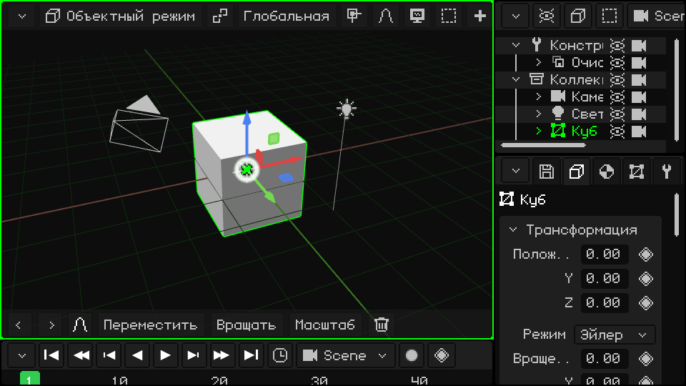
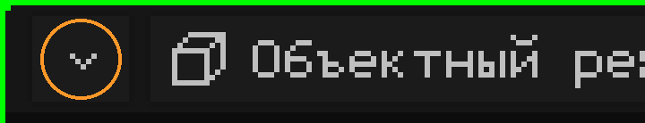
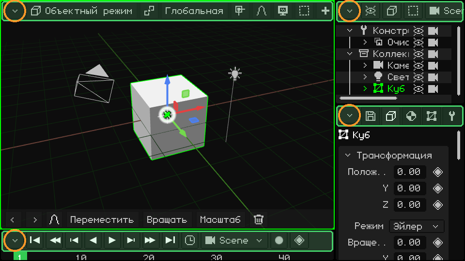
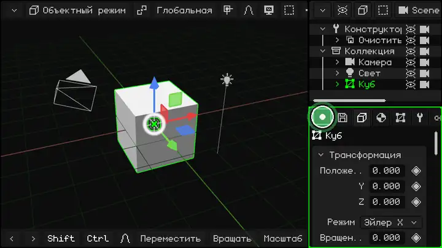
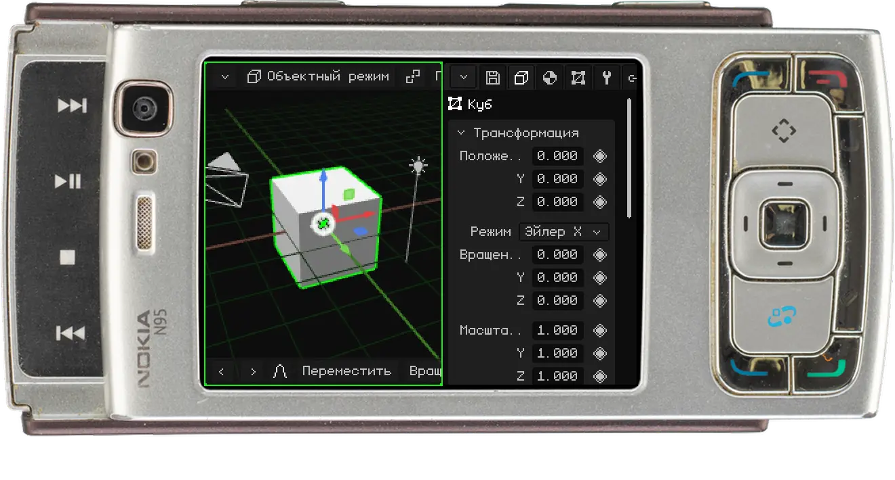
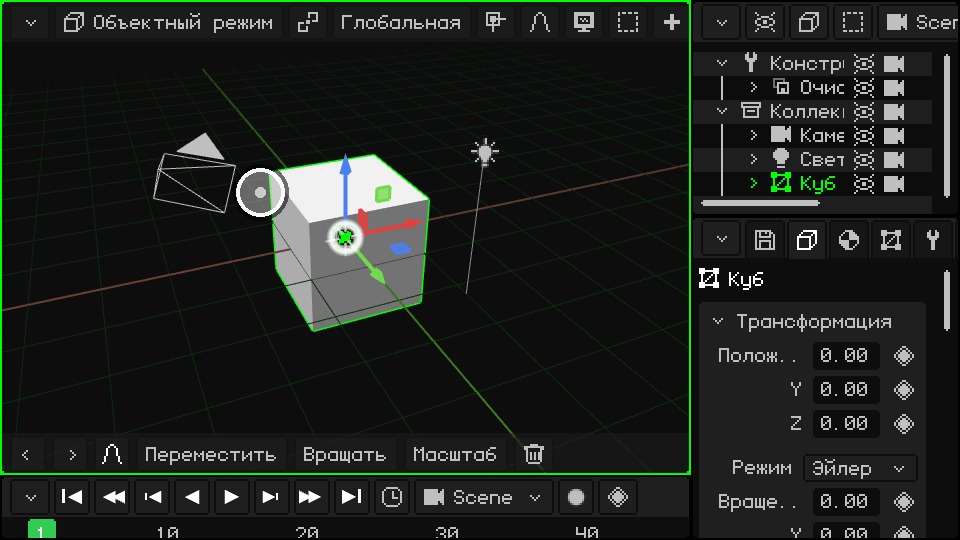
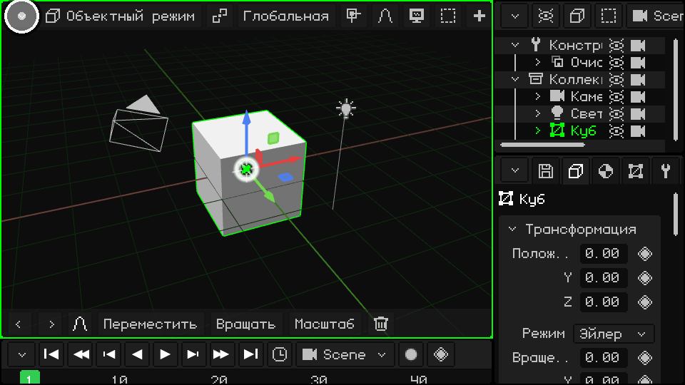
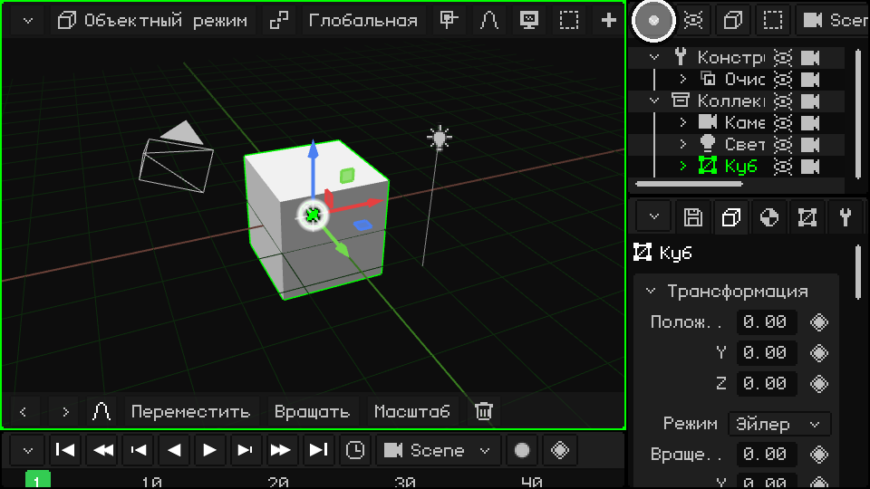
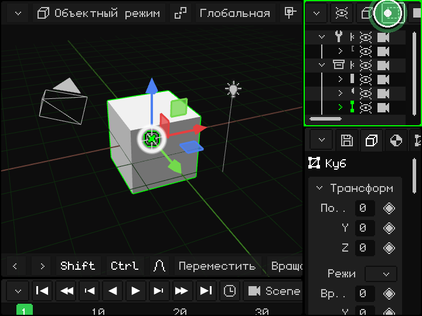
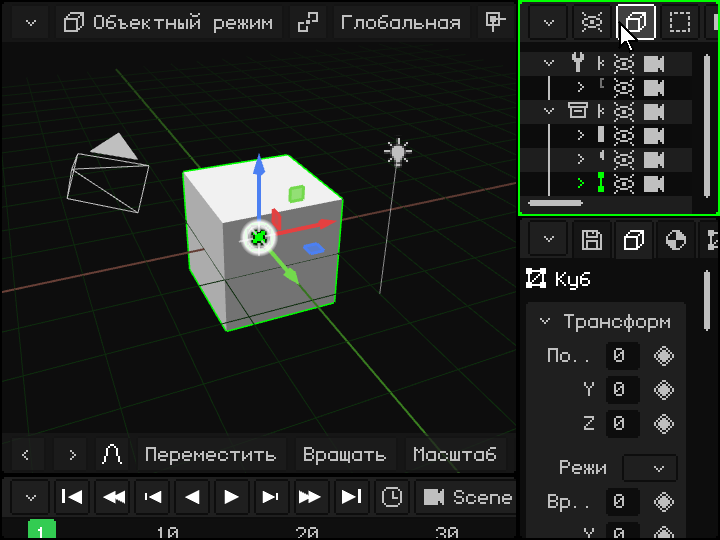

# Интерфейс

> [!NOTE]
>  Nokia N95 поддерживает мышь и клавиатуру (по Bluetooth). Части этой страницы про Nokia объясняют, как пользоваться им без мыши и клавиатуры, только кнопками телефона.

Окно Whisk3D делится на **вьюпорты**: панели, каждая со своим редактором (3D-вьюпорт, Аутлайнер, Свойства...). Их можно делить, менять им размер и выбирать, что показывает каждый. Всё работает одинаково с мышью, пальцем на сенсорном экране и с клавиатуры Nokia.

Вот что видно при первом запуске программы:

## Активный вьюпорт

Вьюпорт под курсором мыши — это **активный вьюпорт**, он выделен зелёной рамкой. Именно он получает команды с клавиатуры, геймпадов и любых других устройств ввода. Когда ты переводишь мышь с одного вьюпорта на другой, зелёная рамка следует за ней:

 **На Nokia N95:** каждое нажатие **зелёной клавиши** вызова  переключает на следующий вьюпорт. На экране N95 помещаются два: 3D-вьюпорт слева и Свойства справа.

## Строка меню и кнопка в углу

У каждого вьюпорта сверху есть **строка меню** (на изображении выделена зелёным) с меню и кнопками этого редактора. Слева вверху всегда находится **кнопка в углу** (оранжевая): она нужна, чтобы сменить вьюпорт или изменить его.

Она одинакова во всех вьюпортах, и это единственная кнопка, которая есть у всех.

## Изменить размер

  Чтобы изменить размер, **нажми и удерживай** кнопку в углу (пальцем или мышью) и перетащи её: так двигаются левая и верхняя границы этого вьюпорта, а соседние подстраиваются. **Простое касание**, без перетаскивания, открывает выпадающее меню с параметрами вьюпорта. Здесь кнопку нижнего правого вьюпорта водят по кругу, и все три вьюпорта меняют размер:

 **На Nokia:** удерживай **зелёную клавишу** вызова  и нажми стрелку: граница активного вьюпорта (того, что в зелёной рамке) сдвигается в эту сторону, и вьюпорт становится больше или меньше. Зелёная клавиша сама по себе, без стрелок, переключает на следующий вьюпорт.

## Параметры вьюпорта

Касание кнопки в углу открывает это меню:

Сверху — **типы вьюпортов**: если выбрать один из них, вьюпорт превращается в этот редактор. Под линией — то, что можно сделать с вьюпортом:

| Пункт | Что делает |
|---|---|
| Раскрыть | Вьюпорт занимает место соседнего, и тот закрывается (если соседний разделён, закрывается вся эта группа). |
| Разделить на столбцы | Делит его на два вьюпорта рядом друг с другом. |
| Разделить на строки | Делит его на два вьюпорта, один над другим. |
| Максимизировать | Разворачивает его на всё окно. Пока он развёрнут, в меню есть только пункт **Свернуть**, который возвращает его на место. |

### Сменить тип

3D-вьюпорт, превращённый в UV-редактор:

### Разделить на столбцы и на строки

### Раскрыть

Аутлайнер занимает место Свойств:

### Максимизировать и свернуть

## Когда видны не все пункты строки меню

Если вьюпорт узкий, его строка меню не помещается целиком. То же самое происходит с нижней панелью инструментов 3D-вьюпорта. Чтобы увидеть остальное:

-  **Пальцем:** перетащи её вбок.
-  **Мышью:** зажми кнопку мыши на строке и тяни или крути над ней **колесо**.
-   **С клавиатуры:** <kbd>M</kbd> на ПК или **левая софт-клавиша** на Nokia открывает строку меню активного вьюпорта. Стрелками влево и вправо ты перемещаешься по ней, и каждое меню открывается, когда ты до него доходишь. Стрелками вверх и вниз ты двигаешься по меню, а OK (<kbd>Enter</kbd> на ПК) выбирает пункт. Строка сама прокручивается, чтобы показать, где ты находишься.

 На Nokia N95: левая софт-клавиша открывает строку меню, а стрелки перемещают по ней.

## Типы вьюпортов

| Вьюпорт | Для чего нужен |
|---|---|
| [3D-вьюпорт](vista-3d.md) | Здесь сцена отображается и редактируется: моделирование, перемещение объектов, рисование, постановка поз и анимация. |
| [Аутлайнер](outliner.md) | Список всего, что есть в сцене. |
| [Библиотека](outliner.md#вид-библиотека) | Ресурсы проекта: меши, материалы, текстуры, анимации, звуки, скрипты и многое другое. |
| [Свойства](propiedades.md) | Данные активного объекта, по вкладкам. |
| [UV-редактор](editor-uv.md) | Как текстура ложится на меш. |
| [Таймлайн](linea-de-tiempo.md) | Анимация: ключевые кадры и кривые. |
| [2D-редактор](editor-2d.md) | Игровые интерфейсы, HUD и 2D-игры. |
| [Консоль](consola.md) | Журнал движка: ошибки, предупреждения и информация. |
| [IDE](editor-de-scripts.md) | Редактор Lua-скриптов и шейдеров. |

Whisk3D продолжает расти: со временем появятся новые вьюпорты, а нынешние могут измениться. Все они будут работать одинаково: строка меню сверху и кнопка в углу.

## Ещё об интерфейсе

| Функция | Описание | Как использовать |
|---|---|---|
| Строка меню с клавиатуры | Открывает строку меню активного вьюпорта, чтобы перемещаться по ней стрелками. | <kbd>M</kbd> (в Режиме редактирования <kbd>M</kbd> — это Слить). |
| Отменить / Повторить | Отменяет или возвращает последнее действие. | <kbd>Ctrl+Z</kbd> / <kbd>Ctrl+Y</kbd> или <kbd>Ctrl+Shift+Z</kbd>; стрелки на панели инструментов. |
| Сохранить проект | Сохраняет открытый .w3d (если он новый, спрашивает имя). | <kbd>Ctrl+S</kbd> или Свойства → вкладка Файл/Рендер → карточка Файл (см. [Проект](proyecto.md)). |
| Полный экран | Включает и выключает полноэкранный режим. | <kbd>F11</kbd>. На Android включается автоматически, если у телефона нет выреза (notch). |
| Пуск / Пауза | Воспроизводит анимацию (или игру) из любой панели. | <kbd>Space</kbd> или кнопка Play на Таймлайне. |

 **На Android**: в вертикальной ориентации сверху 3D-вьюпорт, а снизу Свойства; в горизонтальной добавляется Таймлайн. Когда открывается экранная клавиатура (например, в редакторе скриптов), активный вьюпорт разворачивается на видимую часть экрана и возвращается на место, когда клавиатура закрывается.
