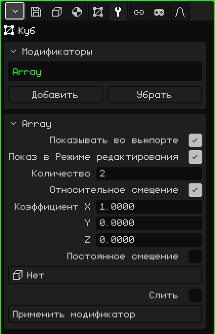

# Массив

Модификатор **Массив** делает копии меша в ряд, каждую со сдвигом относительно предыдущей. Он подходит для всего, что повторяется: столбов забора, ступеней лестницы, колонн коридора или звеньев цепи. Ты моделируешь одну деталь, а Массив собирает остальное; если изменить деталь, изменятся все копии.

## Как добавить

1. Выбери меш.
2. В Свойствах открой вкладку **Модификаторы** (значок гаечного ключа).
3. Нажми **Добавить** и выбери **Массив**.

В списке он появляется под своим внутренним именем, **Array**, а ниже открывается карточка с его параметрами. Как и все модификаторы, он не разрушает меш: его можно выключить, переместить кнопками **Поднять** и **Опустить**, убрать кнопкой **Убрать** или запечь кнопкой **Применить модификатор**.

## Параметры

| Параметр | Что делает |
|---|---|
| Показывать во вьюпорте | Если выключить, копии не вычисляются: ни во вьюпорте, ни при рендере. |
| Показ в Режиме редактирования | Если выключить, во время редактирования видна только исходная деталь. |
| Количество | Сколько всего деталей, считая исходную (по умолчанию 2). При 1 остаётся только исходная. |
| Относительное смещение | Сдвигает каждую копию в зависимости от **размера** детали. По умолчанию включено, с «Коэффициент X» = 1: каждая копия стоит вплотную к предыдущей, без зазора и без наложения. |
| Коэффициент X / Y / Z | На сколько собственных размеров сдвигается каждая копия по этой оси: 1 = вплотную, 2 = с зазором в одну деталь, 0.5 = с наложением наполовину. Y — это глубина, а Z — высота, как во вкладке Объект. Видны только при включённом «Относительное смещение». |
| Постоянное смещение | Сдвигает каждую копию на фиксированное расстояние, независимо от размера детали. По умолчанию выключено. Если включены оба смещения, они складываются. |
| Расстояние X / Y / Z | На сколько метров сдвигается каждая копия по каждой оси. Видны только при включённом «Постоянное смещение». |
| Объект смещения | Объект сцены (удобнее всего Пустышка), который сдвигает, поворачивает и масштабирует каждую копию чуть больше, чем предыдущую. См. ниже. При значении **Нет** не используется. |
| Слить | Сваривает вершины, которые соприкасаются между одной копией и следующей, чтобы они образовали одну поверхность: сплошные перила вместо отдельных секций. По умолчанию выключено. |
| Расстояние слияния | Насколько близко должны быть две вершины, чтобы свариться (по умолчанию 0.001 м). Видно только при включённом «Слить». |
| Применить модификатор | Запекает копии в меш. См. примечание ниже. |

## Примеры

- **Забор:** столб (узкий и высокий Куб), «Количество» = 10 и «Коэффициент X» = 3: десять столбов с зазором в два столба между ними.
- **Лестница:** ступень (плоский Куб), «Коэффициент X» = 0, «Коэффициент Y» = 1 и «Коэффициент Z» = 1: каждая ступень оказывается на шаг дальше и на шаг выше.

## Объект смещения

Если выбран объект, каждая копия повторяет то, насколько этот объект **сдвинут, повёрнут и отмасштабирован относительно меша**, и накапливает это: вторая копия делает это один раз, третья — два раза и так далее.

- Если Пустышка стоит там же, где меш, и повёрнута на 30° вокруг вертикали, каждая копия поворачивается на 30° больше предыдущей: с 12 копиями получается полный оборот.
- Если она к тому же немного выше, каждая копия поднимается чуть больше: винтовая лестница.
- Если она отмасштабирована до 0.9, каждая копия чуть меньше предыдущей: сходящаяся спираль.

Когда Пустышка стоит там же, где меш, копии вращаются вокруг центра меша. Чтобы они выстроились по кругу, а не вращались на месте, отодвинь деталь от центра в Режиме редактирования и выключи «Относительное смещение». Когда ты двигаешь или вращаешь объект, копии обновляются сразу.

## Порядок важен

«Относительное смещение» измеряет меш **таким, каким он приходит** от модификатора выше: если выше стоит [Зеркало](modificador-espejo.md), измеряется уже отражённый объект. Если ниже стоит [Подразделение поверхности](modificador-subdivision.md), копии, сваренные с помощью «Слить», сглаживаются как одна деталь; без «Слить» каждая копия сглаживается отдельно.

> [!NOTE]
> «Применить модификатор» у Массива запекает **все** включённые модификаторы списка, а не только Массив (со значениями для вьюпорта), и оставляет список пустым: уходят и выключенные, и те, что не создают геометрию, например [Арматура](modificador-esqueleto.md). Это можно отменить.

Назад к странице [3D-меш](objeto-malla.md)
