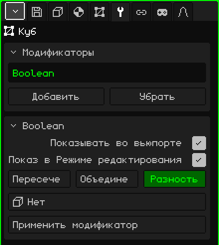

# Булев

Модификатор **Булев** объединяет меш с другим: вычитает из него объём другого, добавляет этот объём или оставляет то, что у них общего. Он нужен для того, что долго моделировать вручную: проём окна в стене, полость чашки, паз или две детали, слитые в одну.

## Как добавить

1. Выбери меш, который будет меняться (например, стену).
2. В Свойствах открой вкладку **Модификаторы** (значок гаечного ключа).
3. Нажми **Добавить** и выбери **Булев**.

В списке он появляется под своим внутренним именем, **Boolean**, а ниже открывается карточка с его параметрами. Как и все модификаторы, он не разрушает меш: под ним стена остаётся целой, и если убрать модификатор, проём исчезнет. Его можно выключить, переместить кнопками **Поднять** и **Опустить**, убрать кнопкой **Убрать** или запечь кнопкой **Применить модификатор**.

## Параметры

| Параметр | Что делает |
|---|---|
| Показывать во вьюпорте | Если выключить, операция не выполняется: виден исходный меш, и во вьюпорте, и при рендере. |
| Показ в Режиме редактирования | Если выключить, во время редактирования виден меш без операции. |
| Пересечение | Оставляет только ту часть, которая находится внутри обоих мешей одновременно. |
| Объединение | Соединяет оба меша в одну поверхность и убирает грани, оказавшиеся внутри. |
| Разность | Вычитает из этого меша объём другого: именно она делает отверстия. Выбрана по умолчанию. |
| Объект | Другой меш, **резак**. При значении **Нет** ничего не делает. В списке показаны все объекты сцены, но подходит только меш. |
| Применить модификатор | Запекает результат в меш. См. примечание ниже. |

Выбранная операция подсвечена зелёным.

## Пример: окно в стене

1. Добавь **Куб** и отмасштабируй его так, чтобы получилась стена: широкая, высокая и тонкая.
2. Добавь ещё один **Куб** (или **Цилиндр** для круглого окна) и поставь его туда, где будет окно, чтобы он проходил сквозь стену насквозь.
3. Выбери стену, добавь ей **Булев**, оставь **Разность** и в поле **Объект** выбери резак.
4. Скрой резак (Скрыть / Показать в [Объектном режиме](modo-objeto.md) или сними флажок **Видимый** во вкладке Объект). Остаётся проём.

Скрытый резак продолжает резать. Чтобы его переместить, снова покажи его или выбери в Аутлайнере.

## Что полезно знать

- Оба меша должны быть **замкнутыми**, без дыр в поверхности: иначе Булев не может понять, что внутри, а что снаружи.
- Если перемещать, вращать, масштабировать или редактировать резак, разрез сразу обновляется. Так можно подогнать окно, глядя на результат.
- Грани, которых разрез не касается, остаются как были: четырёхугольник остаётся четырёхугольником. Разрезанные грани становятся многоугольниками, а не треугольниками, поэтому меш остаётся удобным для редактирования и после применения.
- Грани, которые добавляет резак (например, внутренний край окна), получают первый материал меша.
- UV и цвета вершин сохраняются; там, где проходит разрез, они интерполируются.
- Части, лежащие в одной плоскости, не объединяются: объединение двух стоящих вплотную коробок оставляет их верх разбитым на несколько кусков.

 На Nokia N95 разрез пересчитывается каждый раз, когда ты двигаешь или редактируешь резак. С большими мешами подгони его, примени модификатор и продолжай работать с уже разрезанным мешем.

> [!NOTE]
> «Применить модификатор» у Булева запекает **все** включённые модификаторы списка, а не только этот, и оставляет список пустым: уходят и выключенные, и те, что не создают геометрию, например [Арматура](modificador-esqueleto.md). Это можно отменить. Резак не удаляется: он остаётся обычным объектом.

Назад к странице [3D-меш](objeto-malla.md)
