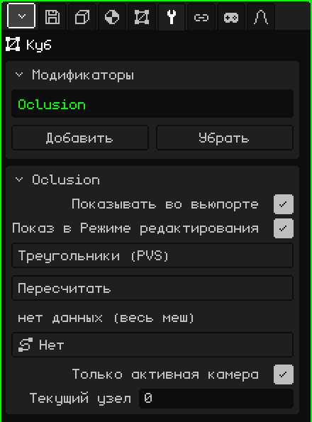

# Отсечение

Модификатор **Отсечение** рисует только те треугольники меша, которые видны из зоны, где находится камера. Он использует заранее рассчитанные списки видимости, по одному на зону, как это делали игры для PlayStation 1 (**PVS**, *потенциально видимое множество*). Он нужен для больших уровней: из всего уровня рисуется только то, что видно из коридора, где ты находишься.

 Он рассчитан на Nokia N95, где каждый не нарисованный треугольник — это выигрыш в скорости. Смена зоны почти ничего не стоит: списки строятся один раз, а при переходе из одной зоны в другую меняется только то, какой из них используется. Никаких вычислений в каждом кадре нет.



## Как добавить

1. Выбери меш уровня.
2. В Свойствах открой вкладку **Модификаторы** (значок гаечного ключа).
3. Нажми **Добавить** и выбери **Отсечение**.

В списке он появляется под своим внутренним именем, **Oclusion**, а ниже открывается карточка с его параметрами. Он не трогает меш: только выбирает, какие треугольники рисовать, поэтому меш остаётся целым и редактируемым. Поэтому у него нет кнопки «Применить модификатор».

Не путай его с объектом **Отсечение** из меню Добавить 3D-вьюпорта: тот работает с целыми объектами, а не с треугольниками меша.

## Откуда берутся данные

Модификатор не вычисляет, что видно: он читает это из файла, который прилагается к модели. Для меша, импортированного из `nivel.obj`, он ищет `nivel.pvs.json` в той же папке:

```json
{ "sectores": 2, "tris": [[0, 1], [2, 3]] }
```

`sectores` — это количество зон, а `tris` содержит для каждой зоны треугольники, которые рисуются, пронумерованные с 0 в порядке граней `.obj`. Обычно этот файл берётся из оригинальной игры или создаётся отдельным инструментом. Каждая зона — это **узел**: узел 1 — первый список, а узел 0 рисует меш целиком.

## Параметры

| Параметр | Что делает |
|---|---|
| Показывать во вьюпорте | Если выключить, меш рисуется целиком. |
| Показ в Режиме редактирования | Ни на что не влияет: в Режиме редактирования меш всегда рисуется целиком. |
| Метод | **Треугольники (PVS)** использует списки из `.pvs.json`. **BSP (ожидает)** показан серым: его пока нельзя выбрать. |
| Пересчитать | Заново читает `.pvs.json`, например после того как его сгенерировали заново. Сообщает «PVS пересчитан» или, если файл не найден, «PVS: нет <модель>.pvs.json рядом с исходным .obj». |
| (строка состояния) | Под кнопкой «Пересчитать»: «Узлов: 4 \| активный узел: 2», «нет данных (весь меш)», если файла нет, или «файл PVS не загружен (Пересчитать)». |
| Путь | Путь сцены (**Добавить → Путь**), например рельс, по которому едет камера. Каждый узел пути — это зона, и движок сам выбирает узел, ближайший к глазу. При значении **Нет** зона задаётся вручную или из скрипта. |
| Только активная камера | Если включено (по умолчанию), во время воспроизведения сцены решает активная камера; на паузе ничего само не выбирается, и узел задаётся вручную. Если выключено, решает вид вьюпорта: можно свободно летать по уровню и смотреть, как треугольники появляются и исчезают. |
| Ветви | Появляется, только если у пути больше одной ветви, например основная дорога и бонусная. Выбирает, какие ветви учитываются при поиске ближайшего узла; каждая включённая ветвь подсвечена зелёным. На кнопке написано, например, «Ветви: 3 (все)» или «Ветви: 2/3». |
| Текущий узел | Зона, которая сейчас рисуется; 0 = меш целиком. Его можно менять вручную, чтобы проверить каждую зону. Когда узел выбирает Путь, движок перезаписывает это значение. |

Из скрипта активный узел меняет `setSector(objeto, n)` (0 = меш целиком). См. [Частицы, туман и видимость](../lua/api-particulas-niebla.md).

## Что полезно знать

- Пока меш находится в Режиме редактирования, он рисуется целиком, чтобы можно было редактировать всё.
- Если в списке есть другой включённый модификатор, создающий геометрию ([Зеркало](modificador-espejo.md), [Массив](modificador-array.md), [Подразделение поверхности](modificador-subdivision.md)…), Отсечение не используется и рисуется всё: номера треугольников в `.pvs.json` относятся к исходному мешу.
- Списки называют треугольники по номерам. Если отредактировать меш и добавить или удалить грани, номера меняются, и списки могут указывать на другие треугольники: Отсечение — для готовых уровней, а не для тех, что ещё моделируются.

Назад к странице [3D-меш](objeto-malla.md)
