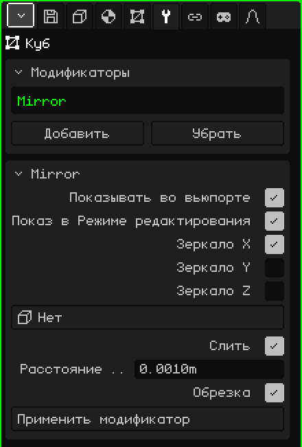

# Зеркало

Модификатор **Зеркало** отражает меш на другую сторону плоскости. Он подходит для всего симметричного: ты моделируешь половину персонажа, лица или машины, а другая половина появляется сама, отражённая. То, что ты меняешь с одной стороны, повторяется с другой прямо во время работы.

## Как добавить

1. Выбери меш.
2. В Свойствах открой вкладку **Модификаторы** (значок гаечного ключа). Она появляется, только когда активный объект — меш.
3. Нажми **Добавить** и выбери **Зеркало**.

В списке карточки Модификаторы он появляется под своим внутренним именем, **Mirror**, а ниже открывается карточка с его параметрами.

Модификатор не разрушает меш: исходный остаётся нетронутым, ты продолжаешь его редактировать, а видишь результат. Его можно в любой момент выключить, переместить в списке кнопками **Поднять** и **Опустить** (они появляются, когда модификаторов два или больше), убрать кнопкой **Убрать** или запечь в меш кнопкой **Применить модификатор**.

## Параметры

| Параметр | Что делает |
|---|---|
| Показывать во вьюпорте | Если выключить, отражение не вычисляется: ни во вьюпорте, ни при рендере. Удобно, чтобы сравнить вариант с ним и без него. |
| Показ в Режиме редактирования | Если выключить, во время редактирования меша видна только исходная половина; при возврате в Объектный режим появляется отражение. |
| Зеркало X | Отражает слева направо. По умолчанию включено: это то, что нужно для персонажа или машины. |
| Зеркало Y | Отражает спереди назад. |
| Зеркало Z | Отражает сверху вниз. |
| Объект-зеркало | При значении **Нет** плоскость зеркала проходит через центр меша. Если выбрать другой объект (например, Пустышку), плоскость проходит через центр этого объекта и вращается вместе с ним; его масштаб не учитывается. Когда его двигаешь или вращаешь, отражение сразу обновляется. |
| Слить | Сваривает шов: вершины, лежащие почти на плоскости, прилипают к ней и становятся общими для обеих половин. Так посередине не остаётся полосы, и гладкое затенение переходит с одной стороны на другую без разрывов: половина сферы выглядит как целая сфера. По умолчанию включено. |
| Расстояние слияния | Насколько близко к плоскости должна быть вершина, чтобы привариться (по умолчанию 0.001 м). Если шов остаётся открытым, немного увеличь значение; если слипаются ненужные вершины, уменьши. Это же значение служит допуском для «Обрезка». |
| Обрезка | Пока ты двигаешь вершины в Режиме редактирования, не даёт им перейти на другую сторону плоскости: вершина, дошедшая до плоскости, прилипает к ней и только скользит по ней. Центральные вершины не отрываются, поэтому шов случайно не раскроется. По умолчанию включено. |
| Применить модификатор | Запекает отражение в меш: обе половины становятся настоящими вершинами, и модификатор уходит из списка. Четырёхугольные грани остаются четырёхугольными. Это можно отменить. |

Если включить больше одной оси, каждое отражение делается поверх результата предыдущего. С включёнными X и Y ты моделируешь четверть объекта, а получаются все четыре части.

## Порядок важен

Модификаторы применяются сверху вниз: каждый работает с тем, что оставил предыдущий. Зеркало почти всегда идёт первым:

- **Зеркало выше [Подразделения поверхности](modificador-subdivision.md):** сначала собирается вся модель, а потом сглаживается целиком, без следа посередине. Если наоборот, каждая половина сглаживается отдельно, и на стыке остаётся складка.
- **Зеркало выше [Массива](modificador-array.md):** Массив копирует уже целый объект, и его «Относительное смещение» использует размер всего объекта.

«Применить модификатор» у Зеркала запекает только Зеркало, где бы оно ни стояло в списке: остальные модификаторы остаются на месте.

## Советы

- Работай с центром меша в середине модели, потому что через него проходит плоскость зеркала. Вершины, которые должны быть посередине, оставляй точно на плоскости.
- Чтобы моделировать было удобно, смотри спереди в ортографической проекции (см. [Навигация в 3D-вьюпорте](../tutoriales/navegacion.md#виды-спереди-сбоку-и-сверху)): плоскость «Зеркало X» будет вертикальной линией посередине.
- Когда модель готова, примени Зеркало, если хочешь доработать каждую половину отдельно, например чтобы персонаж не был идеально симметричным.

Назад к странице [3D-меш](objeto-malla.md)
