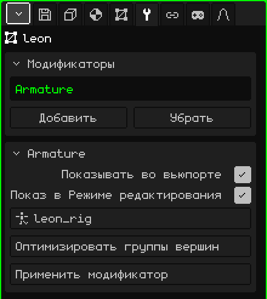

# Арматура

Модификатор **Арматура** заставляет меш следовать за костями арматуры: когда ты ставишь арматуру в позу или анимируешь её, меш изгибается вместе с ней. Именно он превращает неподвижную модель в персонажа, который ходит, прыгает или машет рукой.

## Как добавить

1. Выбери меш.
2. В Свойствах открой вкладку **Модификаторы** (значок гаечного ключа).
3. Нажми **Добавить** и выбери **Арматура**.

В списке он появляется под своим внутренним именем, **Armature**, а ниже открывается карточка с его параметрами. Как и все модификаторы, он не разрушает меш: поза покоя остаётся нетронутой. Его можно выключить, убрать кнопкой **Убрать** или запечь кнопкой **Применить модификатор**.

При импорте FBX или glTF с арматурой модификатор уже добавлен и указывает на свою арматуру.

## Параметры

| Параметр | Что делает |
|---|---|
| Показывать во вьюпорте | Если выключить, меш не деформируется: остаётся в позе покоя. |
| Показ в Режиме редактирования | Если выключить, во время редактирования вершин меш остаётся в покое, без деформации. |
| Цель | Арматура, которая его двигает. В списке показаны только арматуры сцены. При значении **Нет** меш не деформируется. |
| Оптимизировать группы вершин | Оставляет каждой вершине одну кость — ту, что двигала её сильнее всего, — с полным весом. Просит подтверждения, потому что промежуточные веса теряются. |
| Применить модификатор | Запекает в меш позу текущего кадра и убирает модификатор: меш застывает в этой позе. Арматура не меняется. Это можно отменить. |

## Как меш узнаёт, какая кость его двигает

С помощью **групп вершин**. Каждая группа называется **так же, как кость**, и говорит, какие вершины двигает эта кость и насколько: это **вес**, от 0 (никак) до 1 (полностью). Вершина может входить в несколько групп; на локте — наполовину в группу плеча и наполовину в группу предплечья, чтобы он сгибался плавно.

Группы находятся во вкладке **3D-меш**, в карточке **Группы вершин**:

| Кнопка | Что делает |
|---|---|
| Добавить группу вершин / Переименовать | Создаёт группу и задаёт ей имя. Оно должно совпадать с именем кости буква в букву. |
| Назначить / Убрать | В Режиме редактирования добавляет выделенные вершины в группу (с весом 1) или убирает их из неё. |
| Выделить / Снять выделение | Показывает, какие вершины входят в группу. |

Для тонкой настройки весов, например переходов на плечах и коленях, используй [Рисование весов](pintura.md#рисование-весов): этот режим рисует вес выбранной группы, от синего (никак) до красного (полностью).

## Шаг за шагом

1. Собери арматуру (**Добавить → Арматура**) и расставь кости внутри модели (см. [Скелеты](esqueletos.md)).
2. Добавь мешу модификатор **Арматура** и в поле **Цель** выбери арматуру.
3. Создай по группе на каждую кость, с тем же именем, и назначь или нарисуй веса.
4. Выбери арматуру, перейди в **Режим позы** и подвигай кость: меш следует за ней.

## Что полезно знать

- Место Арматуры в списке ни на что не влияет: она не вычисляется вместе с остальными, а деформирует меш в каждом кадре, при его отрисовке.
- Она деформирует исходный меш. Если включены другие модификаторы, создающие геометрию ([Зеркало](modificador-espejo.md), [Массив](modificador-array.md), [Подразделение поверхности](modificador-subdivision.md), [Винт](modificador-screw.md), [Булев](modificador-booleano.md)), виден сгенерированный меш, который за костями не следует. Примени их до того, как начнёшь анимировать.
- Применение одного из этих модификаторов (кроме Зеркала) очищает весь список, и Арматура тоже уходит. Группы вершин остаются: снова добавь Арматуру и заново выбери «Цель».

 На Nokia N95 деформация меша в каждом кадре обходится дорого, и тем дороже, чем больше костей влияет на каждую вершину. **Оптимизировать группы вершин** оставляет по одной кости на вершину, и скиннинг работает гораздо быстрее; взамен суставы сгибаются жёстче. Делай это в конце, когда веса уже готовы.

Назад к странице [3D-меш](objeto-malla.md)
