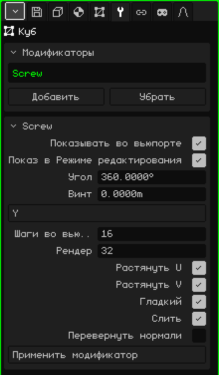

# Винт

Модификатор **Винт** (*Screw* по-английски) вращает профиль вокруг оси и строит поверхность, которую тот оставляет при вращении, как токарный станок. Ты рисуешь половину силуэта вазы, бокала или бутылки, а Винт превращает её в целый объект. Если профиль к тому же поднимается во время вращения, получается резьба или пружина.

## Как добавить

1. Выбери меш с профилем.
2. В Свойствах открой вкладку **Модификаторы** (значок гаечного ключа).
3. Нажми **Добавить** и выбери **Винт**.

В списке он появляется под своим внутренним именем, **Screw**, а ниже открывается карточка с его параметрами. Как и все модификаторы, он не разрушает меш: профиль остаётся на месте, и его можно редактировать, глядя на результат. Его можно выключить, переместить кнопками **Поднять** и **Опустить**, убрать кнопкой **Убрать** или запечь кнопкой **Применить модификатор**.

## Профиль

Профиль — это линия: вершины, соединённые рёбрами, без граней. Ось вращения проходит через **центр** меша, поэтому расстояние от каждой вершины до центра — это радиус объекта на этой высоте. Один из способов его нарисовать:

1. **Добавить → Меш → Вершина** создаёт отдельную вершину в центре и сразу переходит в Режим редактирования.
2. Посмотри спереди (см. [Навигация в 3D-вьюпорте](../tutoriales/navegacion.md#виды-спереди-сбоку-и-сверху)).
3. Командой **Выдавить вершины** (меню Меш → Вершина) вытяни следующую вершину вбок, чтобы сделать дно, а потом вверх для стенки, точка за точкой.

Вершины, лежащие на оси, замыкают объект: первая, в центре, — это центр дна вазы.

## Параметры

| Параметр | Что делает |
|---|---|
| Показывать во вьюпорте | Если выключить, вращения нет: виден только профиль, и во вьюпорте, и при рендере. |
| Показ в Режиме редактирования | Если выключить, во время редактирования профиля видна только линия. |
| Угол | На сколько градусов поворачивается профиль от первого шага до последнего (по умолчанию 360, полный оборот). При 180 получается половина объекта. Отрицательное значение вращает в другую сторону. Может быть больше 360: при 1080 получается три оборота. |
| Винт | На сколько метров поднимается профиль вдоль оси от начала до конца вращения. При 0 это токарный станок (ваза, бокал, бутылка); при другом значении — резьба или пружина. |
| Ось | Вокруг какой оси идёт вращение: X, Y или Z. По умолчанию **Z**, вертикальная: профиль, нарисованный в виде спереди, получается стоящим, как ваза на столе. |
| Шаги во вьюпорте | Сколько копий профиля делается вдоль вращения во вьюпорте, от 2 до 512 (по умолчанию 16). Чем больше шагов, тем круглее и тяжелее. |
| Рендер | Число шагов для команд **Рендер изображения** и **Рендер анимации** (по умолчанию 32). |
| Растянуть U | Строит UV-координаты вокруг оси вращения, чтобы текстура обёртывала объект, как этикетка. |
| Растянуть V | Строит UV-координаты вдоль профиля, сверху вниз. Если оба выключены, UV нет. |
| Гладкий | Гладкое затенение на создаваемой поверхности: она выглядит круглой, а не гранёной. По умолчанию включено. |
| Слить | Сваривает вершины, которые оказываются в одном месте: вершины профиля, касающиеся оси (дно, горлышко закрытой бутылки), и шов, где замыкается оборот. По умолчанию включено. |
| Перевернуть нормали | Разворачивает грани в другую сторону. Используй, если объект выглядит вывернутым, тёмным или как будто изнутри. |
| Применить модификатор | Запекает результат в меш с числом шагов из **Шаги во вьюпорте**. См. примечание ниже. |

Оборот замыкается сам, без шва, только когда «Угол» равен 360, а «Винт» — 0. При другом угле или если профиль поднимается, начало и конец остаются открытыми.

## Примеры

- **Ваза:** профиль половины силуэта, «Угол» 360, «Винт» 0 и от 16 до 32 шагов.
- **Резьба:** короткий профиль вдали от оси, «Угол» 1080 и «Винт» 3: три оборота, каждый поднимается на метр. Увеличь число шагов, чтобы спираль не получилась ломаной.

 На Nokia N95 каждый шаг — это ещё одна копия профиля, которую надо нарисовать. Пока моделируешь, ставь небольшое значение «Шаги во вьюпорте», а большие оставь для «Рендер».

> [!NOTE]
> «Применить модификатор» у Винта запекает **все** включённые модификаторы списка, а не только этот, и оставляет список пустым: уходят и выключенные, и те, что не создают геометрию, например [Арматура](modificador-esqueleto.md). Это можно отменить.

Назад к странице [3D-меш](objeto-malla.md)
