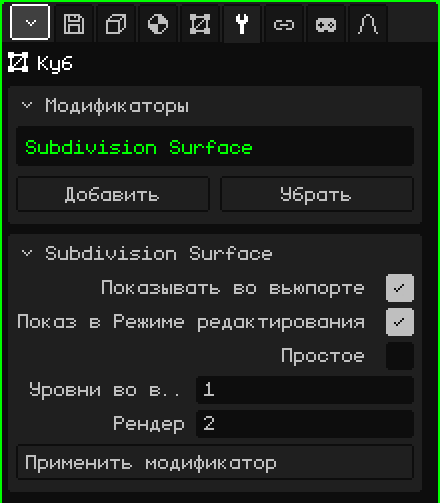

# Подразделение поверхности

Модификатор **Подразделение поверхности** делит каждую грань на более мелкие и по умолчанию скругляет форму. Он позволяет моделировать с малым числом полигонов — так модель быстро редактируется и остаётся лёгкой — и при этом видеть гладкий результат: из куба получается что-то похожее на сферу, а из low-poly персонажа — персонаж со скруглёнными формами.

## Как добавить

1. Выбери меш.
2. В Свойствах открой вкладку **Модификаторы** (значок гаечного ключа).
3. Нажми **Добавить** и выбери **Подразделение поверхности**.

В списке он появляется под своим внутренним именем, **Subdivision Surface**, а ниже открывается карточка с его параметрами. Как и все модификаторы, он не разрушает меш: его можно выключить, переместить кнопками **Поднять** и **Опустить**, убрать кнопкой **Убрать** или запечь кнопкой **Применить модификатор**.

## Параметры

| Параметр | Что делает |
|---|---|
| Показывать во вьюпорте | Если выключить, подразделения нет: ни во вьюпорте, ни при рендере. |
| Показ в Режиме редактирования | Если выключить, во время редактирования виден неподразделённый меш, и редактирование идёт быстрее; при возврате в Объектный режим он снова выглядит гладким. |
| Простое | Если выключено (по умолчанию), каждый уровень сглаживает форму и скругляет углы. Если включено, только делит грани, не сдвигая вершины: форма остаётся прежней, но вершин становится больше, например чтобы рисовать цвета вершин подробнее. |
| Уровни во вьюпорте | Сколько раз меш подразделяется во вьюпорте, от 0 до 6 (по умолчанию 1). Каждый уровень умножает число граней на 4: куб из 6 граней превращается в 24 при 1 уровне, в 96 при 2 и в 384 при 3. При 0 подразделения нет. |
| Рендер | Число уровней для команд **Рендер изображения** и **Рендер анимации** (по умолчанию 2). Так вьюпорт остаётся лёгким, а финальное изображение получается более гладким. |
| Применить модификатор | Запекает подразделение в меш с уровнями из **Уровни во вьюпорте** (а не из «Рендер»). См. примечание ниже. |

## Как работать с подразделением

- Лучше всего оно работает с четырёхугольными гранями. Треугольник делится на 3 четырёхугольника, а пятиугольная грань — на 5.
- Подразделение не меняет затенение: плоский меш по-прежнему выглядит гранёным. Чтобы он выглядел гладким, в Режиме редактирования выбери грани и используй меню Грань → **Гладкое затенение**.
- Чтобы край был чётче, добавь рядом с ним разрез командой **Петлевой разрез и сдвиг** (см. [Режим редактирования](modo-edicion.md)): чем ближе к краю, тем он жёстче.
- Открытые края у незамкнутого меша сглаживаются вдоль края.

## Порядок важен

Модификаторы применяются сверху вниз. Ставь [Зеркало](modificador-espejo.md) **выше** Подразделения: так вся модель сглаживается за один раз. Если Зеркало ниже, каждая половина сглаживается отдельно, и посередине остаётся складка. С [Массивом](modificador-array.md) то же самое: копии, сваренные с помощью «Слить», сглаживаются вместе.

 На Nokia N95 каждый уровень заметно нагружает телефон: уже при 1 уровне граней для отрисовки в четыре раза больше, а при 2 — в шестнадцать. Держи «Уровни во вьюпорте» на 0 или 1, выключай «Показ в Режиме редактирования», пока моделируешь, и оставляй высокие уровни для «Рендер».

> [!NOTE]
> «Применить модификатор» у Подразделения запекает **все** включённые модификаторы списка, а не только этот, и оставляет список пустым: уходят и выключенные, и те, что не создают геометрию, например [Арматура](modificador-esqueleto.md). Это можно отменить.

Назад к странице [3D-меш](objeto-malla.md)
