# Навигация в 3D-вьюпорте

> [!NOTE]
>  Nokia N95 поддерживает мышь и клавиатуру (по Bluetooth). Части этой страницы про Nokia объясняют, как пользоваться им без мыши и клавиатуры, только кнопками телефона.

На этой странице рассказывается, как перемещаться в 3D-вьюпорте. Навигация — это движение твоей точки обзора: вращение вокруг сцены, сдвиг вбок, приближение и отдаление.

Уметь перемещаться по сцене важно: чтобы создавать 3D-модели и анимации удобно и быстро, нужно уметь двигаться по сцене и занимать удобное для работы положение.

Чтобы пользоваться командами ниже, 3D-вьюпорт должен быть [активным вьюпортом](interfaz.md#активный-вьюпорт) — тем, что в зелёной рамке.

Чаще всего ты будешь пользоваться тремя действиями: **орбитой**, **сдвигом** и **зумом**. Каждое можно выполнить мышью, пальцами на сенсорном экране или с клавиатуры Nokia N95. На видео с ПК мышь в правом нижнем углу показывает зелёным кнопку, которая сейчас нажата.

## Орбита

Орбита — это вращение вида вокруг сцены, как будто ты обходишь стол, чтобы со всех сторон рассмотреть то, что на нём лежит.

 **Мышью:** зажми **среднюю кнопку** (она нажимается, если надавить на колесо) и перетаскивай. На тачпаде или на мыши без средней кнопки удерживай <kbd>Alt</kbd> и перетаскивай, зажав **основную кнопку** (левую).

 **Пальцем:** веди пальцем по 3D-вьюпорту. Начинай на фоне: если поставить палец на гизмо (цветные стрелки объекта), ты начнёшь двигать его.

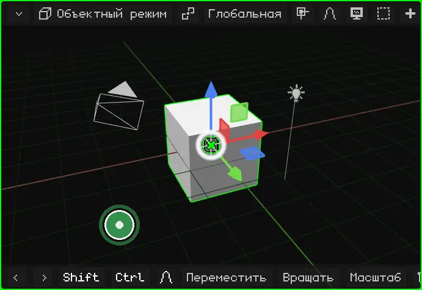

 **На Nokia N95:** удерживай **стрелку** джойстика. Вид вращается в эту сторону, пока ты её держишь.

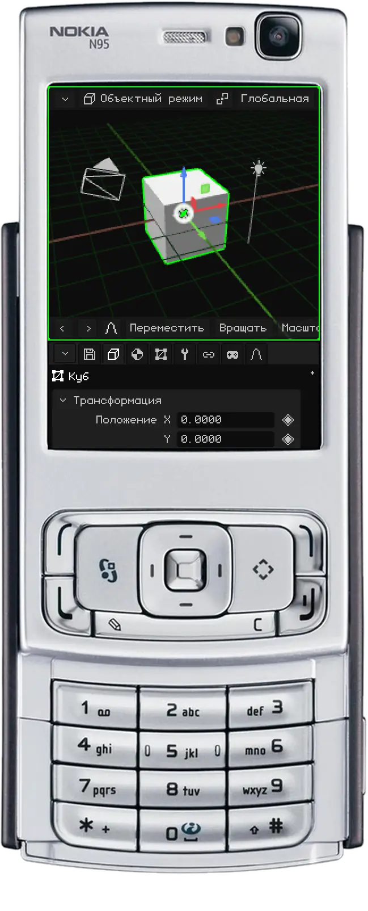

## Сдвиг

Сдвиг (или *панорамирование*) смещает вид вбок, вверх или вниз, не поворачивая его.

 **Мышью:** удерживай <kbd>Shift</kbd> и перетаскивай, зажав **среднюю кнопку**. На тачпаде: <kbd>Alt</kbd> + <kbd>Shift</kbd> и перетаскивай, зажав основную кнопку.

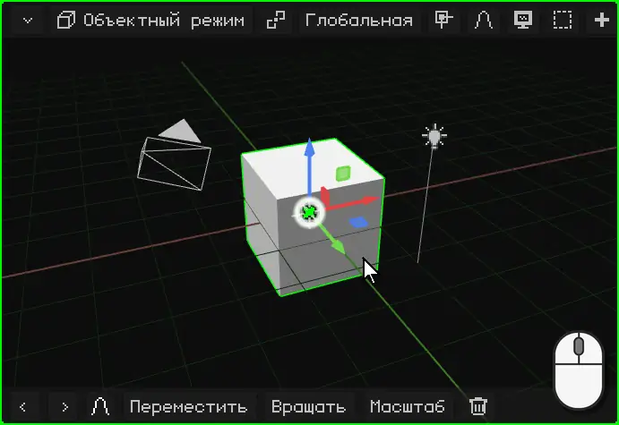

 **Пальцами:** поставь **два пальца** и веди их вместе в одну сторону.

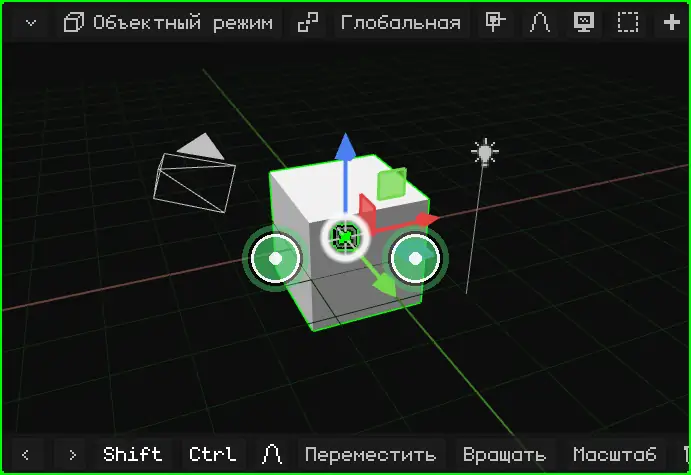

 **На Nokia N95:** удерживай клавишу <kbd>\*</kbd> и нажимай стрелки.

## Зум

С зумом ты приближаешься или отдаляешься. Шаг подстраивается под расстояние: вблизи чего-то маленького зум идёт медленно, а издалека — быстро. Поэтому он одинаково подходит и для всей сцены, и для одной вершины.

 **Мышью:** крути **колесо**. Вперёд — приближение, назад — отдаление. На тачпаде веди двумя пальцами вверх или вниз.

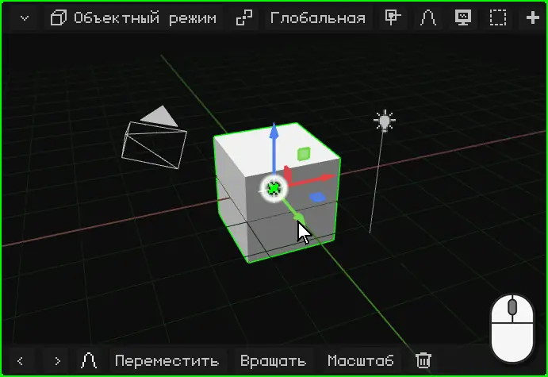

 **Пальцами:** сделай щипок. Если развести пальцы, вид приближается, если свести — отдаляется.

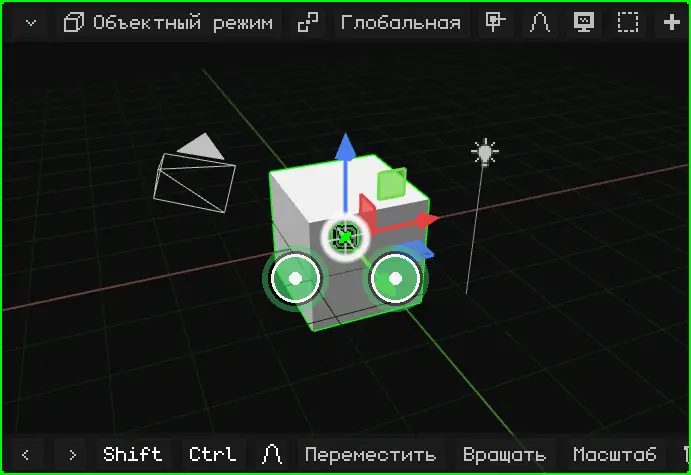

 **На Nokia N95:** удерживай <kbd>0</kbd> и нажимай стрелку **вверх**, чтобы приблизить, или стрелку **вниз**, чтобы отдалить.

## Кадрировать выделенное

Если всё пропало из виду или нужно поработать с чем-то конкретным, **кадрируй** это: вид центрируется на выделенном и подбирает зум так, чтобы оно ровно поместилось. После этого орбита вращает вид вокруг него.

| | Как кадрировать |
|---|---|
|  ПК | <kbd>Num .</kbd> (точка на цифровой клавиатуре) |
|  Nokia N95 | Одно нажатие <kbd>0</kbd>, без стрелок (если удерживать его со стрелкой, это зум) |
|  Сенсорный экран | Двойное касание двумя пальцами |
| Меню | Вид → Показать выделенное |

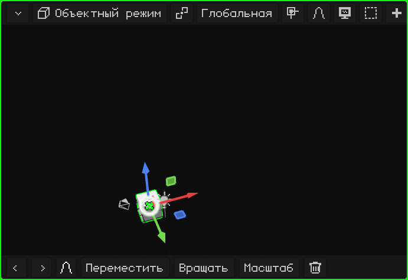

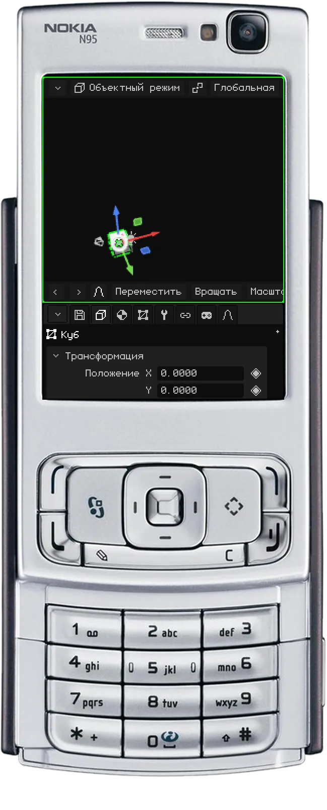

### В Режиме редактирования

В [Режиме редактирования](modo-edicion.md) кадрируется выделенная часть меша: выбранные вершины, рёбра или грани, а не весь объект. Это удобно, чтобы поработать над деталью большой модели: выдели её, кадрируй и вращай вид вокруг неё.

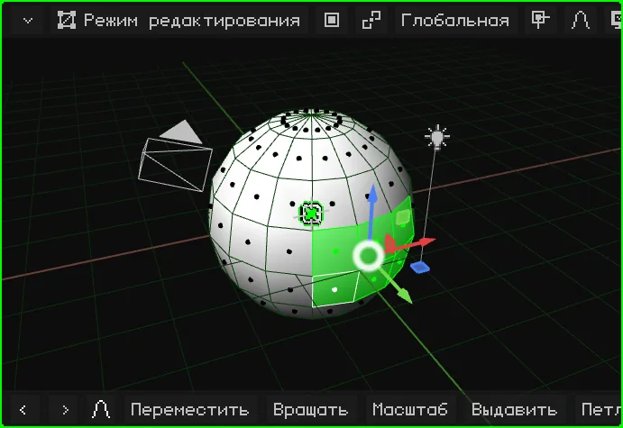

## Локальный вид

Когда в сцене много всего, работать с чем-то одним неудобно: то, что впереди, загораживает обзор, а при орбите всё время оказывается на пути. **Локальный вид** оставляет видимым только выделенное (один или несколько объектов) и кадрирует его. Остальное не удаляется и не скрывается в сцене: оно просто перестаёт отображаться в этом вьюпорте. Слева вверху появляется надпись "Локальный вид".

Чтобы вернуться, сделай то же самое ещё раз: всё снова появится, а вид станет таким, каким был до этого.

| | Как войти и выйти |
|---|---|
|  ПК | <kbd>/</kbd> |
|   Nokia N95 и сенсорный экран | Меню Вид → Локальный вид |

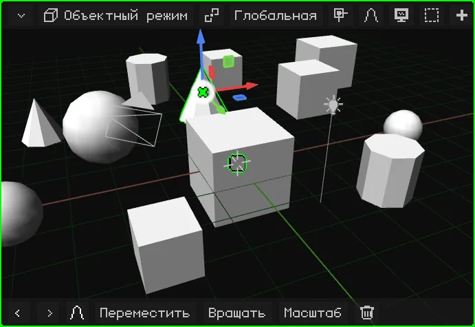

## Виды спереди, сбоку и сверху

Чтобы посмотреть на сцену ровно с одной стороны, не подгоняя орбиту вручную:

| Вид |  ПК | Меню |
|---|---|---|
| Спереди / Сзади | <kbd>Num 1</kbd> / <kbd>Ctrl</kbd> + <kbd>Num 1</kbd> | Вид → Точка обзора → Спереди / Сзади |
| Справа / Слева | <kbd>Num 3</kbd> / <kbd>Ctrl</kbd> + <kbd>Num 3</kbd> | Вид → Точка обзора → Справа / Слева |
| Сверху / Снизу | <kbd>Num 7</kbd> / <kbd>Ctrl</kbd> + <kbd>Num 7</kbd> | Вид → Точка обзора → Сверху / Снизу |

 С <kbd>Ctrl</kbd> каждая клавиша даёт противоположный вид.

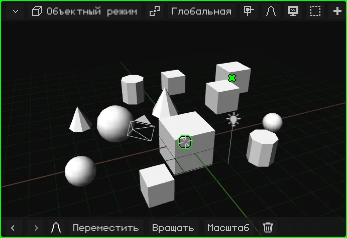

 **На Nokia N95:** удерживай клавишу <kbd>#</kbd> и нажми стрелку. Влево и вправо поворачивают вид вокруг сцены на 90° за раз. Вверх переключает на вид сверху; вниз возвращает вид сбоку, а ещё одно нажатие вниз даёт вид снизу. Если вид был повёрнут свободной орбитой, первая стрелка только выравнивает его по ближайшему из этих видов.

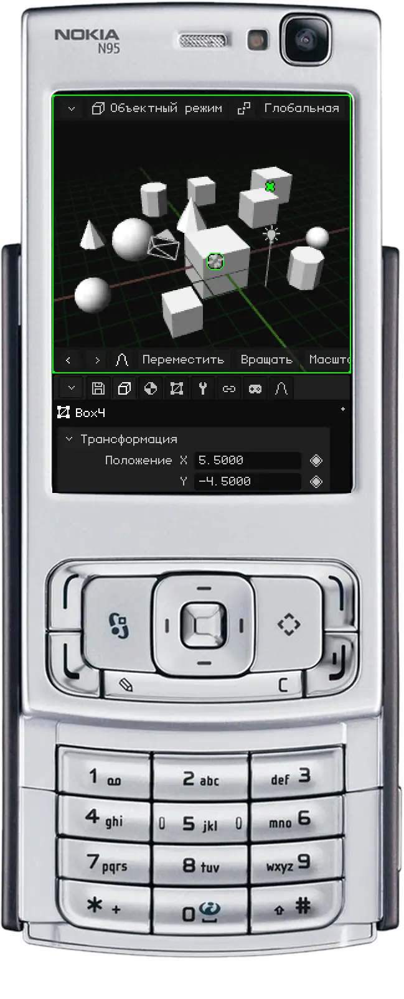

## Перспектива и ортографическая проекция

3D-вьюпорт может показывать сцену двумя способами:

- **Перспектива:** так, как видит глаз или камера. Далёкое выглядит меньше, а параллельные линии (края дороги, ряды коробок на видео) сходятся в одной точке на горизонте — **точке схода**. Так всё выглядит на самом деле, с глубиной.
- **Ортографическая проекция:** без перспективы. Всё сохраняет свой размер, близко оно или далеко, а параллельные линии никогда не пересекаются. Это как архитектурный план или технический чертёж.

Ортографическая проекция нужна для точного моделирования: выравнивать объекты, сравнивать размеры и измерять так, чтобы расстояние не обманывало. Вместе с видами спереди, сбоку и сверху это как работа над чертежом. Перспектива нужна, чтобы увидеть, как всё будет выглядеть.

| | Как переключить |
|---|---|
|  ПК | <kbd>Num 5</kbd> |
|  Nokia N95 | Одно нажатие <kbd>#</kbd>, без стрелок |
| Меню | Вид → Перспектива/Орто |

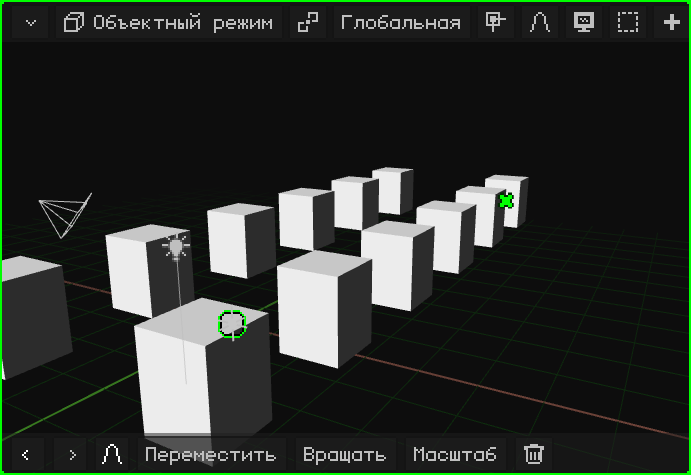

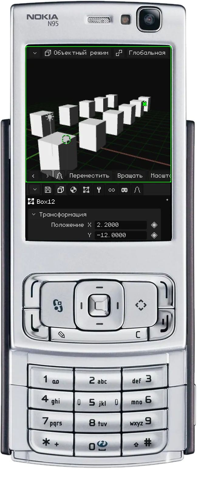

## Блокировка орбиты

Когда **орбита заблокирована**, вид перестаёт вращаться: то, что его вращало, теперь его сдвигает, как будто двигаешь лист бумаги по столу. Это идеально, чтобы удобно работать с моделями, которые рисуются как 2D-план, например с планом дома или механической деталью: если смотреть сверху в ортографической проекции, ты перемещаешься по всему плану, а он никогда не наклоняется.

| | Как заблокировать и разблокировать |
|---|---|
|  ПК | Меню Вид → Блокировать орбиту |
|  Сенсорный экран | Меню Вид → Блокировать орбиту |
|  Nokia N95 | <kbd>9</kbd> |

При блокировке и разблокировке появляется уведомление, а пока орбита заблокирована, пункт Блокировать орбиту в меню выделен зелёным.

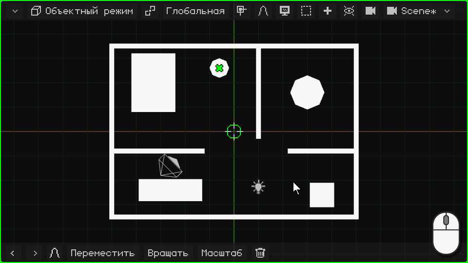

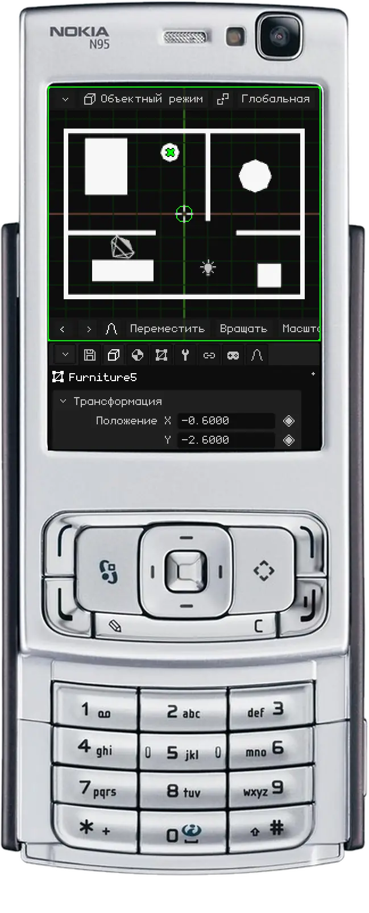

## Активная камера

В сцене может быть несколько камер, но **активная камера** только одна: та, что используется в игре и для рендеров. Что видит эта камера, то видно в игре и то получается, когда ты рендеришь изображение или видео. Вид, в котором ты перемещаешься, нужен только для работы: его нет ни в игре, ни в рендерах.

Чтобы посмотреть через активную камеру:

| | Как войти и выйти |
|---|---|
|  ПК | <kbd>Num 0</kbd> |
|  Nokia N95 | <kbd>8</kbd> (вне Режима редактирования: там 8 — это Петлевой разрез) |
| Меню | Вид → Камеры → Активная камера |

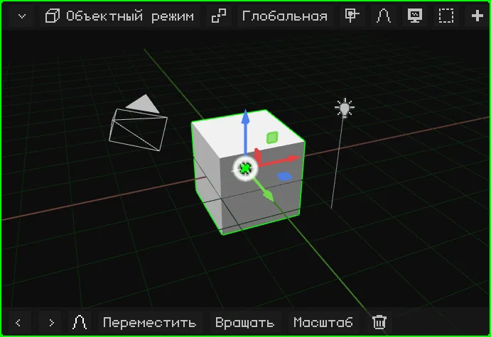

Прямоугольник — это кадр: что внутри, то и получится. Внизу по центру есть **замок**:

- **Открыт** (изначально): зум и сдвиг только приближают тебя, чтобы проверить кадр, а камеру не трогают. Орбита выводит из вида через камеру, и ты продолжаешь навигацию с того места, где стояла камера.
- **Закрыт:** орбита, сдвиг и зум двигают **камеру**. Так настраивается кадр.

### Привязка камеры к виду

Когда замок закрыт, активная камера привязана к виду: орбита, сдвиг и зум работают как при обычной навигации, а камера движется вместе с тобой. Это самый удобный способ поставить камеру точно туда, куда нужно: смотришь через неё, привязываешь её и перемещаешься, пока кадр не получится таким, как задумано.

| | Как включить и выключить |
|---|---|
|  ПК | Клик по замку |
|  Сенсорный экран | Касание замка |
|  Nokia N95 | Левая софт-клавиша открывает строку меню (см. [Когда видны не все пункты строки меню](interfaz.md#когда-видны-не-все-пункты-строки-меню)); там — Вид → Привязать камеру к виду |
| Меню | Вид → Привязать камеру к виду |

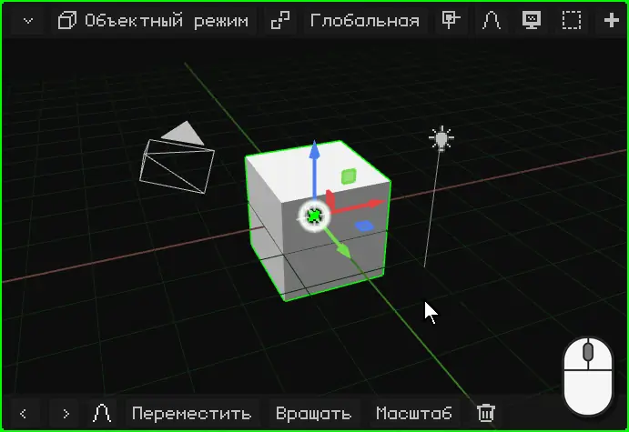

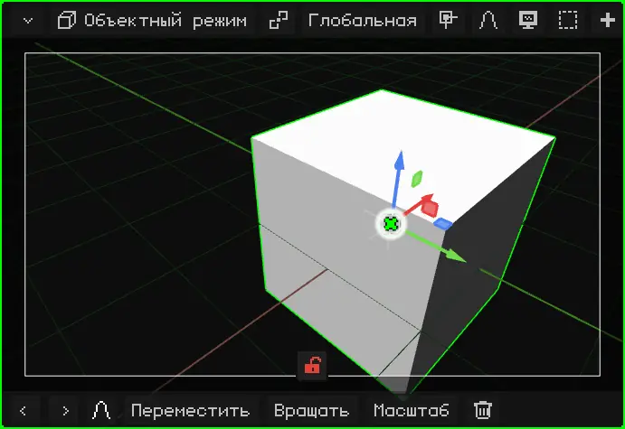

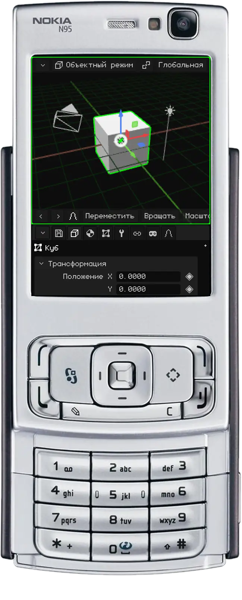

Чтобы активной стала другая камера, выдели её и нажми <kbd>Ctrl</kbd> + <kbd>Num 0</kbd> (или Вид → Камеры → Активный объект как камера).

## Другие параметры вида

| Параметр | Что делает |  ПК |  Nokia N95 | Меню |
|---|---|---|---|---|
| Поворот вида | Поворачивает вид на 15° вокруг его собственной оси, как при наклоне головы. | <kbd>Num 4</kbd> / <kbd>Num 6</kbd> | — | — |

Все горячие клавиши редактора собраны в разделе [Горячие клавиши](atajos.md).

## Всё управление: краткая сводка

### Мышью (ПК)

| Функция | Описание | Как использовать |
|---|---|---|
| Орбита | Вращает вид вокруг опорной точки. | Средняя кнопка + перетаскивание или <kbd>Alt</kbd> + левая кнопка + перетаскивание. |
| Панорамирование | Сдвигает вид вбок. | <kbd>Shift</kbd> + средняя кнопка или <kbd>Alt+Shift</kbd> + левая кнопка + перетаскивание. |
| Зум | Приближает или отдаляет. | Колесо мыши. |
| Выделить | Выбирает то, что под указателем (решается при отпускании кнопки). | Левый клик; <kbd>Shift</kbd>+клик добавляет или убирает. |
| Выделение рамкой | Перетаскивание по фону рисует прямоугольник. | Перетаскивание левой кнопкой или <kbd>B</kbd>. |
| Контекстное меню | Открывает меню режима у указателя (во время трансформации — отменяет её). | Правый клик. |
| Блокировать орбиту | То, что вращало вид, теперь его сдвигает: вид становится похож на 2D-доску. | Меню Вид → Блокировать орбиту. |
| Привязать камеру к виду | При взгляде через активную камеру навигация двигает камеру: так настраивается кадр. | Клик по замку (внизу, в виде через камеру) или меню Вид → Привязать камеру к виду. |

### С клавиатуры

| Функция | Описание | Сочетание |
|---|---|---|
| Вид спереди / Вид сзади | Вид спереди или сзади. | <kbd>Num1</kbd> / <kbd>Ctrl+Num1</kbd> |
| Вид справа / Вид слева | Вид сбоку. | <kbd>Num3</kbd> / <kbd>Ctrl+Num3</kbd> |
| Вид сверху / Вид снизу | Вид сверху или снизу. | <kbd>Num7</kbd> / <kbd>Ctrl+Num7</kbd> |
| Перспектива / Ортографическая | Переключает между двумя проекциями. | <kbd>Num5</kbd> |
| Поворот вида | Поворачивает вид на 15° вокруг его оси. | <kbd>Num4</kbd> / <kbd>Num6</kbd> |
| Вид из камеры | Вид через активную камеру (повторное нажатие — выход). | <kbd>Num0</kbd> |
| Сделать активной камерой | Активный объект становится активной камерой. | <kbd>Ctrl+Num0</kbd> |
| Показать выделенное | Центрирует вид на выделенном и подбирает зум. | <kbd>Num.</kbd> (точка на цифровой клавиатуре) |
| Локальный вид | Показывает только выделенное и кадрирует его; повторное нажатие возвращает всё. | <kbd>/</kbd> |
| Импорт модели | Открывает файловый браузер для импорта OBJ, FBX, glTF или GLB (только ПК). | <kbd>Num9</kbd> |

### Пальцами (Android, сенсорный Web)

| Функция | Описание | Жест |
|---|---|---|
| Орбита | Вращает вид. | Перетаскивание одним пальцем. |
| Зум и панорамирование | Щипок приближает или отдаляет; движение двух пальцев вместе сдвигает вид. | Два пальца. |
| Выделить | Выбирает то, что под пальцем. | Коснуться и отпустить, не сдвигая палец. |
| Показать выделенное | То же, что <kbd>Num.</kbd>. | Двойное касание двумя пальцами. |
| Сенсорные модификаторы | Кнопки Shift и Ctrl на панели инструментов: остаются включёнными (зелёные), чтобы добавлять к выделению или выбирать пути. | Коснуться Shift / Ctrl. |
| Вид (навигация) | В Режиме редактирования и в режимах рисования палец перемещает вид, а не выделяет и не рисует. | Кнопка в виде монитора на панели инструментов. |

### С клавиатуры Nokia N95

| Функция | Клавиша |
|---|---|
| Орбита | Стрелки (удерживать) |
| Зум / Показать выделенное | <kbd>0</kbd> + вверх/вниз / только <kbd>0</kbd> |
| Панорамирование | <kbd>\*</kbd> + стрелки |
| Виды (спереди, сбоку, сверху) / Перспектива-Ортографическая | <kbd>#</kbd> + стрелки / только <kbd>#</kbd> |
| Переместить / Вращать / Масштаб (во время трансформации: ось X / Y / Z) | <kbd>1</kbd> / <kbd>2</kbd> / <kbd>3</kbd> |
| Подтвердить / Отмена | OK (центр) / <kbd>C</kbd> |
| Удалить (когда нечего отменять) / Отменить и Повторить | <kbd>C</kbd> / <kbd>C</kbd> + влево или вправо |
| Сменить затенение | <kbd>6</kbd> |
| Выдавить (Режим редактирования) | <kbd>7</kbd> |
| Петлевой разрез (Режим редактирования) / Вид из камеры (вне редактирования) | <kbd>8</kbd> |
| Блокировать орбиту | <kbd>9</kbd> |
| Привязать камеру к виду (при взгляде через камеру) | Левая софт-клавиша → меню Вид |
| Перебор выделения / добавить, убрать, всё или ничего | Карандаш / Карандаш + стрелки |
| Строка меню / виртуальный курсор | Левая / правая софт-клавиша |
| Сменить вьюпорт, изменить размер, развернуть | Зелёная клавиша (одна, + стрелки, + OK) |
| Игровой режим на весь экран | Зелёная клавиша + <kbd>0</kbd> (ещё раз: изображение занимает весь экран; ещё раз: возврат). Без UI, без рамки камеры и тёмной области вокруг (чёрные полосы остаются, только если камера задаёт соотношение сторон, отличное от экрана, — до второго нажатия), и стрелки не панорамируют: игра видна как есть |

N95 также поддерживает Bluetooth-мышь и Bluetooth-клавиатуру. Для ввода текста используется T9.
