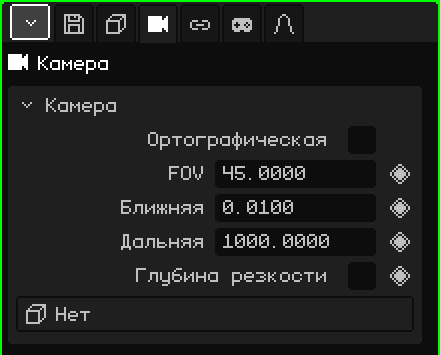

# Камера

**Камера** — это точка обзора, размещённая в сцене. **Активная камера** — та, что используется для игры и для рендеров: то, что видит она, видно во время игры и попадает в изображение или видео. Эта статья — справочник по её свойствам; как добавлять и перемещать объекты, рассказано в уроке [Объектный режим](../tutoriales/modo-objeto.md).

## Вкладки

| Вкладка | Что в ней |
|---|---|
| Объект | Положение, вращение, имя и видимость, как у всех объектов: см. [3D-меш](objeto-malla.md#вкладка-объект). |
| Камера | Объектив камеры: карточка ниже. |
| Ограничители | См. [Ограничители](restricciones.md). |
| Скрипты | Lua-скрипты объекта. См. [Lua в Whisk3D](../lua/README.md). |

## Карточка Камера

| Свойство | Что делает |
|---|---|
| Ортографическая | Без перспективы: удалённое не уменьшается, а параллельные линии не сходятся. См. [Перспектива и ортографическая проекция](../tutoriales/navegacion.md#перспектива-и-ортографическая-проекция). |
| FOV ◆ | Угол обзора в градусах (сверху вниз). Меньше — как телеобъектив: в кадр попадает меньше, и всё видно крупнее. Больше — широкоугольный объектив: в кадр попадает больше, и перспектива преувеличивается. Начальное значение 45. |
| Ближняя ◆ | Минимальное расстояние отрисовки: то, что ближе к камере, не рисуется. Начальное значение 0.01. |
| Дальняя ◆ | Максимальное расстояние отрисовки: то, что дальше, не рисуется. Начальное значение 1000. |
| Глубина резкости | Включает размытие: то, что находится на дистанции фокуса, получается резким, а остальное — размытым. Его рисует трассировка лучей; Постобработка тоже может использовать этот же фокус. |
| Диафрагма (f) | Насколько сильно размытие, как у настоящей камеры: чем меньше число, тем сильнее размытие. |
| Дистанция фокуса ◆ | Расстояние в метрах, на которое наведена резкость. Линия и крестик, которые рисуются на камере, показывают, где это. |
| Объект фокуса | Объект, за которым фокус следит сам, где бы тот ни был. Если объект выбран, «Дистанция фокуса» исчезает. **Нет** возвращает ручную дистанцию. |
| Цель | Объект, на который активная камера смотрит всегда: если объект движется, камера поворачивается за ним. **Нет** оставляет её смотреть туда, куда ты её повернул. |

«Диафрагма (f)», «Дистанция фокуса» и «Объект фокуса» появляются, когда установлен флажок «Глубина резкости».

### Когда менять «Ближняя» и «Дальняя»

Если стена или персонаж совсем рядом с камерой выглядят обрезанными, уменьши значение **Ближняя**. Если пропадает задний план большого уровня, увеличь значение **Дальняя**. Не стоит растягивать диапазон больше, чем нужно: при большом расстоянии между «Ближняя» и «Дальняя» грани, расположенные очень близко друг к другу, могут мерцать, особенно на Nokia N95.

«Ближняя» и «Дальняя» можно анимировать: это пригодится, например, чтобы отодвигать границу отрисовки, когда камера поднимается и показывает больше уровня.

### Камера, которая следует за персонажем

Есть два способа, в зависимости от кадра:

- **Камера стоит на месте и поворачивается:** укажи персонажа в поле **Цель**. Активная камера держит его в центре кадра, даже если он бежит, как человек, который провожает его взглядом.
- **Камера едет вместе с ним:** оставь «Цель» на «Нет» и добавь камере ограничитель **Child Of** с персонажем в качестве источника и установленным только флажком **Положение**. Она движется с ним на том же расстоянии и под тем же углом и не поворачивается, когда поворачивается он (см. [Child Of](restricciones.md#child-of)).

## Выбрать активную камеру

В сцене может быть несколько камер, но активная только одна. Чтобы сменить её:

| | Как выбрать |
|---|---|
|  ПК | Выдели камеру и нажми <kbd>Ctrl</kbd> + <kbd>Num 0</kbd> |
| Меню | Вид → Камеры → Активный объект как камера |
| Свойства | Вкладка Анимация → карточка **Активная камера** |

В карточке «Активная камера» ромб создаёт **переключения камер**: переход от одной камеры к другой в определённом кадре. См. [Таймлайн](linea-de-tiempo.md).

Как смотреть через активную камеру и выстраивать кадр с помощью навигации, см. [Активная камера](../tutoriales/navegacion.md#активная-камера) в уроке по навигации.
