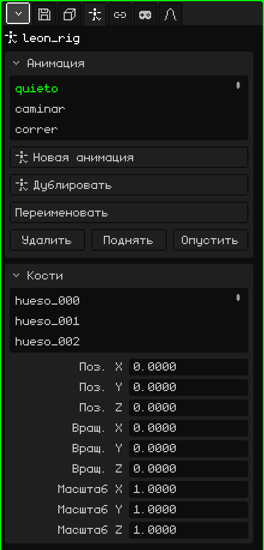

# Арматура

**Арматура** — это объект из **костей**, который нужен для анимации персонажей и всего, что сгибается. Кости двигаются, а меш следует за ними и деформируется: руку анимируют, поворачивая пару костей, а не двигая сотни вершин. Эта статья — справочник по её свойствам; как добавлять и перемещать объекты, рассказано в уроке [Объектный режим](../tutoriales/modo-objeto.md).

Добавить → Арматура создаёт арматуру с одной костью, к которой можно добавлять новые. В 3D-вьюпорте каждая кость рисуется синей линией поверх всего, чтобы её было видно, даже если она внутри меша.

## Покой и поза

У каждой кости есть два состояния:

- **Покой:** место, куда её поставили при сборке арматуры. Это положение, в котором меш не деформирован (например, персонаж с разведёнными руками).
- **Поза:** то, как она стоит в определённом кадре анимации: поднятая рука, повёрнутая голова. Постановка позы не меняет покой: к нему всегда можно вернуться.

## Режимы

У арматуры три режима, которые выбираются в меню **Режим** 3D-вьюпорта:

| Режим | Для чего |
|---|---|
| Объектный режим | Перемещать, вращать и масштабировать всю арматуру, как любой объект. |
| Режим редактирования | Собирать арматуру: создавать кости из кончиков, перемещать их, связывать с родителем. Меняет покой. |
| Режим позы | Ставить позы и анимировать: поворачивать кости и сохранять ключевые кадры. |

 <kbd>Tab</kbd> переключает между Объектным режимом и Режимом позы (а из Режима редактирования переходит в Режим позы).

Инструменты и горячие клавиши каждого режима описаны в разделе руководства [Скелеты](esqueletos.md).

## Вкладки

| Вкладка | Что в ней |
|---|---|
| Объект | Положение, вращение, масштаб, имя и видимость всей арматуры, как у всех объектов: см. [3D-меш](objeto-malla.md#вкладка-объект). |
| Арматура | Анимации и кости: две карточки ниже. |
| Ограничители | См. [Ограничители](restricciones.md). |
| Скрипты | Lua-скрипты объекта. См. [Lua в Whisk3D](../lua/README.md). |

## Вкладка Арматура

### Анимация

Анимации арматуры (**клипы**): ходьба, бег, прыжок. Каждый клип хранит позы костей во времени.

| Свойство | Что делает |
|---|---|
| Список | Клипы арматуры. Выбранный — тот, что редактируется и воспроизводится. |
| Новая анимация | Создаёт пустой клип с костями в покое. |
| Дублировать | Копирует выбранный клип, чтобы сделать вариант, не трогая оригинал (появляется, если есть клипы). |
| Переименовать | Меняет имя клипа. Внутри одной арматуры имена не могут повторяться. |
| Удалить / Поднять / Опустить | Удаляет клип или перемещает его в списке. |

Как анимировать: [Таймлайн](linea-de-tiempo.md).

### Кости

Список костей арматуры. Если выбрать одну, карточка показывает её данные:

| Свойство | Что делает |
|---|---|
| Имя | Имя кости. При его изменении переименовывается и её группа вершин в мешах арматуры, так что меш по-прежнему следует за ней. |
| Родитель | От какой кости она зависит (**Нет**, если это корень). Когда двигается родитель, двигаются и его потомки. Меню не предлагает саму кость и те, что от неё зависят, чтобы не образовался круг. |
| Соединённый | Только если есть родитель. Если флажок установлен, начало кости приварено к кончику родителя: перемещение одного двигает другое. Если установить его у отдельно стоящей кости, она переместится, чтобы прилипнуть. Если флажок снят, кость остаётся дочерней, но не прикреплена (видна пунктирная линия). |
| Поз. X, Y, Z | Где находится кость в текущей позе, относительно родителя. |
| Вращ. X, Y, Z | Насколько она повёрнута в текущей позе, в градусах. |
| Масштаб X, Y, Z | Её размер в текущей позе: 1 — исходный. |

«Поз.», «Вращ.» и «Масштаб» редактируют **позу** и видны сразу, но не сохраняются в анимации, пока не вставлен ключевой кадр («Вставить ключевой кадр» в Режиме позы).

## Чтобы меш следовал за арматурой

Чтобы меш деформировался вместе с костями, нужны две вещи:

1. **Модификатор Арматура** на меше (Свойства → вкладка Модификаторы → Добавить → Арматура), с арматурой, выбранной в поле **Цель**. См. [Арматура (модификатор)](modificador-esqueleto.md).
2. **Группы вершин** с именами костей (Свойства → вкладка 3D-меш → [Группы вершин](objeto-malla.md#группы-вершин)). Каждая группа говорит, какие вершины двигает её кость и насколько; веса рисуются в режиме [Рисование весов](pintura.md#рисование-весов).

Для жёсткого объекта, например меча в руке или шляпы, ничего этого не нужно: достаточно ограничителя [Child Of](restricciones.md#child-of) с арматурой в качестве источника и костью руки или головы. Это гораздо легче, чем деформировать меш, и на Nokia N95 это заметно.

## Импорт персонажа

Добавить → Импорт → glTF или GLB загружает собранного персонажа за один раз. Например, Leon:

- **меш** — как потомок арматуры;
- **арматура** — с именем файла и `_rig` на конце;
- **группы вершин** — по одной на каждую кость, которая двигает меш, с весами из файла;
- **анимации** — как клипы в карточке Анимация;
- и, если в файле есть анимации, **модификатор Арматура**, уже добавленный на меш и указывающий на его арматуру.

Выбери клип в списке, нажми Play на Таймлайне, и персонаж задвигается.
