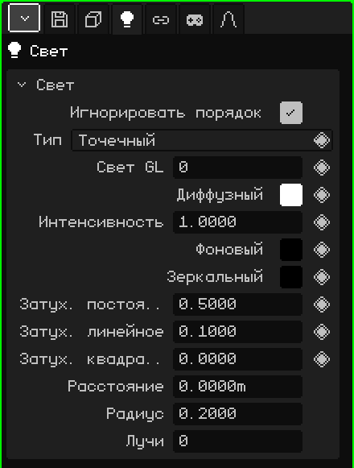

# Свет

**Источник света** освещает сцену: материалы с включённым Освещением выглядят светлее или темнее в зависимости от того, какой свет на них падает. Эта статья — справочник по его свойствам; как добавлять и перемещать объекты, рассказано в уроке [Объектный режим](../tutoriales/modo-objeto.md).

## Три типа

| Тип | Как светит | Для чего |
|---|---|---|
| **Точечный** | Из точки во все стороны, как лампочка. | Лампы, свечи, костры, свечение объекта. |
| **Солнце** | Параллельными лучами, которые все идут с одной стороны. Важно, куда он направлен, а не где находится. | Дневной свет на улице. |
| **Прожектор** | Конусом, как фонарик. | Фонарики, фары машины, прожекторы на сцене. |

Добавить → Свет создаёт Точечный источник; Добавить → Солнце и Добавить → Прожектор сразу создают два других. Тип можно поменять потом в свойстве **Тип**.

Солнце и прожектор направляются вращением объекта. Солнце всегда рисует линию до пола в ту сторону, куда светит; когда источник выделен, прожектор показывает свой конус, а точечный — сферу размером со значение **Расстояние**.

## Вкладки

| Вкладка | Что в ней |
|---|---|
| Объект | Положение, вращение, имя и видимость, как у всех объектов: см. [3D-меш](objeto-malla.md#вкладка-объект). |
| Свет | Карточка ниже. |
| Ограничители | См. [Ограничители](restricciones.md). |
| Скрипты | Lua-скрипты объекта. См. [Lua в Whisk3D](../lua/README.md). |

## Карточка Свет

| Свойство | Что делает |
|---|---|
| Игнорировать порядок | Если флажок установлен (по умолчанию), источник освещает всю сцену, где бы он ни был в Аутлайнере. Если снят, он освещает только то, что рисуется **после** него в Аутлайнере: так можно освещать определённые вещи определёнными источниками. |
| Тип | Точечный, Солнце или Прожектор. |
| Свет GL ◆ | Какой из 8 источников света OpenGL он использует (от 0 до 7). См. [Больше 8 источников света](#больше-8-источников-света). |
| Диффузный ◆ | Цвет света. |
| Интенсивность ◆ | Насколько сильно он светит. 1 — цвет как есть; больше — сильнее. |
| Фоновый ◆ | Равномерный свет, который доходит повсюду, в том числе до граней, не обращённых к источнику. Изначально чёрный (без фонового света). Немного увеличь его, чтобы тени не были чёрными. |
| Зеркальный ◆ | Цвет блика, который свет оставляет на материалах. Изначально чёрный (без блика). |
| Затух. постоянное, Затух. линейное, Затух. квадратичное ◆ | **Затухание**: как свет гаснет с расстоянием. Постоянное равномерно ослабляет его везде; линейное понемногу гасит его по мере удаления; квадратичное гасит гораздо быстрее вдали. У Солнца их нет. |
| Угол прожектора ◆ | Только у Прожектора: насколько раскрыт конус, в градусах, от центра до края. При 45 конус раскрывается на 90° в сумме. |
| Экспонента прожектора ◆ | Только у Прожектора: как свет распределяется в конусе. 0 светит равномерно; большее значение собирает его в центре и затемняет края. |
| Расстояние | Докуда светит Точечный источник или Прожектор при трассировке лучей, в метрах; это же длина рисуемого конуса. 0 — без ограничения. У Солнца его нет. |
| Радиус | Для трассировки лучей: размер лампы. 0 даёт жёсткие тени с резким краем; больше — тени с мягким краем. У Солнца это градусы. |
| Лучи | Для трассировки лучей: сколько теневых лучей посылает этот источник. Больше лучей — мягкие тени чище, но медленнее. 0 берёт значение из вкладки Файл / Рендер. |

### Расстояние и затухание

Оба параметра меняют то, докуда заметен источник, но по-разному:

- **Затухание** действует всегда, в 3D-вьюпорте, в игре и при трассировке лучей: свет постепенно гаснет с расстоянием, но никогда не обрывается полностью.
- **Расстояние** — это граница для трассировки лучей: свет плавно гаснет до нуля ровно на ней, а дальше не светит. В OpenGL оно ничего не обрезает: там решает затухание. Оно также служит ориентиром, потому что сфера или конус показывают, где свет заканчивается.

## Больше 8 источников света

OpenGL рисует до **8 источников света одновременно**, с номерами от 0 до 7: это свойство **Свет GL**. В сцене их может быть гораздо больше; после 8 новые делят номер с каким-нибудь из предыдущих. Трассировка лучей, напротив, использует все.

При снятом флажке **Игнорировать порядок** номер можно намеренно использовать повторно: источник со значением «Свет GL» 0 освещает то, что рисуется после него в Аутлайнере, а другой источник ниже с тем же «Свет GL» 0 заменяет его для всего, что идёт дальше. Так у длинного уровня могут быть разные источники в каждой зоне, и их не больше 8.

## Примеры

| Сцена | Как собрать |
|---|---|
| Улица днём | Солнце с чуть желтоватым «Диффузный» и немного голубого «Фоновый», чтобы тени не были чёрными. |
| Комната с лампой | Точечный источник в лампе, с немного увеличенным «Затух. линейное», чтобы свет гас к стенам. Для трассировки лучей — «Расстояние» размером с комнату. |
| Фонарик | Прожектор с маленьким значением «Угол прожектора» и большим «Экспонента прожектора», прикреплённый к руке персонажа ограничителем [Child Of](restricciones.md#child-of). |
| Мерцающий свет | Ключевые кадры на «Интенсивность» (◆), со значениями, которые то растут, то падают. |
