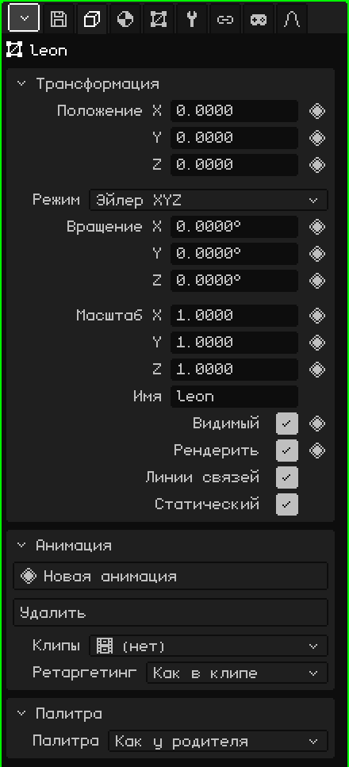
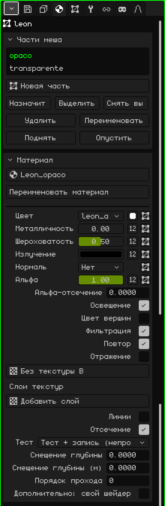
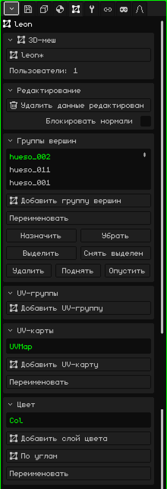
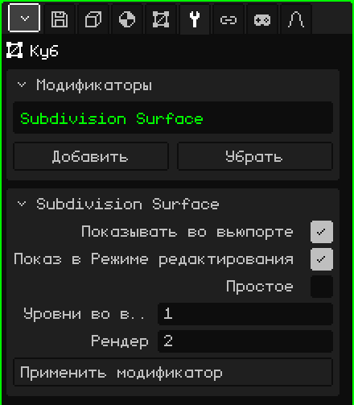

# 3D-меш

**3D-меш** — это объект, у которого есть форма: он состоит из вершин, рёбер и граней, и именно его моделируют, раскрашивают и анимируют. Куб, персонаж или целый уровень — всё это меши. Эта статья — справочник по его свойствам; как создавать, перемещать и связывать объекты с родителем, рассказано в уроке [Объектный режим](../tutoriales/modo-objeto.md).

## Вкладки

Когда выделен меш, Свойства показывают эти вкладки, помимо вкладок Файл / Рендер и Анимация, которые есть всегда:

| Вкладка | Что в ней |
|---|---|
| Объект | Общее для всех объектов: положение, вращение, масштаб, имя и видимость. |
| Материал | Части меша и материал каждой из них. |
| 3D-меш | Данные меша: какой меш используется, его группы вершин, UV-карты и слои цвета. |
| Модификаторы | Модификаторы, которые меняют форму, не разрушая её. |
| Трансформация | Только в Режиме редактирования: центр выделенного, чтобы ввести его числами. |
| Ограничители | См. [Ограничители](restricciones.md). |
| Скрипты | Lua-скрипты объекта. См. [Lua в Whisk3D](../lua/README.md). |

## Вкладка Объект

Она одинакова для всех типов объектов: у камер, источников света, арматур и звуков она тоже есть.

### Трансформация

| Свойство | Что делает |
|---|---|
| Положение X, Y, Z ◆ | Где находится объект, в метрах. Z — это высота. |
| Режим | Как записывается вращение: **Эйлер XYZ** (три угла в градусах, проще всего читать), **Кватернион (WXYZ)** или **Ось-угол**. С двумя последними появляется **Вращение W**. Смена режима не поворачивает объект: меняется только то, как показываются числа. |
| Вращение X, Y, Z ◆ | Поворот вокруг каждой оси. |
| Масштаб X, Y, Z ◆ | Размер по каждой оси: 1 — исходный размер, 2 — вдвое больше, 0.5 — вдвое меньше. |
| Имя | Имя объекта, то же, что показывает Аутлайнер. Не может повторяться: если такое уже есть, к нему добавляется номер (`.001`). |
| Видимый ◆ | Виден ли объект. Это тот же глаз, что в Аутлайнере. |
| Рендерить ◆ | Попадает ли он в рендеры. Если флажок снят, объект по-прежнему виден в 3D-вьюпорте, но не появляется на изображении и в видео. |
| Линии связей | Линия, соединяющая объект с его родителем. Её полезно выключить, когда у объекта много потомков и линии загораживают вид. |
| Статический | Отмечает, что объект никогда не двигается. Важно только внутри объекта Отсечение с методом сетки: статический объект помещается в свою ячейку один раз, а не проверяется в каждом кадре. |

### Анимация и Палитра

- **Анимация:** собственные анимации объекта, например анимация вершин, и их клипы. См. [Таймлайн](linea-de-tiempo.md).
- **Палитра:** какую цветовую палитру использует объект. С **Как у родителя** (по умолчанию) он наследует её; если выбрать палитру проекта, она перекрашивает его самого и всё, что от него зависит.

## Вкладка Материал

### Части меша

Меш может быть разделён на **части**, и у каждой части свой материал. У дома, например, стены могут быть в одной части, а стёкла окон — в другой.

| Свойство | Что делает |
|---|---|
| Список | Части меша. Выбранная — та, которую показывает карточка Материал ниже. |
| Новая часть | Создаёт пустую часть. |
| Назначить | Переносит в выбранную часть грани, выделенные в Режиме редактирования. |
| Выделить / Снять выделение | Выделяет грани этой части или снимает с них выделение. Если нужно, «Выделить» переходит в Режим редактирования, чтобы показать их. |
| Удалить / Переименовать | Удаляет часть (её грани переходят в предыдущую) или меняет её имя. «Удалить» появляется, если частей больше одной. |
| Поднять / Опустить | Меняют порядок. Части рисуются в этом порядке: прозрачное лучше оставлять в конце. |

### Материал

Материал определяет, как выглядит часть: её цвет, текстуру и то, как на неё падает свет. Материал по умолчанию не редактируется: чтобы что-то изменить, сначала создай материал селектором вверху (**Новый материал**); тем же селектором выбирается другой материал проекта. Самые используемые параметры:

| Свойство | Что делает |
|---|---|
| Переименовать материал | Меняет имя материала. |
| Цвет | Текстура части, квадратик **Базовый цвет** и UV-карта, которую использует текстура. |
| Металличность, Шероховатость, Излучение, Нормаль, Альфа | Каждый может быть числом или текстурой (кнопка **Число / текстура**). Альфа — это прозрачность: при значении меньше 1 или с альфа-текстурой материал становится прозрачным. |
| Альфа-отсечение | Отрезает то, у чего низкая альфа, без смешивания: для решёток, сетчатых заборов или листьев. 0 выключает. |
| Пропускание, IOR | Стекло и преломление. Только когда включена **Трассировка лучей** (вкладка Файл / Рендер). |
| Освещение | Падает ли на неё свет сцены. Если выключено, цвет выглядит плоским, всегда одинаковым. Если у графического бэкенда есть шейдеры, появляется **Затенение**: Повершинно или Попиксельно. |
| Цвет вершин | Использует цвета, нарисованные на меше (см. [Раскраска вершин](pintura.md#раскраска-вершин)), вместо базового цвета. |
| Фильтрация / Повтор | Сглаживает текстуру вблизи (если флажок снят, видны пиксели) / повторяет её, как плитку. |
| Отражение | Отражение окружения, как у хрома. |
| Слои текстур | До четырёх дополнительных текстур поверх первой, каждая со своей UV-картой и своим смешиванием. |
| Линии / Толщина линии | Рисует рёбра части, с толщиной в пикселях. |
| Отсечение | Не рисует задние грани. |
| Тест, Смещение глубины, Порядок прохода | Дополнительные параметры глубины, для декалей и предметов, лежащих поверх других. |
| Дополнительно: свой шейдер | Файл, который рисует материал по-своему: см. [Свои шейдеры](shaders.md). |

Если у объекта есть физика (Добавить → Физика), его карточка **Физика** тоже появляется в этой вкладке.

## Вкладка 3D-меш

### 3D-меш

Форма объекта — это ресурс проекта, и несколько объектов могут **использовать один и тот же** меш (это и делает Дублировать связанно): если редактировать один, меняются все.

| Свойство | Что делает |
|---|---|
| Селектор | Меш, который использует объект (со `*`, если есть несохранённые изменения). Отсюда выбирается другой меш проекта или **Новая копия**. |
| Пользователи | Сколько объектов сцены используют этот меш. |
| Сделать уникальным | Появляется, если меш общий: даёт объекту собственную копию, чтобы редактировать её, не трогая остальные. |

Если меш из библиотеки, появляется предупреждение «Принадлежит библиотеке (только чтение): откройте библиотеку для правки», а то, что могло бы его изменить, исчезает с панели.

### Редактирование

**Удалить данные редактирования** нужно для уровня, который больше не будут моделировать: убирает из меша данные, которые использует Режим редактирования, поэтому он быстрее загружается и занимает меньше памяти (это важно на Nokia N95). Пока этих данных нет, войти в Режим редактирования нельзя. **Преобразовать в редактируемый меш** вычисляет их заново.

Флажок **Блокировать нормали** делает так, что в Режиме редактирования при перемещении вершин нормали этого меша не пересчитываются. Так сохраняются нормали, пришедшие с импортированной моделью или исправленные вручную. По умолчанию он снят, и у каждого меша он свой.

### Группы вершин

**Группа вершин** — это список вершин, у каждой из которых есть вес. Её использует [арматура](objeto-esqueleto.md), чтобы знать, какие вершины двигает каждая кость: группа называется так же, как кость. Веса рисуются в режиме [Рисование весов](pintura.md#рисование-весов).

| Свойство | Что делает |
|---|---|
| Добавить группу вершин / Переименовать | Создаёт группу или меняет её имя. |
| Назначить / Убрать | Добавляет в группу (с весом 1) или убирает из неё вершины, выделенные в Режиме редактирования. |
| Выделить / Снять выделение | Выделяет вершины группы или снимает с них выделение, чтобы увидеть, что она захватывает. |
| Удалить / Поднять / Опустить | Удаляет группу или перемещает её в списке. |

**UV-группы** работают так же, но их веса предназначены для 2D-арматур [UV-редактора](editor-uv.md).

### UV-карты

**UV-карта** говорит, как текстура ложится на меш. У меша их может быть несколько: например, одна для цветовой текстуры, а другая для слоя текстуры, который повторяется иначе. Каждая текстура материала выбирает, какую из них использовать.

**Добавить UV-карту** создаёт карту, **Переименовать** меняет её имя, а «Удалить», «Поднять» и «Опустить» появляются, когда карт больше одной.

### Цвет

**Слои цвета** хранят цвета, нарисованные на меше в режиме Раскраска вершин. **Добавить слой цвета** создаёт слой; **Режим цвета** переключает между **По вершинам** (грани с общей вершиной делят её цвет) и **По углам** (у каждой грани может быть свой цвет, для жёстких краёв). «Переименовать», «Удалить», «Поднять» и «Опустить» — как у UV-карт.

## Вкладка Модификаторы

**Модификатор** меняет меш, не разрушая его: его можно в любой момент выключить, переупорядочить или удалить, а исходный меш остаётся на месте.

В карточке **Модификаторы** есть список (модификаторы применяются по порядку, сверху вниз), **Добавить** (меню с типами), **Убрать** и **Поднять / Опустить**. Ниже карточка выбранного модификатора (с его именем в заголовке) содержит **Показывать во вьюпорте** (если выключено, он не вычисляется), **Показ в Режиме редактирования** (если выключено, редактирование идёт быстрее, а пересчёт происходит при выходе), его свойства и **Применить модификатор**, который запекает его в меш и убирает из списка.

У каждого модификатора своя статья:

| Модификатор | Для чего |
|---|---|
| [Винт](modificador-screw.md) | Вращает профиль вокруг оси: винты, вазы, пружины. |
| [Зеркало](modificador-espejo.md) | Отражает меш: моделируется одна половина, а другая получается сама. |
| [Массив](modificador-array.md) | Копии в ряд: лестницы, заборы, цепи. |
| [Подразделение поверхности](modificador-subdivision.md) | Сглаживает меш, подразделяя его. |
| [Булев](modificador-booleano.md) | Объединяет, пересекает или вычитает другой объект. |
| [Отсечение](modificador-culling.md) | Оптимизация: не рисует то, что не видно из камеры. |
| [Арматура](modificador-esqueleto.md) | Деформирует меш с помощью арматуры. |
