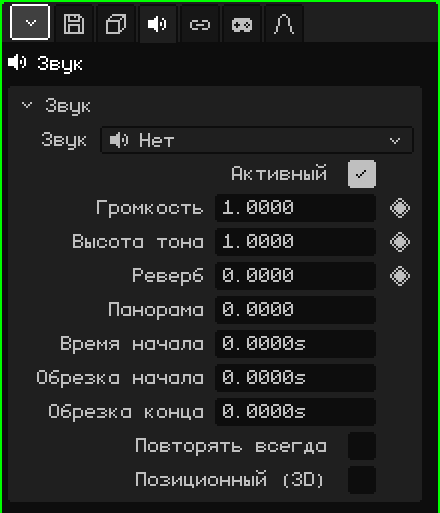

# Звук

Объект **Звук** — это аудио, размещённое в сцене: музыка, эффект, шум машины. В 3D-вьюпорте он выглядит как динамик. Он может звучать одинаково везде, как музыка, или из того места, где находится, — тем громче, чем ближе. Эта статья — справочник по его свойствам; как добавлять и перемещать объекты, рассказано в уроке [Объектный режим](../tutoriales/modo-objeto.md).

Новый объект Звук создаётся без аудио: **Нет**. Файл выбирается в карточке Звук.

## Сразу с выбранным звуком

-  Если перетащить звук из [Библиотеки](outliner.md#вид-библиотека) в 3D-вьюпорт, там, куда он упадёт, создаётся объект Звук с этим звуком.
-  Если бросить звуковой файл (например, `.wav`) на 3D-вьюпорт, он добавляется в проект, и там же создаётся объект.

## Вкладки

| Вкладка | Что в ней |
|---|---|
| Объект | Положение, имя и видимость, как у всех объектов: см. [3D-меш](objeto-malla.md#вкладка-объект). Скрытый звук не звучит, а скрытие коллекции заглушает звуки внутри неё. |
| Звук | Карточка ниже. |
| Ограничители | См. [Ограничители](restricciones.md). |
| Скрипты | Lua-скрипты объекта, которые могут включать и выключать его звук в игре. См. [Lua в Whisk3D](../lua/README.md). |

## Карточка Звук

| Свойство | Что делает |
|---|---|
| Звук | Файл, который звучит, с его длительностью. В меню перечислены звуки проекта, **Нет** и **Загрузить звук из обозревателя файлов...**, который добавляет звук с диска в проект. |
| Активный | Если флажок снят, звук не звучит. Удобно, чтобы выключить его, не удаляя. |
| Громкость ◆ | Насколько громко звучит: 1 — громкость файла, 0 — тишина, 2 — вдвое громче. |
| Высота тона ◆ | Выше или ниже. 1 — оригинал; 2 звучит на октаву выше и вдвое быстрее, 0.5 — на октаву ниже и вдвое медленнее. Поэтому изменение высоты тона меняет и длительность. |
| Реверб ◆ | Какая часть этого звука уходит в эхо реверберации: 0 — ничего, 1 — всё. Создаёт ощущение пещеры, церкви или коридора. |
| Панорама | С какой стороны звучит: -1 слева, 0 посередине, 1 справа. Только без «Позиционный (3D)»: с ним сторону определяет положение объекта. |
| Время начала | На какой секунде сцены он начинается. |
| Обрезка начала | Сколько секунд отрезается от начала файла. |
| Обрезка конца | Сколько секунд отрезается от конца файла. |
| Повторять всегда | Участок между двумя обрезками повторяется без остановки и без разрывов. Для фоновой музыки и непрерывных шумов. |
| Позиционный (3D) | Звучит из того места, где находится объект. См. ниже. |
| Радиус полной громкости | Только с «Позиционный (3D)»: до этого расстояния, в метрах, звучит в полную силу. |
| Дальность слышимости | Только с «Позиционный (3D)»: начиная с этого расстояния, в метрах, его уже не слышно. |

## Время задаётся в секундах

Время звука измеряется в **секундах**, а не в кадрах. Поэтому, если сцена переходит с 30 на 60 кадров в секунду, звуки остаются привязаны к тем же моментам, и ничего переставлять не нужно.

На [Таймлайне](linea-de-tiempo.md#звуки) у каждого выделенного звука есть своя **полоса**: где он начинается и сколько длится. Перетаскивание полосы меняет **Время начала**, а перетаскивание одного из её концов меняет обрезки. Звук играет при нажатии Play на таймлайне и замолкает при остановке.

В игре звук начинается, когда появляется (например, звук взрыва, который входит в префаб), плюс значение **Время начала**.

## Позиционный (3D)

Если флажок снят, звук слышно одинаково, где бы он ни был, как музыку. Если установлен, его слышно **оттуда, где он находится**, относительно слушателя:

- Чем ближе, тем громче: до границы **Радиус полной громкости** он звучит в полную силу, а дальше стихает и пропадает на границе **Дальность слышимости**.
- Если он справа, звучит справа; если слева — слева.
- Если он сзади, звучит тише и ближе к центру.

Слушатель — это активная камера в игре и активный 3D-вьюпорт в редакторе (или камера, если смотреть через неё). Когда звук выделен, 3D-вьюпорт рисует две сферы: радиуса полной громкости и дальности слышимости.

## Примеры

| Звук | Как собрать |
|---|---|
| Фоновая музыка | Без «Позиционный (3D)», с «Повторять всегда». |
| Водопад | «Позиционный (3D)» и «Повторять всегда», с маленьким «Радиус полной громкости» и большой «Дальность слышимости»: его слышно уже издалека, и он становится громче при приближении. |
| Удар через 4 секунды после начала анимации | «Время начала» 4 или полоса, сдвинутая туда на Таймлайне. При 30 FPS это кадр 121: кадр 1 — это секунда 0. |
| Музыка, которая затихает в конце | Ключевые кадры на «Громкость» (◆): 1 незадолго до конца и 0 в конце. |
