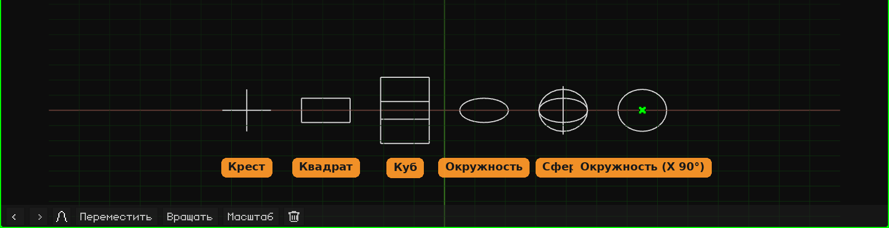

# Пустышка

**Пустышка** — это объект без меша: её не видно ни при рендере, ни в игре. Она служит точкой отсчёта: опорой, вокруг которой вращаются или масштабируются зависящие от неё объекты; местом, куда направить камеру или ограничитель; контроллером для анимации. Она добавляется через **Добавить → Пустышка**, в позицию 3D-курсора. Как добавлять и перемещать объекты, рассказано в уроке [Объектный режим](../tutoriales/modo-objeto.md).

В 3D-вьюпорте она рисуется линиями. Новая Пустышка — это **окружность, лежащая на полу**: её легко увидеть и схватить. Форма, размер и поворот рисунка меняются в её карточке. Это **только внешний вид**: он не меняет ни объект, ни его трансформацию, ни его потомков.

## Вкладки

| Вкладка | Что в ней |
|---|---|
| Объект | Положение, вращение, масштаб, имя и видимость, как у всех объектов: см. [3D-меш](objeto-malla.md#вкладка-объект). Масштабирование Пустышки масштабирует и её потомков. |
| Пустышка (крест) | Карточка ниже. |
| Ограничители | См. [Ограничители](restricciones.md). |
| Скрипты | Lua-скрипты объекта. См. [Lua в Whisk3D](../lua/README.md). |

## Карточка Пустышка

| Свойство | Что делает |
|---|---|
| Форма | Как она рисуется, каждая форма со своим значком: **Крест** (три оси), **Квадрат**, **Куб**, **Окружность** или **Сфера** (три окружности, по одной на ось). Квадрат и окружность изначально лежат на полу. На маленьких экранах (Nokia N95, PSP, 3DS и Dreamcast) окружность и сфера рисуются вдвое меньшим числом линий: там разницы не видно, а телефону приходится рисовать меньше. |
| Размер | Размер рисунка в метрах, от края до края. 1 — один метр. |
| Вращение X, Y, Z | Поворачивает рисунок, в градусах. Например, окружность с **X** = 90 стоит вертикально. |

Ничто из этого не двигает и не поворачивает объект: Пустышка остаётся на месте, а её потомки ничего не замечают. Всё это сохраняется вместе с проектом.

## Для чего она нужна

- **Опора:** объект-потомок Пустышки вращается и масштабируется относительно Пустышки. Например, мяч, привязанный к Пустышке, которая стоит в его нижней точке, сплющивается о пол, когда масштабируешь Пустышку.
- **Порядок в сцене:** несколько объектов, привязанных к Пустышке, двигаются вместе, если двигать только Пустышку.
- **Цель:** [ограничители](restricciones.md) могут указывать на Пустышку, например чтобы камера всё время на неё смотрела.
