# Свойства

> [!NOTE]
>  Nokia N95 поддерживает мышь и клавиатуру (по Bluetooth). Части этой страницы про Nokia объясняют, как пользоваться им без мыши и клавиатуры, только кнопками телефона.

**Свойства** — это вьюпорт с данными **активного объекта**, то есть последнего выделенного: его положение, имя, материал, цвет источника света, модификаторы меша. Он разбит на **вкладки**, и в каждой вкладке есть **карточки** со строками значений. Почти всё, что ты здесь меняешь, сразу видно в 3D-вьюпорте.

Как объяснялось в разделе [Вьюпорты](interfaz.md#активный-вьюпорт), клавиши работают в активном вьюпорте — том, что в зелёной рамке.

 На Nokia N95 Свойства находятся справа от 3D-вьюпорта: **зелёная клавиша**  делает их активным вьюпортом. Когда ты возвращаешься, выбрана та же строка, на которой ты остановился.

## Вкладки

Вкладки — это иконки в строке меню Свойств. Каждая показывает свою группу карточек.

Вкладки **меняются в зависимости от активного объекта**: у каждого типа объекта видны только те, что ему нужны. У меша есть Материал, 3D-меш и Модификаторы; у источника света вместо материала — вкладка Свет; у камеры — вкладка Камера.

| Вкладка | Когда появляется |
|---|---|
| Файл / Рендер (дискета) | Всегда, даже если ничего не выделено. |
| Объект | С любым 3D-объектом: положение, вращение, масштаб, имя и видимость. |
| Вкладка типа объекта | Материал у меша, Свет у источника света, Камера у камеры, и так для каждого типа. Её иконка меняется вместе с типом. |
| 3D-меш и Модификаторы | Только у меша. |
| Трансформация | Только у меша в Режиме редактирования. |
| Ограничители | С любым 3D-объектом. |
| Скрипты | С любым объектом. |
| Анимация | Всегда. |

Вкладка типа остаётся на своём месте: если ты был в материале меша и выделяешь источник света, ты попадаешь на вкладку Свет. Если вкладки, на которой ты был, у нового объекта нет (Модификаторы, когда выделяешь источник света), Свойства возвращаются на вкладку Объект.

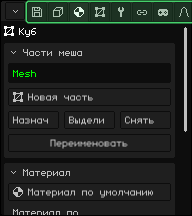

| | Как переключить вкладку |
|---|---|
|  ПК | Клик по вкладке. Если помещаются не все, крути колесо над строкой. |
|  Сенсорный экран | Касание вкладки. Если помещаются не все, перетащи строку вбок. |
|  Nokia N95 | Поднимись стрелкой **вверх** до заголовка первой карточки и нажми её ещё раз: текущая вкладка станет зелёной. **Влево** и **вправо** переключают вкладки, а **вниз** возвращает к карточкам. На первой вкладке стрелка влево открывает меню кнопки в углу. |

## Карточки

**Карточки** — это блоки на каждой вкладке: заголовок и строки под ним. Стрелка в заголовке показывает, развёрнута карточка или свёрнута. Если свернуть те, которыми не пользуешься, нужные будут под рукой.

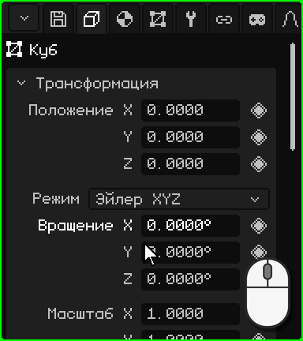

| | Как свернуть и развернуть |
|---|---|
|  ПК | Клик по заголовку. |
|  Сенсорный экран | Касание заголовка. |
|  Nokia N95 | <kbd>OK</kbd> на заголовке. Стрелка **влево** сворачивает карточку с любой её строки, а **вправо** на заголовке разворачивает её. |

Если карточки не помещаются во вьюпорт, панель прокручивается: колесом мыши на ПК или перетаскиванием пальца вверх или вниз на сенсорном экране. На Nokia панель сама следует за выбранной строкой.

### Перемещение клавишами

 На Nokia N95 есть **выбранная строка**: её название выделено зелёным, а значение — белой рамкой. **Вверх** и **вниз** переходят от строки к строке и от карточки к следующей, а <kbd>OK</kbd> использует строку: редактирует число, ставит флажок, открывает выпадающий список. Во время редактирования рамка становится зелёной.

 На ПК, когда мышь над Свойствами, стрелки и <kbd>Enter</kbd> делают то же самое, а <kbd>Esc</kbd> отменяет то, что ты редактируешь.

## Числа

Большинство строк — это **числа**: название слева, значение справа, как Положение, Вращение и Масштаб в карточке Трансформация. Число можно **ввести** или **перетащить**. У каждого свой шаг, а у некоторых есть предел: Свет GL у источника света — от 0 до 7.

### Ввести число

 Клик по числу, не двигая мышь: значение выделяется, и то, что ты печатаешь, его заменяет. <kbd>Enter</kbd> применяет его, а <kbd>Esc</kbd> оставляет как было. Клик в любом другом месте тоже применяет значение.

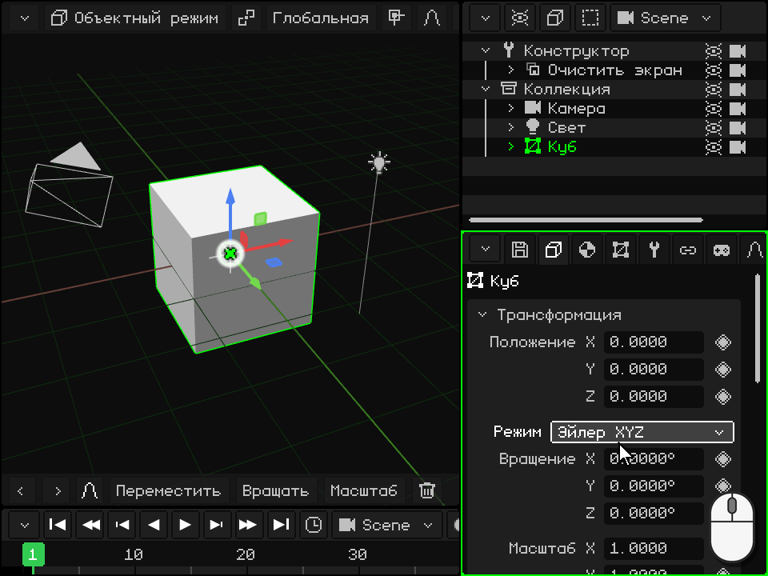

 Касание числа открывает внизу **цифровую клавиатуру** Whisk3D с названием строки и её значением. На ней есть цифры, точка, **DEL** для удаления и стрелки для перемещения курсора. **OK** применяет значение, а **X** отменяет; касание за пределами клавиатуры тоже применяет его.

 Цифровая клавиатура умеет и **считать**: с <kbd>+</kbd>, <kbd>-</kbd>, <kbd>\*</kbd>, <kbd>/</kbd> и скобками можно написать `2*3` или `1.5+0.25`, и после касания OK останется результат. Клавиша <kbd>-</kbd> также нужна, чтобы ввести отрицательное число.

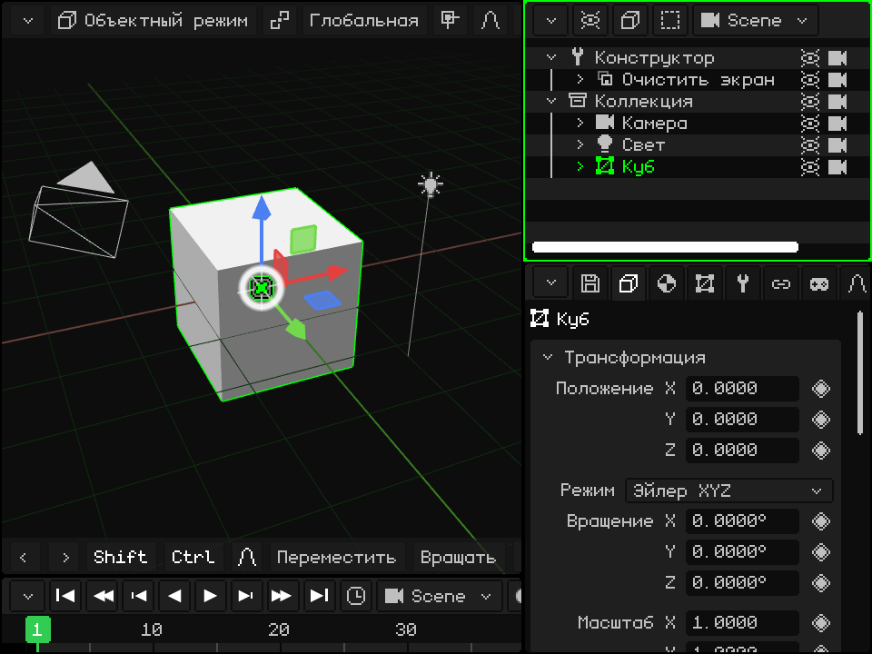

 Дойди до строки стрелками и нажми <kbd>OK</kbd>: значение выделяется, и клавиши телефона вводят цифры (строка меню Свойств показывает **123**). Первая введённая цифра заменяет прежнее значение. <kbd>\*</kbd> — это десятичная точка, <kbd>C</kbd> стирает, **влево** и **вправо** двигают курсор, <kbd>OK</kbd> применяет значение, а **левая софт-клавиша** отменяет.

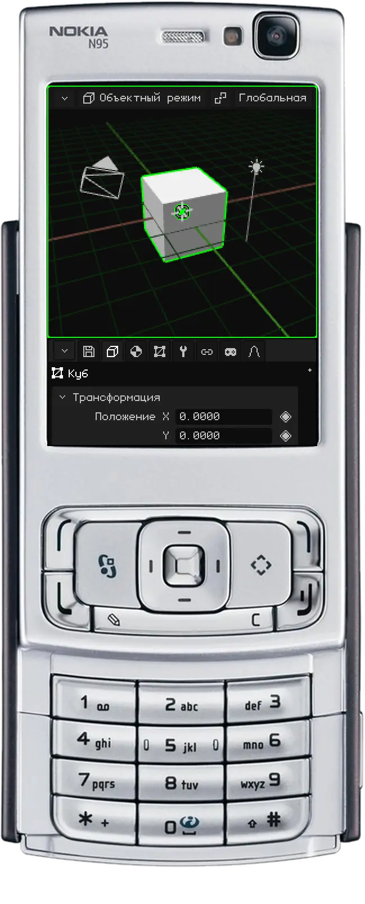

### Перетащить число

 Зажми кнопку мыши на числе и веди мышь вбок: вправо значение растёт, влево уменьшается. Если указатель доходит до края вьюпорта, он появляется с другой стороны, и можно тянуть дальше. Когда отпускаешь кнопку, значение остаётся.

 Поставь палец на число (а не на его название) и веди вбок. Если вести вверх или вниз, вместо изменения значения прокручивается панель.

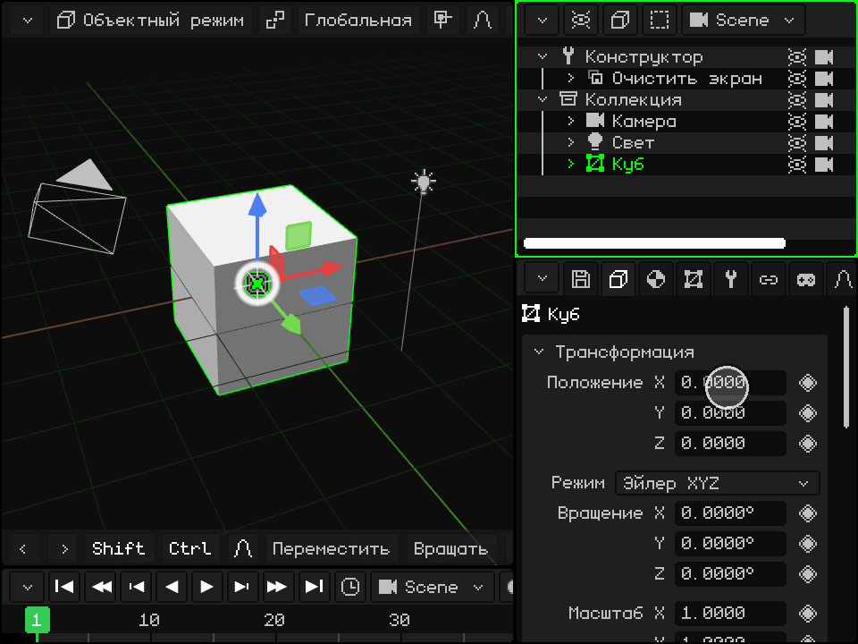

## Выпадающие списки

**Выпадающий список** — это кнопка, которая показывает выбранный вариант, как **Тип** источника света (Точечный, Солнце или Прожектор) или **Режим** вращения. Если его активировать, открывается список вариантов, текущий выделен зелёным; когда выбираешь другой, список закрывается.

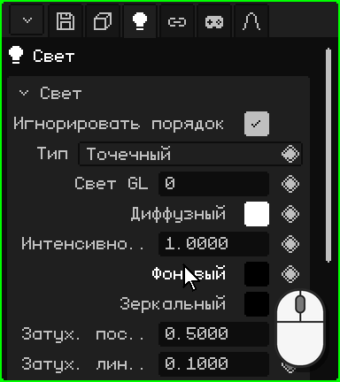

| | Как открыть и выбрать |
|---|---|
|  ПК | Клик по кнопке и ещё один по варианту. |
|  Сенсорный экран | Касание кнопки и ещё одно касание варианта. |
|  Nokia N95 | <kbd>OK</kbd> открывает его, **вверх** и **вниз** перебирают варианты, а <kbd>OK</kbd> выбирает. <kbd>C</kbd> закрывает его, ничего не меняя. |

## Флажки

**Флажок** включается или выключается: отмечен — да, пуст — нет. Он находится справа в строке, как **Освещение** в материале: если его выключить, объект не реагирует на свет и выглядит плоским, своего цвета. Клик или касание строки (флажка или его названия) переключает его, а на Nokia — <kbd>OK</kbd>.

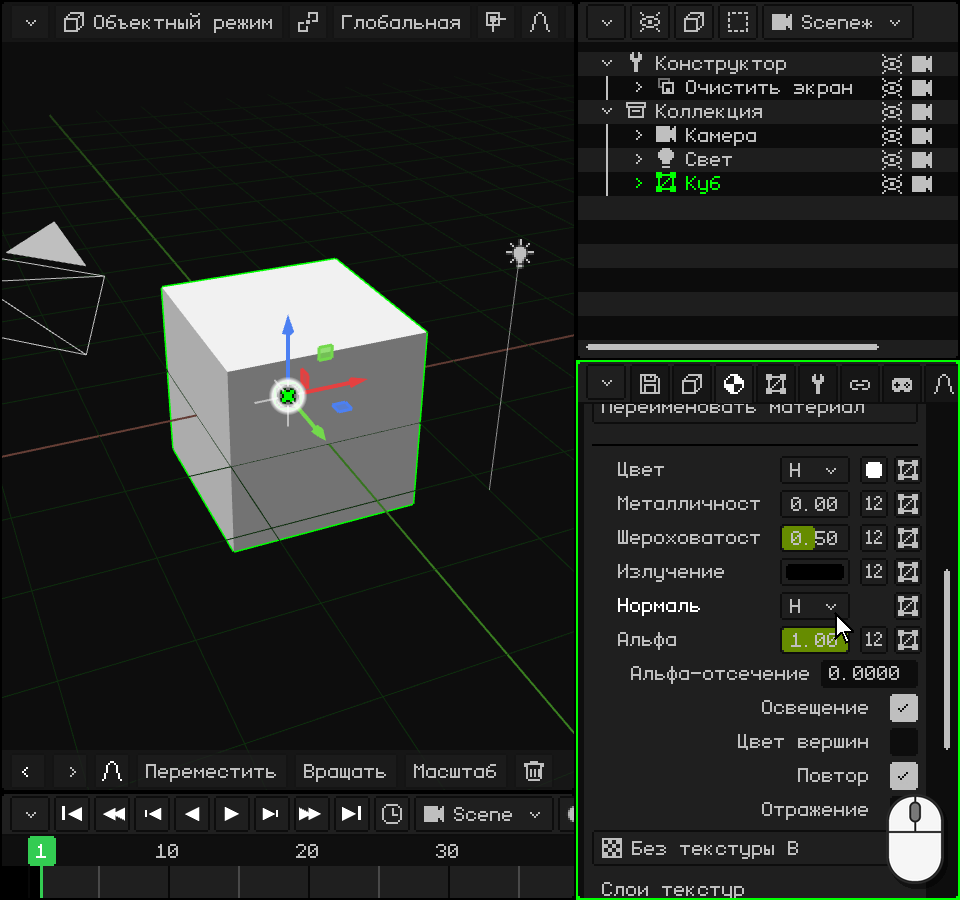

## Текст

**Текстовое поле** хранит имя или путь, как **Имя** объекта в конце карточки Трансформация. Когда поле активируется, в конце текста появляется курсор. Новое имя видно и в Аутлайнере.

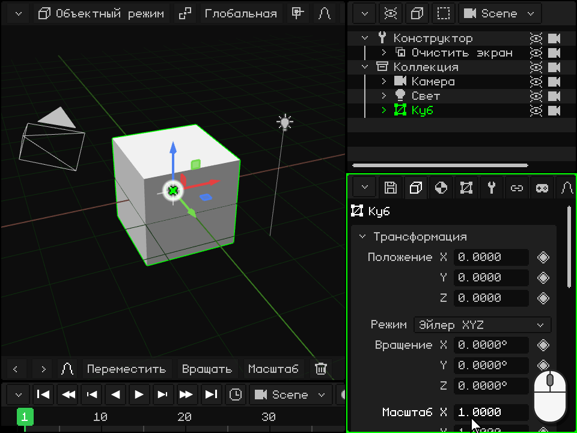

-  **На ПК:** клик по полю, и печатай. <kbd>Enter</kbd> (или клик в другом месте) подтверждает, а <kbd>Esc</kbd> возвращает прежний текст.
-  **На сенсорном экране:** касание открывает клавиатуру Whisk3D с буквой ñ. **Aa** переключает на заглавные, **123** — на цифры и символы, **DEL** стирает, а **OK** подтверждает. В веб-версии открывается клавиатура телефона.
-  **На Nokia N95:** <kbd>OK</kbd>, и пиши клавиатурой телефона, как SMS: каждая клавиша даёт свои буквы при нескольких нажатиях. <kbd>#</kbd> переключает между Abc, abc и ABC, а если её удерживать, включает 123 (строка меню Свойств показывает режим). <kbd>0</kbd> — это пробел, <kbd>1</kbd> — знаки препинания, а <kbd>\*</kbd> открывает другие символы. <kbd>C</kbd> стирает, **влево** и **вправо** двигают курсор, <kbd>OK</kbd> подтверждает, а **левая софт-клавиша** отменяет.

## Цвета

Строка **цвета** показывает справа квадратик с цветом, как **Диффузный**, **Фоновый** и **Зеркальный** в карточке источника света. Если её активировать, открывается **окно выбора цвета**:

- **круг** выбирает тон и насыщенность, а полоса рядом — значение (насколько цвет светлый);
- вкладки **RGB**, **HSV** и **Hex** показывают цвет числами: Красный, Зелёный и Синий; Тон, Насыщенность и Значение; или шестнадцатеричный код (`#FF8800`), с кнопками Копировать и Вставить;
- **Альфа** — это прозрачность;
- **OK** оставляет цвет, а **Отмена** возвращает прежний.

Цвет меняется, пока ты его двигаешь, поэтому его видно в сцене ещё до подтверждения. Клик или касание за пределами окна тоже закрывает его и оставляет цвет.

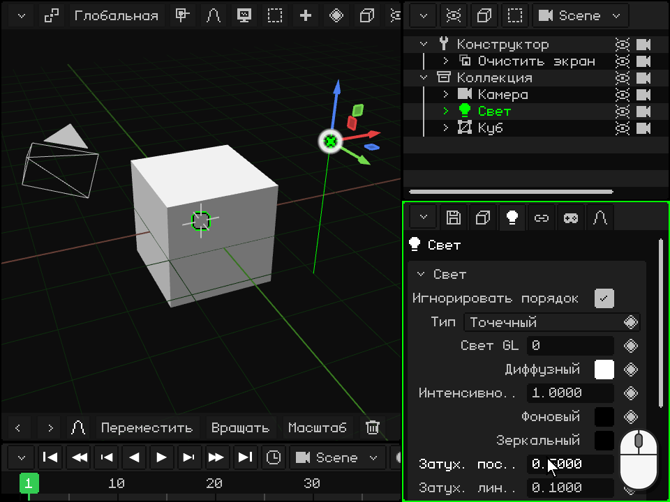

  Мышью или пальцем тяни внутри круга и полосы, а числа перетаскивай вбок, как в Свойствах.

 На Nokia N95 **вверх** и **вниз** переходят по кругу, полосе, вкладкам, строкам с числами и OK / Отмена. На строке с числом **влево** и **вправо** меняют его (если удерживать — всё быстрее). На круге <kbd>OK</kbd> включает его редактирование: **влево** и **вправо** вращают тон, **вверх** и **вниз** меняют насыщенность, а <kbd>OK</kbd> выходит. Полоса редактируется так же, стрелками вверх и вниз. <kbd>C</kbd> закрывает окно и возвращает прежний цвет.

## Списки

В некоторых карточках есть **список**: модификаторы меша, его части, его UV-развёртки. Выбранный элемент отмечен, а то, что под списком, показывает его данные или действует на него. Под списком есть ряды **кнопок**.

**Поднять** и **Опустить** меняют место выбранного элемента. Порядок важен: модификаторы применяются сверху вниз, а части меша рисуются в этом порядке. Эти две кнопки появляются, когда в списке два элемента или больше.

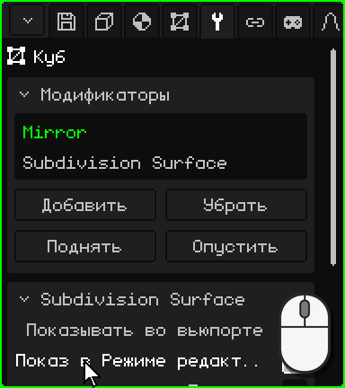

| | Как пользоваться списком |
|---|---|
|  ПК | Клик выбирает. Если помещаются не все, крути колесо над списком. |
|  Сенсорный экран | Касание выбирает. Если помещаются не все, веди пальцем по списку вверх или вниз. |
|  Nokia N95 | <kbd>OK</kbd> на списке, **вверх** и **вниз** выбирают, а <kbd>OK</kbd> выходит. В ряду кнопок **влево** и **вправо** переходят от кнопки к кнопке (рамка показывает, на какой ты), а <kbd>OK</kbd> нажимает её. |

## Ромб: анимировать свойство

Справа от свойств, которые можно анимировать, есть **ромб**; те, у кого его нет, не анимируются. Клик или касание ромба ставит **ключевой кадр**: он сохраняет значение этого свойства в текущем кадре Таймлайна. Если поставить ключевые кадры в разных кадрах, свойство само меняется при воспроизведении анимации.

Цвет ромба показывает, что со свойством **в текущем кадре**:

| Ромб | Что это значит | Что делает клик |
|---|---|---|
| Серый | Свойство не анимировано. | Ставит первый ключевой кадр с текущим значением. |
| Бледно-зелёный | Свойство анимировано, но в этом кадре ключевого кадра нет. | Ставит ключевой кадр с текущим значением. |
| Зелёный | В этом кадре есть ключевой кадр. | Убирает его. |

Изменение значения не меняет цвет ромба: новое значение не попадает в анимацию, пока ты не поставишь ключевой кадр, а если перейти на другой кадр раньше, свойство вернётся к тому, что задаёт анимация. В кадре, где ключевой кадр уже есть (зелёный ромб), новое значение сохраняется двумя кликами: первый убирает ключевой кадр, а второй ставит его заново с текущим значением.

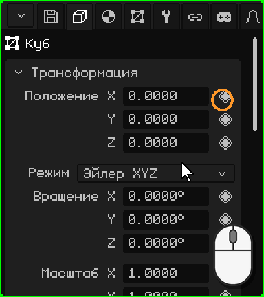

 На Nokia N95, когда ты на строке, стрелка **вправо** переходит на ромб (его отмечает белая рамка), <kbd>OK</kbd> ставит или убирает ключевой кадр, а **влево** возвращает к значению.

На вкладке Анимация карточка **Активная камера** выбирает, какая камера главная в каждый момент анимации: это монтажные склейки сцены. У её ромба есть ещё один цвет, **более светлый зелёный**: выбранная камера не та, что задаёт анимация в этом кадре, — это изменение ещё не сохранено. Клик сохраняет склейку в текущем кадре.

Анимации будет посвящён отдельный урок дальше.

Все вкладки и их карточки описаны в руководстве: [Свойства](propiedades.md). Вернуться к разделу [Вьюпорты](interfaz.md).

## Что есть на каждой вкладке

| Вкладка | Что в ней |
|---|---|
| Файл / Рендер (дискета) | **Файл**: открыть, сохранить, сохранить как, сохранить версию, извлечь ресурсы. **Рендер**: путь, размер, дополнительные проходы, фон, **Трассировка лучей** (лучи, сэмплы, проходы), Рендер изображения и Рендер анимации. **Игра**: платформа (Windows, Symbian, Linux .deb, AppImage, WebGL, Android, Android 2.3), окно, ориентация, иконка, физика, звук, громкость, **разрешение** (процент экрана, в котором рисует игра: на Android 2.3 система растягивает изображение, и на этих телефонах чем меньше пикселей рисуется, тем больше кадров в секунду) и Собрать игру (если телефон подключён по adb, игра устанавливается на него и запускается). **Экспорт**: OBJ, glTF, GLB, STL (только треугольники, для 3D-печати или передачи в CAD-программу). **Настройки**: язык, сглаживание, графика, скин, логи, масштаб, **Сочетания клавиш…** и Сохранить изменения. |
| Объект | Положение, вращение (Эйлер, кватернион или ось-угол), масштаб, имя, видимость, рендер; анимации и палитра объекта. |
| Контекстная | Зависит от типа: части меша и **материал** (текстура, освещение, цвет вершин, прозрачность, отражения, карта нормалей, смешивание, глубина, слои текстур, **Дополнительно: свой шейдер** — см. [Свои шейдеры](shaders.md); Шероховатость, Металличность, Пропускание и IOR при трассировке лучей), свет, камера, туман, частицы, физика, хитбокс, скелет и кости, 2D-элементы, префабы, процедуры. |
| 3D-меш | Используемый меш (и сколько объектов его разделяют), UV-развёртки, цветовые слои, группы вершин, UV-группы. Если в Библиотеке выбран ресурс: его данные и расположение (внутри или снаружи .w3d). |
| Модификаторы | См. [Модификаторы](objeto-malla.md#вкладка-модификаторы). |
| Трансформация | Только в Режиме редактирования: центр выделения и его UV, доступные для редактирования. |
| Арматура 2D | 2D-скелеты и кости меша. |
| Ограничители | Копировать положение, Копировать вращение, Билборд (смотреть на камеру), Дочерний объект. |
| Скрипты | Lua-скрипты объекта и их свойства (см. [документ по Lua](../lua/README.md)). |
| Анимация | Активная анимация, слои смешивания (Микс), точные значения выбранного ключевого кадра и переключения камер. |

## Процедуры

Процедура — это список шагов отрисовки (перенести, повернуть, задать текстуру, нарисовать меш, вызвать другую процедуру, Вызвать Lua…), который собирается в Свойствах. Это самый быстрый способ рисовать на N95.

| Функция | Описание | Сочетание |
|---|---|---|
| Добавить / убрать шаг | Добавляет шаги, сгруппированные по темам, или убирает выбранный. | Кнопки; <kbd>X</kbd> или <kbd>Delete</kbd> убирает |
| Захватить шаг | Перемещает шаг стрелками; <kbd>Enter</kbd> подтверждает. | <kbd>G</kbd> |
| Вставить ключевой кадр | Анимирует значения шага в текущем кадре. | <kbd>I</kbd> |
| Повтор | Сколько раз подряд выполняется список (цикл процедуры). 1 = обычная процедура. | Поле Повтор |
| Режим рендера / Использует | Отдельный список для каждого режима затенения или один и тот же для всех. | Выпадающие списки |
