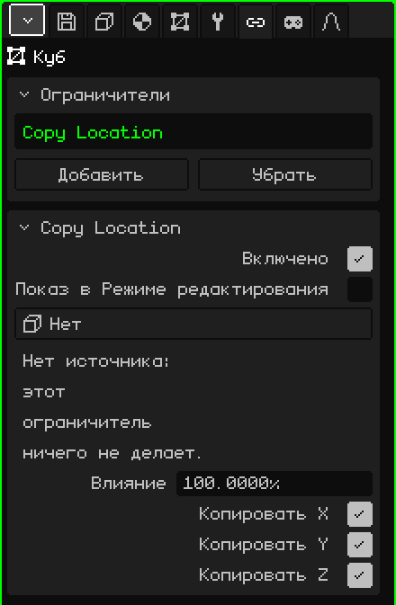
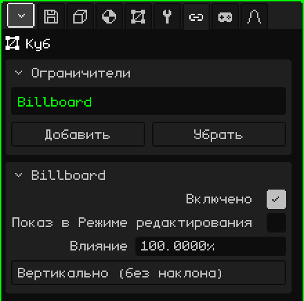
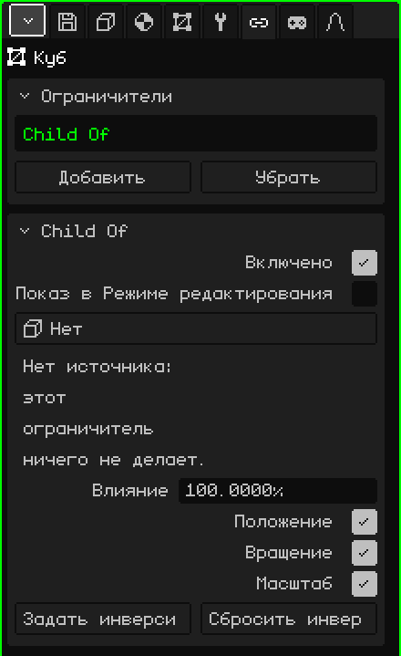

# Ограничители

**Ограничитель** (по-английски *constraint*) заставляет объект брать что-то у другого: его положение, его вращение, всегда смотреть на камеру или следовать за ним, как если бы объект был его потомком. Он нужен, чтобы вещи сами вставали на место, без ручной анимации: тень, которая идёт под персонажем, плоское дерево, всегда обращённое лицом к зрителю, меч, прикреплённый к руке. Эта статья объясняет каждый ограничитель и все его параметры; как добавлять и перемещать объекты, рассказано в уроке [Объектный режим](../tutoriales/modo-objeto.md).

## Где они находятся

В Свойства → вкладка **Ограничители**. Она есть у любого 3D-объекта: мешей, камер, источников света, арматур, звуков, пустышек. У 2D-элементов интерфейса её нет.

Прежде чем разбирать каждый из них, три вещи, которые верны для всех:

- **Они не меняют числа объекта.** Ограничитель применяется поверх, при отрисовке. Карточка Трансформация во вкладке Объект по-прежнему показывает собственные положение и вращение объекта, и если ограничитель выключить или удалить, объект возвращается точно туда.
- **Они вычисляются для каждого вида.** Те, что зависят от камеры (Billboard или источник **Вид**), используют камеру, которая рисует: если открыты два 3D-вьюпорта, каждый видит результат со своей точки обзора. В игре — активную камеру.
- **Они везде работают одинаково:** в редакторе, в скомпилированной игре, на Android и на Nokia N95.

## Карточка Ограничители

| Свойство | Что делает |
|---|---|
| Список | Ограничители объекта. Выбранный — тот, что показывает карточка ниже. |
| Добавить | Меню с четырьмя типами: **Copy Location**, **Copy Rotation**, **Billboard** и **Child Of**. |
| Убрать | Удаляет выбранный ограничитель. |
| Поднять / Опустить | Меняют порядок (появляются, когда ограничителей два или больше). |

**Порядок** важен: ограничители применяются сверху вниз, и каждый работает с тем, что оставили стоящие выше. Если два из них влияют на одно и то же, побеждает нижний.

## Общее для всех

Ниже появляется карточка выбранного ограничителя с его именем в заголовке. Эти три строки есть во всех типах:

| Свойство | Что делает |
|---|---|
| Включено | Включает или выключает ограничитель, не удаляя его. Удобно, чтобы сравнить, как всё выглядит с ним и без него. |
| Показ в Режиме редактирования | Если выключено (по умолчанию), пока редактируются вершины объекта, ограничитель не применяется: меш виден и редактируется там, где он на самом деле находится. Если включено, ограничитель применяется и в Режиме редактирования. |
| Влияние | Насколько он действует, от 0 до 100 %. При 100 применяется полностью; при 0 ничего не делает; в промежутке объект оказывается между тем местом, где был бы сам по себе, и тем, куда его ведёт ограничитель (при 50 — на полпути). |

**Показ в Режиме редактирования** выключен по умолчанию намеренно: редактировать дерево, которое поворачивается вслед за камерой, или меш, который убегает в другое место, очень неудобно.

## Copy Location

**Копирует положение** другого объекта: объект встаёт точно туда, где находится источник, по выбранным осям.

| Свойство | Что делает |
|---|---|
| Источник | Откуда копировать. **Нет**, **Вид** (камера, которая рисует) или любой объект сцены, кроме самого объекта и тех, что от него зависят. |
| Копировать X, Копировать Y, Копировать Z | Какие оси копируются. Оси те же, что в карточке Трансформация: Z — это высота. Ось без флажка сохраняет собственное значение объекта. |

Положение копируется как есть, без отступа: с тремя осями объект оказывается прямо на источнике. Чтобы он был смещён, сними флажок с той оси, по которой он не должен следовать, или сдвинь меш в Режиме редактирования (чтобы следовать за чем-то, сохраняя расстояние, см. [Child Of](#child-of)).

Предупреждения карточки:

- «Нет источника: этот ограничитель ничего не делает.» Появляется, когда источник стоит на «Нет», а также если удалить объект-источник: кнопка сама переключается на «Нет».
- «Нет осей: этот ограничитель ничего не делает.» Появляется, когда сняты флажки со всех трёх осей.

**Примеры:**

- **Круглая тень под персонажем:** плоскость с тёмным пятном, с установленными флажками «Копировать X» и «Копировать Y» и снятым «Копировать Z». Она следует под персонажем по всему полу, а когда он прыгает, тень остаётся на земле.
- **Небо, до которого не дойти:** большая сфера с нарисованным небом и источником **Вид**. Небо всегда центрировано на камере, поэтому сколько ни иди, до края не дойдёшь.
- **Свет, который сопровождает персонажа:** источник света с персонажем в поле «Источник» и только «Копировать X» и «Копировать Y». Он следует за персонажем сверху, оставаясь на своей собственной высоте.

## Copy Rotation

**Копирует вращение** другого объекта: объект поворачивается так же, как источник, не сходя с места.

| Свойство | Что делает |
|---|---|
| Источник | Откуда копировать: **Нет**, **Вид** (камера, которая рисует) или объект сцены, кроме самого объекта и тех, что от него зависят. |
| Копировать X, Копировать Y, Копировать Z | Какие повороты копируются, по тем же осям, что и вращение в карточке Трансформация. С тремя осями объект получает в точности ту же ориентацию, что и источник; с одной или двумя копируются только эти углы, а остальные остаются собственными. |

У него те же предупреждения, что и у Copy Location («Нет источника…» и «Нет осей…»). При промежуточном влиянии поворот всегда идёт по кратчайшему пути.

**Примеры:**

- **Потолочные вентиляторы в баре:** анимируется вращение лопастей только одного вентилятора, а лопасти остальных копируют его вращение. Так как все висят прямо, достаточно установить флажки на всех трёх осях. Чтобы изменить скорость всех, меняется анимация одного.
- **Что-то, прикреплённое к экрану, в игре от первого лица** (руки и оружие, кабина корабля): два ограничителя на одном объекте, Copy Location и Copy Rotation, оба с источником **Вид**. Объект движется туда же, куда камера, и поворачивается вместе с ней. Меш сдвигается в Режиме редактирования, чтобы он оказался впереди, внизу и справа.

## Billboard

Заставляет объект **поворачиваться лицом к камере**: он сам разворачивается так, чтобы быть обращённым к экрану. Источника у него нет: это всегда камера, которая рисует.

| Свойство | Что делает |
|---|---|
| Режим | **Вертикально (без наклона)**: поворачивается только вбок, как человек, который оборачивается, и всегда остаётся прямым. **Смотреть на камеру**: кроме того, наклоняется, чтобы смотреть на камеру, когда она сверху или снизу. |

Билборд выравнивается по **плоскости** экрана, а не по точке, где находится камера: все билборды вида остаются параллельными экрану.

При влиянии 100 вращение определяет билборд, а вращение из карточки Трансформация не учитывается. Если плоскость оказывается повёрнутой ребром, её поворачивают в Режиме редактирования (поскольку «Показ в Режиме редактирования» по умолчанию выключен, там она видна без ограничителя).

Предупреждение карточки: «При влиянии от 0 до 100 билборд может развернуться на 180 градусов при пересечении камеры. Используйте 100%, чтобы этого избежать.» Так происходит из-за того, как билборд смешивается с поворачивающейся ориентацией: если этот разворот мешает, используй 100 %.

**Примеры:**

- **Дешёвые деревья:** плоскость с фотографией дерева (с прозрачностью) и режимом «Вертикально (без наклона)». С любой стороны она выглядит как целое дерево, и это всего одна плоскость: идеально, чтобы заполнить лес на Nokia N95.
- **Дым, искры, сияние лампы, солнце на фоне:** плоскость с текстурой и режимом «Смотреть на камеру», чтобы она была обращена к зрителю и при взгляде сверху.
- **Табличка с именем персонажа или полоска здоровья** над головой: «Смотреть на камеру» и привязка к персонажу как к родителю, чтобы она следовала за ним.

## Child Of

Заставляет объект вести себя как **потомок** другого объекта или **кости** арматуры, даже если в Аутлайнере он висит в другом месте. Он следует за ним, когда тот движется, вращается или масштабируется, как будто прикреплён к нему.

| Свойство | Что делает |
|---|---|
| Источник | Объект, который служит родителем: **Нет** или объект сцены, кроме самого объекта и тех, что от него зависят. Варианта «Вид» здесь нет. |
| Кость | Только если источник — арматура: кость, от которой зависит объект. **Нет** следует за всей арматурой. |
| Положение | Следует ли он за перемещениями источника. |
| Вращение | Поворачивается ли, когда поворачивается источник. |
| Масштаб | Увеличивается ли и уменьшается вместе с источником. |
| Задать инверсию | Оставляет объект там, где он был до ограничителя, и с этого момента заставляет его следовать за источником. |
| Сбросить инверсию | Снова измеряет положение объекта от источника: с положением 0, 0, 0 он оказывается точно на источнике (или в основании кости). |

Если источник удалить, появляется предупреждение «Нет источника: этот ограничитель ничего не делает.», как и у остальных.

### Задать или сбросить инверсию

При выборе источника объект прыгает: его положение начинает измеряться от источника. Есть два способа работы:

- **Сначала расположить, потом задать:** поставь объект туда, где он должен быть (например, меч в руку), выбери источник и кость и нажми **Задать инверсию**: объект возвращается туда, куда ты его поставил, и оттуда следует за источником.
- **Сбросить и ввести числа:** после **Сбросить инверсию** карточка Трансформация объекта показывает расстояние до источника. Удобно, когда известно точное число: положение 0, 0, 0 ставит объект точно на кость.

Ограничитель создаётся со сброшенной инверсией, поэтому объект и прыгает при выборе источника.

### Влияние в Child Of

При 0 решает настоящий родитель объекта (тот, что в Аутлайнере), а при 100 — источник. Поэтому меч может быть потомком персонажа в Аутлайнере (так он перемещается вместе с ним, когда персонажа переносят в другое место) и при этом иметь Child Of к руке: он следует за ней и не сдвигается дважды.

**Примеры:**

- **Оружие в руке Leon:** Child Of с арматурой Leon в качестве источника и костью правой руки в поле «Кость»; оружие подгоняется в руке, и нажимается «Задать инверсию». Для жёсткого объекта это гораздо легче, чем деформировать меш арматурой, и на Nokia N95 это заметно.
- **Шляпа или очки:** так же, с костью головы.
- **Камера, которая сопровождает, не поворачиваясь:** установлен только флажок «Положение». Камера движется с персонажем на том же расстоянии, но не разворачивается, когда он разворачивается.
- **Объект на движущейся платформе:** Child Of к платформе, с «Положение» и «Вращение», чтобы он ехал вместе с ней, не меняя своего места в Аутлайнере.

## Когда какой использовать

| Чтобы объект… | Ограничитель |
|---|---|
| перемещался туда, где находится другой объект или камера | Copy Location |
| поворачивался так же, как другой объект или камера | Copy Rotation |
| всегда был обращён лицом к камере | Billboard |
| следовал за другим объектом или костью, сохраняя расстояние | Child Of |

Если два объекта копируют друг друга (A копирует B, а B копирует A), Whisk3D разрывает круг, чтобы не зависнуть, и сообщает об этом в [Консоли](consola.md): один из двух остаётся со своим собственным положением. Решение — убрать один из двух ограничителей.
