# Строка меню 3D-вьюпорта

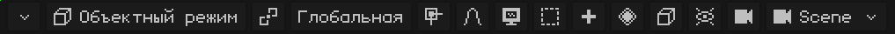

Если строка меню не помещается целиком, её можно прокручивать: см. [Когда видны не все пункты строки меню](interfaz.md#когда-видны-не-все-пункты-строки-меню).

## Режим

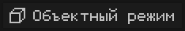 Показывает режим, в котором идёт работа; если нажать на неё, можно выбрать другой. Какие режимы появляются, зависит от активного объекта: у меша есть Режим редактирования и три режима рисования; у арматуры — Режим редактирования и Режим позы. С другим типом объекта (источником света, камерой) кнопка не появляется, потому что единственный режим — Объектный режим. Каждый режим объяснён в разделе [Режимы](vista-3d.md#режимы).

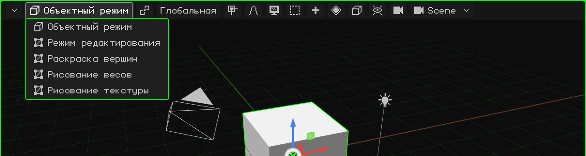

 <kbd>Tab</kbd> переключает из Объектного режима в Режим редактирования и обратно.  На N95 — <kbd>OK</kbd>.

Когда меш находится в **Режиме редактирования**, рядом появляется кнопка **Вершина / Ребро / Грань**: что выделяется кликом (см. [Режим редактирования](modo-edicion.md)).

## Опорная точка

 **Опорная точка** — это место, от которого происходит трансформация: вокруг чего вращается и от чего масштабируется выделенное. Значок кнопки меняется в зависимости от выбранной опорной точки, так что с первого взгляда видно, какая установлена.

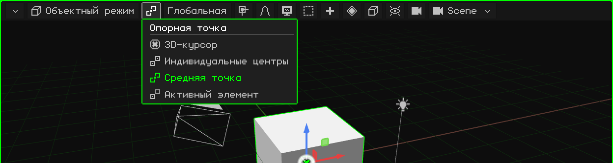

| Опорная точка | Откуда идут вращение и масштабирование |
|---|---|
|  **3D-курсор** | От 3D-курсора. Удобно, чтобы вращать вещи вокруг любой точки: ставишь туда курсор (через [меню Привязка](#привязка)) и вращаешь. |
|  **Индивидуальные центры** | Каждый объект от своего центра: все вращаются одновременно, каждый на своём месте. |
|  **Средняя точка** | От центра всего выделенного. Используется по умолчанию. |
|  **Активный элемент** | От центра активного объекта (выбранного последним): остальные вращаются вокруг него. |

Пример каждого варианта, на видео, есть в уроке [Объектный режим](../tutoriales/modo-objeto.md#опорная-точка).

## Ориентация

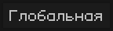 Оси, которые используются при перемещении, вращении или масштабировании по оси (с помощью <kbd>X</kbd>, <kbd>Y</kbd>, <kbd>Z</kbd>, гизмо или клавиш N95). Кнопка показывает выбранную ориентацию.

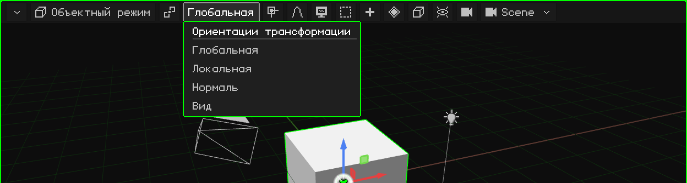

| Ориентация | Оси |
|---|---|
| **Глобальная** | Оси мира: всегда одинаковые, Z направлена вверх. Используется по умолчанию. |
| **Локальная** | Оси самого объекта: поворачиваются вместе с ним. Повёрнутая машина едет вдоль своей Локальной оси. |
| **Нормаль** | В Режиме редактирования: направление, куда смотрит выбранная грань (его использует Выдавить). |
| **Вид** | Оси экрана: X вбок, Y вверх. |

 Во время трансформации второе нажатие буквы оси переключает с Глобальной на Локальную: <kbd>G</kbd> <kbd>Y</kbd> <kbd>Y</kbd>.

## Привязка

 Когда **привязка** включена, то, что перемещается, прилипает к чему-то: к вершинам, рёбрам или граням других объектов или к их центрам. Кнопка становится зелёной, когда привязка включена.

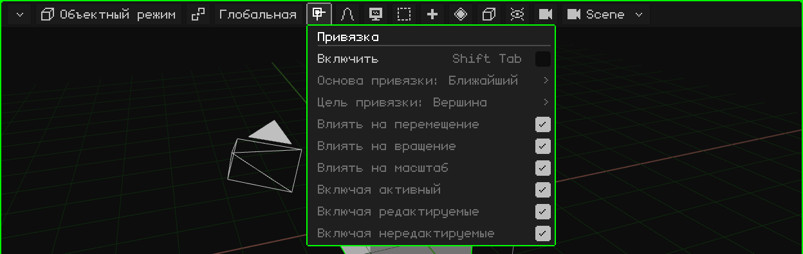

| Параметр | Что делает | Сочетание |
|---|---|---|
| Включить | Включает или выключает привязку. | <kbd>Shift+Tab</kbd> |
| Основа привязки | Какая точка перемещаемого прилипает: ближайшая, центр, медиана или активная. | Меню |
| Цель привязки | К чему прилипает: вершина, ребро, грань, их центры. С Проекция на грань / Ближайшая грань вершины ложатся на другую поверхность (для ретопологии). | Меню |
| Влиять на перемещение / вращение / масштаб | В каких операциях действует. | Меню |
| Включая активный / редактируемые / нередактируемые | К каким объектам можно прилипать. | Меню |

**3D-курсор** перемещается другим меню, меню привязки курсора: <kbd>Shift</kbd> + <kbd>S</kbd> или меню Объект → Привязка (Курсор к выделенному, Выделение к курсору...). Это объяснено в уроке [Объектный режим](../tutoriales/modo-objeto.md#3d-курсор).

## Пропорциональное редактирование

 При **пропорциональном редактировании**, когда ты перемещаешь, вращаешь или масштабируешь что-то, то, что рядом, плавно следует за ним: тем сильнее, чем ближе. Это нужно, чтобы моделировать органические формы (рельеф, лицо), не двигая вершину за вершиной. Кнопка становится зелёной, когда оно включено.

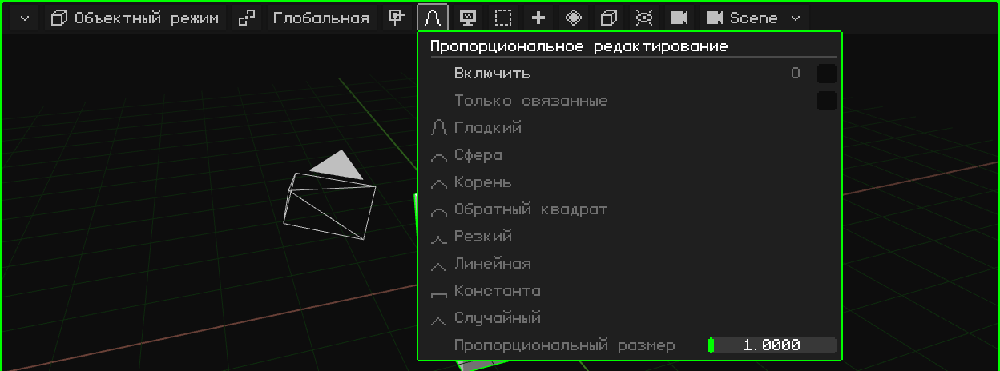

| Параметр | Что делает | Сочетание |
|---|---|---|
| Включить | Включает или выключает пропорциональное редактирование. | <kbd>O</kbd> |
| Только связанные | Измеряет расстояние по рёбрам: не тянет отдельные куски, даже если они рядом. | Меню |
| Спад | Как влияние распределяется с расстоянием: Гладкий, Сфера, Корень, Обратный квадрат, Резкий, Линейная, Константа или Случайный. | Меню |
| Пропорциональный размер | Радиус влияния. Во время трансформации меняется колесом или клавишами <kbd>PageUp</kbd> / <kbd>PageDown</kbd>. | Меню / колесо |

## Вид

 Всё, что касается **навигации**: откуда смотреть на сцену. Каждый пункт, с видео, описан в уроке [Навигация в 3D-вьюпорте](../tutoriales/navegacion.md).

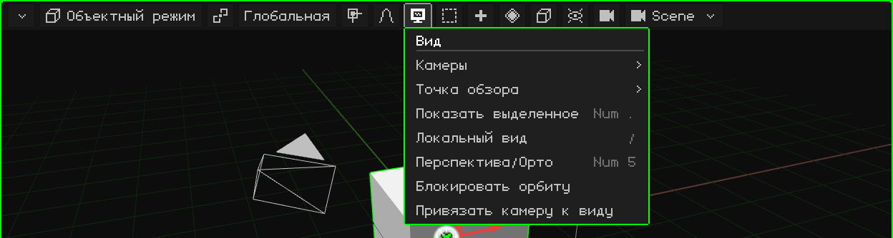

| Параметр | Что делает |  Сочетание |
|---|---|---|
| Камеры | Смотреть через активную камеру или сделать выбранный объект активной камерой. | <kbd>Num 0</kbd> / <kbd>Ctrl+Num 0</kbd> |
| Точка обзора | Спереди, Сзади, Справа, Слева, Сверху, Снизу. | <kbd>Num 1</kbd>, <kbd>Num 3</kbd>, <kbd>Num 7</kbd> (с <kbd>Ctrl</kbd> — противоположный вид) |
| Показать выделенное | Центрирует вид на выделенном и приближает его так, чтобы оно ровно поместилось. | <kbd>Num .</kbd> |
| Локальный вид | Оставляет на виду только выделенное, и обратно. | <kbd>/</kbd> |
| Перспектива/Орто | Переключает с перспективы на ортографическую проекцию и обратно. | <kbd>Num 5</kbd> |
| Блокировать орбиту | То, что вращало вид по орбите, начинает его сдвигать. | — |
| Привязать камеру к виду | При взгляде через камеру навигация двигает камеру. | — |

## Выделить

 Выделить разом всё, ничего, противоположное текущему выделению или то, что попадает внутрь рамки.

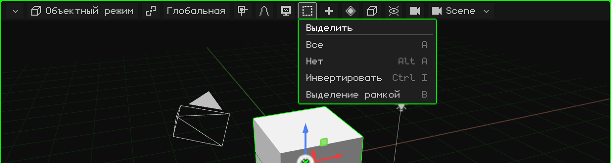

| Параметр | Что делает | Сочетание |
|---|---|---|
| Все | Выделяет всё. | <kbd>A</kbd> |
| Нет | Снимает выделение со всего. | <kbd>Alt+A</kbd> |
| Инвертировать | Выделенное перестаёт быть выделенным, и наоборот. | <kbd>Ctrl+I</kbd> |
| Выделение рамкой | Рамка, которую протягиваешь: слева направо (зелёная) выделяет только то, что целиком внутри; справа налево (синяя) достаточно задеть. <kbd>Shift</kbd> добавляет к выделению. | <kbd>B</kbd> или протягивание по фону |

В Режиме редактирования добавляются Выделить связанное, петли и пути (см. [Режим редактирования](modo-edicion.md)).

## Добавить

 Создаёт новые объекты, которые появляются в 3D-курсоре и остаются выделенными. Есть только в Объектном режиме.

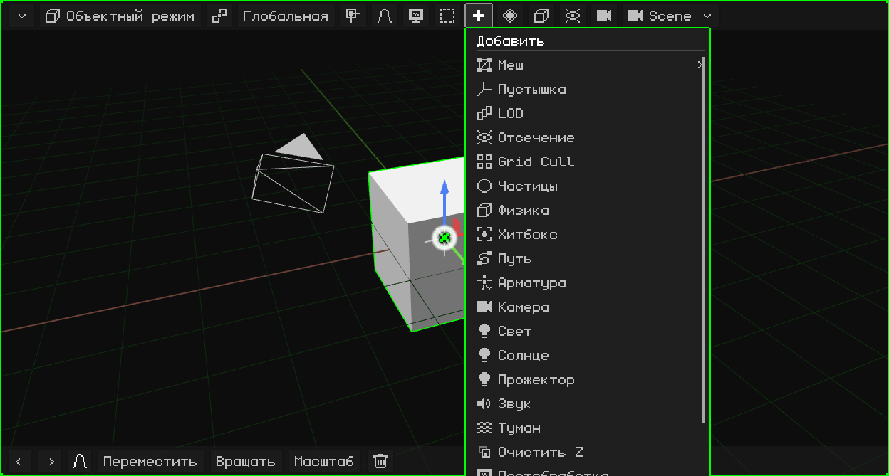

Каждый тип описан в разделе [Объектный режим → Меню Добавить](modo-objeto.md#меню-добавить).  <kbd>Shift</kbd> + <kbd>A</kbd> открывает его там, где находится мышь.

В Режиме редактирования вместо него появляются **Меш** (операции моделирования, см. [Режим редактирования](modo-edicion.md)) и **UV** (развёртка и проецирование UV, см. [UV-редактор](editor-uv.md)). В режиме Рисование текстуры появляется **дискета**, которая сохраняет нарисованную текстуру; она становится зелёной, когда есть несохранённый рисунок.

## Анимация

 **Ключевые кадры** выделенного: сохранить значение положения, вращения или масштаба в текущем кадре, чтобы анимация шла от одного ключевого кадра к другому. Кнопка появляется, когда что-то выделено, в Объектном режиме и в Режиме позы, а её пункты зависят от выделенного.

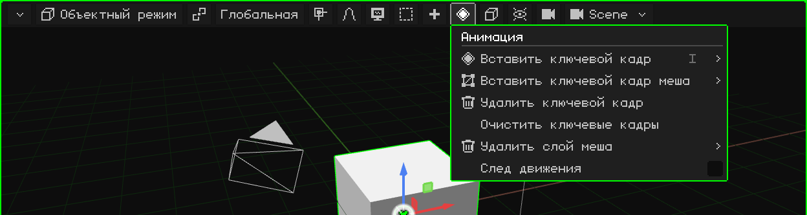

| Параметр | Что делает | Сочетание |
|---|---|---|
| Вставить ключевой кадр | Меню, в котором выбирается, что сохранить: положение, вращение, масштаб или всё. | <kbd>I</kbd> (<kbd>Shift+I</kbd>: всё без вопросов) |
| Вставить ключевой кадр меша | Только для 3D-меша: выбирает, что сохранить из анимации меша — вершины, нормали или UV. | Меню |
| Удалить ключевой кадр | Удаляет ключевой кадр в текущем кадре. | Меню |
| Очистить ключевые кадры | Удаляет всю анимацию выделенного. | Меню |
| Удалить слой меша | Только для 3D-меша: целиком удаляет слой анимации меша — слой **вершин**, **нормалей** (например, у модели без освещения) или **UV**. Хотя бы один ключевой кадр всегда остаётся. | Меню |
| След движения | Рисует во вьюпорте путь, который проходят анимированные объекты. | Меню |

### В Режиме позы

Когда ты ставишь арматуру в позу, меню работает с ключевыми кадрами выделенных костей (и активной):

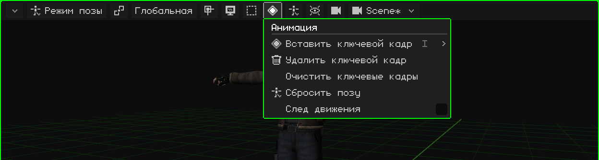

| Параметр | Что делает | Сочетание |
|---|---|---|
| Вставить ключевой кадр | Сохраняет позу выделенных костей в текущем кадре: положение, вращение, масштаб или всё. | <kbd>I</kbd> |
| Удалить ключевой кадр | Удаляет ключевой кадр этих костей в текущем кадре. Отменяется через <kbd>Ctrl+Z</kbd>. | Меню |
| Очистить ключевые кадры | Удаляет все ключевые кадры этих костей в активной анимации. Отменяется через <kbd>Ctrl+Z</kbd>. | Меню |
| Сбросить позу | Выделенные кости (или все, если ни одна не выделена) возвращаются к положению, вращению и масштабу, которые у них в Режиме редактирования. Отменяется через <kbd>Ctrl+Z</kbd>. | Меню |
| След движения | Рисует во вьюпорте путь, который проходят анимированные объекты. | Меню |

У анимации есть свой урок и своя глава, [Таймлайн](linea-de-tiempo.md).

## Объект

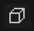 То, что можно сделать с выделенным. Это то же меню, что открывается правым кликом во вьюпорте (или, на сенсорном экране, если задержать палец неподвижно). Кнопка появляется, когда что-то выделено.

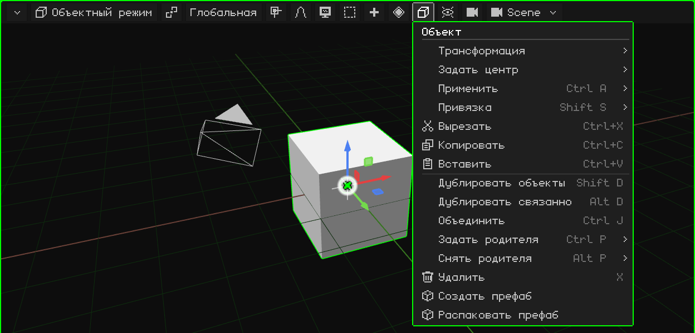

Каждый пункт описан в разделе [Объектный режим](modo-objeto.md). В Режиме редактирования эта кнопка становится меню того, что выделяется (Вершина, Ребро или Грань); в Режиме позы — меню Поза; при редактировании арматуры — меню Арматура.

## Наложения

 **Наложения** — это вспомогательные элементы, которые рисуются поверх сцены для работы и не попадают в рендер: пол, оси, гизмо, 3D-курсор. Здесь они включаются и выключаются, все вместе или по одному.

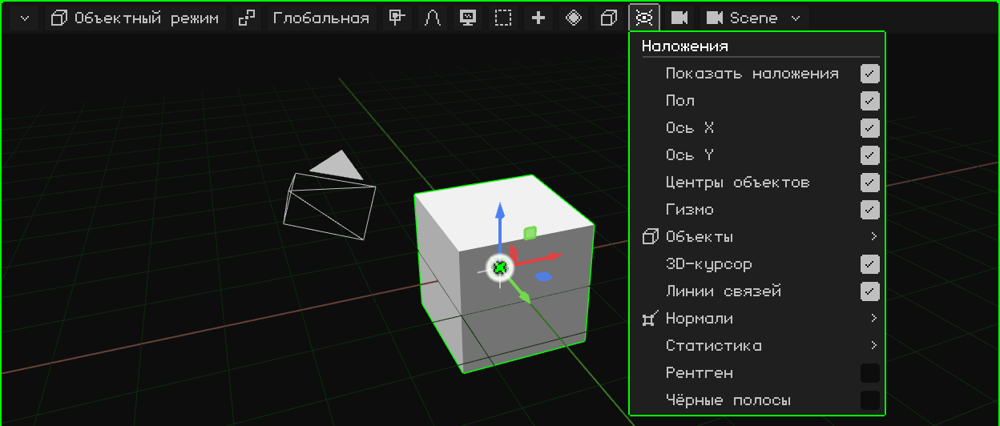

| Параметр | Что делает | Сочетание |
|---|---|---|
| Показать наложения | Включает или выключает все подсказки сразу. | <kbd>K</kbd> |
| Пол, Ось X, Ось Y, Центры объектов, 3D-курсор, Линии связей | Каждая подсказка по отдельности. Линии связей соединяют каждого потомка с его родителем. | Меню |
| Гизмо | Гизмо перемещения, вращения и масштабирования. На Nokia N95 по умолчанию выключено. | Меню |
| Объекты | Какие типы объектов рисуются: арматуры, источники света, камеры, пустышки, частицы, кривые, хитбоксы. | Меню |
| Нормали | Рисует нормали вершин или граней, с настройкой их размера. | Меню |
| Статистика | Кадры в секунду, вершины, грани, вызовы отрисовки и время. | Меню |
| Рентген | В Режиме редактирования меш становится полупрозрачным, и можно выбирать элементы сзади. | Меню |
| Чёрные полосы | При взгляде через камеру с другими пропорциями, чем у экрана, закрывает то, что выходит за кадр. | Меню |

## Рендер

 **Режим затенения**: как сцена рисуется во вьюпорте. Он не меняет проект, только то, как он выглядит, пока ты работаешь.

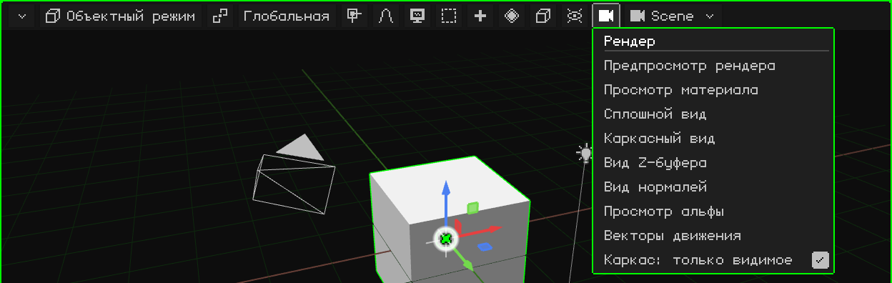

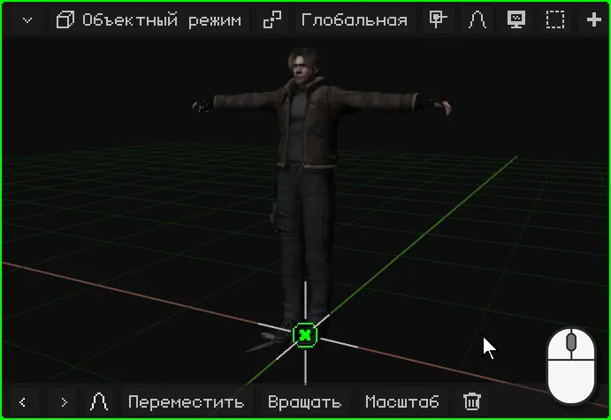

| Режим | Как выглядит |
|---|---|
| Предпросмотр рендера | Со светом сцены. Если включена трассировка лучей, показывает трассированное изображение, которое уточняется постепенно. |
| Просмотр материала | Режим по умолчанию: материалы и текстуры с нейтральным светом со стороны вида, не зависящим от источников света сцены. |
| Сплошной вид | Всё серое, чтобы видеть форму. |
| Каркасный вид | Только рёбра. С **Каркас: только видимое** — только рёбра того, что обращено к зрителю. |
| Вид Z-буфера | Глубина: светлое близко, тёмное далеко. |
| Вид нормалей | Нормали в цвете. |
| Просмотр альфы | Прозрачность в чёрно-белом. |
| Векторы движения | Насколько каждый пиксель сдвинулся с прошлого кадра (красный = X, зелёный = Y). Это то же изображение, что и проход `_vectores` рендера. |

 <kbd>Z</kbd> переключает на следующий режим.  На N95 — <kbd>6</kbd>.

## Сцена

 Имя того, что редактируется: **сцены**, **игры** или **префаба** проекта. Если нажать на кнопку, можно выбрать другое, создать новое или преобразовать сцену в игру.

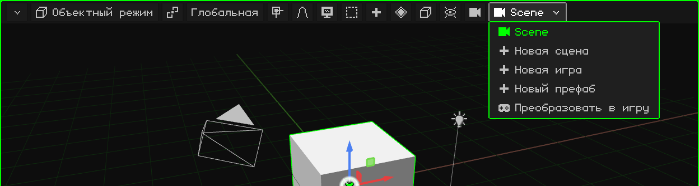

Сцены, игры и префабы описаны в разделе [Проект](proyecto.md).
