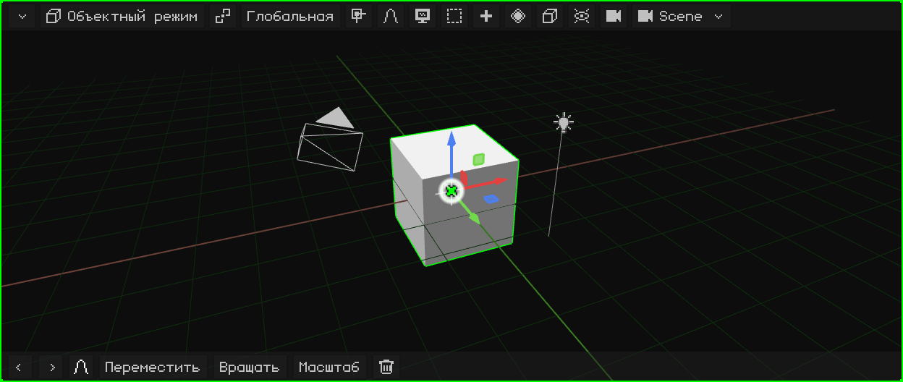
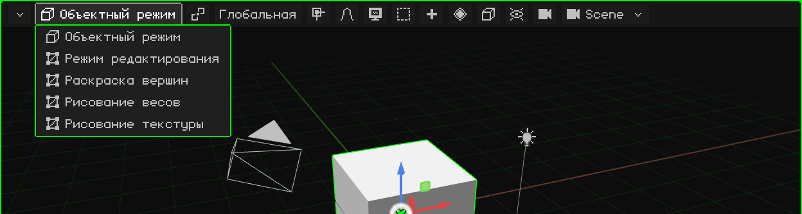
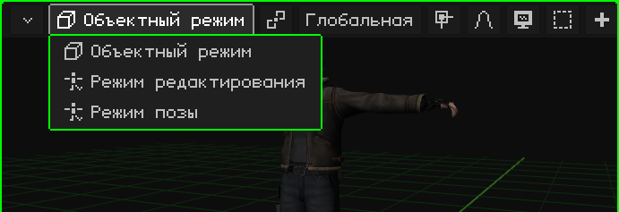
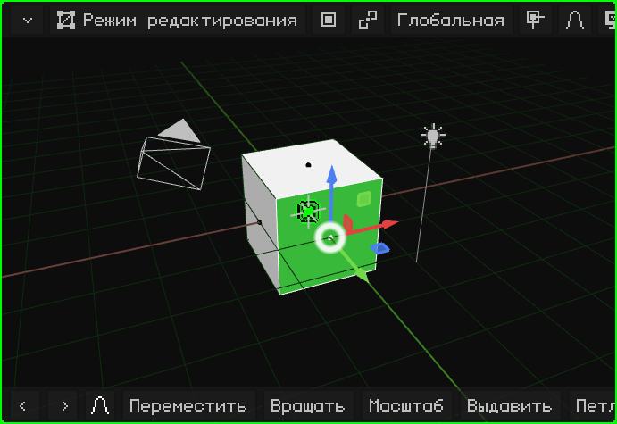
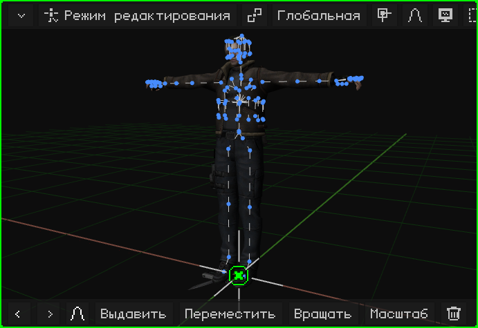
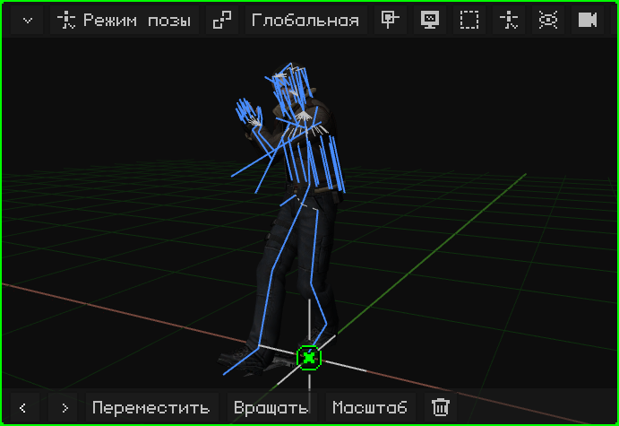
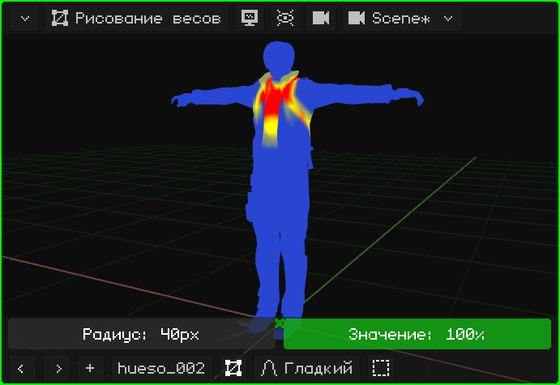
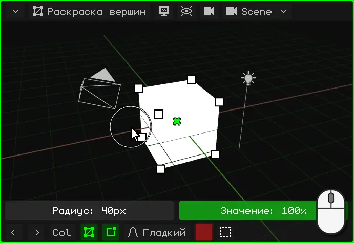
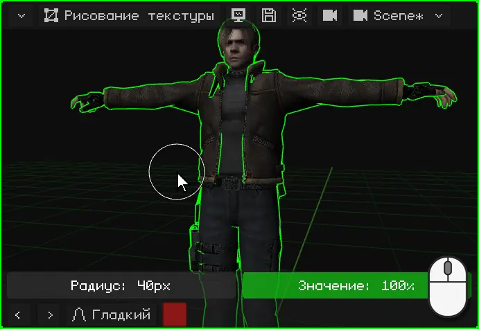
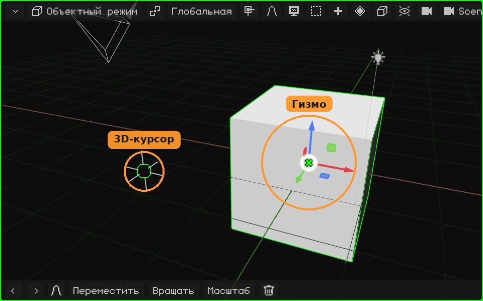

# 3D-вьюпорт

**3D-вьюпорт** — это вьюпорт, в котором сцена отображается и редактируется: здесь моделируют, перемещают объекты, рисуют, ставят позы и анимируют. Как у всех вьюпортов, сверху у него **строка меню**, а снизу — **панель инструментов**.

- **Строка меню**, кнопка за кнопкой, со всеми её меню: [Строка меню 3D-вьюпорта](vista-3d-barra.md).
- **Навигация** (орбита, сдвиг, зум, виды, камера): [Навигация в 3D-вьюпорте](navegacion.md) и урок [Навигация в 3D-вьюпорте](../tutoriales/navegacion.md).
- **Перемещение, вращение и масштабирование**, гизмо, опорная точка и ориентация: [Перемещение, вращение и масштабирование](transformar.md).

## Режимы

3D-вьюпорт работает в разных **режимах**: что делают клики, клавиши и меню, зависит от текущего режима. Режим выбирается первой кнопкой строки меню, которая показывает текущий режим, или клавишей <kbd>Tab</kbd> (Объектный режим ↔ Режим редактирования; на Nokia N95 — <kbd>OK</kbd>).

Какие режимы можно выбрать, зависит от **активного объекта**. **Объектный режим** есть у всех. У 3D-меша к нему добавляются Режим редактирования и три режима рисования; у скелета — Режим редактирования и Режим позы. С любым другим объектом (источником света, камерой, звуком) единственный режим — Объектный режим, и кнопка не появляется.

| Режим | У каких объектов есть | Для чего |
|---|---|---|
| [Объектный режим](modo-objeto.md) | У всех | Работать с целыми объектами: создавать, перемещать, вращать, масштабировать, дублировать, связывать с родителем и удалять их. |
| [Режим редактирования](modo-edicion.md) | 3D-меши и кривые | Моделировать: перемещать, добавлять и удалять вершины, рёбра и грани меша. |
| [Режим редактирования](esqueletos.md#режим-редактирования-скелета) | Скелеты | Собирать скелет: создавать кости и расставлять их в положении покоя. |
| [Режим позы](esqueletos.md#режим-позы) | Скелеты | Ставить кости в позы и сохранять позы: так анимируют персонажа. |
| [Рисование весов](pintura.md#рисование-весов) | 3D-меши | Рисовать, насколько каждая кость двигает каждую вершину. |
| [Раскраска вершин](pintura.md#раскраска-вершин) | 3D-меши | Рисовать цвета прямо по вершинам. |
| [Рисование текстуры](pintura.md#рисование-текстуры) | 3D-меши | Рисовать по текстуре прямо поверх объекта. |

### Объектный режим

Режим, в котором запускается Whisk3D, и единственный, который есть у всех объектов. Здесь работают с целыми объектами: их выделяют, перемещают, вращают, масштабируют, добавляют и удаляют. См. [Объектный режим](modo-objeto.md) и урок [Объектный режим](../tutoriales/modo-objeto.md).

### Режим редактирования меша

Моделируется **форма** меша: вершины, рёбра и грани. В строке меню появляются кнопка **Вершина / Ребро / Грань** (что выделяется кликом) и меню **Меш** и **UV**. Остальная сцена по-прежнему видна, но трогать её нельзя.

### Режим редактирования скелета

Собирается **скелет**: кости создаются (выдавливанием из конца другой кости), перемещаются и связываются с родителем. Это его положение **покоя** — то, в котором он находится, когда не анимирован.

### Режим позы

Скелет **ставят в позу**: кости вращают и перемещают, не меняя сам скелет, а меш следует за ними. Позы, сохранённые в разных кадрах, и есть анимация персонажа.

### Рисование весов

Рисуется, **насколько каждая кость двигает каждую часть меша**: красным — то, что выбранная кость двигает полностью, синим — то, что она не двигает. Благодаря этому, когда сгибается рука, сгибается именно рука, а не талия.

### Раскраска вершин

**Цвета рисуются по вершинам** меша, без текстуры. Это нужно, чтобы раскрашивать простые модели, рисовать тени вручную и для эффектов в шейдерах.

### Рисование текстуры

Рисуют **прямо по текстуре**, поверх объекта, как по кукле. Нарисованное сохраняется дискетой, которая появляется в строке меню.

В режимах рисования над панелью инструментов появляется строка кисти (**Радиус** и **Значение**). См. [Режимы рисования](pintura.md).

## Панель инструментов

Внизу 3D-вьюпорта находятся **Отменить** и **Повторить** (стрелки), **последние использованные команды** (в начале это Переместить, Вращать, Масштаб и Удалить; то, чем пользуешься, перемещается вперёд) и **пропорциональное редактирование**. Во время перемещения, вращения или масштабирования панель инструментов меняется: зелёная галочка подтверждает, красный крестик отменяет, рядом ориентация, а **X**, **Y** и **Z** ограничивают движение этими осями. См. [Перемещение, вращение и масштабирование](transformar.md#панель-инструментов).

 На сенсорном экране к ней добавляются **Shift** и **Ctrl**, которые остаются включёнными (зелёным) и работают как эти клавиши, и кнопка **Вид** (монитор), чтобы в Режиме редактирования и в режимах рисования палец перемещал вид, а не выделял и не рисовал.

 На Nokia N95 она скрыта, чтобы оставить экран сцене, и появляется, когда нужна: в режимах рисования — строка кисти (**Радиус** и **Значение**), а при перемещении, вращении или масштабировании с включённым пропорциональным редактированием — ползунок его радиуса. Её кнопки нажимаются **виртуальной мышью**: она включается правой клавишей выбора, стрелки её перемещают, а <kbd>OK</kbd> делает клик.

## Гизмо и 3D-курсор

- **Гизмо** — цветные стрелки над выделенным: за них берутся, чтобы перемещать, вращать и масштабировать. Клик по гизмо переключает его с одного режима на другой. См. [Гизмо](transformar.md#гизмо).
- **3D-курсор** — круг с крестиком: там появляется то, что добавляется через Добавить, и он может быть опорной точкой. См. [3D-курсор](../tutoriales/modo-objeto.md#3d-курсор).

 На Nokia N95 гизмо по умолчанию выключено: экран маленький, и там перемещают клавишами. Оно включается в **Наложения → Гизмо**, а берут его виртуальной мышью.
