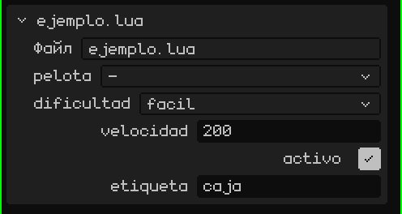
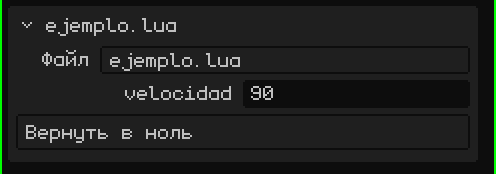

# Скрипт — это компонент объекта

В Whisk3D скрипт всегда принадлежит **объекту** сцены (мешу, пустому объекту, 2D-кнопке…). У объекта может быть несколько скриптов; каждый выполняется отдельно, со своими переменными, в том порядке, в котором они перечислены.

Внутри скрипта `yo()` возвращает объект-владелец. Чтобы использовать *другие* объекты, скрипт объявляет глобальную таблицу с именем `propiedades`. Редактор читает её и показывает по полю на каждую запись в карточке скрипта на панели Свойства:

```lua
propiedades = {
  pelota     = "objeto",                          -- поле для выбора объекта сцены
  dificultad = { "facil", "normal", "dificil" },  -- выпадающий список (первый вариант — по умолчанию)
  velocidad  = 200,                               -- собственное число каждого объекта, использующего скрипт
  activo     = true,                              -- да/нет
  etiqueta   = "caja",                            -- текст
}

function inicio()
  local p   = objeto("pelota")         -- объект, выбранный в поле "pelota"
  local dif = opcion("dificultad")     -- "facil", "normal" или "dificil"
  local v   = propiedad("velocidad")   -- 200 или то, что задано у этого объекта
end
```

> [!NOTE]
> Чтобы прочитать `propiedades`, редактор **выполняет файл**, даже когда игра не запущена. Поэтому вне функций размещай только объявления (таблицы, константы, `local`) и никогда — код, который что-то делает.

Вот как это выглядит в карточке скрипта на панели Свойства: по полю на каждое свойство, в том же порядке, что и в коде.



Так один и тот же скрипт подходит для многих объектов с разными значениями: поле `velocidad` у одного врага может быть 200, а у другого 350.

## Менять свойства в реальном времени

`propiedad("velocidad")` читает значение в текущий момент. Если изменить его на панели Свойства во время игры, скрипт увидит новое значение в следующем кадре, но только если снова прочитает его через `propiedad()`. Если ты сохранил его в переменную (`local v = propiedad("velocidad")` в `inicio()`), в переменной останется начальное значение.

```lua
function actualizar(dt)
  -- читается в каждом кадре: видит то, что ты меняешь на панели Свойства во время игры
  mover(yo(), propiedad("velocidad") * dt, 0, 0)
end
```

Читать `propiedad()` в каждом кадре медленнее, чем пользоваться переменной. Так работать во всей игре не стоит: используй это, пока подбираешь значения, а когда они готовы, сохрани их в переменные в `inicio()`.

## Кнопки

Если свойство — **функция**, в карточке появляется **кнопка**: нажатие на неё вызывает эту функцию. Чтобы на кнопке было написано не имя, а что-то другое, помести текст и функцию в таблицу:

```lua
propiedades = {
  velocidad = 90,
  cero = { "Вернуть в ноль", function()
    setRotacion(yo(), 0, 0, 0)
  end },
}
```



Во время игры функция выполняется в запущенном скрипте. Без игры скрипт загружается только ради этого вызова: так кнопка служит **дополнением редактора**, которое что-то делает со сценой. Например, с `seleccionados()` — объектами, выделенными в редакторе:

```lua
propiedades = {
  subir = { "Поднять выделенное", function()
    for _, o in ipairs(seleccionados()) do
      mover(o, 0, 0, 1)   -- на метр вверх
    end
  end },
}
```

> [!NOTE]
> То, что кнопка делает при остановленной игре, остаётся в сцене, как если бы ты сделал это вручную, и отменяется так же: <kbd>Ctrl</kbd> + <kbd>Z</kbd> отменяет за один раз всё, что сделала кнопка. Пока игра идёт, в историю ничего не записывается: когда ты нажимаешь **Стоп**, всё возвращается как было.

Скрипты не делят переменные между собой. Чтобы передавать друг другу данные (очки, выиграл ли игрок…), они используют общее пространство: `setCompartido("puntos", 10)` записывает, а `compartido("puntos")` читает. В нём хранятся числа, да/нет и строки, и оно очищается при остановке игры.
