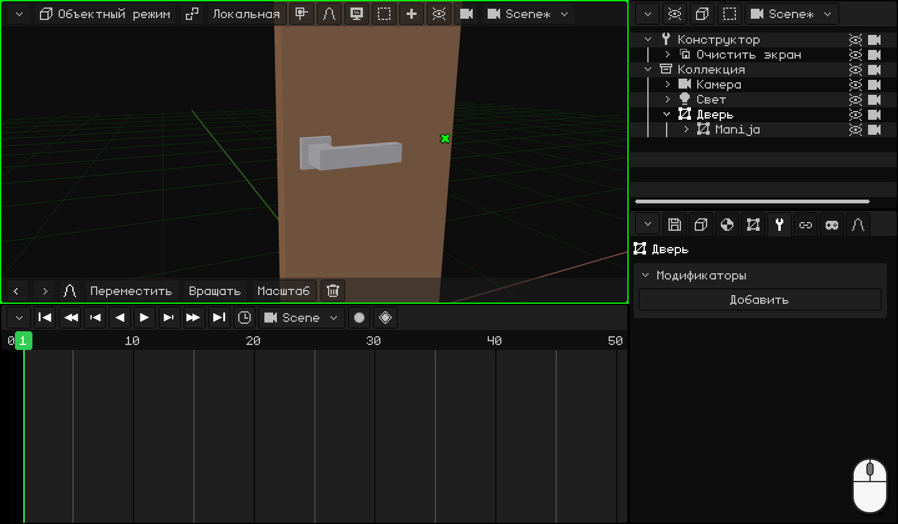
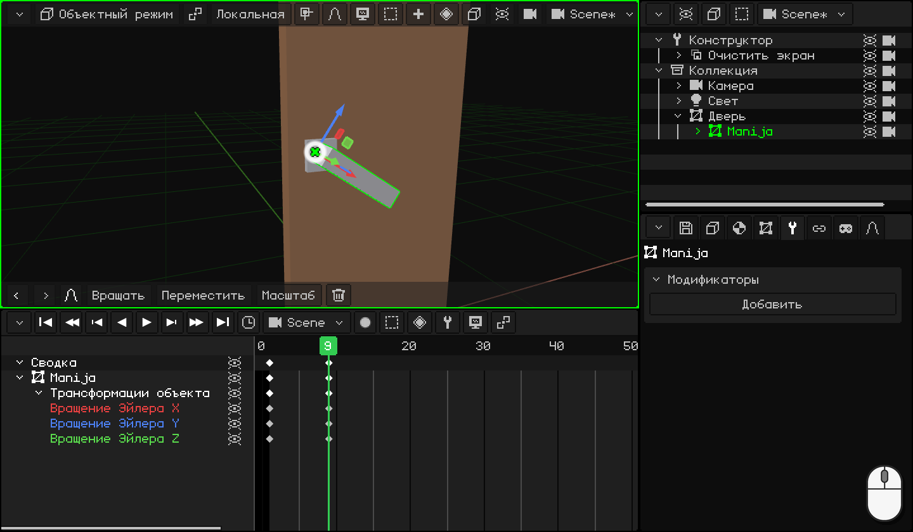
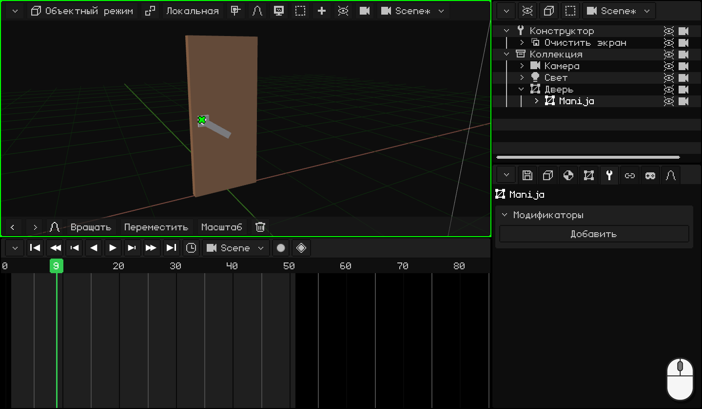
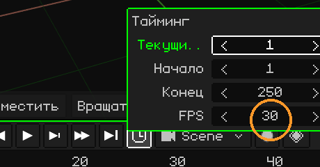
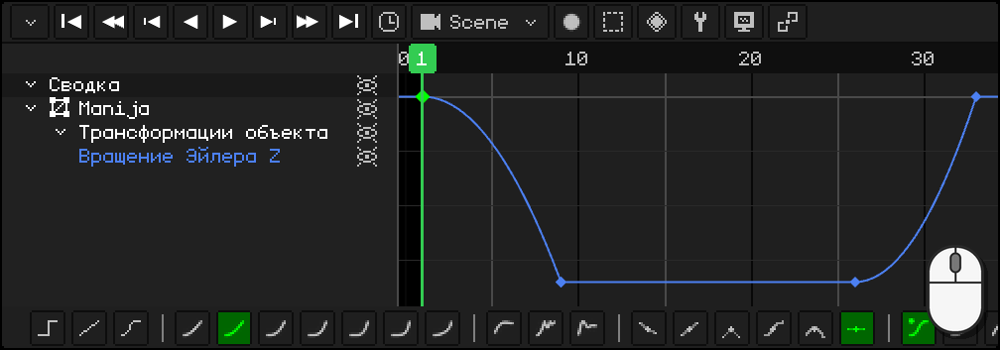
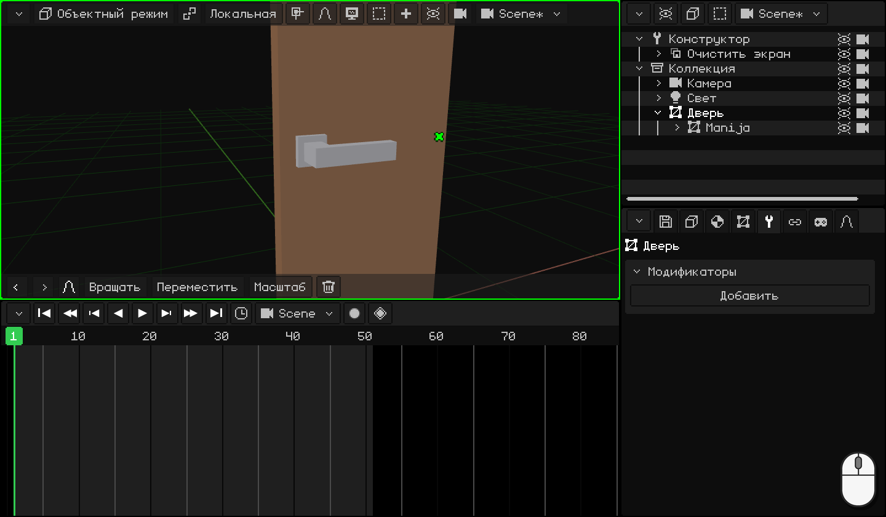

# Анимация двери

Начнём с двери с ручкой из предыдущего урока, [Моделирование дверной ручки](modelar-picaporte.md): центр двери находится на петле, у рычага свой центр там, где он поворачивается, и рычаг — потомок двери. Теперь анимируем её как настоящую дверь: сначала опускается ручка, и только когда она внизу, дверь начинает открываться, а в конце ручка возвращается на место.

По ходу ты научишься:

- ставить **ключевые кадры**: позу объекта в кадре;
- **дублировать** ключевые кадры, которые уже такие, как нужно;
- настраивать **время** анимации и выбирать её **кадры в секунду**;
- пользоваться **редактором кривых**: что такое кривая и как изменить её кликом и панелью инструментов.

## 1. Ручка

**Ключевой кадр** сохраняет состояние объекта в кадре: его положение, вращение или масштаб. Если есть два ключевых кадра, программа вычисляет все кадры между ними: это и есть анимация.

1. Кликни по **рычагу**, чтобы выделить его. На **Таймлайне** перейди на кадр **1**: ручка поднята.
2. Когда мышь над 3D-вьюпортом, нажми <kbd>I</kbd> и выбери **Только вращение**: на Таймлайне появляется ромб в кадре 1.
3. Перейди на кадр **9** (клик по числам Таймлайна) и опусти ручку: <kbd>R</kbd> <kbd>Y</kbd> `-34` <kbd>Enter</kbd>. Она поворачивается вокруг своего центра, который мы задали в предыдущем уроке.
4. Снова <kbd>I</kbd> → **Только вращение**: ещё один ромб, в кадре 9.

 На сенсорном экране: ключевой кадр ставится кнопкой с ромбом в строке меню 3D-вьюпорта, **Анимация → Вставить ключевой кадр → Только вращение**, а кадр переключается касанием чисел Таймлайна. Ручка опускается через **Вращать** **Y** `-34` на панели инструментов, с числами на клавиатуре верхней строки.

 На Nokia N95: <kbd>2</kbd> (вращать), <kbd>2</kbd> (ось Y), карандаш + `-34` и <kbd>OK</kbd>. Ключевой кадр — через **Анимация → Вставить ключевой кадр → Только вращение**.

## 2. Дублируем ключевые кадры

Ручка должна оставаться внизу, пока дверь открывается, а в конце вернуться наверх. Обе эти позы у тебя уже есть: поворачивать её заново не нужно.

1. На Таймлайне кликни по ромбу в кадре **9** (ручка внизу), нажми <kbd>Shift</kbd> + <kbd>D</kbd>, перенеси копию на кадр **26** и кликни. С 9-го по 26-й кадр ручка остаётся внизу.
2. Кликни по ромбу в кадре **1** (ручка наверху), <kbd>Shift</kbd> + <kbd>D</kbd> и копию — на **33**: ручка возвращается наверх.

Смотри на ромб копии, а не на указатель: он оказывается на один кадр правее мыши. Пока копия проходит над другим ключевым кадром, с ним ничего не происходит: она **заменяет** его, только если отпустить её точно на нём.

  На сенсорном экране и на N95 (виртуальной мышью) вместо дублирования копируют и вставляют: касание ключевого кадра в кадре 9 и в меню **Ключ** Таймлайна (кнопка с ромбом) — **Копировать**; касание чисел, чтобы перейти на кадр 26, и **Ключ → Вставить**. То же самое с ключевым кадром из 1 в 33.

## 3. Дверь

1. Кликни по **двери**, чтобы выделить только её. Перейди на кадр **11** и нажми <kbd>I</kbd> → **Только вращение**: до этого момента дверь закрыта. Открываться она начинает только в кадре 11, когда ручка уже внизу.
2. Перейди на кадр **26**, открой её: <kbd>R</kbd> <kbd>Z</kbd> `-80` <kbd>Enter</kbd>, и снова <kbd>I</kbd> → **Только вращение**.

Запусти **воспроизведение** (<kbd>Space</kbd> или кнопка ▶ на Таймлайне): ручка опускается, дверь открывается, и ручка возвращается наверх. Всё это время ручка движется вместе с дверью, потому что она её потомок.

 На сенсорном экране: **Вращать** **Z** `-80` и **Анимация → Вставить ключевой кадр → Только вращение**.

 На Nokia N95: <kbd>2</kbd>, <kbd>3</kbd> (ось Z), карандаш + `-80` и <kbd>OK</kbd>; и **Анимация → Вставить ключевой кадр → Только вращение**.

## 4. Время

Всё происходит слишком быстро или слишком медленно? Нужно сдвинуть ключевые кадры:

- <kbd>G</kbd> сдвигает выделенные ключевые кадры во времени (например, возврат ручки — с 33 на 36).
- <kbd>S</kbd> масштабирует их: если выделены все, `2` делает анимацию вдвое длиннее.

Анимация заканчивается на кадре **50**: в **часах** Таймлайна — **Конец** `50` <kbd>Enter</kbd>.

### Кадры в секунду

Время анимации считается в **кадрах**, а сколько кадров помещается в секунду, говорит **FPS** (*frames per second*: кадры в секунду). Он меняется в тех же **часах**, в поле **FPS**. У каждой анимации свой FPS: анимация сцены и каждый клип могут идти с разным FPS.

Whisk3D начинает с **30**: 50 кадров двери длятся чуть больше полутора секунд.

| FPS | Для чего |
|---|---|
| **24** | Кино. Придаёт анимации более кинематографичный вид, а если её рендерить, кадров получается намного меньше: минута при 24 — это 1440 кадров, при 30 — 1800. |
| **30** или **60** | Сериалы и видеоигры. |

Анимировать при 60 не обязательно. В игре движок сам вычисляет промежуточные кадры: анимация, сделанная при 30, выглядит плавно на экране с 60 и занимает меньше памяти.

Выбирай FPS **до** того, как начнёшь анимировать. Ключевые кадры остаются на своих кадрах: если потом увеличить FPS, анимация пойдёт быстрее, а если уменьшить — медленнее.

## 5. Кривые

Переключи Таймлайн в **редактор кривых** (**Вид → Кривые**). Там каждое анимированное значение — это **кривая**: она показывает, в каком положении, повороте или масштабе находится объект в каждый момент. По горизонтали идёт **время**, по вертикали — **значение**.

**Только вращение** сохраняет все три оси, но ручка и дверь поворачиваются только вокруг одной: две другие кривые — плоские линии, которые ничего не делают. Удали их: выдели эти строки и нажми <kbd>X</kbd>. Останутся только меняющиеся кривые, и работать станет удобнее.

### Форма кривой

Если кривая — **прямая линия**, объект движется всё время с одной скоростью: резко трогается и резко останавливается. Это выглядит **механически**. Иногда нужно именно это, но в жизни почти ничего так не движется: вещи **разгоняются**, когда трогаются, и **тормозят**, когда приходят на место.

Посмотри на шесть мячей, которые движутся слева направо за **одно и то же время**, каждый со своей кривой. Рядом с каждым — его кривая с точкой, которая движется вместе с ним:

| Кривая | Как движется | Для чего |
|---|---|---|
| **Линейная** | Всё время с одной скоростью. | Машина, конвейерная лента, что-то механическое. |
| **Разгон и торможение** (плавный вход и выход) | Трогается медленно, в середине идёт быстро и приходит медленно. | Почти всё: идущий человек, дверь, камера. |
| **Разгон и резкая остановка** (плавный вход) | Трогается медленно и приходит на полной скорости. | Что-то, что падает и ударяется; ручка, которая доходит до упора. |
| **Резкий старт и плавное торможение** (плавный выход) | Трогается на полной скорости и постепенно тормозит. | Что-то брошенное; ящик, который закрывается сам. |
| **Отскок** | Приходит, несколько раз отскакивает от конечной точки и останавливается. | Что-то, что падает и подпрыгивает; захлопывающаяся крышка. |
| **Упругая** | Проскакивает, возвращается и колеблется, как пружина, пока не остановится. | Пружина, антенна, что-то, что изящно появляется на экране. |

Кривые делают анимацию **естественной**.

### Панель инструментов

Когда выделен ключевой кадр или участок, панель инструментов Таймлайна меняет его кривую одним кликом:

- **Режим интерполяции:** **Константа**, **Линейная** и **Безье**; затем расчётные, от самой мягкой до самой резкой (**Синусоидальная**, **Квадратичная**, **Кубическая**, **Квартичная**, **Квинтичная**, **Экспоненциальная** и **Круговая**), и с эффектами (**С откатом**, **Отскок** и **Упругая**).
- **Тип рукоятки:** как устроены рукоятки кривой **Безье**.
- **Плавность:** у расчётных кривых — где находится эффект: **Автоматическая**, **Плавный вход**, **Плавный выход** или **Плавный вход и выход**.

С клавиатуры: <kbd>E</kbd> открывает **Режим интерполяции**, а <kbd>Ctrl</kbd> + <kbd>E</kbd> — **Плавность**.

### Ручка: ТУК!

Настоящую ручку ты опускаешь, она набирает скорость и резко останавливается об упор: ТУК! Когда её отпускаешь, пружина поднимает её, и наверху она снова резко останавливается. Оба раза — **разгон и резкая остановка**.

1. Выдели **рычаг** и в редакторе кривых кликни по строке оставшейся кривой: Таймлайн кадрирует её целиком.
2. Кликни по участку кривой, который идёт вниз, между кадрами 1 и 9: клик по линии выделяет этот участок.
3. На панели инструментов — **Квадратичная**. Её плавность **Автоматическая** — это **Плавный вход**: разгон и резкая остановка.
4. То же самое с участком возврата, между 26 и 33.

  На сенсорном экране и на N95: касание (или виртуальная мышь) по участку и ещё одно по **Квадратичная**: панель инструментов та же.

### Дверь

Двери подходит обычная кривая, **Безье**: **разгон и торможение**. Ты толкаешь её, она набирает скорость и постепенно тормозит, пока не останется открытой. Менять ничего не нужно.

В следующем уроке, [Прыгающий мяч](pelota.md), мы используем кривые, чтобы придать мячу вес, вместе с ещё одним принципом анимации: растяжением и сжатием.
