# Моделирование дверной ручки

Начнём с двери из предыдущего урока, [Изменить центр: дверь](puerta.md): её размер 0,90 × 0,10 × 2 метра, а центр находится на петле. Сделаем ей дверную ручку из двух частей: **накладки**, прижатой к двери, и **рычага**, который поворачивается.

По ходу ты научишься:

- дублировать грань и строить из неё новую деталь;
- **отделять** часть меша в другой объект (<kbd>P</kbd>) и снова **присоединять** её (<kbd>Ctrl</kbd> + <kbd>J</kbd>);
- давать каждой части меша свой **материал**;
- пользоваться модификатором **Зеркало**, чтобы ручка была с обеих сторон двери;
- видеть с помощью **Рентгена** грани, которые никогда не видны, и удалять их;
- ставить **центр** туда, где будет поворачиваться рычаг, с помощью 3D-курсора;
- **связывать** рычаг **с родителем**-дверью, чтобы они двигались вместе.

## 1. Накладка

1. Выдели дверь, войди в **Режим редактирования** (<kbd>Tab</kbd>) и в кнопке **Вершина / Ребро / Грань** выбери **Грань**.
2. Кликни по большой передней грани двери.
3. **Дублируй её:** <kbd>Shift</kbd> + <kbd>D</kbd>. Копия прилипает к мыши; правый клик (или <kbd>Esc</kbd>) оставляет её там, где она была, прямо поверх оригинала.
4. **Уменьши её**, пока не получится небольшой квадрат. На глаз: <kbd>S</kbd> и двигай мышь; потом <kbd>S</kbd> <kbd>Z</kbd>, чтобы подогнать только высоту. Числами: <kbd>S</kbd> `0.15` <kbd>Enter</kbd> и <kbd>S</kbd> <kbd>Z</kbd> `0.45` <kbd>Enter</kbd> дают квадрат 13,5 см.
5. **Перенеси её** на сторону, противоположную петле, где будет ручка: <kbd>G</kbd> <kbd>X</kbd> `-0.31` <kbd>Enter</kbd>.
6. **Выдави её** чуть-чуть, чтобы у неё появилась толщина: <kbd>E</kbd> `0.03` <kbd>Enter</kbd> (3 см).

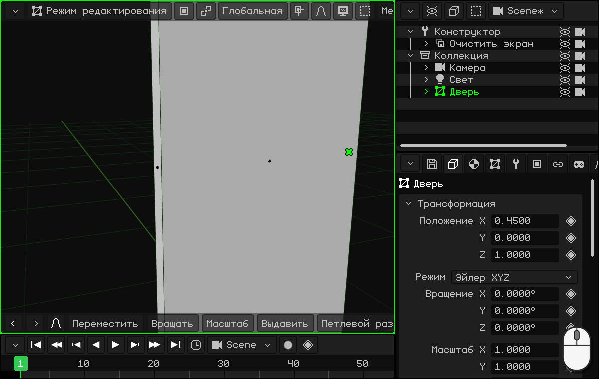

 На сенсорном экране: касание грани и **Меш → Дублировать** (копия остаётся поверх). Потом **Масштаб**, **Переместить** и **Выдавить** на панели инструментов, с числами на клавиатуре верхней строки, и галочка.

 На Nokia N95: **Меш → Дублировать** левой софт-клавишей; потом <kbd>3</kbd> (масштаб), <kbd>1</kbd> (переместить) и <kbd>7</kbd> (выдавить), с удерживаемым карандашом для чисел и <kbd>OK</kbd>.

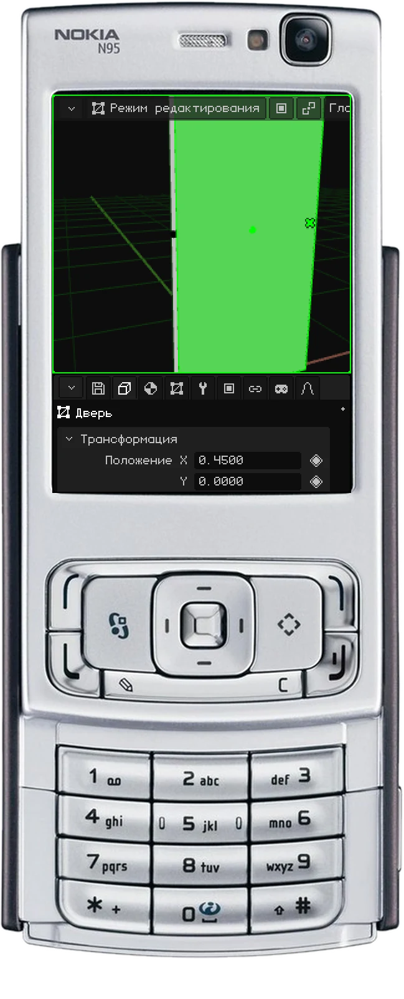

## 2. Отделяем накладку

Накладка пока что часть меша двери. Перенесём её в отдельный объект:

1. Когда накладка выделена, <kbd>L</kbd> (**Выделить связанное**) выделяет всю деталь: 6 граней накладки, без двери.
2. <kbd>P</kbd> (**Разделить**): накладка становится новым объектом, **Дверь.001**. Его видно в Аутлайнере.

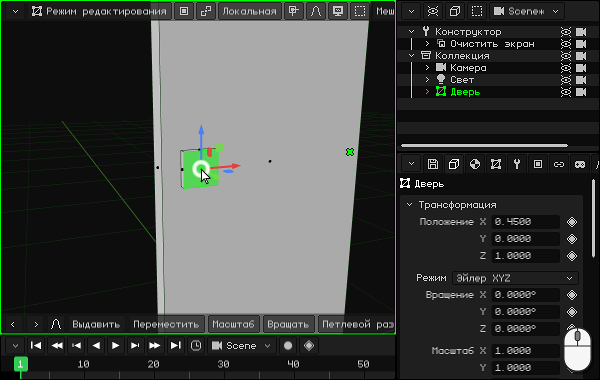

  На сенсорном экране и на N95: **Выделить → Выделить связанное** и касание накладки; потом **Меш → Разделить**.

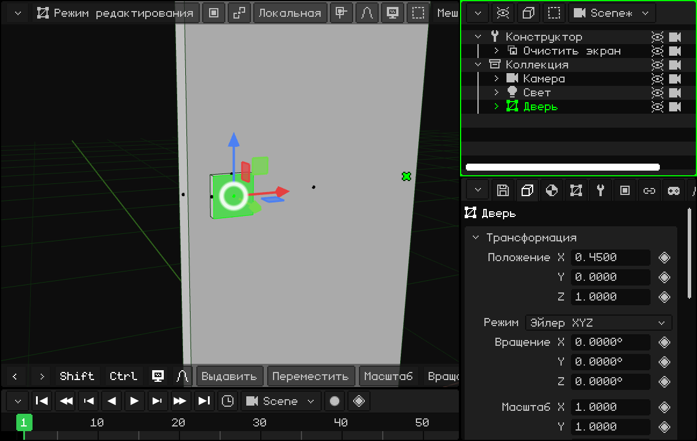

После отделения от накладки в двери ничего не остаётся: ни граней, ни линий.

## 3. Материалы: дерево и металл

Теперь у каждой части может быть свой материал. В **Свойствах**, на вкладке **Материал**:

1. Выдели дверь. В **Переименовать материал** напиши `Дерево`, а в **Цвет** выбери коричневый.
2. Выдели накладку (Дверь.001). Поскольку она получена из двери, у неё тоже материал Дерево: нажми **Новый материал**, назови его `Металл` и дай ему серый цвет.

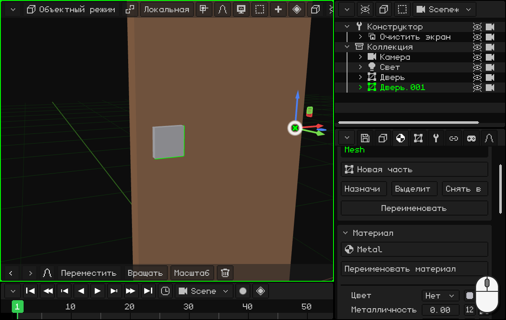

## 4. С другой стороны двери: Зеркало

Ручка бывает с обеих сторон. Вместо того чтобы делать ещё одну накладку, используем модификатор **Зеркало**:

1. Выдели накладку и в **Свойства → Модификаторы** добавь **Зеркало**.
2. Выключи **Зеркало X** и включи **Зеркало Y**: появляется вторая накладка, с другой стороны двери.

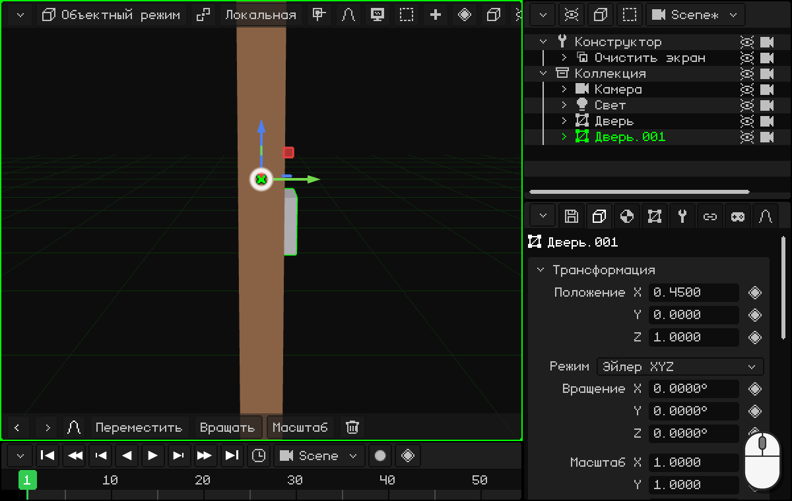

Отражение строится относительно **центра** объекта. Накладка получена из двери, поэтому центр у неё тот же: на петле, ровно посередине толщины двери. Поэтому копия оказывается точно с другой стороны. См. [Зеркало](../editor/modificador-espejo.md).

## 5. Рычаг

Рычаг делается из накладки тем же приёмом:

1. Выдели накладку и нажми <kbd>/</kbd> на цифровой клавиатуре (**Локальный вид**): видна только накладка, с ней проще работать. Войди в **Режим редактирования**.
2. Выдели переднюю грань накладки, **дублируй её** (<kbd>Shift</kbd> + <kbd>D</kbd> и правый клик) и уменьши: <kbd>S</kbd> `0.6` <kbd>Enter</kbd>.
3. **Выдави её** наружу: <kbd>E</kbd> `0.08` <kbd>Enter</kbd>. Это ось рычага.

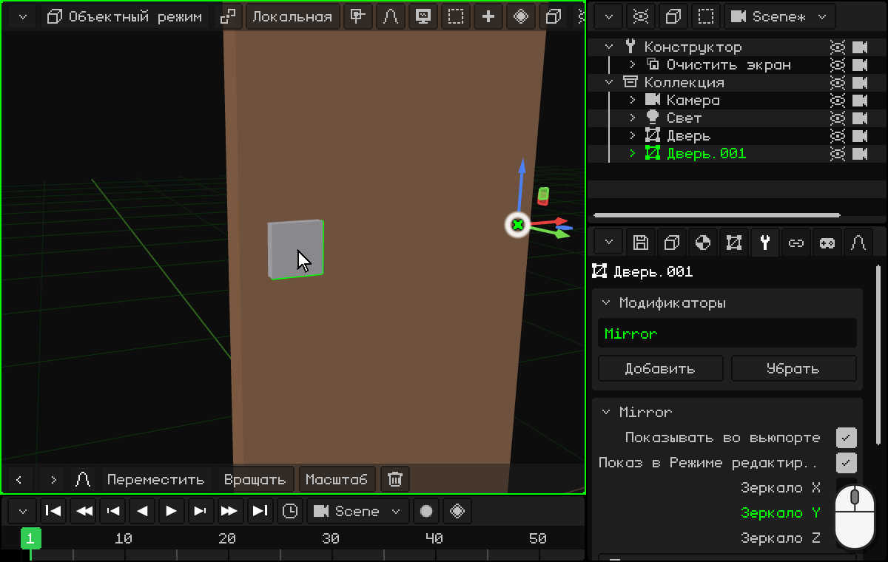
4. Переключись на **Ребро** и выдели внешнее ребро со стороны края двери. Сдвинь его наружу: <kbd>G</kbd> <kbd>Y</kbd> `0.05` <kbd>Enter</kbd>. Передняя грань становится наклонной.
5. Переключись на **Грань** и выдели эту наклонную грань. Выдави её **по X**, а не по её нормали: <kbd>E</kbd>, <kbd>X</kbd>, `0.34` и <kbd>Enter</kbd>. Получается плечо рычага.
6. Кончик получился наклонным. Чтобы выровнять его, масштабируй его до нуля по X: <kbd>S</kbd> <kbd>X</kbd> `0` <kbd>Enter</kbd>. Все его вершины оказываются на одной X: кончик становится плоским.

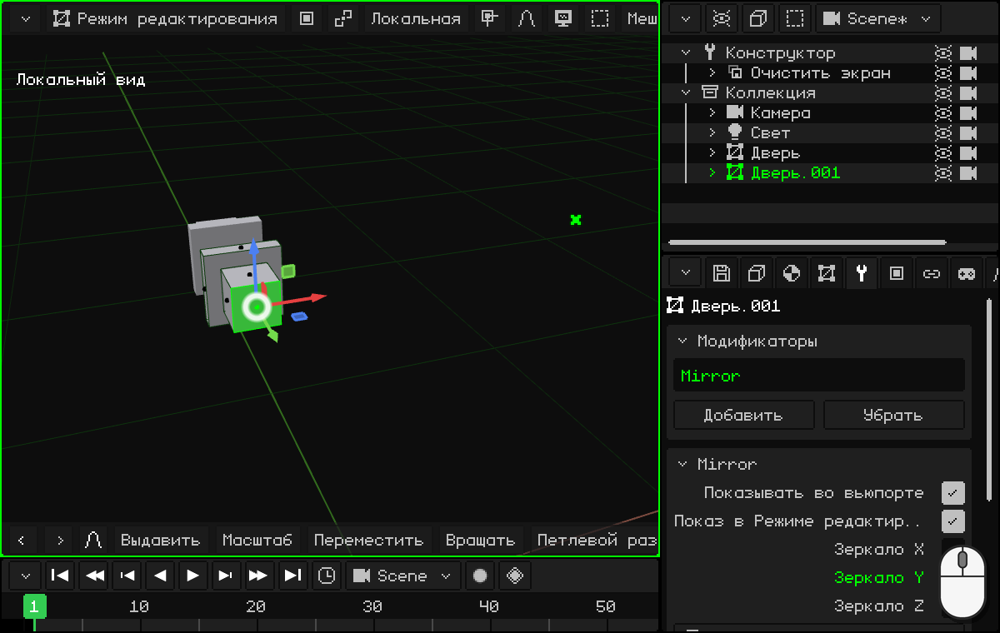
7. <kbd>L</kbd> выделяет весь рычаг, а <kbd>P</kbd> отделяет его: он становится **Дверь.002**. Дай ему имя: двойной клик в Аутлайнере, и напиши `Рычаг`.

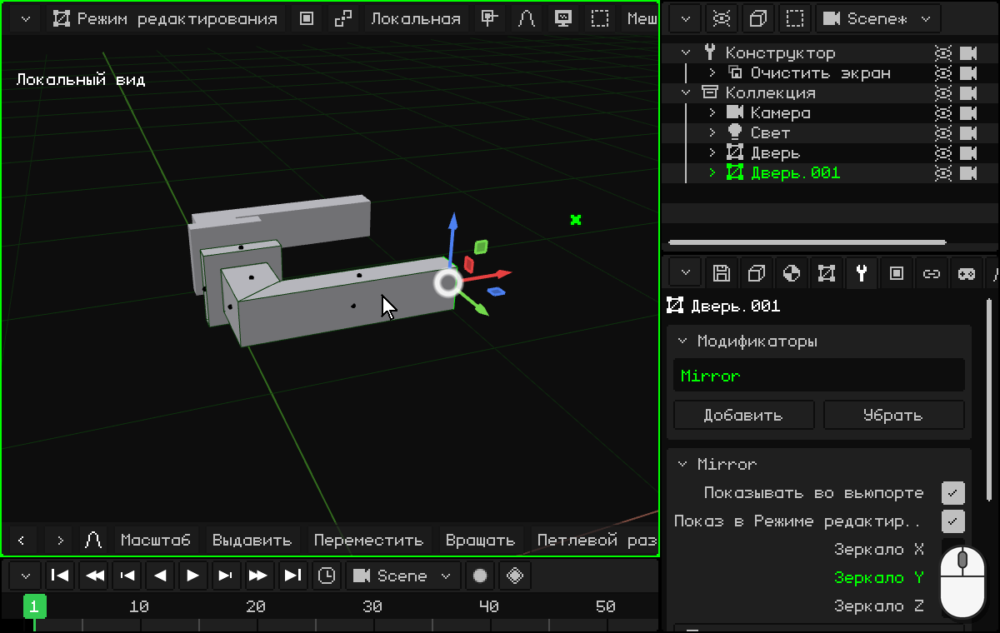

 На сенсорном экране: касание грани, **Меш → Дублировать**, **Масштаб** `0.6` и **Выдавить** `0.08`; **Ребро**, касание внешнего ребра и **Переместить** **Y** `0.05`; **Грань**, касание наклонной грани, **Выдавить** **X** `0.34` и **Масштаб** **X** `0`. Чтобы отделить, **Выделить → Выделить связанное** и **Меш → Разделить**.

 На Nokia N95: <kbd>3</kbd> и `0.6`, <kbd>7</kbd> и `0.08`; ребро (виртуальной мышью), <kbd>1</kbd>, <kbd>2</kbd> (ось Y) и `0.05`; наклонная грань, <kbd>7</kbd>, <kbd>1</kbd> (ось X) и `0.34`; <kbd>3</kbd>, <kbd>1</kbd> и `0`.

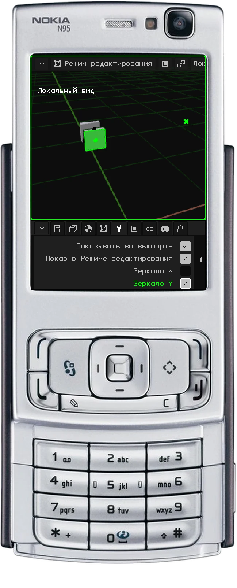

Рычаг получен из накладки, поэтому у него есть её материал (Металл) и её модификатор Зеркало.

## 6. Присоединяем накладку к двери

Накладка не двигается отдельно: она часть двери. Снова присоединим её:

1. Выдели накладку и в **Модификаторах** нажми **Применить модификатор**: отражение становится настоящей геометрией.
2. Выдели накладку, потом дверь с <kbd>Shift</kbd> + клик (дверь становится активной) и нажми <kbd>Ctrl</kbd> + <kbd>J</kbd> (**Объединить**). Теперь это один меш с двумя материалами.

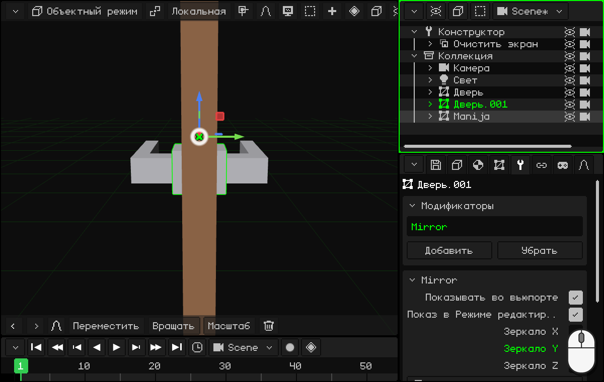

  На сенсорном экране и на N95: **Объект → Объединить**.

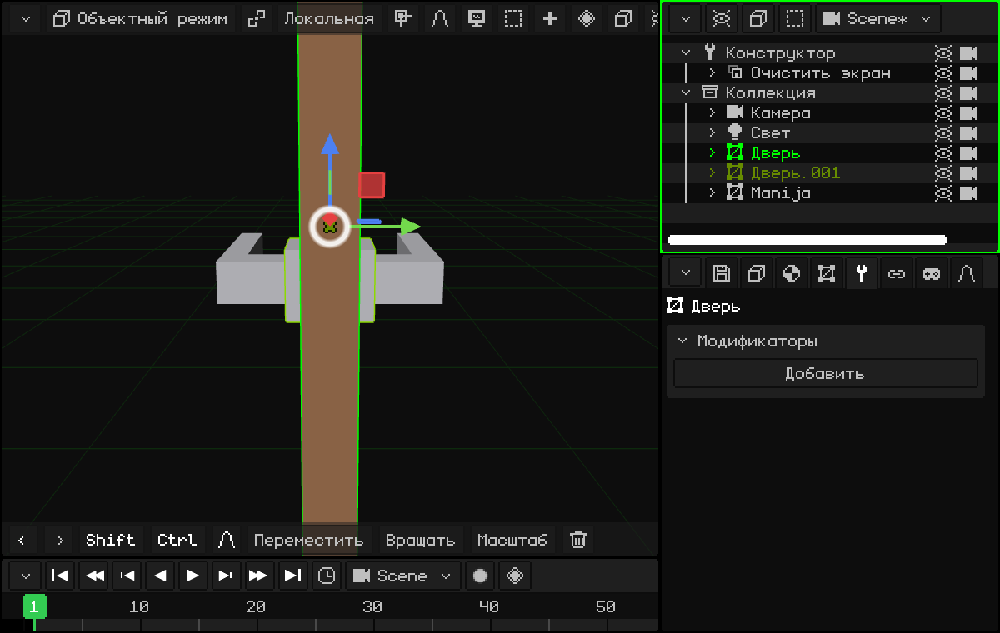

Так части меша отделяются и присоединяются: <kbd>P</kbd> — отделить, <kbd>Ctrl</kbd> + <kbd>J</kbd> — объединить.

## 7. Грани, которых никогда не видно

Накладка прижата к двери. Задняя грань каждой накладки закрыта: её никогда не будет видно, но программа всё равно её рисует. Чтобы её увидеть:

1. Выдели дверь и войди в **Режим редактирования**.
2. В **Наложениях** включи **Рентген**: меш становится прозрачным, и видны задние грани.
3. Выдели заднюю грань каждой накладки (ту, что касается двери) и удали их: <kbd>X</kbd> → **Грани**.

Невидимую геометрию лучше удалять: это грани, которые рисуются впустую. В маленькой модели это незаметно, но в большой сцене или на телефоне это выигрыш в производительности.

## 8. Где поворачивается рычаг: центр

Рычаг должен поворачиваться вокруг своей оси, а не вокруг петли двери.

1. Выдели рычаг и примени его Зеркало (**Модификаторы → Применить модификатор**).
2. Войди в **Режим редактирования** с **Рентгеном**. Выдели две задние грани рычага, те, что касаются накладок (по одной с каждой стороны).
3. <kbd>Shift</kbd> + <kbd>S</kbd> → **Курсор к выделенному**: 3D-курсор оказывается посередине между ними, ровно на оси рычага.
4. Эти две грани тоже не видны: удали их (<kbd>X</kbd> → **Грани**).
5. Вернись в **Объектный режим** и перенеси центр в курсор: <kbd>W</kbd> (или правый клик) → **Задать центр → Центр к 3D-курсору**.

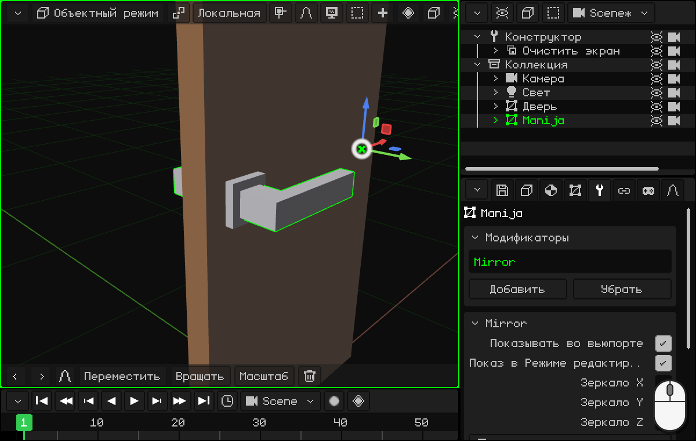

Это то же самое, что мы делали с петлёй в уроке [Изменить центр: дверь](puerta.md#переносим-центр-к-петле).

## 9. Чтобы рычаг двигался вместе с дверью

Попробуй повернуть дверь: рычаг остаётся висеть в воздухе. Это два отдельных объекта. Отмени поворот (<kbd>Ctrl</kbd> + <kbd>Z</kbd>).

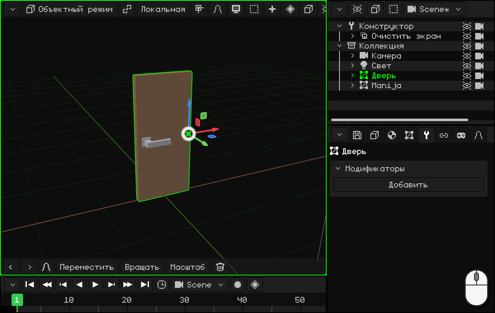

Чтобы рычаг двигался вместе с дверью, его нужно **связать с родителем**: рычаг становится **потомком** двери.

1. Выдели рычаг, а потом дверь с <kbd>Shift</kbd> + клик (дверь, родитель, становится активной).
2. <kbd>Ctrl</kbd> + <kbd>P</kbd> → **Объект (сохр. трансформацию)**. В Аутлайнере рычаг оказывается внутри двери.

Выдели только дверь (клик по ней) и снова поверни её: теперь рычаг движется вместе с ней. И рычаг по-прежнему поворачивается вокруг своей оси, как настоящая дверная ручка. Если выделены оба, поворачивается только дверь, а рычаг следует за ней, потому что он её потомок.

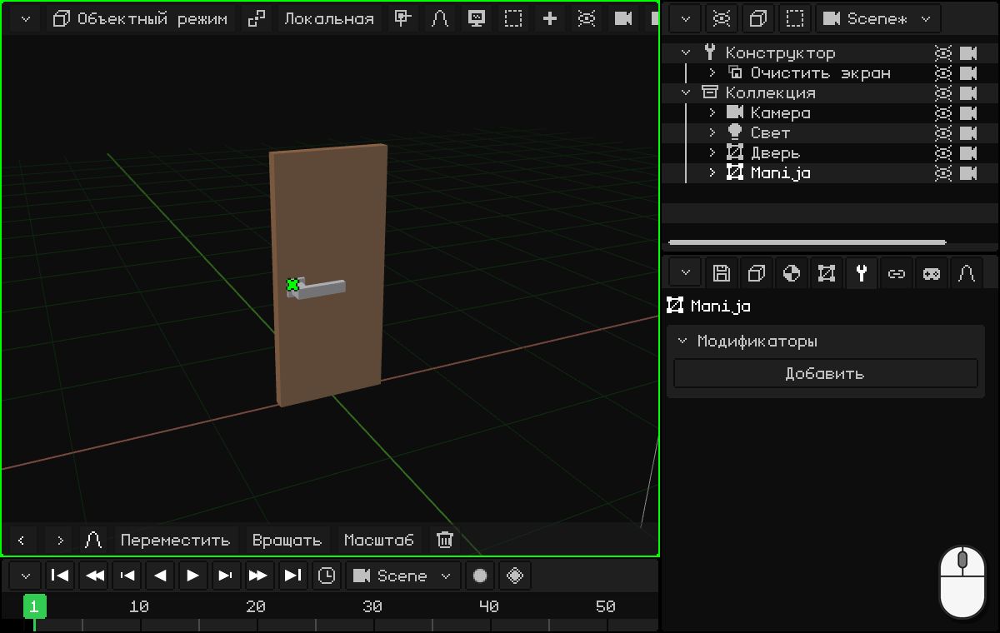

  На сенсорном экране и на N95: **Объект → Задать родителя → Объект (сохр. трансформацию)**.

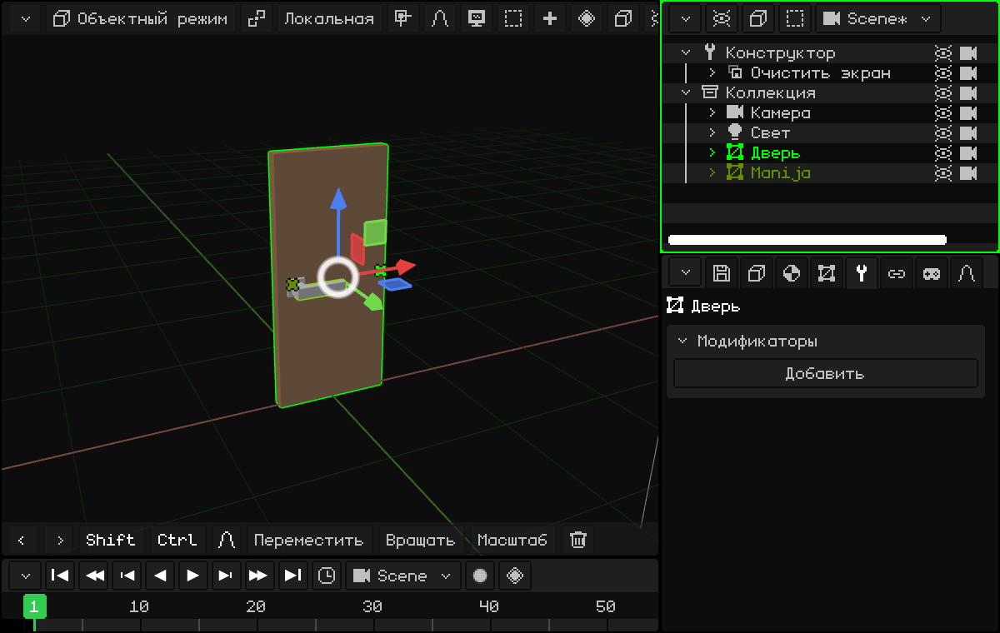

В следующем уроке мы анимируем дверь: [Анимация двери](animar-puerta.md).
