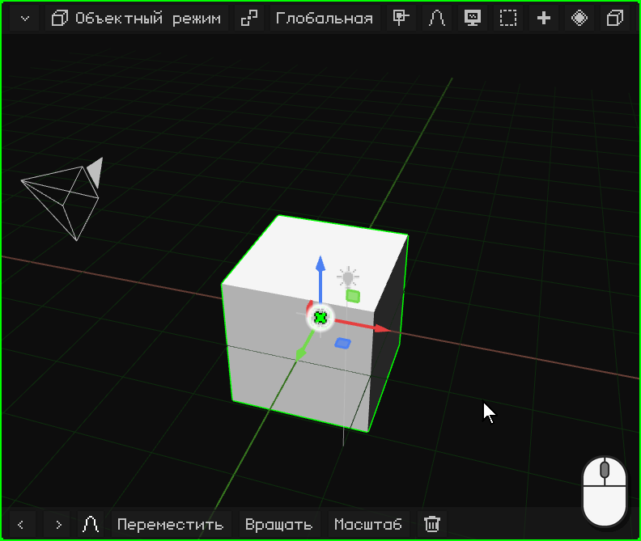
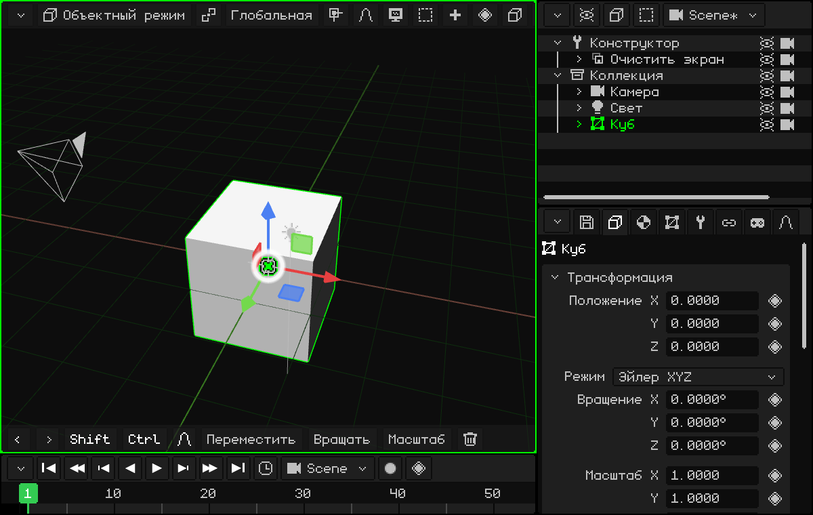
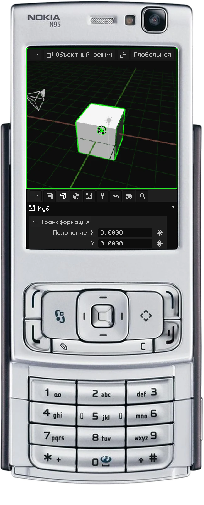
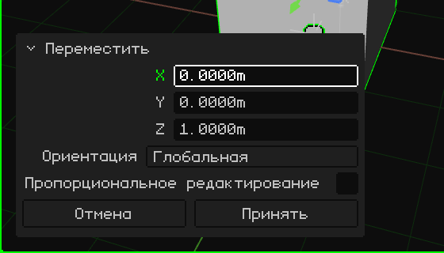
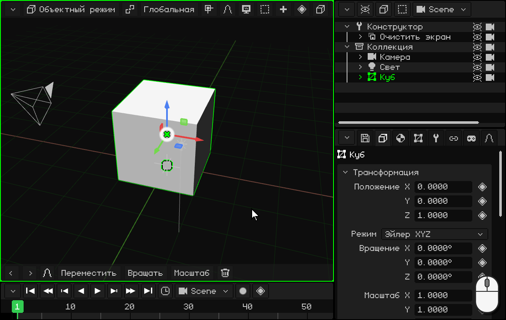
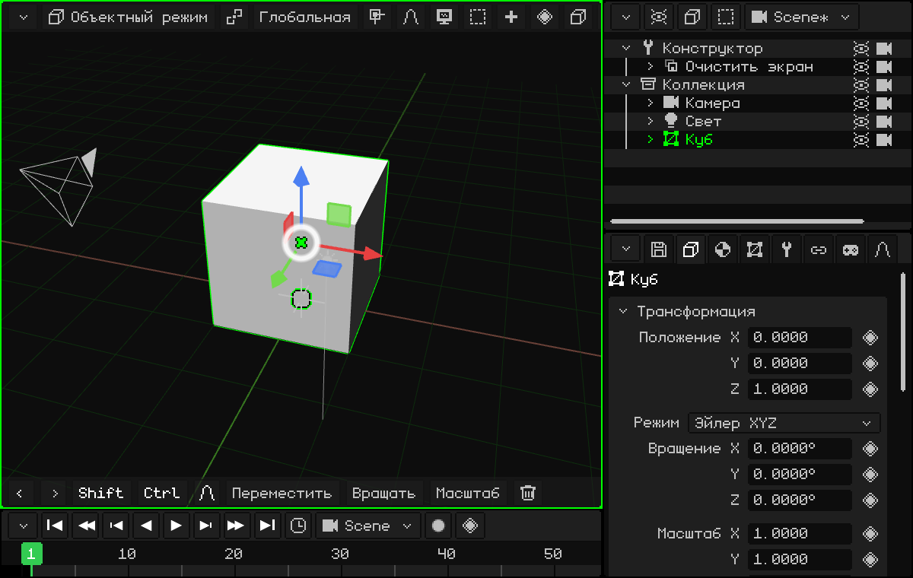
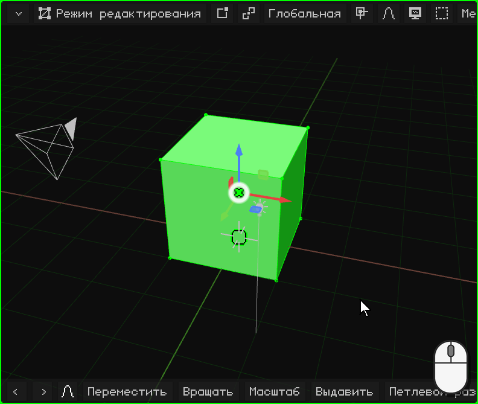
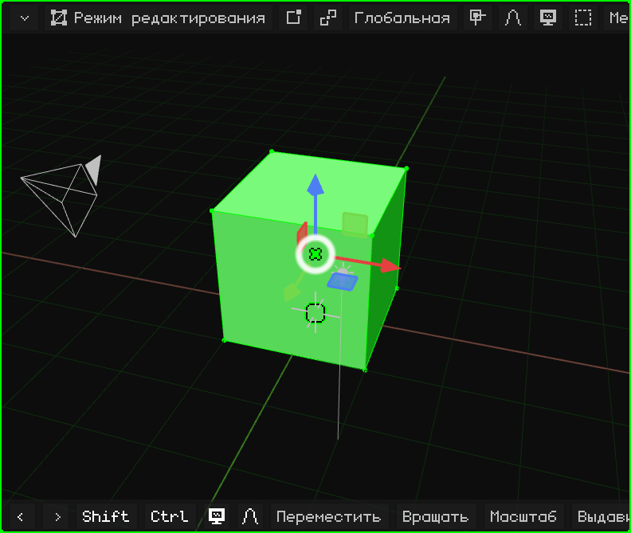
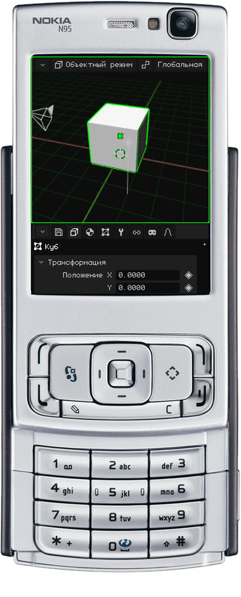
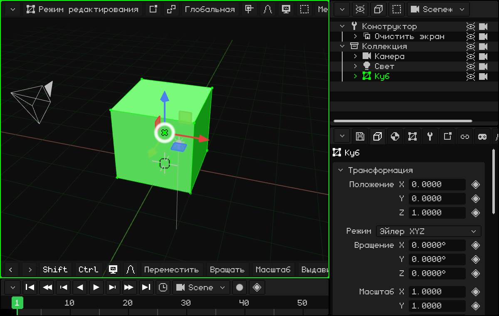

# Моделируем дверь

Сделаем нашу первую простую модель: дверь! Для начала нам подойдёт куб, который уже есть в сцене, размером 2 × 2 × 2 метра.

Я (Dante) часто использую двери, чтобы строить пространство: этому я научился, когда изучал строительство. Двери почти всегда высотой 2 метра, а человек (обычно) ниже двери. Если в сцене есть дверь, ты сразу видишь масштаб всего остального.

## Ставим её на пол

Центр куба находится на полу, так что половина куба оказывается под ним. Поднимем его на 1 метр по оси Z, чтобы он стоял на полу. Когда куб выделен:

 Нажми <kbd>G</kbd>: куб следует за мышью. Потом <kbd>Z</kbd>: он привязан к оси Z (появляется синяя линия). Введи `1` и нажми <kbd>Enter</kbd>.

 Коснись **Переместить** на панели инструментов, потом **Z**, коснись верхней строки, чтобы открыть цифровую клавиатуру, введи `1`, нажми **OK** и зелёную галочку.

 <kbd>1</kbd> (переместить), <kbd>3</kbd> (ось Z), удерживая **карандаш**, <kbd>1</kbd>, и <kbd>OK</kbd>.

Как вводить числа на каждом устройстве, описано в разделе [Точными числами](modo-objeto.md#точными-числами).

### Исправить последнюю операцию

После перемещения, вращения или масштабирования слева внизу вместо панели инструментов появляется небольшая панель **Настроить последнюю операцию**. В свёрнутом виде она только показывает, что ты сделал (например, **Переместить**); касание или клик по её заголовку разворачивает её:

Каждое значение можно исправить: если вместо 1 метра ты хотел 1,2, касаешься Z, вводишь `1.2`, и операция выполняется заново с новым значением. **Принять** закрывает панель, и возвращается панель инструментов; **Отмена** отменяет операцию.

## Придаём форму

Смоделировать дверь можно двумя способами.

### Самый простой способ, который я не советую: масштабировать объект

В Объектном режиме масштабируй куб по осям X и Y, пока он не примет форму двери. Например, <kbd>S</kbd> <kbd>X</kbd> `0.45` <kbd>Enter</kbd> (90 см в ширину) и <kbd>S</kbd> <kbd>Y</kbd> `0.05` <kbd>Enter</kbd> (10 см в толщину).

Я его не советую, потому что у объекта остаётся разный масштаб по каждой оси (0,45; 0,05 и 1), а в идеале масштаб должен быть **1** по всем трём осям (см. [Лучше с масштабом 1](modo-objeto.md#лучше-с-масштабом-1)). Если всё же сделаешь так, **всегда применяй трансформацию**: <kbd>Ctrl</kbd> + <kbd>A</kbd> → **Масштаб** (или Объект → Применить → Масштаб). Форма не меняется, а масштаб возвращается к 1.

 На сенсорном экране: **Масштаб**, **X**, верхняя строка, `0.45` и OK, и то же самое с **Y** и `0.05`. Потом **Объект → Применить → Масштаб**.

### Способ, который я советую: Режим редактирования

Выдели куб и войди в Режим редактирования: нажми <kbd>Tab</kbd> или выбери **Режим редактирования** кнопкой режима в 3D-вьюпорте. При входе все вершины выделены.

В Режиме редактирования выделяются **вершины**, **рёбра** и **грани**: это основа. И, так же как в Объектном режиме, их можно перемещать, вращать и масштабировать (см. [Режим редактирования](../editor/modo-edicion.md)).

Когда всё выделено, сожми куб по X и по Y, пока дверь не станет такой, как тебе нужно. По Z этого делать не нужно: высота уже 2 метра! Поскольку меняется меш, а не объект, масштаб остаётся равным 1.

**На глаз, гизмо:** клик (или касание) по центру гизмо переключает его на вращение, а ещё один — на **масштабирование**. Возьмись за красный конец (X) и тяни его к центру до нужной ширины; потом за зелёный (Y), пока дверь не станет тонкой, как настоящая.

**Числами:** <kbd>S</kbd>, <kbd>X</kbd>, `0.45`, <kbd>Enter</kbd> и <kbd>S</kbd>, <kbd>Y</kbd>, `0.05`, <kbd>Enter</kbd>.

 На сенсорном экране: кнопка режима → **Режим редактирования**; потом **Масштаб**, **X**, касание верхней строки, `0.45`, **OK** и галочка, и то же самое с **Y** и `0.05`.

 На Nokia N95: <kbd>OK</kbd> переключает в Режим редактирования. <kbd>3</kbd> (масштаб), <kbd>1</kbd> (ось X), удерживая карандаш, `0` <kbd>*</kbd> `45` (<kbd>*</kbd> — это точка), и <kbd>OK</kbd>. То же самое с <kbd>2</kbd> (ось Y) и `0.05`.

## Точные размеры

Если вместо «на глаз» ты хочешь, например, дверь шириной ровно **90 см**: в кнопке **Вершина / Ребро / Грань** выбери **Грань** и кликни по одной из боковых сторон. Мы знаем, что куб шириной 2 метра, значит, надо убрать лишнее, чтобы осталось 0,9: эту сторону нужно сдвинуть на **1,1 метра**. <kbd>G</kbd> <kbd>X</kbd> `-1.1` <kbd>Enter</kbd>.

При перемещении ось **X** ограничивает движение одной осью, чтобы куб не исказился:

-  Клавишей <kbd>X</kbd>.
-  Касанием **X** на панели инструментов. `-1.1` вводится на цифровой клавиатуре, которая открывается касанием верхней строки.
-  Клавишей <kbd>1</kbd> во время перемещения. Число вводится с удерживаемым карандашом: <kbd>#</kbd> меняет знак, а <kbd>*</kbd> — это точка. Грань выделяется виртуальной мышью (правая клавиша выбора, стрелки и <kbd>OK</kbd>).

Для толщины, когда всё выделено, <kbd>S</kbd> <kbd>Y</kbd> `0.05` <kbd>Enter</kbd>, как раньше.

Вот и наша первая 3D-модель! Поздравляю.

В следующем уроке мы сделаем так, чтобы дверь открывалась на петле: [Изменить центр: дверь](puerta.md).
