# Объектный режим

В **Объектном режиме** работают с объектами целиком: их выделяют, перемещают, вращают, масштабируют, добавляют, удаляют и вкладывают друг в друга. В этом режиме запускается Whisk3D, и об этом говорит кнопка слева вверху 3D-вьюпорта. Чтобы менять форму меша (его вершины, рёбра и грани), есть Режим редактирования, которому посвящён отдельный урок.

## Что такое объект

Всё, что есть в сцене, — это **объект**: куб, с которого начинается проект, камера, источник света, персонаж. У каждого объекта есть:

- **имя**, которое видно в Аутлайнере;
- его **трансформация**: где он находится (положение), как повёрнут (вращение) и какого он размера (масштаб);
- **свойства**, которые зависят от его типа: у источника света есть цвет и интенсивность, у камеры — объектив, у меша — материал.

Типов объектов много, но все они выделяются, перемещаются, вращаются и масштабируются одинаково.

## Выделить объект

| | Как выделить |
|---|---|
|  ПК | Клик по объекту. <kbd>Shift</kbd> + клик добавляет или убирает ещё один. Клик по пустому месту снимает выделение. |
|  Сенсорный экран | Касание объекта. Если на панели инструментов 3D-вьюпорта включён **Shift**, каждое касание добавляет или убирает ещё один. |
|  Nokia N95 | Клавиша **карандаша** переходит от одного объекта к следующему. Карандаш со стрелками добавляет, убирает, выделяет всё или снимает выделение. |

Выделенное обводится контуром, а последний выделенный — это **активный объект**: его показывают Свойства.

### Выделить несколько объектов рамкой

 Тяни мышь с зажатой основной кнопкой по 3D-вьюпорту, начиная с фона: рисуется **рамка**, и когда отпускаешь кнопку, выделяются объекты, которые она захватила. Рамку также можно вызвать клавишей <kbd>B</kbd>.

 На сенсорном экране перетаскивание пальцем вращает вид: рамку нужно выбрать в меню **Выделить → Выделение рамкой**, а потом провести пальцем.

Направление протягивания меняет то, что выделяется, и рамка показывает это цветом:

| Протягивание | Цвет рамки | Что выделяет |
|---|---|---|
| Слева направо | Зелёный | Только то, что **целиком внутри** рамки. |
| Справа налево | Синий | Всё, чего рамка **касается**, хотя бы чуть-чуть. |

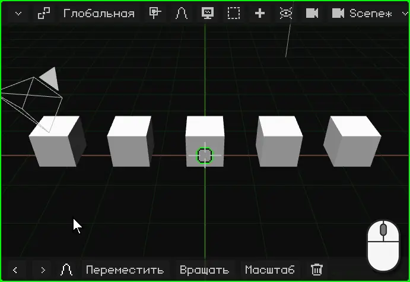

## Контекстное меню

Как в любой программе, в **контекстном меню** под рукой то, что можно сделать с выделенным. В Объектном режиме это меню **Объект**, и оно открывается там, где находится указатель:

| | Как открыть |
|---|---|
|  ПК | Правый клик по 3D-вьюпорту |
|  Сенсорный экран | Подержать палец неподвижно на 3D-вьюпорте полсекунды |
|  Nokia N95 | Левая софт-клавиша открывает строку меню; там — меню Объект |

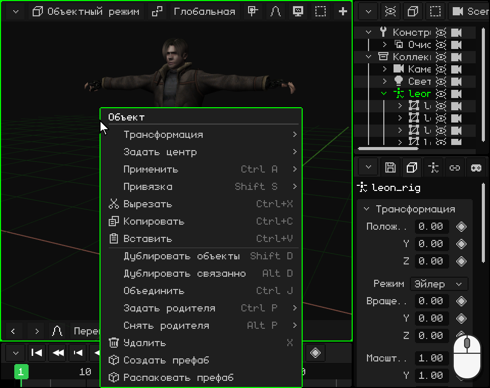

 Выделен Leon, палец неподвижно лежит на 3D-вьюпорте: через полсекунды телефон вибрирует, и открывается меню. Когда поднимаешь палец, ничего не выбирается: пункт нужно коснуться после этого.

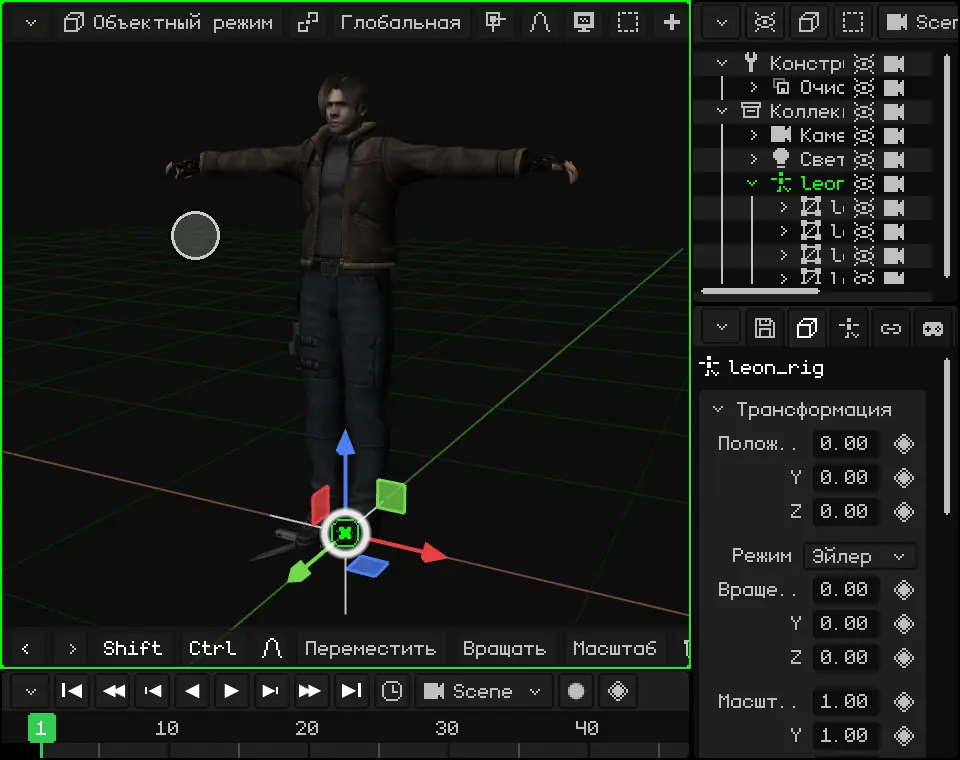

| Пункт | Что делает |  Сочетание |
|---|---|---|
| **Вырезать** | Сохраняет выделенное, чтобы вставить его потом, и убирает его из сцены. | <kbd>Ctrl</kbd> + <kbd>X</kbd> |
| **Копировать** | Сохраняет копию выделенного вместе с потомками, чтобы вставить её потом: в этой сцене, в другом проекте или в другом открытом окне Whisk3D. | <kbd>Ctrl</kbd> + <kbd>C</kbd> |
| **Вставить** | Помещает в сцену то, что последним скопировали или вырезали, на то же место, и оставляет это выделенным. | <kbd>Ctrl</kbd> + <kbd>V</kbd> |
| **Дублировать объекты** | Делает копию выделенного, независимую от оригинала, и оставляет её захваченной, чтобы ты её передвинул: клик (или <kbd>OK</kbd>) оставляет её там, где она есть. | <kbd>Shift</kbd> + <kbd>D</kbd> |
| **Дублировать связанно** | Как Дублировать, но копия **использует тот же меш**, что и оригинал: если изменить форму одного, изменятся оба. Положение, вращение и масштаб у каждого свои. Подходит для множества одинаковых вещей, как деревья в лесу или стулья в зале: все они редактируются сразу и занимают меньше памяти. | <kbd>Alt</kbd> + <kbd>D</kbd> |
| **Удалить** | Удаляет выделенное. Спрашивает подтверждение. | <kbd>X</kbd> или <kbd>Delete</kbd> |

Остальные пункты меню разбираются в этом же уроке: Трансформация (перемещение, вращение и масштабирование), [Задать центр и Привязка](#относительно-чего-перемещать-вращать-и-масштабировать), [Применить](#лучше-с-масштабом-1), [Задать родителя и Снять родителя](#аутлайнер-объекты-сцены). **Объединить** соединяет несколько мешей в один, а **префабам** (объектам, собранным для повторного использования) посвящён отдельный урок.

## Перемещение, вращение и масштабирование

Три основные операции с объектом — **перемещение**, **вращение** и **масштабирование**. Каждую можно выполнить гизмо, с клавиатуры или, на сенсорном экране, командами панели инструментов. Если что-то пошло не так, **Отменить** (<kbd>Ctrl</kbd> + <kbd>Z</kbd> на ПК) возвращает всё назад.

### Гизмо

**Гизмо** — это цветные стрелки, которые появляются на выделенном объекте. Каждый цвет — это ось: **красный** — X, **зелёный** — Y, а **синий** — Z, направленная вверх.

У гизмо три режима, по одному на каждую операцию. **Клик по гизмо без перетаскивания переключает на следующий режим**: от перемещения к вращению, от вращения к масштабированию и от масштабирования снова к перемещению.

 Клик мышью по гизмо меняет режим.

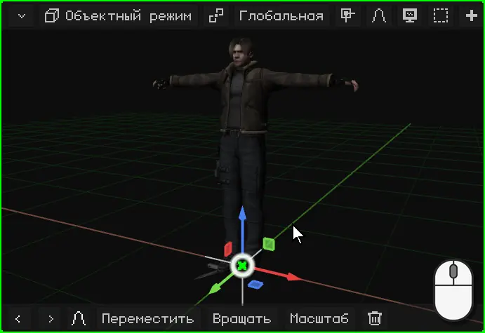

 Касание гизмо меняет режим.

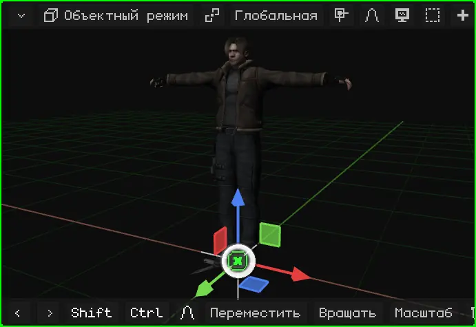

Чтобы им пользоваться, возьмись за часть гизмо и тяни. Когда отпускаешь, операция выполнена.

| Режим | За что взяться | Что происходит |
|---|---|---|
| Перемещение | За стрелку | Перемещает только по этой оси. |
| Перемещение | За квадратик | Перемещает в плоскости: синий квадратик перемещает по X и Y, не меняя высоту. |
| Перемещение | За круг в центре | Перемещает свободно, следом за указателем. |
| Вращение | За цветной полукруг | Вращает вокруг этой оси. |
| Вращение | За белое кольцо | Вращает в плоскости экрана. |
| Масштаб | За квадратный конец | Растягивает или сжимает по этой оси. |
| Масштаб | За круг в центре | Равномерно увеличивает или уменьшает по всем трём осям. |

 Мышью: клик по части гизмо и перетаскивание.

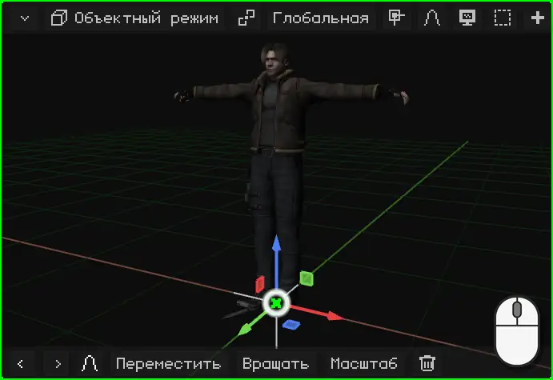

 Пальцем: поставь его на часть гизмо и тяни. Если поставить его на фон, ты будешь вращать вид.

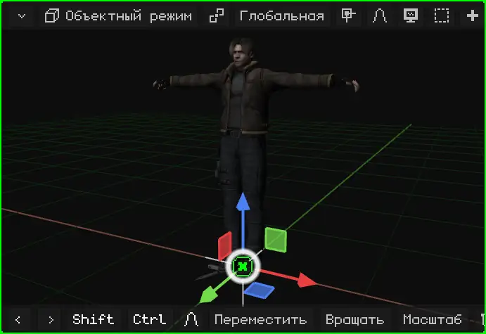

 На Nokia N95 гизмо по умолчанию выключено: перемещение, вращение и масштабирование выполняются клавишами, как описано ниже. Его можно включить в Наложения → Гизмо, чтобы пользоваться им с Bluetooth-мышью.

### С клавиатуры или командами

С клавиатуры ни во что целиться не нужно: нажимаешь клавишу, и объект следует за мышью (или за стрелками на телефоне), пока ты не подтвердишь.

| | Переместить | Вращать | Масштаб | Только по одной оси | Подтвердить | Отменить |
|---|---|---|---|---|---|---|
|  ПК | <kbd>G</kbd> | <kbd>R</kbd> | <kbd>S</kbd> | <kbd>X</kbd> / <kbd>Y</kbd> / <kbd>Z</kbd> | Клик или <kbd>Enter</kbd> | <kbd>Esc</kbd> или правый клик |
|  Nokia N95 | <kbd>1</kbd> | <kbd>2</kbd> | <kbd>3</kbd> | <kbd>1</kbd> / <kbd>2</kbd> / <kbd>3</kbd> | <kbd>OK</kbd> (центр джойстика) | <kbd>C</kbd> |

 Нажимаешь <kbd>G</kbd> и двигаешь мышь: объект следует за ней. Если нажать <kbd>X</kbd>, он движется только по X; ещё одно нажатие <kbd>X</kbd> переключает с Глобальной на Локальную. То же самое при вращении: <kbd>R</kbd>, а потом <kbd>Z</kbd> вращает вокруг оси Z, вертикальной; без оси объект вращается в плоскости экрана. Можно также ввести число: <kbd>G</kbd>, <kbd>X</kbd>, <kbd>2</kbd> и <kbd>Enter</kbd> сдвигают его на 2 метра по X.

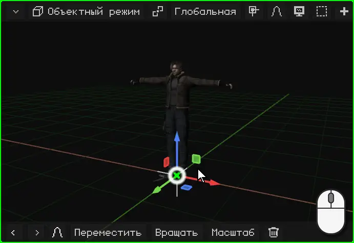

 На Nokia N95: <kbd>1</kbd> — переместить, <kbd>2</kbd> — вращать, <kbd>3</kbd> — масштабировать, а движение выполняют **стрелки**. Пока операция идёт, <kbd>1</kbd>, <kbd>2</kbd> и <kbd>3</kbd> уже не меняют операцию: они выбирают ось X, Y или Z. Например, <kbd>2</kbd>, а потом <kbd>3</kbd> вращает вокруг оси Z, вертикальной. <kbd>OK</kbd> подтверждает, а <kbd>C</kbd> отменяет.

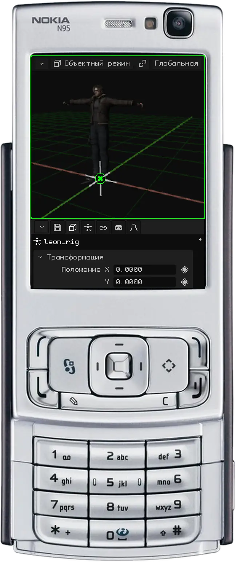

 **На сенсорном экране** без клавиатуры можно пользоваться гизмо, как описано выше, или **командами** панели инструментов 3D-вьюпорта. Касаешься **Переместить**, **Вращать** или **Масштаб** и ведёшь пальцем в любом месте вида: объект следует за пальцем. Панель меняется: **зелёная галочка** подтверждает, **красный крестик** отменяет, а кнопки **X**, **Y** и **Z** ограничивают движение этими осями.

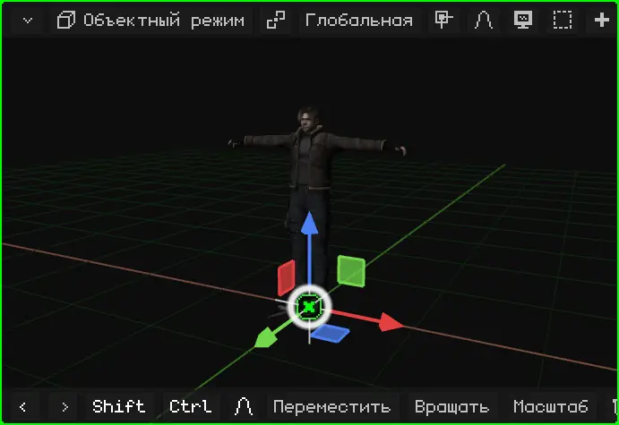

### Точными числами

Для точной работы движение задаётся числом: повернуть что-то ровно на 90°, уменьшить вдвое с `0.5` или увеличить ровно вдвое с `2`, или сдвинуть на 1,5 метра. **Одна единица Whisk3D — это один метр.**

Пока операция идёт, строка меню 3D-вьюпорта показывает, что делается, и значение.

 **С клавиатуры:** после <kbd>G</kbd>, <kbd>R</kbd> или <kbd>S</kbd> введи число и нажми <kbd>Enter</kbd>. <kbd>R</kbd> <kbd>Z</kbd> <kbd>9</kbd> <kbd>0</kbd> <kbd>Enter</kbd> поворачивает объект на 90° вокруг вертикальной оси; <kbd>S</kbd> <kbd>0</kbd> <kbd>.</kbd> <kbd>5</kbd> <kbd>Enter</kbd> уменьшает его вдвое, а <kbd>S</kbd> <kbd>2</kbd> <kbd>Enter</kbd> увеличивает вдвое; <kbd>G</kbd> <kbd>X</kbd> <kbd>1</kbd> <kbd>.</kbd> <kbd>5</kbd> <kbd>Enter</kbd> сдвигает его на 1,5 метра по X.

 **На сенсорном экране:** начни операцию кнопкой **Переместить**, **Вращать** или **Масштаб** на панели инструментов и коснись верхней строки — той, что показывает значение: откроется цифровая клавиатура Whisk3D. Введи число и коснись **OK**; зелёная галочка завершает операцию. Клавиатура умеет и считать, например `90/2`.

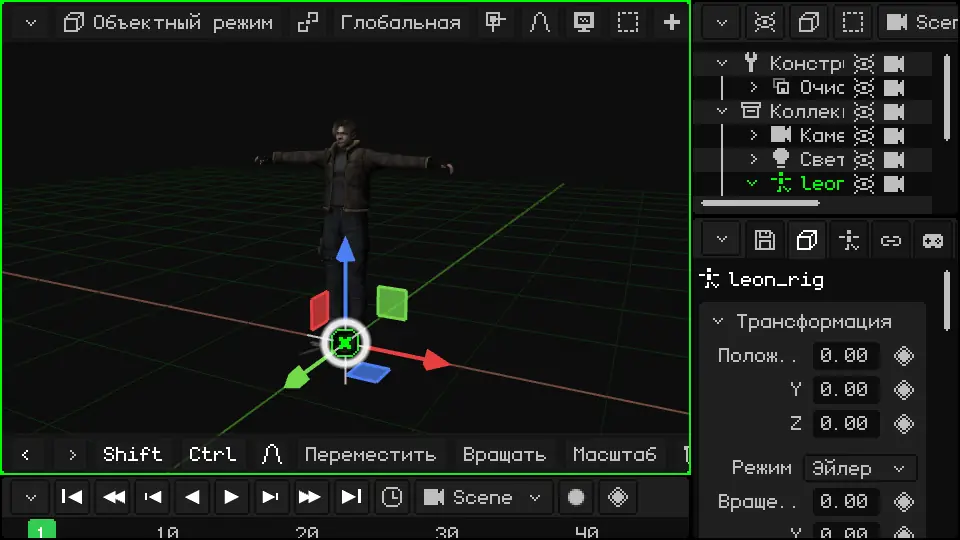

Все горячие клавиши Объектного режима есть в руководстве: [Перемещение, вращение и масштабирование](../editor/transformar.md) и [Объектный режим](../editor/modo-objeto.md).

### Панель инструментов: последние команды

  На **панели инструментов** 3D-вьюпорта (нижней) есть Отменить и Повторить (стрелки), а за ними — **последние команды, которыми ты пользовался**, последняя впереди. Сначала это Переместить, Вращать, Масштаб и Удалить. Если ты масштабируешь объект, Масштаб выходит вперёд: то, чем ты пользуешься чаще всего, всегда под рукой.

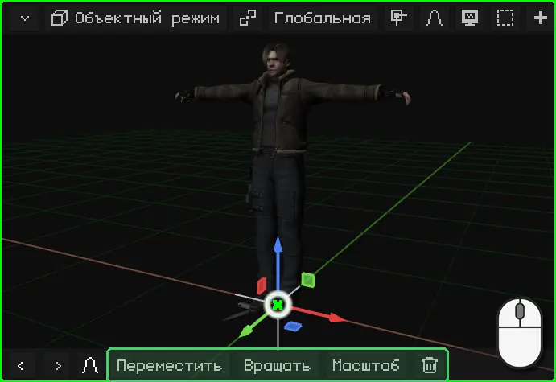

 На Nokia N95 панель инструментов по умолчанию скрыта, чтобы оставить экран сцене: перемещение, вращение и масштабирование выполняются клавишами телефона. Когда она появляется (например, панель пропорционального редактирования во время трансформации), её кнопками пользуются через **виртуальную мышь**: она включается правой клавишей выбора, стрелки двигают её, а <kbd>OK</kbd> делает клик.

## Относительно чего перемещать, вращать и масштабировать

### Центр объекта

У каждого объекта есть **центр**: точка, из которой выходит гизмо. Относительно неё выполняется трансформация: объект вращается вокруг своего центра и увеличивается или уменьшается от него. **Положение**, которое показывают Свойства, — это положение его центра.

У примитивов центр находится посередине. У импортированной модели он там, где его оставила программа, в которой её сделали: у Leon — у ног.

### 3D-курсор

**3D-курсор** — это круг с крестом в 3D-вьюпорте. Сначала он находится в центре мира.

 Он нужен для двух вещей:

- всё, что добавляется через **Добавить**, появляется в нём;
- он может быть центром, относительно которого выполняются вращение и масштабирование, как описано в разделе [Опорная точка](#опорная-точка).

3D-курсор перемещается через меню **Привязка**, которое также переносит объекты к курсору:

| | Как открыть меню Привязка |
|---|---|
|  ПК | <kbd>Shift</kbd> + <kbd>S</kbd> |
| Меню | Объект → Привязка (в Режиме редактирования — Меш → Привязка) |

| Пункт | Что делает |
|---|---|
| Курсор к выделенному | Переносит 3D-курсор в центр выделенного. В Режиме редактирования — в центр выделенных вершин, рёбер или граней. |
| Курсор к активному | Переносит 3D-курсор в центр активного объекта. |
| Курсор в начало координат | Возвращает его в центр мира. |
| Курсор к сетке | Переносит его в ближайшую точку сетки. |
| Выделение к курсору | Переносит выделенное к 3D-курсору. |
| Выделение к курсору (со смещением) | То же самое, но с несколькими объектами сохраняет расстояние между ними: группа переносится целиком. |
| Выделение к активному | Переносит выделенное к активному объекту. |
| Выделение к сетке | Ставит каждый выделенный объект в ближайшую точку сетки. |

Например, чтобы положить коробку кому-то в руку или поставить объект точно туда, где находится другой: выделяешь целевой объект — **Курсор к выделенному**; потом выделяешь тот, который нужно перенести, — **Выделение к курсору**.

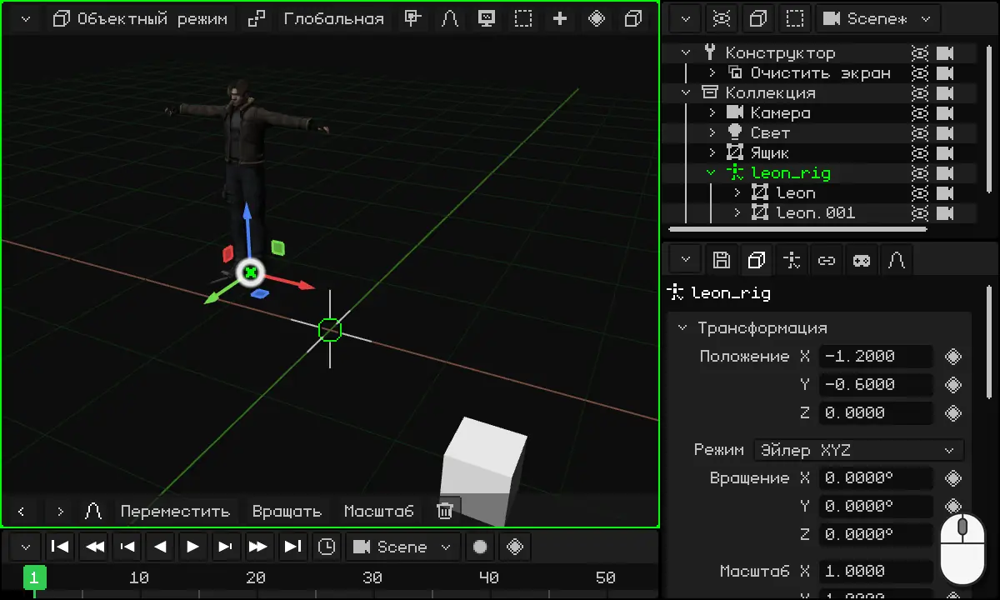

### Опорная точка

**Опорная точка** — это центр, относительно которого вращается и масштабируется выделенное. Она выбирается кнопкой опорной точки в строке меню 3D-вьюпорта, слева от **Глобальная** (её иконка меняется в зависимости от выбранной точки):

| Опорная точка | Относительно чего вращение и масштабирование |
|---|---|
| **Средняя точка** | Относительно центра всего выделенного. Выбрана по умолчанию. С одним объектом это его центр. |
| **Активный элемент** | Относительно центра активного объекта (последнего выделенного): остальные вращаются вокруг него. |
| **Индивидуальные центры** | Каждый объект относительно своего центра: все вращаются одновременно, каждый на своём месте. |
| **3D-курсор** | Относительно 3D-курсора. |

С **3D-курсором** можно повернуть что угодно вокруг любой точки: ставишь туда курсор (через меню Привязка) и вращаешь. Это удобно, чтобы расставить стулья вокруг стола, стрелки часов или всё, что должно вращаться вокруг чего-то.

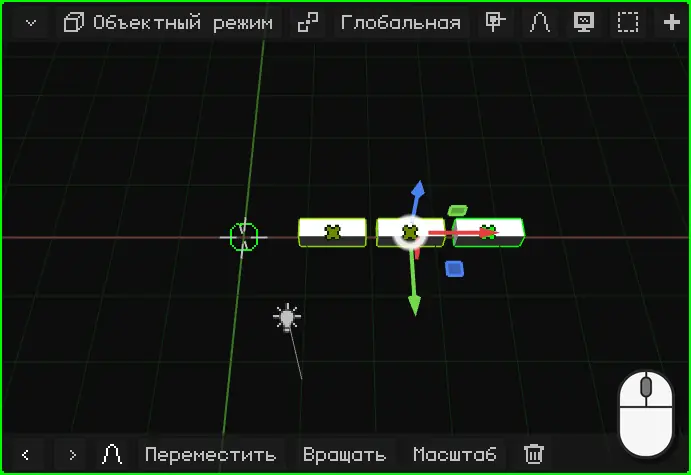

### Глобальная и Локальная

Когда ты перемещаешь, вращаешь или масштабируешь по оси, эта ось может быть осью **мира** или осью **объекта**. Это выбирается кнопкой **Глобальная** в строке меню 3D-вьюпорта:

| Ориентация | Оси |
|---|---|
| **Глобальная** | Оси мира: всегда одни и те же, Z смотрит вверх. Выбрана по умолчанию. |
| **Локальная** | Оси самого объекта, которые поворачиваются вместе с ним. |
| **Вид** | Оси экрана: X вбок, Y вверх. |
| **Нормаль** | В Режиме редактирования — направление, в котором смотрит выделенная грань. |

Разница видна, когда объект повёрнут. Например, Leon повёрнут на 40°: в **Глобальной** его ось Y — это ось мира, и он движется по диагонали относительно того, куда смотрит; в **Локальной** ось Y поворачивается вместе с ним, и он идёт прямо вперёд. То же с машиной, которая повернула за угол: чтобы она ехала вперёд, её двигают по Локальной оси.

 С клавиатуры повторное нажатие буквы оси переключает с Глобальной на Локальную: <kbd>G</kbd> <kbd>Y</kbd> перемещает по оси Y мира, а <kbd>G</kbd> <kbd>Y</kbd> <kbd>Y</kbd> — по оси Y объекта. На Nokia N95 то же самое делает <kbd>2</kbd> <kbd>2</kbd> во время перемещения.

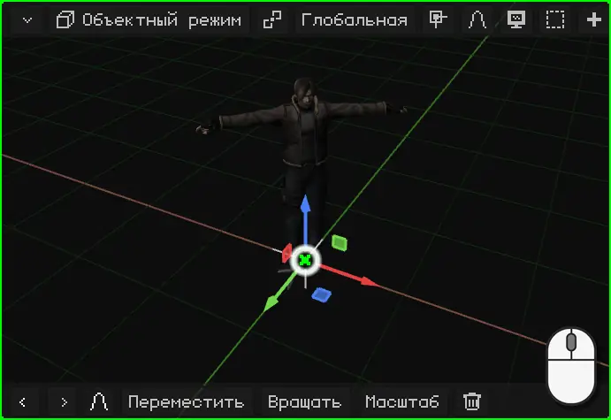

### Изменить центр объекта

Центр 3D-меша можно перенести, не сдвигая сам меш, через **Объект → Задать центр**. Как это делается, на примере двери, которая должна открываться на петле, описано в уроке [Изменить центр: дверь](puerta.md).

## Свойства

**Свойства** активного объекта находятся во вьюпорте Свойства. Вкладка **Объект** (с кубом) одинакова для всех объектов: сверху карточка **Трансформация** с положением, вращением и масштабом. Числа можно вводить вручную: клик (или касание) по числу, и печатай. Перемещение объекта в 3D-вьюпорте меняет эти числа, а изменение чисел перемещает объект.

Остальные вкладки зависят от типа объекта: у источника света есть вкладка света, у меша — вкладки материала и модификаторов.

### Ромб: что можно анимировать

Рядом со многими свойствами есть **ромб**. Ромб означает, что это свойство **можно анимировать**: клик по ромбу сохраняет его значение в текущем кадре (*ключевой кадр*), а ещё один клик по зелёному ромбу убирает его. С несколькими ключевыми кадрами свойство само меняется со временем.

Цвет ромба показывает состояние свойства: **серый** — оно ещё не анимировано; ярко-**зелёный** — оно уже анимировано, и в этом кадре есть ключевой кадр; **бледно-зелёный** — оно анимировано, но в этом кадре ключевого кадра нет.

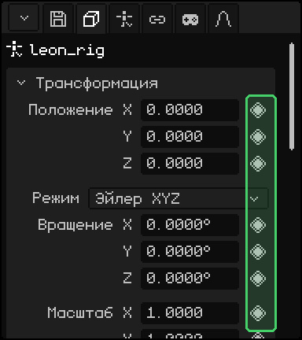

Анимации будет посвящён отдельный урок дальше.

### Лучше с масштабом 1

Совет: **оставляй масштаб объектов равным 1**. Увеличивать или уменьшать объект через Масштаб удобно, но масштабированный объект потом может доставить проблем: потомки наследуют масштаб и искажаются при вращении, а физика, столкновения и некоторые модификаторы могут считаться неправильно.

Если ты масштабировал объект, **примени масштаб**: его текущий размер становится настоящим, а масштаб возвращается к 1, и внешне ничего не меняется.

| | Как применить масштаб |
|---|---|
|  ПК | <kbd>Ctrl</kbd> + <kbd>A</kbd> → Масштаб |
| Меню | Объект → Применить → Масштаб |

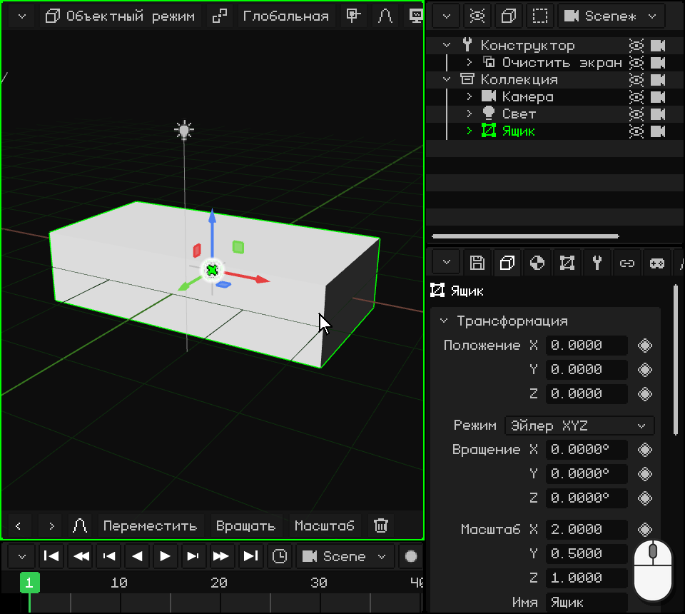

В том же меню **Положение** и **Вращение** делают то же самое с положением и вращением, а **Все трансформации** применяет все три.

## Аутлайнер: объекты сцены

**Аутлайнер** — это список всех объектов сцены. Клик (или касание) по строке выделяет этот объект, так же как в 3D-вьюпорте. На ПК он находится справа вверху.

Объект может находиться **внутри другого**: он стоит правее, под ним. Внешний объект — **родитель**, а внутренний — **потомок**. Потомок **наследует трансформации** родителя: если перемещать, вращать или масштабировать родителя, потомок следует за ним. Потомка можно двигать и отдельно, но всегда относительно родителя.

Пример — Leon: его меши, четыре видимые части, — потомки его скелета, `leon_rig`. Если переместить скелет, переместится весь Leon.

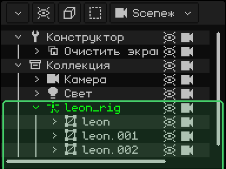

Вложить объект в другой — значит **связать с родителем**:

| | Как связать с родителем |
|---|---|
|  ПК | В Аутлайнере перетащить строку потомка и отпустить её на строке родителя. Или выделить потомка, потом родителя (с <kbd>Shift</kbd>) и нажать <kbd>Ctrl</kbd> + <kbd>P</kbd>. |
|  Сенсорный экран | Выделить потомка; включить **Shift** на панели инструментов и коснуться родителя; потом меню Объект → Задать родителя. |
|  Nokia N95 | При активном Аутлайнере и выделенном потомке: <kbd>1</kbd>, стрелка **вправо** вкладывает его в объект над ним, а **влево** вынимает; ещё раз <kbd>1</kbd> подтверждает. |
| Меню | Объект → Задать родителя; чтобы убрать связь, Объект → Снять родителя |

 На видео коробку перетаскивают в Аутлайнере на `leon_rig`: она становится его потомком, и когда Leon перемещается, коробка следует за ним.

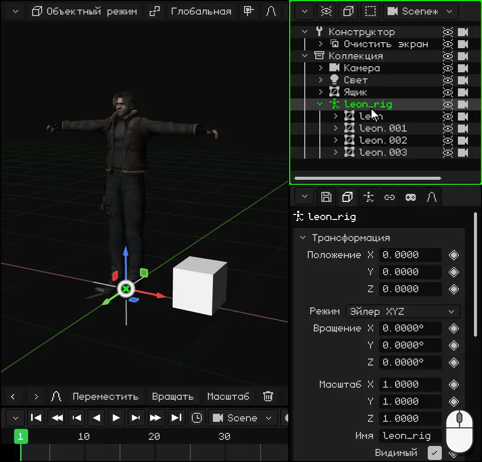

## Типы объектов

Все объекты добавляются из меню **Добавить** (кнопка **+** в строке меню 3D-вьюпорта или <kbd>Shift</kbd> + <kbd>A</kbd> на ПК). Новый объект появляется в 3D-курсоре и остаётся выделенным.

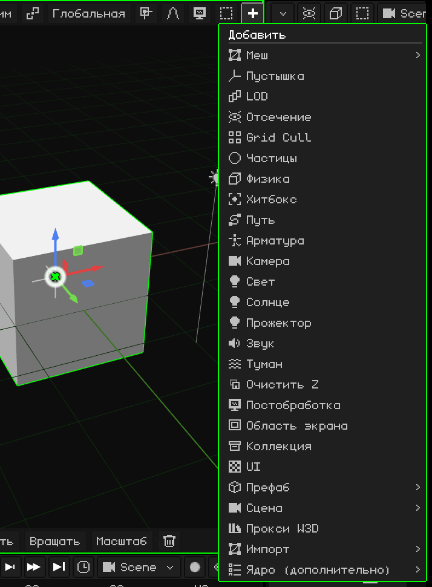

Основные:

| Объект | Что это |
|---|---|
| [3D-меш](../editor/objeto-malla.md) | 3D-модель: персонаж, дом, камень. Состоит из вершин, рёбер и граней и отображается со своим материалом и текстурами. Примитивы из Добавить → Меш (куб, сфера, цилиндр...) — это меши, с которых начинают моделирование. |
| [Камера](../editor/objeto-camara.md) | Точка обзора игры и рендеров. То, что видит активная камера, видно в игре и получается на изображении или видео. |
| [Свет](../editor/objeto-luz.md) | Освещает сцену. Есть три типа: Точечный (лампочка), Солнце (дневной свет с параллельными лучами) и Прожектор (конус, как у фонарика). |
| [Арматура](../editor/objeto-esqueleto.md) | Цепочка костей, которая двигает меш, для анимации персонажей. У Leon есть такой скелет: когда скелет идёт, меш следует за ним. |
| [Звук](../editor/objeto-sonido.md) | Звук, размещённый в сцене. Может звучать фоном, как музыка, или из того места, где находится объект. |
| Пустышка | Объект без формы: точка в сцене. Служит родителем, чтобы сгруппировать другие объекты, или ориентиром. |
| Коллекция | Папка для упорядочивания объектов в Аутлайнере. |

Есть и другие: пути, туман, частицы, хитбоксы для столкновений, 2D-интерфейсы для игр и объекты для оптимизации. А в будущем будет добавляться ещё много других. Этот урок рассказывает об объектах в целом; у каждого есть своя статья, где его свойства объясняются одно за другим.

## Что есть у всех объектов

Кроме трансформации и свойств, у любого объекта могут быть:

- Lua-**скрипты**, которые задают его поведение в игре: чтобы он двигался сам, реагировал на клавиши, сталкивался. О них речь пойдёт дальше.
- **Анимации**: любое свойство с ромбом можно анимировать. Им посвящён отдельный урок.
- **Ограничители**: правила, которые привязывают объект к другому, например копировать его положение или всегда смотреть на камеру. Они описаны в разделе [Ограничители](../editor/restricciones.md).

У некоторых типов есть и что-то своё. Например, у 3D-мешей есть **модификаторы**, которые меняют форму, не разрушая её: отражают её как в зеркале, повторяют, сглаживают. Они описаны в разделе [3D-меш](../editor/objeto-malla.md).

## Импорт 3D-моделей

Кроме моделирования в Whisk3D, можно загружать модели, сделанные в других программах. Поддерживаются такие форматы:

| Формат | Что загружается |
|---|---|
| **GLB** и **glTF** | Меш, материалы и текстуры, скелет и анимации. Это самый полный формат: Leon хранится в .glb. |
| **OBJ** | Меш, материалы и текстуры (с файлом .mtl). Без скелета и анимаций. |
| **FBX** | Меш, материалы, скелет и анимации. |
| **STL** | Только форма: треугольники, без материалов и цветов. Это формат 3D-печати и CAD-программ. |

Импорт выполняется через **Добавить → Импорт**: выбираешь формат, а потом файл.

 На ПК файл можно также перетащить из папки и отпустить над 3D-вьюпортом.

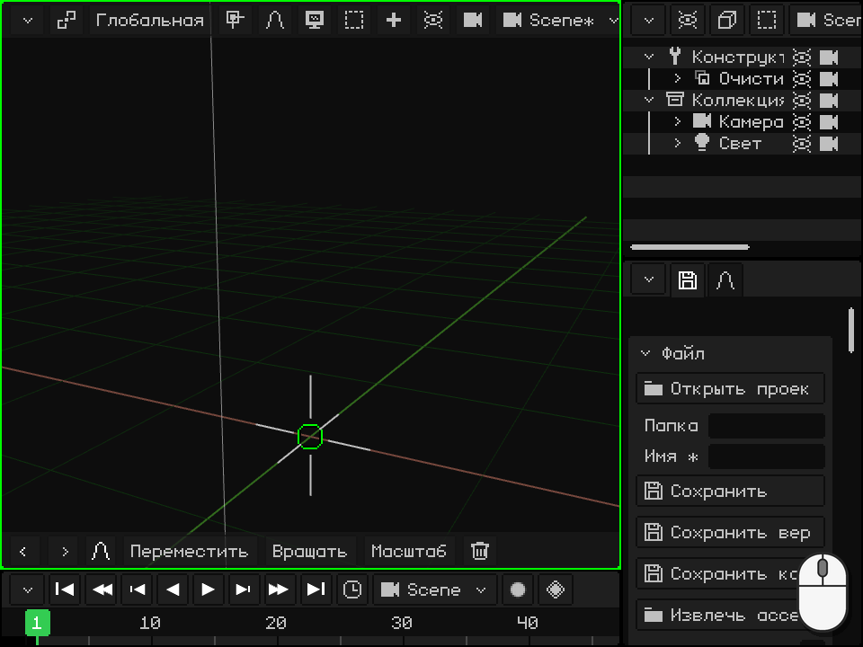

Модель со скелетом загружается как **скелет с мешами внутри**: скелет — родитель, а меши — его потомки, как было показано в разделе [Аутлайнер](#аутлайнер-объекты-сцены). Анимации сохраняются в скелете и готовы к использованию.

Чтобы перенести модель в другую программу или на 3D-принтер, есть обратный путь: Свойства → вкладка с дискетой → **Экспорт**, с форматами OBJ, glTF, GLB или STL.
