# Навигация в 3D Viewport

> [!NOTE]
> Nokia N95 поддерживает мышь и клавиатуру (по Bluetooth). Части этого урока про Nokia объясняют, как пользоваться им без мыши и клавиатуры, только кнопками телефона.

В этом уроке рассказывается, как перемещаться в 3D Viewport. Навигация — это движение твоей точки обзора: вращение вокруг сцены, сдвиг вбок, приближение и отдаление.

Уметь перемещаться по сцене важно: чтобы создавать 3D-модели и анимации удобно и быстро, нужно уметь двигаться по сцене и занимать удобное для работы положение.

Как объяснялось в [предыдущем уроке](viewports.md#активный-вьюпорт), чтобы пользоваться командами ниже, 3D Viewport должен быть активным вьюпортом — тем, что в зелёной рамке.

Чаще всего ты будешь пользоваться тремя действиями: **орбитой**, **сдвигом** и **зумом**. Каждое можно выполнить мышью, пальцами на сенсорном экране или с клавиатуры Nokia N95. На видео с ПК мышь в правом нижнем углу показывает зелёным кнопку, которая сейчас нажата.

## Орбита

Орбита — это вращение вида вокруг сцены, как будто ты обходишь стол, чтобы со всех сторон рассмотреть то, что на нём лежит.

**Мышью:** зажми **среднюю кнопку** (она нажимается, если надавить на колесо) и перетаскивай. На тачпаде или на мыши без средней кнопки удерживай <kbd>Alt</kbd> и перетаскивай, зажав **основную кнопку** (левую).

**Пальцем:** веди пальцем по 3D Viewport. Начинай на фоне: если поставить палец на гизмо (цветные стрелки объекта), ты начнёшь двигать его.

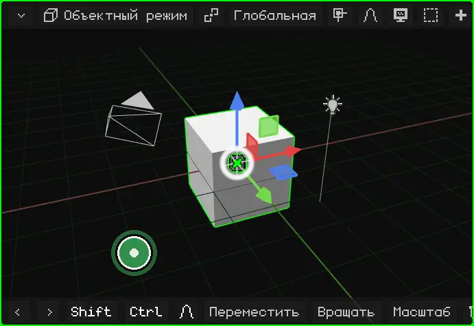

**На Nokia N95:** удерживай **стрелку** джойстика. Вид вращается в эту сторону, пока ты её держишь.

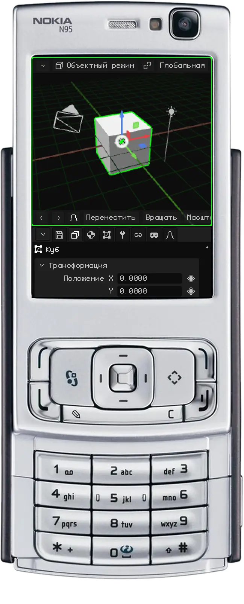

## Сдвиг

Сдвиг (или *панорамирование*) смещает вид вбок, вверх или вниз, не поворачивая его.

**Мышью:** удерживай <kbd>Shift</kbd> и перетаскивай, зажав **среднюю кнопку**. На тачпаде: <kbd>Alt</kbd> + <kbd>Shift</kbd> и перетаскивай, зажав основную кнопку.

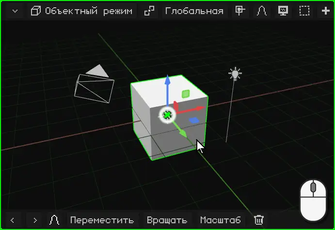

**Пальцами:** поставь **два пальца** и веди их вместе в одну сторону.

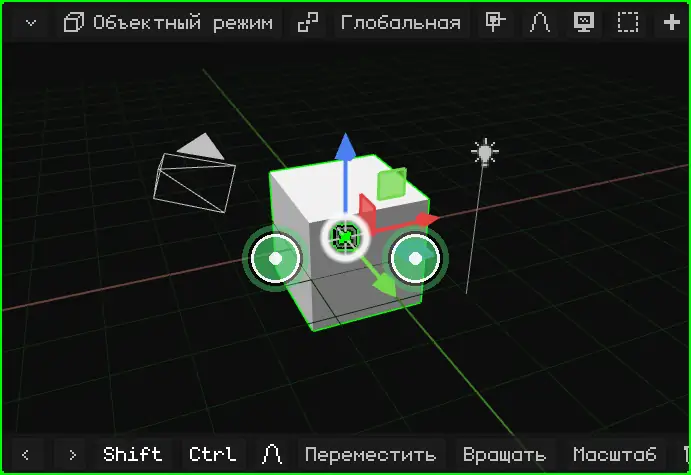

**На Nokia N95:** удерживай клавишу <kbd>\*</kbd> и нажимай стрелки.

## Зум

С зумом ты приближаешься или отдаляешься. Шаг подстраивается под расстояние: вблизи чего-то маленького зум идёт медленно, а издалека — быстро. Поэтому он одинаково подходит и для всей сцены, и для одной вершины.

**Мышью:** крути **колесо**. Вперёд — приближение, назад — отдаление. На тачпаде веди двумя пальцами вверх или вниз.

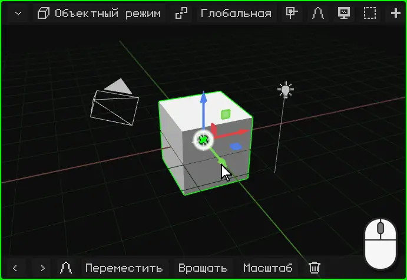

**Пальцами:** сделай щипок. Если развести пальцы, вид приближается, если свести — отдаляется.

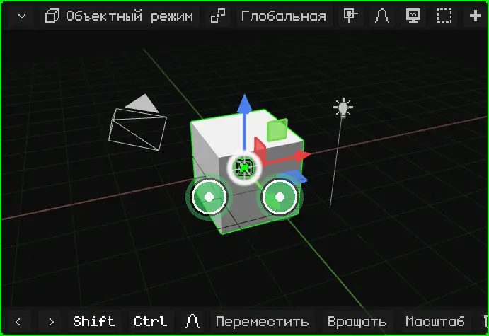

**На Nokia N95:** удерживай <kbd>0</kbd> и нажимай стрелку **вверх**, чтобы приблизить, или стрелку **вниз**, чтобы отдалить.

## Кадрировать выделенное

Если всё пропало из виду или нужно поработать с чем-то конкретным, **кадрируй** это: вид центрируется на выделенном и подбирает зум так, чтобы оно ровно поместилось. После этого орбита вращает вид вокруг него.

| | Как кадрировать |
|---|---|
| ПК | <kbd>Num .</kbd> (точка на цифровой клавиатуре) |
| Nokia N95 | Одно нажатие <kbd>0</kbd>, без стрелок (если удерживать его со стрелкой, это зум) |
| Сенсорный экран | Двойное касание двумя пальцами |
| Меню | View → Frame Selected |

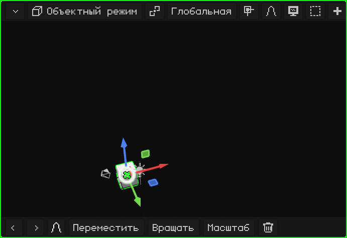

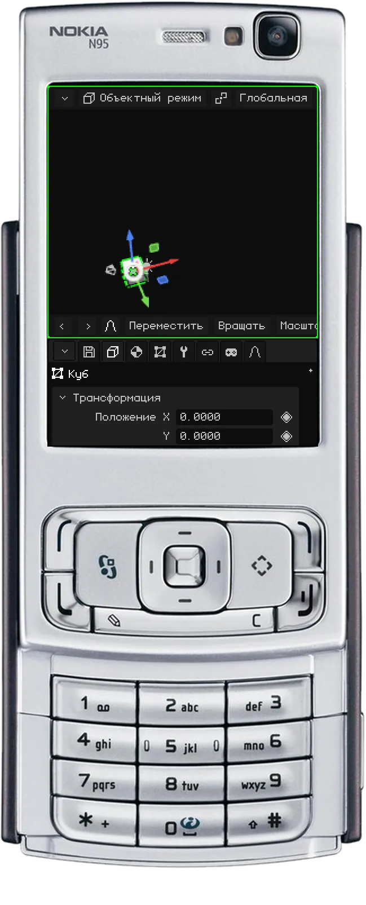

### В Edit Mode

В [Edit Mode](../editor/modo-edicion.md) кадрируется выделенная часть меша: выбранные вершины, рёбра или грани, а не весь объект. Это удобно, чтобы поработать над деталью большой модели: выдели её, кадрируй и вращай вид вокруг неё.

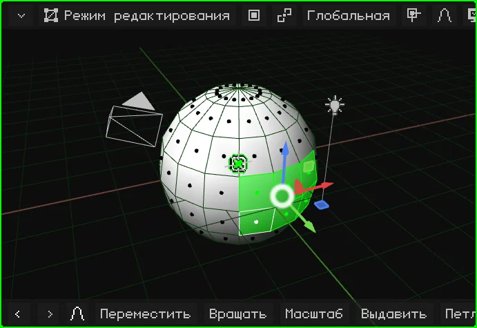

## Локальный вид

Когда в сцене много всего, работать с чем-то одним неудобно: то, что впереди, загораживает обзор, а при орбите всё время оказывается на пути. **Локальный вид** оставляет видимым только выделенное (один или несколько объектов) и кадрирует его. Остальное не удаляется и не скрывается в сцене: оно просто перестаёт отображаться в этом вьюпорте. Слева вверху появляется надпись "Local View".

Чтобы вернуться, сделай то же самое ещё раз: всё снова появится, а вид станет таким, каким был до этого.

| | Как войти и выйти |
|---|---|
| ПК | <kbd>/</kbd> |
| Nokia N95 и сенсорный экран | Меню View → Local View |

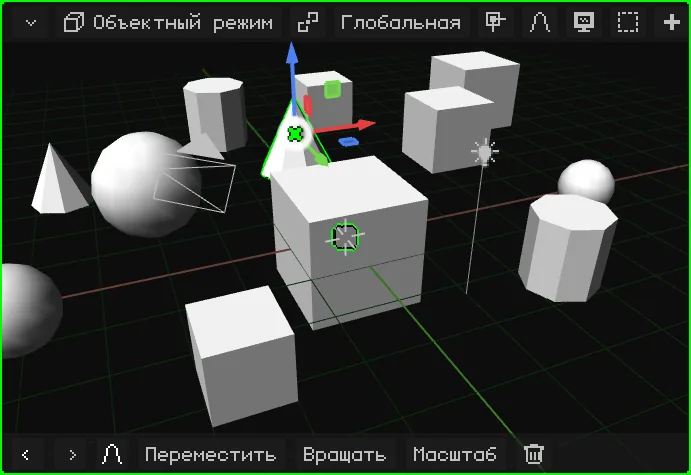

## Виды спереди, сбоку и сверху

Чтобы посмотреть на сцену ровно с одной стороны, не подгоняя орбиту вручную:

| Вид | ПК | Меню |
|---|---|---|
| Спереди / Сзади | <kbd>Num 1</kbd> / <kbd>Ctrl</kbd> + <kbd>Num 1</kbd> | View → Viewpoint → Front / Back |
| Справа / Слева | <kbd>Num 3</kbd> / <kbd>Ctrl</kbd> + <kbd>Num 3</kbd> | View → Viewpoint → Right / Left |
| Сверху / Снизу | <kbd>Num 7</kbd> / <kbd>Ctrl</kbd> + <kbd>Num 7</kbd> | View → Viewpoint → Top / Bottom |

С <kbd>Ctrl</kbd> каждая клавиша даёт противоположный вид.

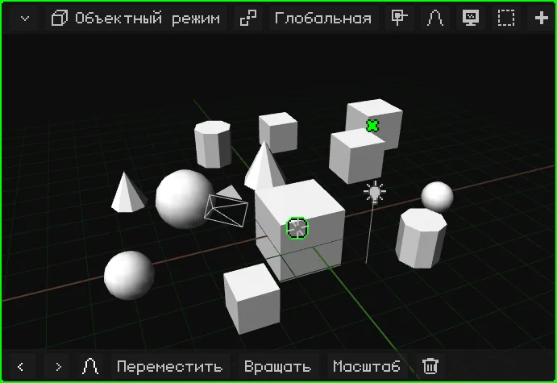

**На Nokia N95:** удерживай клавишу <kbd>#</kbd> и нажми стрелку. Влево и вправо поворачивают вид вокруг сцены на 90° за раз. Вверх переключает на вид сверху; вниз возвращает вид сбоку, а ещё одно нажатие вниз даёт вид снизу. Если вид был повёрнут свободной орбитой, первая стрелка только выравнивает его по ближайшему из этих видов.

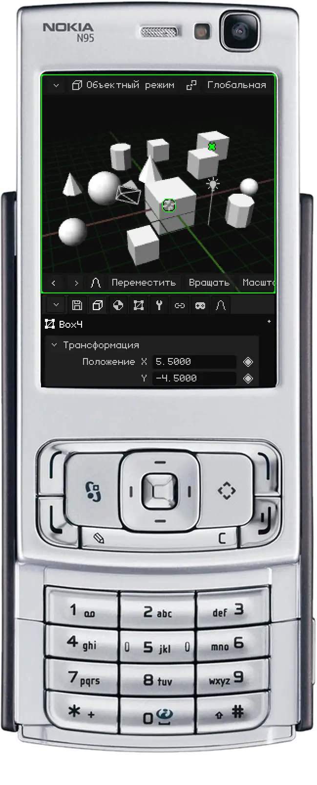

## Перспектива и ортографическая проекция

3D Viewport может показывать сцену двумя способами:

- **Перспектива:** так, как видит глаз или камера. Далёкое выглядит меньше, а параллельные линии (края дороги, ряды коробок на видео) сходятся к горизонту. Так всё выглядит на самом деле, с глубиной.
- **Ортографическая проекция:** без перспективы. Всё сохраняет свой размер, близко оно или далеко, а параллельные линии остаются параллельными. Это как архитектурный план или технический чертёж.

Ортографическая проекция нужна для точного моделирования: выравнивать объекты, сравнивать размеры и измерять так, чтобы расстояние не обманывало. Вместе с видами спереди, сбоку и сверху это как работа над чертежом. Перспектива нужна, чтобы увидеть, как всё будет выглядеть.

| | Как переключить |
|---|---|
| ПК | <kbd>Num 5</kbd> |
| Nokia N95 | Одно нажатие <kbd>#</kbd>, без стрелок |
| Меню | View → Perspective/Ortho |

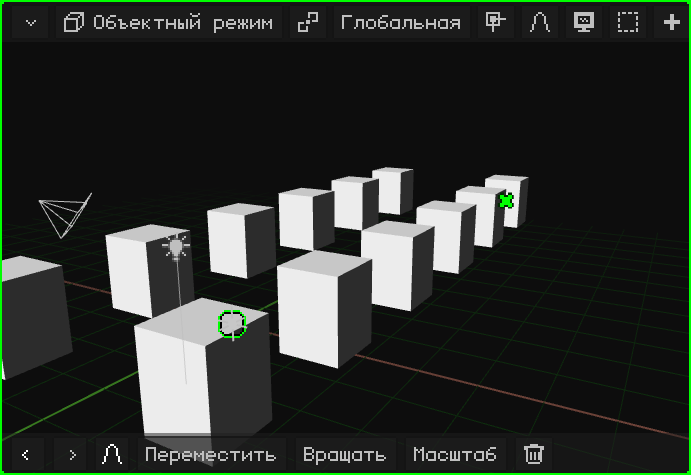

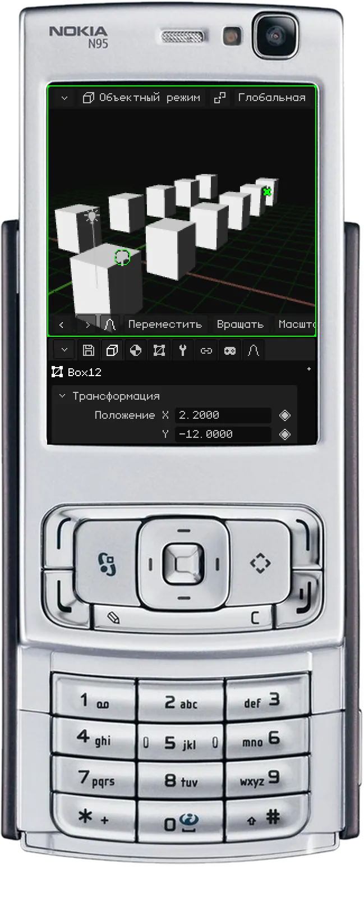

## Активная камера

В сцене может быть несколько камер, но **активная камера** только одна: та, что используется в игре и для рендеров. Что видит эта камера, то видно в игре и то получается, когда ты рендеришь изображение или видео. Вид, в котором ты перемещаешься, нужен только для работы: его нет ни в игре, ни в рендерах.

Чтобы посмотреть через активную камеру:

| | Как войти и выйти |
|---|---|
| ПК | <kbd>Num 0</kbd> |
| Nokia N95 | <kbd>8</kbd> (вне Edit Mode: там 8 — это Loop Cut) |
| Меню | View → Cameras → Active Camera |

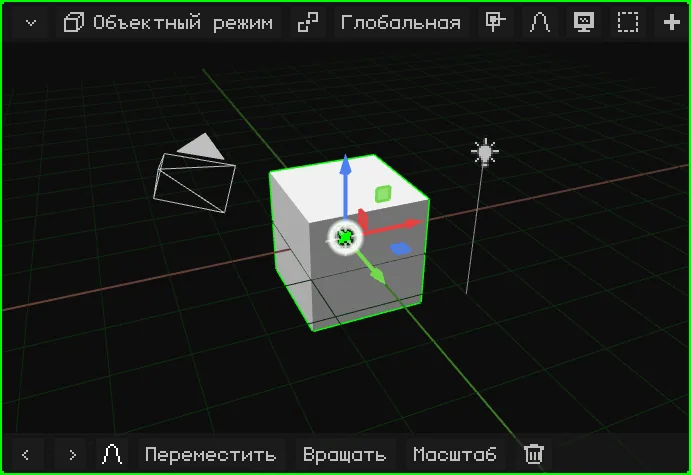

Прямоугольник — это кадр: что внутри, то и получится. Внизу по центру есть **замок**:

- **Открыт** (изначально): зум и сдвиг только приближают тебя, чтобы проверить кадр, а камеру не трогают. Орбита выводит из вида через камеру, и ты продолжаешь навигацию с того места, где стояла камера.
- **Закрыт:** орбита, сдвиг и зум двигают **камеру**. Так настраивается кадр.

Он открывается и закрывается касанием или кликом.

Чтобы активной стала другая камера, выдели её и нажми <kbd>Ctrl</kbd> + <kbd>Num 0</kbd> (или View → Cameras → Set Active Object as Camera).

## Другие параметры вида

| Параметр | Что делает | ПК | Nokia N95 |
|---|---|---|---|
| Поворот вида | Поворачивает вид на 15° вокруг его собственной оси, как при наклоне головы. | <kbd>Num 4</kbd> / <kbd>Num 6</kbd> | — |
| Lock Orbit | Вид перестаёт вращаться: то, что его вращало, теперь его сдвигает, как на 2D-доске. | View → Lock Orbit | <kbd>9</kbd> |

Все горячие клавиши редактора собраны в разделе [Горячие клавиши](../editor/atajos.md), а страница руководства [Навигация](../editor/navegacion.md) сводит их в таблицы.
