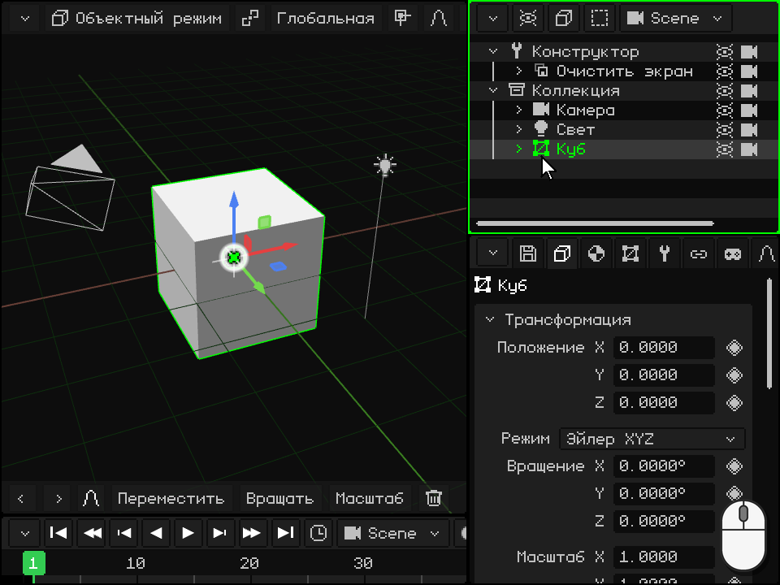
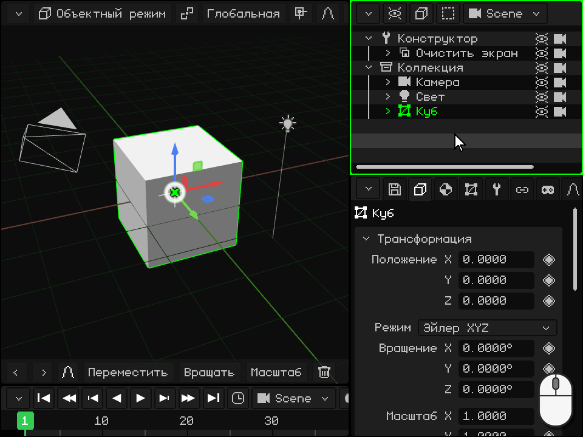
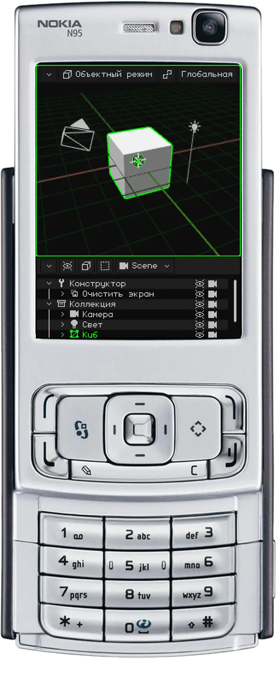
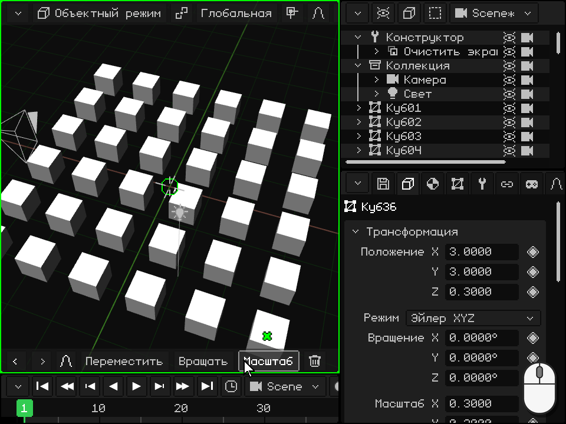
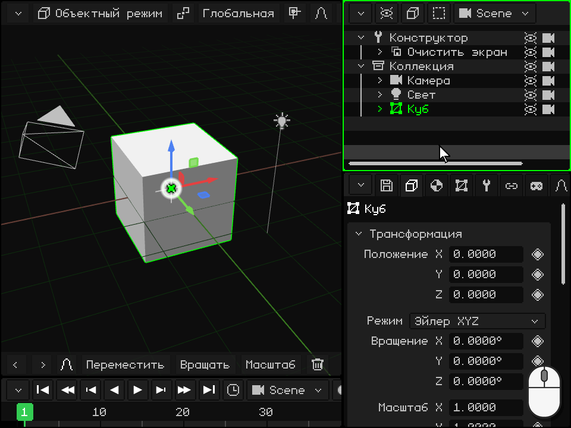

# Аутлайнер

> [!NOTE]
>  Nokia N95 поддерживает мышь и клавиатуру (по Bluetooth). Части этой страницы про Nokia объясняют, как пользоваться им без мыши и клавиатуры, только кнопками телефона.

**Аутлайнер** — это список всего, что есть в сцене: объектов, камер, источников света и коллекций. Это один из вьюпортов, о которых шла речь в уроке [Вьюпорты](viewports.md); на ПК он находится справа вверху. Здесь объекты выделяют, скрывают, упорядочивают, вкладывают друг в друга и переименовывают.

То, что ты выделяешь в Аутлайнере, выделяется и в 3D-вьюпорте, и наоборот. Последний выделенный — это **активный объект**: его показывают Свойства.

 **На Android** Аутлайнера на экране нет: место отдано 3D-вьюпорту и Свойствам. Чтобы им пользоваться, преврати вьюпорт в Аутлайнер (или раздели какой-нибудь) кнопкой в углу, как в разделе [Сменить тип](viewports.md#сменить-тип). Работать можно и без Аутлайнера: объекты выделяются касанием в 3D-вьюпорте, а в Свойствах есть имя и флажки **Видимый** и **Рендерить**.

 **На Nokia N95** Аутлайнера на экране нет: помещаются только два вьюпорта. Пока наводишь порядок в сцене, преврати Свойства в Аутлайнер: **левой софт-клавишей** ты входишь в их вкладки, а стрелкой влево доходишь до меню кнопки в углу; там выбери Аутлайнер. Чтобы вернуться, левая софт-клавиша в Аутлайнере сразу открывает это меню. **Зелёной клавишей**  ты делаешь его активным вьюпортом: всё, что дальше описано для N95, выполняется, когда зелёная рамка на Аутлайнере.

## Что показывает каждая строка

Каждая строка — это объект. **Стрелка** сворачивает или разворачивает то, что у него внутри; **иконка** показывает его тип (меш, камера, свет, коллекция...); дальше идёт **имя** — зелёное, если объект активный, и тёмно-зелёное, если он выделен; а справа — **глаз** и **камера**. Объект, который находится внутри другого, стоит правее, под ним, а бледная строка — это скрытый объект.

В новом проекте сверху находится **Конструктор** — процедура, которая подготавливает экран, а под ним **Коллекция** с камерой, светом и кубом. Коллекция — это папка для порядка.

## Выделение

| | Как выделить |
|---|---|
|  ПК | Клик по строке выделяет только этот объект. <kbd>Shift</kbd> + клик выделяет все строки от активной до этой. <kbd>Ctrl</kbd> + клик добавляет или убирает одну. Когда мышь над Аутлайнером, стрелки вверх и вниз переходят на предыдущую или следующую строку. |
|  Сенсорный экран | Касание строки. Если на панели инструментов 3D-вьюпорта включены **Shift** или **Ctrl**, касание работает так же, как с клавиатурой. Перетаскивание пальцем прокручивает список. |
|  Nokia N95 | Стрелки вверх и вниз переходят на предыдущую или следующую строку, и список сам прокручивается следом. |
| Меню | Выделить → Выделить всё, Снять всё выделение или Инвертировать выделение |

## Свернуть и развернуть

Если у объекта внутри есть другие, его стрелка показывает или прячет их. Если свернуть то, чем сейчас не пользуешься, список станет короче.

| | Как свернуть и развернуть |
|---|---|
|  ПК | Клик по стрелке. Когда мышь над Аутлайнером, стрелка вправо на клавиатуре разворачивает активный объект, а стрелка влево сворачивает его; если он уже свёрнут, стрелка влево переходит к внешнему объекту и сворачивает его. |
|  Сенсорный экран | Касание стрелки. |
|  Nokia N95 | Вправо разворачивает активный объект, а влево сворачивает его; если он уже свёрнут, влево переходит к внешнему объекту и сворачивает его. |

## Скрыть: глаз и камера

- **Глаз** показывает или скрывает объект в 3D-вьюпорте. Скрытый объект не попадает и в рендер. Если внутри него есть другие объекты, они скрываются вместе с ним, и их строки становятся бледными.
- **Камера** решает, попадает ли объект в **рендер**. Если её выключить, объект по-прежнему виден, пока ты работаешь, но не появляется на изображениях и видео, которые ты рендеришь.

Нажатие на них не меняет выделение.

| | Глаз | Камера |
|---|---|---|
|  ПК | Клик по глазу или <kbd>H</kbd> (когда мышь над Аутлайнером) для активного объекта | Клик по камере |
|  Сенсорный экран | Касание глаза | Касание камеры |
|  Nokia N95 | <kbd>2</kbd>, для активного объекта | <kbd>3</kbd>, для активного объекта |
| Меню | Элемент → Скрыть/Показать (для активного объекта) | — |

Оба переключателя есть и в Свойствах, в карточке Трансформация: **Видимый** и **Рендерить**. У них есть ромб, поэтому их можно анимировать: например, чтобы что-то появилось в определённый момент видео.

## Упорядочить и вложить один объект в другой

Порядок в списке можно менять, а объект можно вложить **внутрь** другого: он становится его **потомком**, и когда родитель перемещается, вращается или масштабируется, потомок следует за ним. В уроке [Объектный режим](modo-objeto.md#аутлайнер-объекты-сцены) это называется **связать с родителем**. Сам объект в сцене не сдвигается: меняется только его место в списке.

 **Мышью:** возьми строку и перетащи её. Над верхним или нижним краем другой строки появляется **зелёная линия**: если отпустить, объект встанет перед этой строкой или после неё, на том же уровне. Над серединой другой строки эта строка подсвечивается: если отпустить, объект окажется **внутри** неё. Если отпустить ниже последней строки, объект выходит из всего, что его содержало. У верхнего или нижнего края список прокручивается сам, так что можно добраться до любой строки длинного списка.

 **Пальцем:** держи палец неподвижно на строке секунду, пока телефон не завибрирует: строка захвачена. Потом перетащи её и отпусти так же, как мышью. Если отпустить её, не сдвинув, откроется меню объекта. Без этой паузы перетаскивание пальцем прокручивает список.

 **На Nokia N95:** выбери строку стрелками и нажми <kbd>1</kbd>. Строка станет зелёной, и теперь стрелки двигают её:

-  **Вверх** и **вниз** поднимают или опускают её среди строк того же уровня.
-  **Вправо** вкладывает её внутрь строки над ней, того же уровня.
-  **Влево** вынимает её из того объекта, в котором она находится: она встаёт после него, на его уровне.
-  Ещё раз <kbd>1</kbd> (или <kbd>OK</kbd>) оставляет её там. <kbd>C</kbd> отменяет и возвращает её на прежнее место.

 Весь путь отменяется за один раз, через <kbd>C</kbd> + влево. Это пригодится, например, чтобы поставить источник света перед объектами, которые он освещает.

## Найти активный объект и кадрировать его

В большой сцене список длинный, а выделение в 3D-вьюпорте его не прокручивает: строка объекта может оказаться за пределами видимой части. Чтобы найти её в списке или увидеть объект в 3D-вьюпорте (**кадрировать** его, как в разделе [Кадрировать выделенное](navegacion.md#кадрировать-выделенное)):

| | В Аутлайнере | В 3D-вьюпорте |
|---|---|---|
|  ПК | <kbd>Num .</kbd>, когда мышь над Аутлайнером (**Показать активный**): список прокручивается, пока выделенное не окажется посередине. Если объект внутри чего-то свёрнутого, у него нет строки: сначала разверни. | <kbd>Num .</kbd>, когда мышь над 3D-вьюпортом |
|  Сенсорный экран | Прокрути список пальцем | Двойное касание двумя пальцами в 3D-вьюпорте |
|  Nokia N95 | Список сам следует за строкой, которую ты выбираешь стрелками | Одно нажатие <kbd>0</kbd>, даже если активный вьюпорт — Аутлайнер |
| Меню | — | Вид → Показать выделенное, в строке меню 3D-вьюпорта |

## Переименовать

| | Как переименовать |
|---|---|
|  ПК | Двойной клик по имени или <kbd>F2</kbd> для активного объекта: строка превращается в текстовое поле. Напиши новое имя и подтверди <kbd>Enter</kbd> или кликом в другом месте; <kbd>Esc</kbd> оставляет всё как было. |
|  Сенсорный экран | Двойное касание имени: открывается экранная клавиатура. |
|  Nokia N95 | Левой софт-клавишей ты входишь в строку меню, а стрелкой вправо доходишь до Элемент → Переименовать. Введи имя через T9 и подтверди <kbd>OK</kbd>. |
| Меню | Элемент → Переименовать |

Два объекта одной сцены не могут называться одинаково: если имя уже занято, Whisk3D добавляет к нему номер и предупреждает тебя. Если скрипт обращался к объекту по имени, он обновляется сам.

## Дублировать и удалить

| | Дублировать | Удалить |
|---|---|---|
|  ПК | <kbd>Shift</kbd> + <kbd>D</kbd>; <kbd>Alt</kbd> + <kbd>D</kbd> для Дублировать связанно | <kbd>X</kbd> или <kbd>Delete</kbd> |
|  Nokia N95 | Элемент → Дублировать | <kbd>C</kbd> |
| Меню | Элемент → Дублировать или Дублировать связанно | Элемент → Удалить |

Из Аутлайнера копия появляется прямо поверх оригинала и не следует за мышью, как в 3D-вьюпорте: передвинь её потом. Удаление требует подтверждения, и оба действия можно отменить.

## Строка меню Аутлайнера

| Кнопка | Что в ней |
|---|---|
| **Параметры вида** (глаз) | Что показывается: Конструктор, остальные процедуры и столбцы глаза и камеры (**Иконки видимости** и **Рендер иконок**). |
| **Элемент** (куб) | Удалить, Переименовать, Переместить, Скрыть/Показать, Дублировать, Дублировать связанно, Создать префаб и Распаковать префаб. |
| **Выделить** | Выделить всё, Снять всё выделение и Инвертировать выделение. |
| Сцена | Какая сцена, игра или префаб проекта сейчас редактируется ([Сцены, игры и префабы](outliner.md#сцены-игры-и-префабы)). |

 Правый клик по строке выделяет её и открывает то же меню прямо там, у указателя.

 Пальцем: держи строку, пока телефон не завибрирует, и отпусти её, не сдвигая: откроется то же меню.

## Библиотека

**Ресурсов** проекта (мешей, материалов, текстур, анимаций, звуков, скриптов, префабов...) в Аутлайнере нет: у них свой вьюпорт, **Библиотека**, который выбирается кнопкой в углу. Она показывает миниатюры по папкам, говорит, какие ресурсы используются, а какие нет, и ресурс можно перетащить в 3D-вьюпорт: меш создаёт объект, а материал назначается тому, что окажется под ним. Она описана в разделе [Вид «Библиотека»](outliner.md#вид-библиотека); остальное об Аутлайнере — в его [руководстве](outliner.md) и в [Горячих клавишах](../editor/atajos.md#аутлайнер).

## Вид «Библиотека»

| Функция | Описание |
|---|---|
| Ресурсы | Меши, материалы, текстуры, анимации, префабы, сцены, звуки, скрипты, [шейдеры](../editor/shaders.md), шрифты и видео, по папкам. Материал или шейдер, перетаскиваемый на меш в 3D, показывается на части под указателем ещё до того, как его отпустить. Зелёная галочка = используется; красный крестик = сирота; `*` = не сохранён. |
| Фильтр / Список или сетка | Показать только один тип; смотреть миниатюры. |
| Перетаскивание ресурса | В папку (перемещает его), в 3D-вьюпорт (меш = новый объект, материал или текстура = назначается тому, на что его бросили, префаб = экземпляр) или в выпадающий список Свойств. |
| Новая папка / Переместить в папку | Упорядочивание (папки нужны только для порядка). |
| Дублировать ресурс / Выделить пользователей / Удалить неиспользуемые | Скопировать, найти, кто использует ресурс, удалить то, что никто не использует. |
| Внутри .w3d / Внешний | Из Свойств (карточка Ресурс): переносит ресурс внутрь проекта или наружу. |

## Сцены, игры и префабы

Кнопка с именем сцены (в Аутлайнере и в 3D-вьюпорте) показывает список сцен, игр и префабов проекта. Там можно создавать новые, выбирать начальную сцену и превращать сцену в игру (или наоборот).
