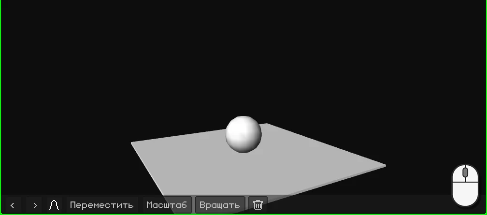
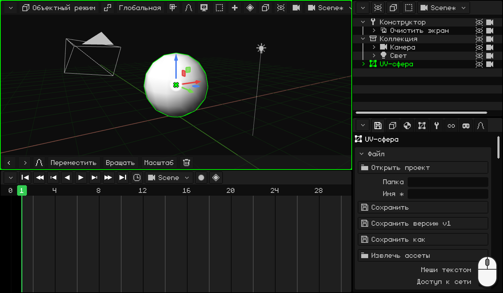
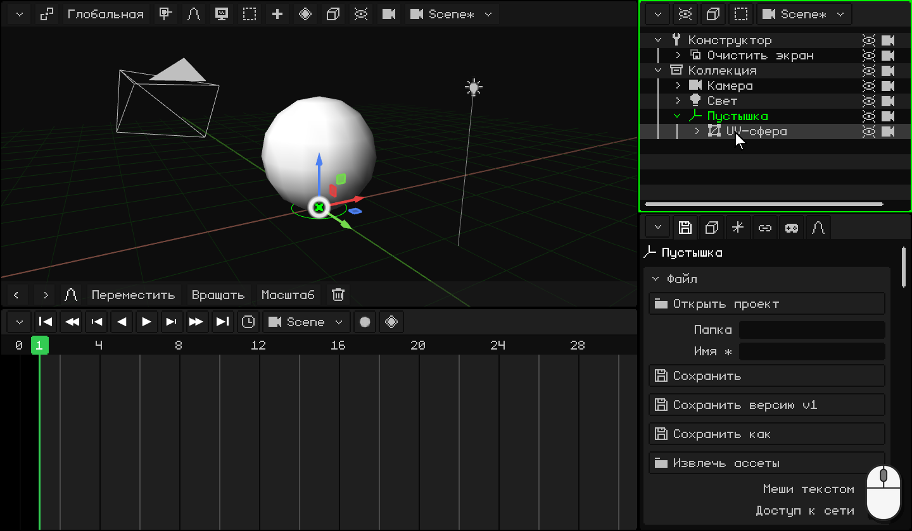
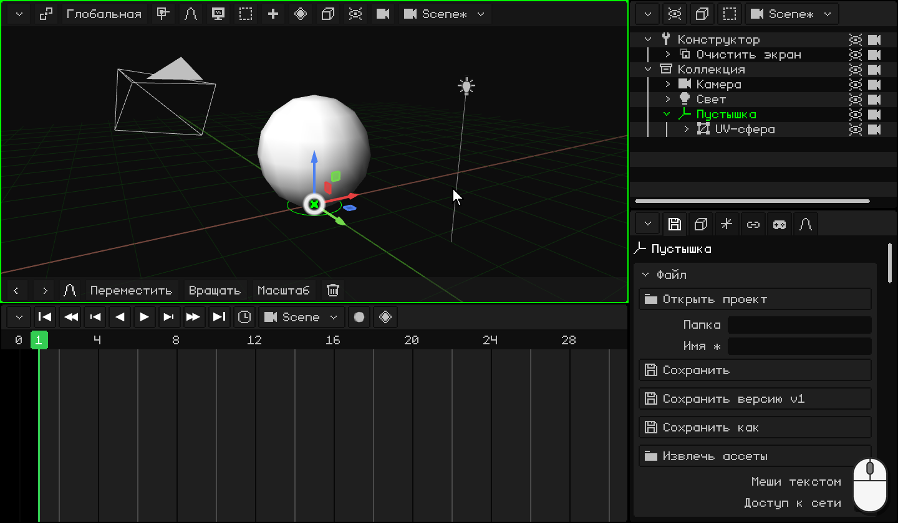
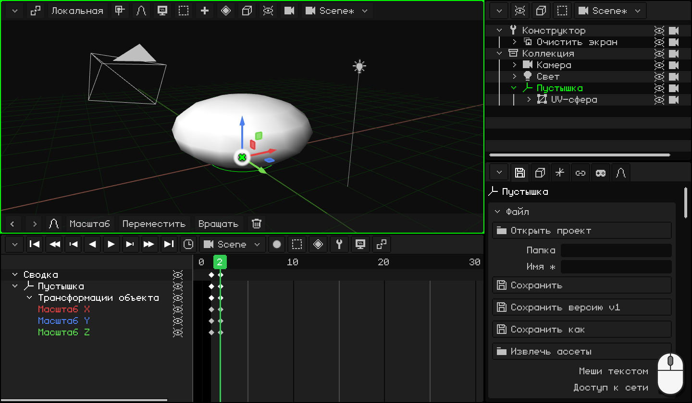
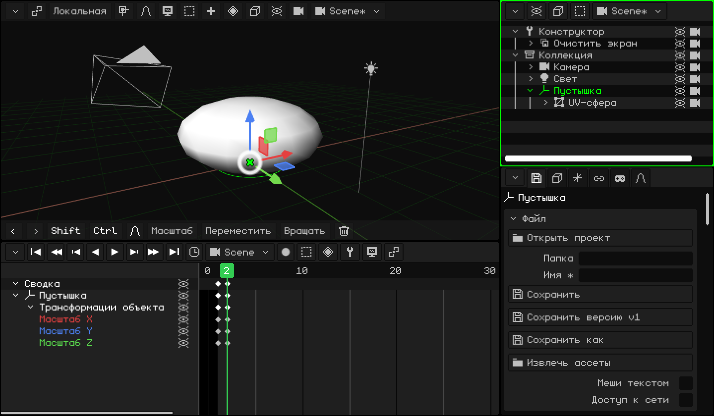
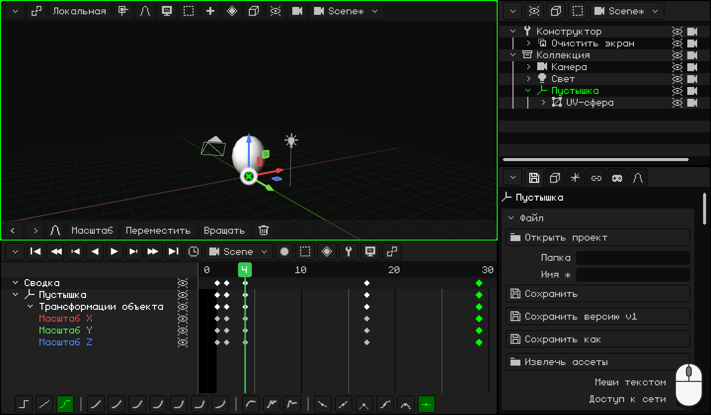
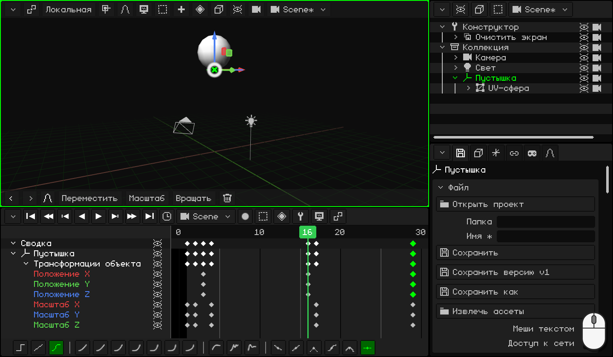
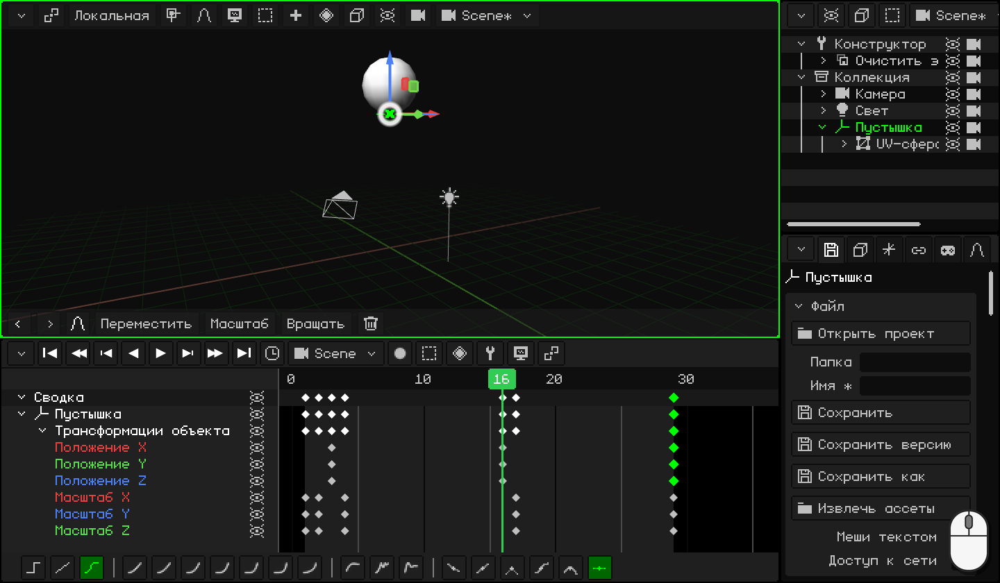

# Прыгающий мяч

Мяч, который прыгает и прыгает без конца: с этого упражнения начинает любой аниматор. Кажется, что это просто, но чтобы всё выглядело хорошо, нужны два важнейших принципа анимации:

- **растяжение и сжатие**: мяч сплющивается о пол и вытягивается, когда отскакивает. Это придаёт ему вес и упругость;
- **разгон и торможение**: вверх он летит всё медленнее, а вниз падает всё быстрее, как под действием гравитации.

По ходу ты научишься:

- ставить **Пустышку** на пол, чтобы сплющивать мяч о пол, а не к его центру;
- **дублировать** ключевые кадры, чтобы вернуться к позе, которая у тебя уже есть;
- делать **цикл**: анимацию, которая повторяется так, что стык незаметен;
- пользоваться **кривыми**, чтобы у мяча был вес.

Если ты ещё ничего не анимировал, начни с урока [Анимация двери](animar-puerta.md): там объясняются ключевые кадры, Таймлайн и кривые.

## 1. Мяч и его Пустышка

1. Удали куб и добавь сферу: <kbd>Shift</kbd> + <kbd>A</kbd> → **Меш → UV-сфера**. Её высота 2 метра, и появляется она центром на полу: подними её, чтобы она стояла на полу, <kbd>G</kbd> <kbd>Z</kbd> `1` <kbd>Enter</kbd>.
2. Войди в **Режим редактирования** (<kbd>Tab</kbd>) и выбери **Вершина** в кнопке **Вершина / Ребро / Грань**. Самая нижняя вершина закрыта сферой: включи **Наложения → Рентген**, чтобы видеть её сквозь сферу, и кликни по ней.
3. <kbd>Shift</kbd> + <kbd>S</kbd> → **Курсор к выделенному**: 3D-курсор переходит в нижнюю точку мяча, на пол.
4. Вернись в **Объектный режим** (<kbd>Tab</kbd>) и выключи **Рентген**.
5. <kbd>Shift</kbd> + <kbd>A</kbd> → **Пустышка**. Она появляется там, где находится 3D-курсор: на полу, прямо под мячом.
6. **Свяжи** мяч **с родителем**-Пустышкой. В **Аутлайнере** кликни по **UV-сфера** и <kbd>Ctrl</kbd> + клик по **Пустышка** (последний выделенный становится родителем). Когда мышь над 3D-вьюпортом, <kbd>Ctrl</kbd> + <kbd>P</kbd> → **Объект (сохр. трансформацию)**. В Аутлайнере сфера оказывается внутри Пустышки.

### Зачем нужна Пустышка?

Масштабирование уменьшает или увеличивает объект относительно его **центра**. У сферы он посередине: если её сплющить, она сжимается к середине и повисает в воздухе. Пустышка стоит на полу: если сплющить её, мяч сплющивается **о пол**, как при ударе.

С этого момента анимируется **Пустышка**, а не сфера.

  На сенсорном экране и на N95: вершина — касанием (или виртуальной мышью); курсор — через **Меш → Привязка → Курсор к выделенному**; Пустышка — через **Добавить → Пустышка**; а чтобы связать с родителем, выдели сферу и Пустышку (Пустышка активна) и выбери **Объект → Задать родителя → Объект (сохр. трансформацию)**.

## 2. Сжатие

Когда мяч касается пола, он **сплющивается**: становится ниже и шире. Чтобы не казалось, что он уменьшается, всё, что он теряет в высоту, он набирает в ширину.

1. Выдели **Пустышку**. В кадре **1** мяч круглый и касается пола: <kbd>I</kbd> → **Только масштаб**.
2. <kbd>→</kbd> (стрелка вправо) переходит на кадр **2**. Сплющи мяч: <kbd>S</kbd> <kbd>Z</kbd> `0.75` <kbd>Enter</kbd> делает его ниже, а <kbd>S</kbd> <kbd>Shift</kbd> + <kbd>Z</kbd> `1.6` <kbd>Enter</kbd> — шире. <kbd>Shift</kbd> + <kbd>Z</kbd> — это *все оси, кроме Z*: X и Y вместе.
3. <kbd>I</kbd> → **Только масштаб**.

 На сенсорном экране: ключевой кадр ставится кнопкой с ромбом в строке меню 3D-вьюпорта, **Анимация → Вставить ключевой кадр → Только масштаб**; кадр переключается касанием чисел Таймлайна. Чтобы сплющить мяч: **Масштаб** **Z** `0.75`, **Масштаб** **X** `1.6` и **Масштаб** **Y** `1.6`, с числами на клавиатуре верхней строки.

 На Nokia N95: <kbd>3</kbd>, <kbd>3</kbd> (ось Z), карандаш + `0.75` и <kbd>OK</kbd>; потом <kbd>3</kbd>, <kbd>1</kbd> (X) и `1.6`, и <kbd>3</kbd>, <kbd>2</kbd> (Y) и `1.6`. Ключевой кадр — через **Анимация → Вставить ключевой кадр → Только масштаб**.

## 3. Растяжение

Отрываясь от пола, мяч **вытягивается** в ту сторону, куда летит: становится выше и тоньше. А когда долетает до верха, снова становится круглым.

1. Круглый мяч у тебя уже есть, в ключевом кадре на кадре 1: дублируй его. На Таймлайне кликни по ромбу в кадре **1**, <kbd>Shift</kbd> + <kbd>D</kbd>, перенеси копию на кадр **4** и кликни. Смотри на ромб копии, а не на указатель: он оказывается на один кадр правее мыши.
2. Сделай то же самое для кадров **17** и **29**: там мяч снова круглый.
3. Перейди на кадр **4** (клик по числам Таймлайна). Вытяни мяч: <kbd>S</kbd> <kbd>Z</kbd> `1.1` <kbd>Enter</kbd> и <kbd>S</kbd> <kbd>Shift</kbd> + <kbd>Z</kbd> `0.9` <kbd>Enter</kbd>.
4. <kbd>I</kbd> → **Только масштаб**.

  На сенсорном экране и на N95 (виртуальной мышью) вместо дублирования копируют и вставляют: касание ключевого кадра в кадре 1 и в меню **Ключ** Таймлайна (кнопка с ромбом) — **Копировать**; касание чисел, чтобы перейти на кадр 4, и **Ключ → Вставить**. То же самое для 17 и 29. Чтобы вытянуть мяч: **Масштаб** **Z** `1.1`, **Масштаб** **X** `0.9` и **Масштаб** **Y** `0.9`.

## 4. Прыжок

1. Перейди на кадр **3**: мяч ещё на полу, это момент, когда он отрывается. <kbd>I</kbd> → **Только положение**.
2. Перейди на кадр **16** и подними мяч: <kbd>G</kbd> <kbd>Z</kbd> `5` <kbd>Enter</kbd> (5 метров). <kbd>I</kbd> → **Только положение**.
3. Чтобы он вернулся на пол, дублируй ключевой кадр из кадра **3** на **29**.

Запусти **воспроизведение** (<kbd>Space</kbd>): мяч прыгает. Но что-то не так: он тормозит, не долетев до пола, будто парит. Это исправят кривые в части 6.

 На сенсорном экране: **Переместить** **Z** `5` и **Анимация → Вставить ключевой кадр → Только положение**. Ключевой кадр из 3 переносится на 29 через **Ключ → Копировать** и **Ключ → Вставить**, как в части 3.

 На Nokia N95: <kbd>1</kbd>, <kbd>3</kbd> (ось Z), карандаш + `5` и <kbd>OK</kbd>; и **Анимация → Вставить ключевой кадр → Только положение**.

## 5. Цикл

Кадр **29** такой же, как **1**: мяч круглый и касается пола. Если бы анимация шла до 29-го, подряд оказались бы два одинаковых кадра, и мяч на мгновение замирал бы: стык был бы заметен. Поэтому она заканчивается на **28**: после 28-го идёт 1-й, такой же, как 29-й.

Кликни по **часам** Таймлайна и в поле **Конец** введи `28` <kbd>Enter</kbd>.

В тех же часах есть **FPS** этой анимации. Мяч идёт при 30: каждый прыжок длится 28 кадров, почти секунду. Если хочешь кинематографичный стиль, поставь 24, но **до** того, как начнёшь анимировать: с теми же кадрами при 24 он двигался бы медленнее. Какой FPS подходит в каждом случае, описано в уроке [Анимация двери](animar-puerta.md), в части про время.

## 6. Кривые: гравитация

**Только положение** сохранил все три оси, но мяч движется только по Z: строки **Положение X** и **Положение Y** — плоские линии. Удали их: клик по каждой и <kbd>X</kbd>.

Теперь переключись в редактор кривых (**Вид → Кривые**). Кривая Z — это прыжок: вверх и вниз. Подумай о настоящем мяче:

- **Вверх** он отрывается от пола на полной скорости и постепенно тормозит, пока не замрёт наверху: **резкий старт и плавное торможение**. Выдели ключевой кадр в кадре **3** и на панели инструментов Таймлайна выбери **Кубическая** и **Плавный выход**.
- **Вниз** он трогается медленно и падает всё быстрее, до удара об пол: **разгон и резкая остановка**. Выдели ключевой кадр в кадре **16**: **Кубическая** и **Плавный вход**.

(С клавиатуры: <kbd>E</kbd> для **Режима интерполяции** и <kbd>Ctrl</kbd> + <kbd>E</kbd> для **Плавности**.)

Кривая становится похожа на дуги настоящего мяча: закруглённая наверху и острая внизу, где он бьётся об пол. Запусти **воспроизведение**: теперь у мяча есть вес.

Хочешь, чтобы мяч прыгал выше или ниже? В редакторе кривых возьми верхний ключевой кадр (в кадре 16) и передвинь его.

## 7. Посмотри на него

Чтобы увидеть мяч без сетки и Пустышки, выключи **Наложения → Показать наложения** и запусти **воспроизведение**.

Три мяча внизу прыгают за одно и то же время. У первого линейные кривые: он поднимается и опускается всё время с одной скоростью, как машина. У второго кривые гравитации: он тормозит наверху и бьётся об пол. Третий ещё и растягивается и сжимается: это мяч из этого урока.

