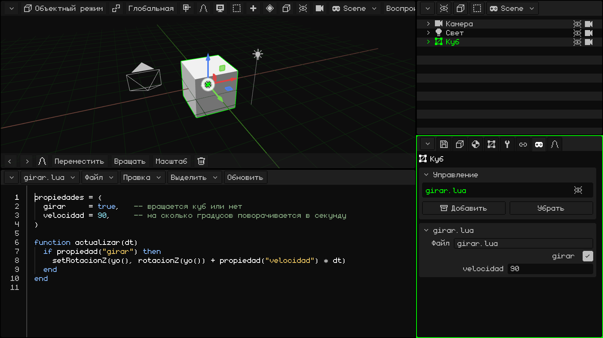
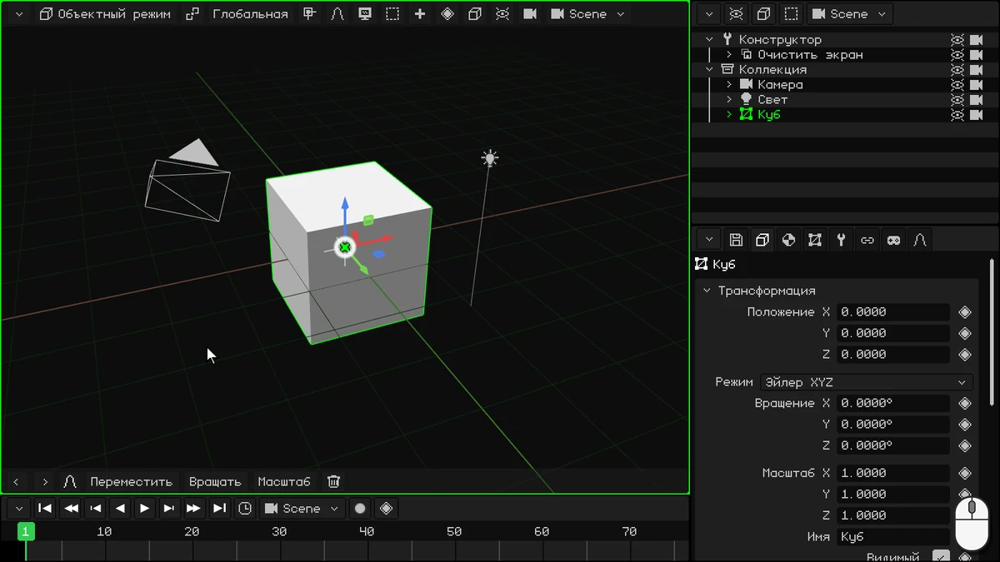
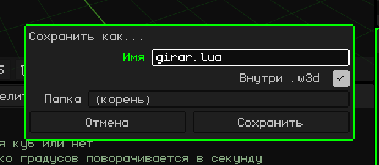
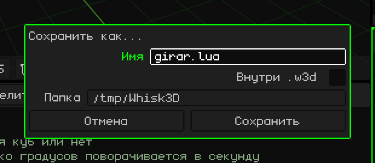
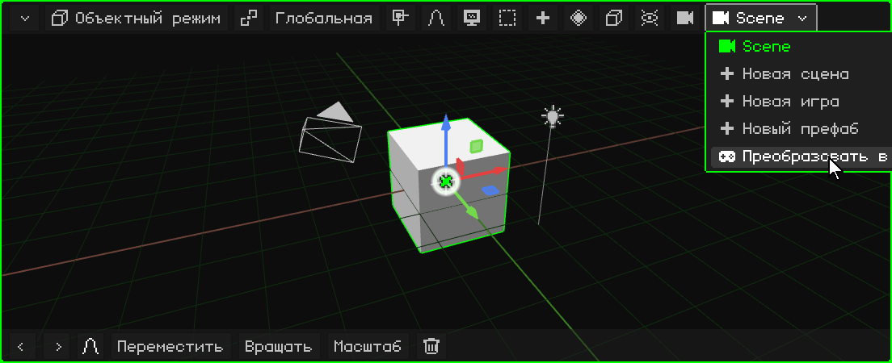
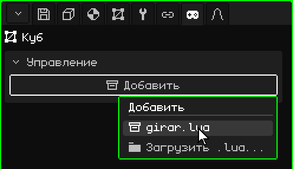
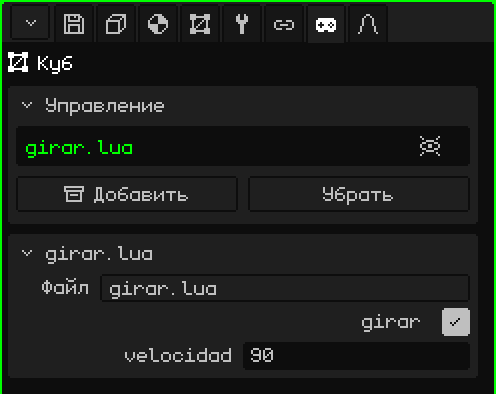
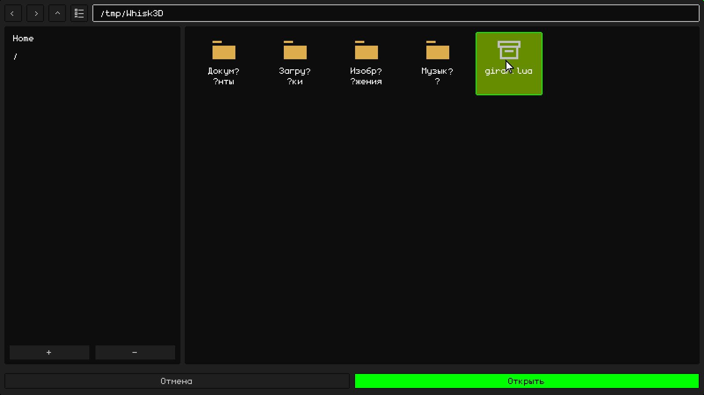
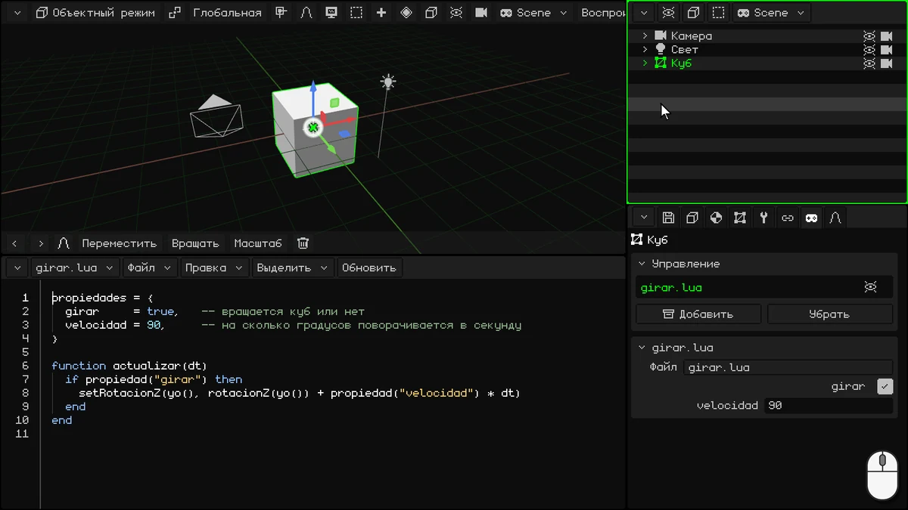

# Твой первый скрипт: вращающийся куб

В этом уроке ты напишешь свой первый скрипт на **Lua**: он будет вращать куб.



## 1. IDE

В этом уроке Таймлайн тебе не понадобится: преврати его в IDE, редактор скриптов. Нажми кнопку в углу Таймлайна (слева вверху) и выбери **IDE**.

IDE открывается пустым. Чтобы писать было удобнее, увеличь его: перетащи ту же кнопку в углу вверх.



> [!NOTE]
> Можно также писать скрипты в других редакторах или внешних IDE и загружать их. Скрипты могут лежать как вне проектов W3D, так и внутри них.

## 2. Напиши скрипт

В скрипте две части: вверху **свойства**, а внизу **функция**, которая вращает куб.

### Свойства

```lua
propiedades = {
  girar     = true,   -- вращается куб или нет
  velocidad = 90,     -- на сколько градусов поворачивается в секунду
}
```

- **`propiedades`** — это значения скрипта, которые можно менять на панели Свойства, по одному в строке. `girar = true` — **логическое** значение (истина или ложь: `true` или `false`), на панели оно выглядит как флажок. `velocidad = 90` — число, оно выглядит как числовое поле. То, что ты пишешь здесь, — значение **по умолчанию**: у каждого объекта, который использует скрипт, может быть своё.
- Всё, что идёт после `--`, — это **комментарий**: Lua его не читает, он для тебя.

### Функция

```lua
function actualizar(dt)
  if propiedad("girar") then
    setRotacionZ(yo(), rotacionZ(yo()) + propiedad("velocidad") * dt)
  end
end
```

**Функция** — это блок кода с именем: он начинается с `function имя()` и заканчивается `end`. То, что внутри, выполняется не тогда, когда ты это пишешь, а каждый раз, когда кто-то **вызывает** функцию.

В Whisk3D есть **зарезервированные функции**: если в твоём скрипте есть функция с одним из этих имён, движок сам вызывает её в нужный момент. Например:

- **`inicio()`**: всего один раз, при нажатии Play. Нужна, чтобы всё подготовить.
- **`actualizar(dt)`**: в **каждом кадре**, пока идёт игра.

Есть и другие, например те, что сообщают, когда объект сталкивается с другим. Все они описаны в руководстве по Lua: [Когда движок вызывает твой скрипт](../lua/ciclo-del-script.md).

`actualizar` идеально подходит для видеоигры. Игра рисует экран много раз в секунду, и каждое такое изображение — это **кадр**: всё, что движется, в каждом кадре сдвигается чуть-чуть. Здесь куб в каждом кадре поворачивается ещё немного.

- Она работает, пока объект **видим**: если ты его скроешь, его скрипт перестанет выполняться, пока объект снова не станет видимым.
- `dt` — это секунды, прошедшие с предыдущего кадра. Если умножить скорость на `dt`, куб будет поворачиваться на 90 градусов **в секунду**, идёт ли игра с частотой 30 или 60 кадров в секунду.

Что она делает внутри:

**`if propiedad("girar") then` … `end`** — это **условие**. `if` («если») выполняет код внутри, только если то, что стоит между `if` и `then`, истинно. В нём может быть `elseif` («а если нет, то сделай это, если…»), который проверяет другое условие, и `else` («иначе»), который выполняется, когда не выполнилось ни одно из условий; оба необязательны. В конце всегда стоит `end`. Например:

```lua
if puntos >= 100 then
  premio = "золото"
elseif puntos >= 50 then
  premio = "серебро"
else
  premio = "ничего"
end
```

При 120 очках приз — золото; при 70 — серебро, а при 10 — ничего. Выполняется только первая подходящая часть. (В Lua `elseif` пишется слитно.)

В нашем скрипте у `if` нет ни `elseif`, ни `else`: если **girar** истинно (флажок отмечен), куб вращается; если ложно, ничего не происходит, и функция заканчивается. `propiedad("girar")` читает значение, которое у этого объекта стоит на панели. Поскольку оно читается в каждом кадре, если ты изменишь его во время игры, скрипт сразу об этом узнает.

- **`yo()`** — это объект, у которого есть скрипт: куб. **`rotacionZ(yo())`** возвращает его поворот в градусах вокруг оси Z (вертикальной, той самой Z, которую ты видишь на панели Свойства), а **`setRotacionZ`** задаёт новый: тот же, только чуть больше. Так куб крутится, как волчок.

`propiedad`, `yo`, `rotacionZ` и `setRotacionZ` — тоже функции, но наоборот: их даёт Whisk3D, а вызываешь ты. Они описаны в [руководстве по Lua](../lua/README.md).

### Скрипт целиком

Нажми внутри IDE и напиши всё вместе:

```lua
propiedades = {
  girar     = true,   -- вращается куб или нет
  velocidad = 90,     -- на сколько градусов поворачивается в секунду
}

function actualizar(dt)
  if propiedad("girar") then
    setRotacionZ(yo(), rotacionZ(yo()) + propiedad("velocidad") * dt)
  end
end
```

## 3. Сохрани его

Сначала сохрани проект, если ещё не сохранил: скрипт можно сохранить внутри проекта, только если сам проект уже сохранён. В Свойствах, на вкладке с **дискетой** (карточка **Файл**), введи **Имя**, например `girar-cubo`, и нажми **Сохранить**. Проект сохранится в папку, указанную в поле **Папка** этой карточки.

Затем в строке меню IDE выбери **Файл → Сохранить как...**:

1. В поле **Имя** введи `girar.lua`.
2. Отметь **Внутри .w3d**: скрипт сохранится внутри проекта, в том же файле `.w3d`. В поле **Папка** теперь выбирается папка внутри проекта: **(корень)** — главная.
3. Нажми **Сохранить**.



Если не отмечать **Внутри .w3d**, скрипт сохранится отдельным файлом, вне проекта, в папке, которую ты выберешь в поле **Папка**. Это удобно, например, чтобы редактировать его в другой программе.



## 4. Преврати сцену в игру

**Сцена** нужна, чтобы моделировать и анимировать; скрипты работают в **игре**. У игры нет своих анимаций: анимации делаются в сцене или в 3D-модели со скелетом и импортируются в игру, чтобы использовать их там. В строке меню 3D-вьюпорта (или Аутлайнера) нажми кнопку сцены — ту, на которой написано её имя, — и выбери **Преобразовать в игру**.



**Преобразовать в игру** не меняет твою сцену: эта команда делает копию — игру, в которой всё выглядит так, как в текущем кадре Таймлайна. Анимации сцены в игру не попадают: этот кадр записывается как начальное положение и состояние игры. Исходная сцена остаётся прежней, со своими анимациями, и её можно снова найти в меню кнопки сцены.

Теперь ты в игре: на кнопке сцены виден джойстик, а в строке меню 3D-вьюпорта появляется **Воспроизвести**.

## 5. Назначь его кубу

1. Выдели **Куб** в игре (в Аутлайнере или в 3D-вьюпорте).
2. В Свойствах перейди на вкладку с **джойстиком**.
3. В карточке **Управление** нажми **Добавить**: откроется меню со скриптами проекта. Выбери `girar.lua`.



Скрипт появляется в списке карточки Управление, а ниже добавляется его собственная карточка **girar.lua** со свойствами, которые ты написал: флажок **girar** (отмечен) и **velocidad** (90).

В списке справа от скрипта есть **глаз**: если нажать на него, скрипт выключится (движок не будет его использовать), но не уберётся из объекта, а сам объект не скроется. Ещё одно нажатие снова его включает.



### Внешний скрипт

Если ты написал скрипт в другом редакторе или сохранил его вне `.w3d`, нажми **Добавить → Загрузить .lua...**. Откроется файловый браузер **Загрузить скрипт**: выбери файл и нажми **Открыть**.



## 6. Нажми Play

Нажми **Воспроизвести**: куб вращается. Пока игра идёт, в строке меню 3D-вьюпорта видны **Стоп** и **Пауза**.

Во время игры попробуй изменить свойства в карточке **girar.lua**:

- поставь **velocidad** на 360: куб вращается в четыре раза быстрее;
- сними флажок **girar**: куб останавливается. Отметь его снова, и он продолжит вращаться.

Чтобы закончить, нажми **Стоп**: куб вернётся в то состояние, в котором был до нажатия Play.



> [!NOTE]
> Всё, что происходит во время игры, теряется, когда ты нажимаешь **Стоп**: куб возвращается на место, а **girar** и **velocidad** — к значениям, которые были до нажатия Play. Чтобы изменить их по-настоящему, меняй их, когда игра остановлена.

## Что дальше

- [Lua в Whisk3D](../lua/README.md): руководство по Lua со всеми функциями.
- [Скрипт — это компонент объекта](../lua/scripts-y-objetos.md): свойства (а также списки, тексты и объекты сцены).
- [Когда движок вызывает твой скрипт](../lua/ciclo-del-script.md): `actualizar`, `inicio` и остальные.

## Скачай пример

Вот готовый проект, чтобы ты мог его попробовать или сравнить со своим: **[girar-cubo.w3d](ejemplos/girar-cubo.w3d)**. Открой его в Whisk3D и нажми **Воспроизвести**. Скрипт находится внутри `.w3d`, и его видно в IDE.
