# Изменить центр: дверь

В этом уроке ты сделаешь так, чтобы дверь открывалась на петле. Для этого нужно изменить её **центр**: точку, вокруг которой вращается объект (см. [Центр объекта](modo-objeto.md#центр-объекта) в уроке про Объектный режим).

Начнём с двери из предыдущего урока, [Моделируем дверь](modelar-puerta.md), с центром посередине. Если ты делал её, сдвигая боковую сторону, центр остался смещённым: **Объект → Задать центр → Центр к геометрии** возвращает его на середину.

## Дверь вращается неправильно

Попробуй её повернуть. Дверь вращается вокруг своей середины, как вращающаяся дверь, а не на петле:

 Гизмо: клик по его центру переключает его на **Вращать**, а синее кольцо поворачивает дверь вокруг вертикальной оси.

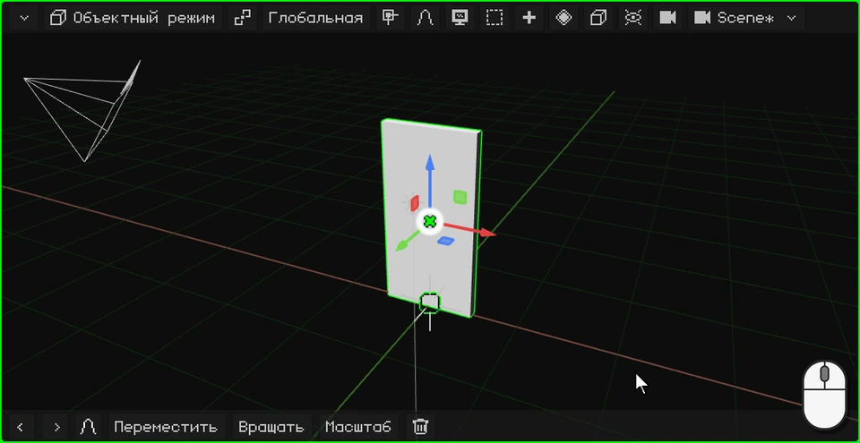

 Пальцем: касание центра гизмо переключает его на **Вращать**, и синее кольцо можно тянуть.

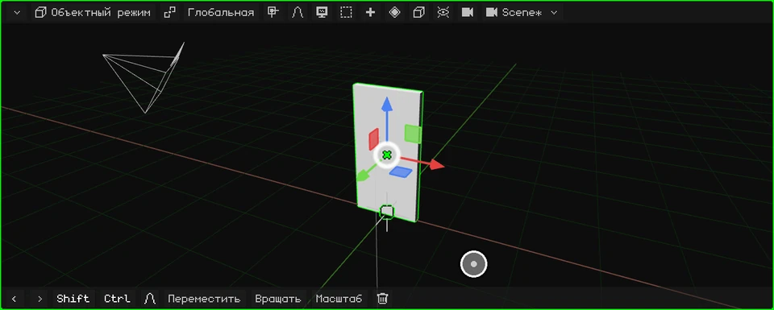

 На Nokia N95 гизмо по умолчанию выключено: <kbd>2</kbd> (вращать), <kbd>3</kbd> (ось Z, вертикальная) и стрелки; <kbd>OK</kbd> подтверждает.

Она вращается неправильно, потому что её центр посередине. Перенесём его к петле.

## Переносим центр к петле

1. **Войди в Режим редактирования.** Клик по кнопке режима и ещё один по **Режим редактирования** (на ПК можно и клавишей <kbd>Tab</kbd>).

   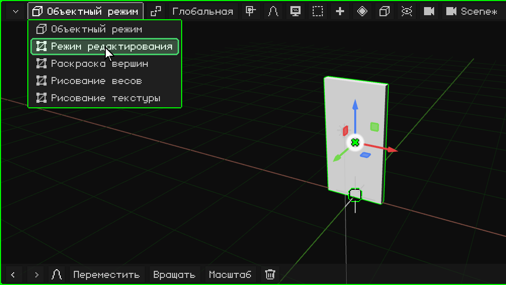

2. **Выбери грани.** В Режиме редактирования появляется кнопка **Вершина / Ребро / Грань**: клик по ней, и выбери **Грань**.

   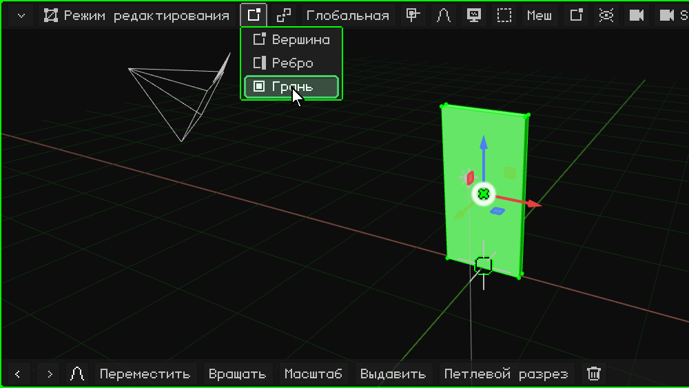

3. **Выдели грань, где будет петля.** Клик по узкой боковой грани двери, с той стороны, где будет петля: она становится зелёной.

   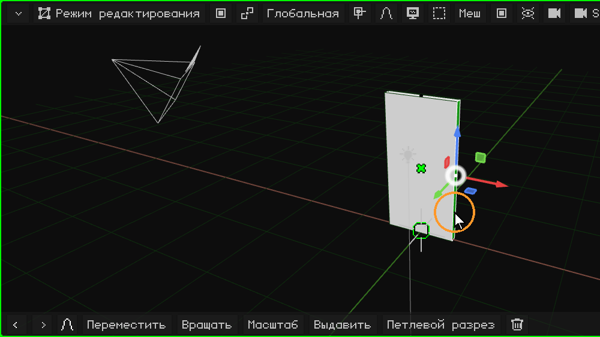

4. **Перенеси туда 3D-курсор.** В меню **Меш**: **Привязка** → **Курсор к выделенному**: 3D-курсор оказывается на петле.

   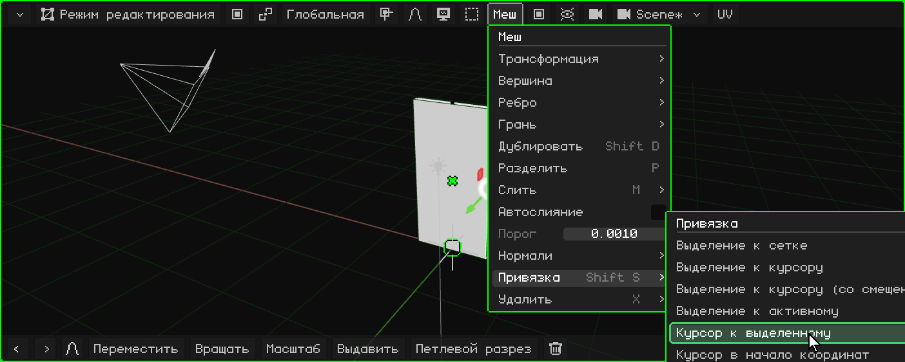

5. **Вернись в Объектный режим.** Клик по кнопке режима и ещё один по **Объектный режим** (или <kbd>Tab</kbd>).

   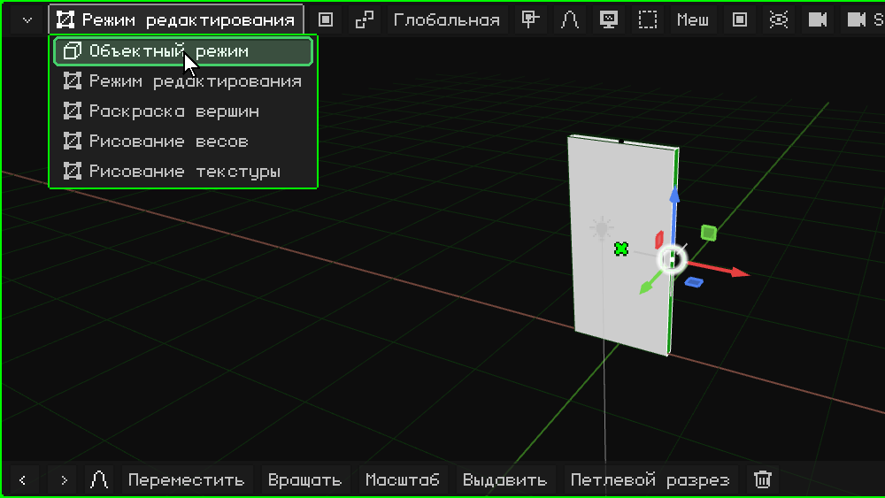

6. **Перенеси центр в 3D-курсор.** В меню **Объект**: **Задать центр** → **Центр к 3D-курсору**. Дверь не сдвигается: сдвигается её центр, а вместе с ним гизмо, которое оказывается на петле.

   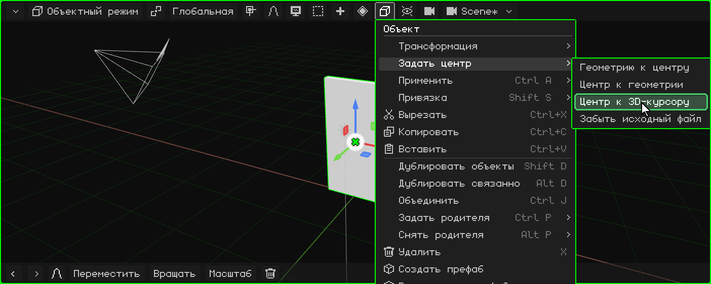

## Теперь она вращается правильно

Поверни её снова гизмо: теперь она открывается и закрывается на петле.

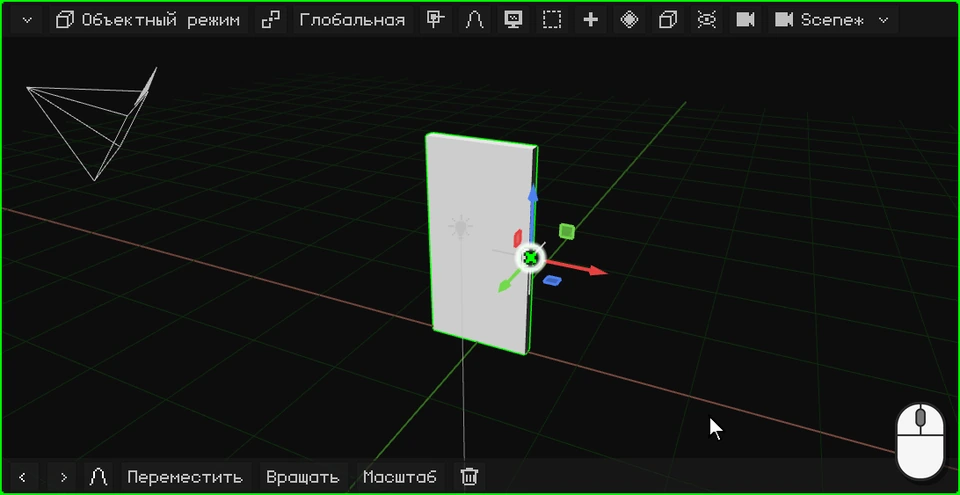

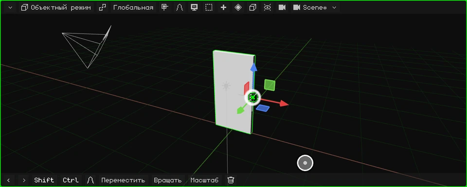

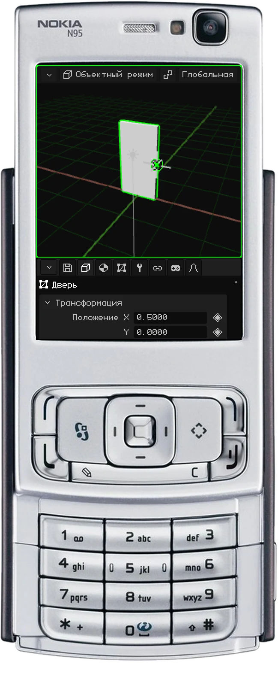

 На сенсорном экране шаги выше те же, только касаниями: меню открываются и пункты выбираются касанием.

 На Nokia N95 <kbd>OK</kbd> переключает из Объектного режима в Режим редактирования, а меню открываются левой софт-клавишей.

## Пункты Задать центр

| Пункт | Что делает |
|---|---|
| **Центр к геометрии** | Переносит центр в середину меша. |
| **Центр к 3D-курсору** | Переносит центр туда, где находится 3D-курсор. |
| **Геометрию к центру** | Наоборот: оставляет центр на месте и сдвигает меш, пока его середина не совпадёт с центром. |

В следующем уроке сделаем дверную ручку: [Моделирование дверной ручки](modelar-picaporte.md).
