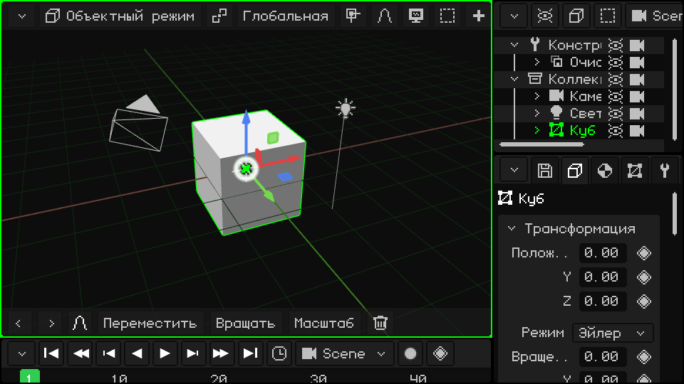
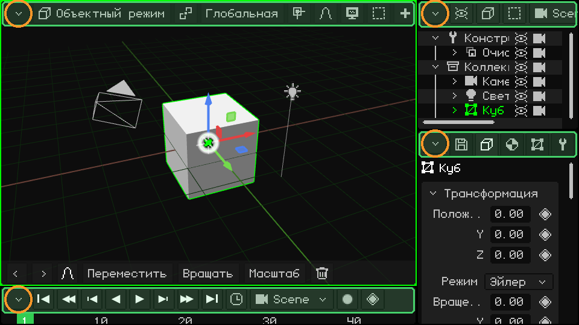
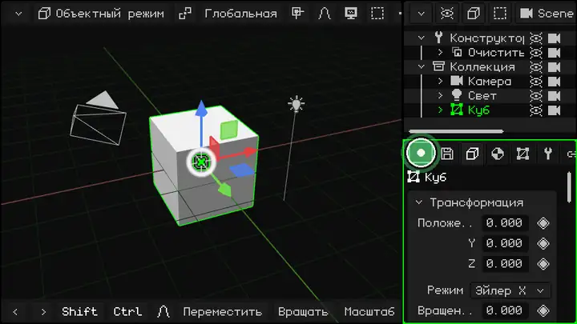
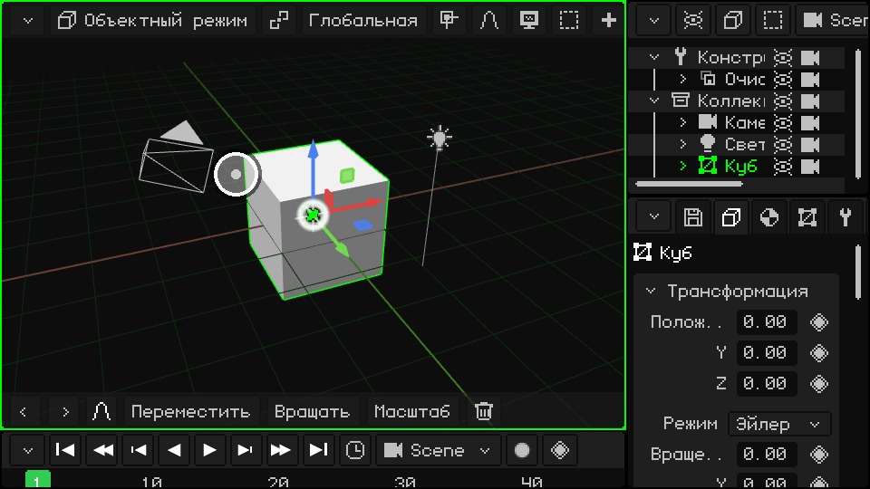
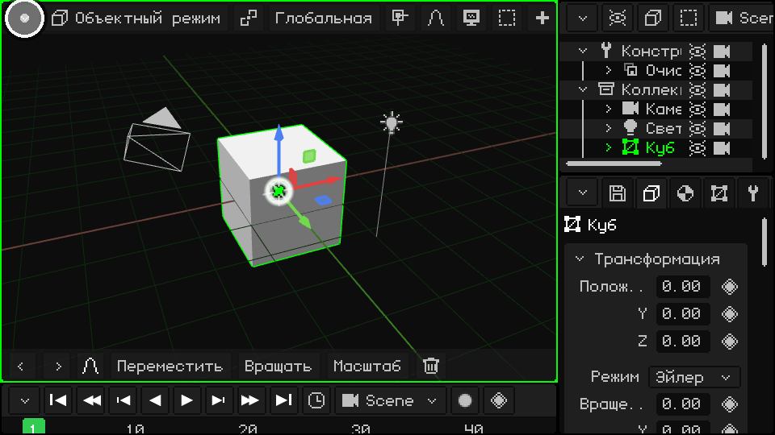
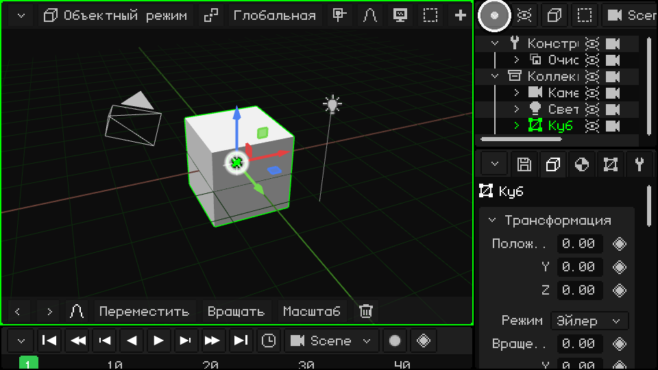
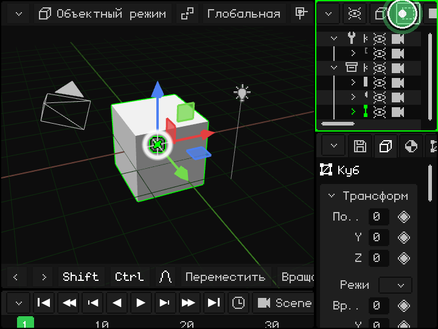
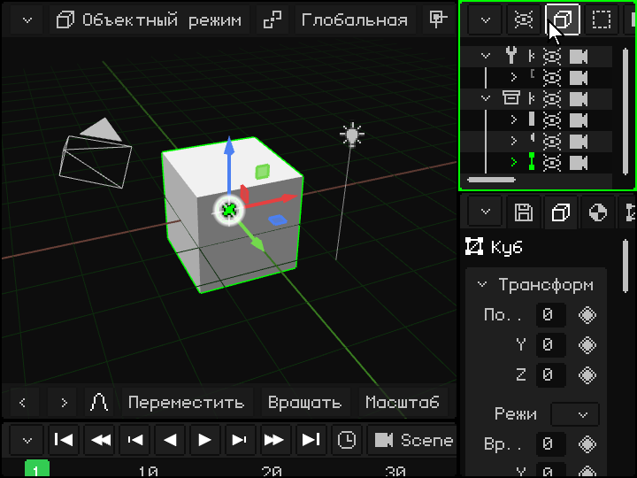
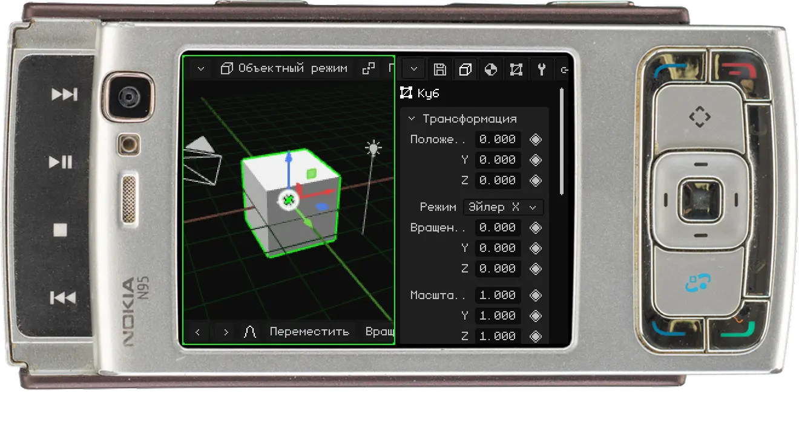

# Вьюпорты

Окно Whisk3D делится на **вьюпорты**: панели, каждая со своим редактором (3D Viewport, Outliner, Properties...). Их можно делить, менять им размер и выбирать, что показывает каждый. Всё работает одинаково с мышью, пальцем на сенсорном экране и с клавиатуры Nokia.

Вот что видно при первом запуске программы:

## Строка меню и кнопка в углу

У каждого вьюпорта сверху есть **строка меню** (на изображении выделена зелёным) с меню и кнопками этого редактора. Слева вверху всегда находится **кнопка в углу** (оранжевая): она нужна, чтобы сменить вьюпорт или изменить его.

## Изменить размер

Нажми на кнопку в углу пальцем (или мышью) и **перетащи её**. Так двигаются левая и верхняя границы этого вьюпорта, а соседние подстраиваются. Здесь кнопку нижнего правого вьюпорта водят по кругу, и все три вьюпорта меняют размер:

> [!TIP]
> Если коснёшься кнопки и отпустишь её, не перетаскивая, откроется её меню. На ПК можно также перетаскивать границу между двумя вьюпортами.

## Меню кнопки в углу

При касании кнопки в углу открывается это меню:

Сверху — **типы вьюпортов**: если выбрать один из них, вьюпорт превращается в этот редактор. Под линией — то, что можно сделать с вьюпортом:

| Пункт | Что делает |
|---|---|
| Expand | Вьюпорт занимает место соседнего, и тот закрывается (если соседний разделён, закрывается вся эта группа). |
| Split in Columns | Делит его на два вьюпорта рядом друг с другом. |
| Split in Rows | Делит его на два вьюпорта, один над другим. |
| Maximize | Разворачивает его на всё окно. Пока он развёрнут, в меню есть только **Minimize**, который возвращает его на место. |

### Сменить тип

3D Viewport, превращённый в UV Editor:

### Split in Columns и Split in Rows

### Expand

Outliner занимает место Properties:

### Maximize и Minimize

## Когда строка меню не помещается

Если вьюпорт узкий, его строка меню не помещается целиком. То же самое происходит с нижней панелью инструментов 3D Viewport. Чтобы увидеть остальное:

- **Пальцем:** перетащи её вбок.
- **Мышью:** зажми кнопку мыши на строке и тяни или крути над ней **колесо**. В 3D Viewport колесо отвечает за зум, поэтому его строку нужно перетаскивать.
- **С клавиатуры:** <kbd>M</kbd> на ПК или **левая софт-клавиша** на Nokia открывает строку меню активного вьюпорта. Стрелками влево и вправо ты перемещаешься по ней, и каждое меню открывается, когда ты до него доходишь. Стрелками вверх и вниз ты двигаешься по меню, а OK (<kbd>Enter</kbd> на ПК) выбирает пункт. Строка сама прокручивается, чтобы показать, где ты находишься.

На Nokia N95: левая софт-клавиша открывает строку меню, а стрелки перемещают по ней.

## Типы вьюпортов

| Вьюпорт | Для чего нужен |
|---|---|
| [3D Viewport](../editor/vista-3d.md) | Здесь сцена отображается и редактируется: моделирование, перемещение объектов, рисование, постановка поз и анимация. |
| [Outliner](../editor/outliner.md) | Список всего, что есть в сцене. |
| [Library](../editor/outliner.md#вид-library) | Ресурсы проекта: меши, материалы, текстуры, анимации, звуки, скрипты и многое другое. |
| [Properties](../editor/propiedades.md) | Данные активного объекта, по вкладкам. |
| [UV Editor](../editor/editor-uv.md) | Как текстура ложится на меш. |
| [Timeline](../editor/linea-de-tiempo.md) | Анимация: ключевые кадры и кривые. |
| [2D Editor](../editor/editor-2d.md) | Игровые интерфейсы, HUD и 2D-игры. |
| [Console](../editor/consola.md) | Журнал движка: ошибки, предупреждения и информация. |
| [IDE](../editor/editor-de-scripts.md) | Редактор Lua-скриптов и шейдеров. |

У каждого вьюпорта будет свой урок с подробностями. А пока о каждом из них рассказывает [Руководство Whisk3D](../editor/README.md).

Whisk3D продолжает расти: со временем появятся новые вьюпорты, а нынешние могут измениться. Все они будут работать одинаково: строка меню сверху и кнопка в углу.
