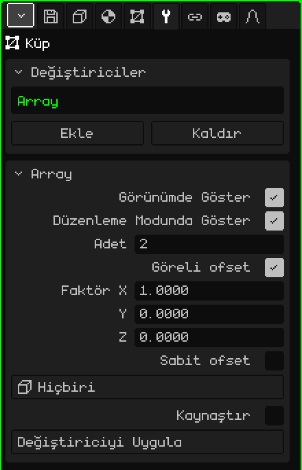

# Dizi

**Dizi** değiştiricisi örgünün kopyalarını bir sıra hâlinde oluşturur; her kopya bir öncekine göre kaydırılmıştır. Tekrar eden her şey için işe yarar: bir çitin direkleri, bir merdivenin basamakları, bir koridorun sütunları ya da bir zincirin halkaları. Tek bir parça modellersin, Dizi gerisini kurar; parçayı değiştirirsen bütün kopyalar da değişir.

## Nasıl eklenir

1. Örgüyü seç.
2. Özellikler'de **Değiştiriciler** sekmesini aç (anahtar simgesi).
3. **Ekle**'ye dokun ve **Dizi**'yi seç.

Listede iç adıyla, **Array** olarak görünür ve altında parametrelerinin bulunduğu kart açılır. Tüm değiştiriciler gibi örgüyü bozmaz: kapatılabilir, **Yukarı taşı** ve **Aşağı taşı** ile yeri değiştirilebilir, **Kaldır** ile silinebilir ya da **Değiştiriciyi Uygula** ile örgüye kalıcı olarak işlenebilir.

## Parametreler

| Parametre | Ne yapar |
|---|---|
| Görünümde Göster | Kapalıyken kopyalar hesaplanmaz: ne görünümde ne de render alırken. |
| Düzenleme Modunda Göster | Kapalıyken düzenleme yaparken yalnızca asıl parça görünür. |
| Adet | Asıl parça da dahil toplam kaç parça olduğu (varsayılan 2). 1 olursa yalnızca asıl parça kalır. |
| Göreli ofset | Her kopyayı parçanın **boyutuna** göre kaydırır. Açık gelir, Faktör X 1'dedir: her kopya bir öncekine boşluksuz ve üst üste binmeden yapışık durur. |
| Faktör X / Y / Z | Her kopyanın o eksende kendi boyutunun kaç katı kaydırılacağı: 1 = yapışık, 2 = arada bir parça boyunda boşluk, 0.5 = yarı yarıya üst üste. Nesne sekmesinde olduğu gibi Y derinlik, Z yüksekliktir. Yalnızca Göreli ofset açıkken görünür. |
| Sabit ofset | Parçanın boyutundan bağımsız olarak her kopyayı sabit bir mesafe kaydırır. Kapalı gelir. İki ofset de açıksa toplanır. |
| Mesafe X / Y / Z | Her kopyanın her eksende kaç metre kaydırılacağı. Yalnızca Sabit ofset açıkken görünür. |
| Ofset Nesnesi | Sahnedeki bir nesne (en rahatı bir Boş nesnedir); her kopyayı bir öncekinden biraz daha fazla kaydırır, döndürür ve ölçekler. Aşağıya bak. **Hiçbiri** seçiliyse kullanılmaz. |
| Kaynaştır | Bir kopyayla sonraki arasında birbirine değen köşeleri kaynaştırır, böylece tek bir yüzey oluştururlar: ayrı ayrı parçalar yerine kesintisiz bir korkuluk. Kapalı gelir. |
| Kaynaştırma Mesafesi | İki köşenin kaynaşması için birbirine ne kadar yakın olması gerektiği (varsayılan 0.001 m). Yalnızca Kaynaştır açıkken görünür. |
| Değiştiriciyi Uygula | Kopyaları örgüye kalıcı olarak işler. Aşağıdaki nota bak. |

## Örnekler

- **Bir çit:** bir direk (dar ve uzun bir Küp), Adet 10 ve Faktör X 3: her birinin arasında iki direk genişliğinde boşluk olan on direk.
- **Bir merdiven:** bir basamak (basık bir Küp), Faktör X 0, Faktör Y 1 ve Faktör Z 1: her basamak bir adım daha geride ve bir adım daha yukarıda kalır.

## Ofset Nesnesi

Bir nesne seçildiğinde her kopya, o nesnenin **örgüye göre ne kadar kaydırılmış, döndürülmüş ve ölçeklenmiş** olduğunu tekrarlar ve bunu biriktirir: ikinci kopya bunu bir kez yapar, üçüncüsü iki kez, ve böyle devam eder.

- Boş nesne örgüyle aynı yerdeyse ve dikey eksen etrafında 30° döndürülmüşse, her kopya bir öncekinden 30° daha fazla döner: 12 kopyayla tam tur atılır.
- Ayrıca biraz daha yukarıdaysa, her kopya biraz daha yükselir: bir döner merdiven.
- 0.9'a ölçeklenmişse, her kopya bir öncekinden biraz daha küçüktür: içe doğru kapanan bir sarmal.

Boş nesne örgüyle aynı yerdeyken kopyalar örgünün orijini etrafında döner. Kendi etraflarında dönmek yerine bir çember oluşturmaları için Düzenleme Modunda parçayı orijinden uzağa kaydır ve Göreli ofseti kapat. Nesneyi taşıdığında ya da döndürdüğünde kopyalar anında güncellenir.

## Sıra önemlidir

Göreli ofset, örgüyü üstteki değiştiriciden **geldiği hâliyle** ölçer: üstte bir [Ayna](modificador-espejo.md) varsa, zaten yansıtılmış nesneyi ölçer. Altta bir [Alt Bölüm Yüzeyi](modificador-subdivision.md) varsa, Kaynaştır ile kaynaştırılmış kopyalar tek bir parça gibi yumuşatılır; Kaynaştır olmadan her kopya ayrı ayrı yumuşatılır.

> [!NOTE]
> Bir Dizi'de Değiştiriciyi Uygula, yalnızca Dizi'yi değil, listedeki açık olan **tüm** değiştiricileri (görünümdeki değerlerle) kalıcı olarak işler ve listeyi boşaltır: kapalı olanlar ve [İskelet](modificador-esqueleto.md) gibi geometri üretmeyenler de gider. Geri alınabilir.

[3D Örgü](objeto-malla.md) sayfasına dön
