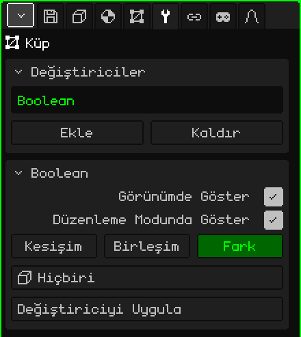

# Boolean

**Boolean** değiştiricisi örgüyü başka bir örgüyle birleştirir: diğerinin hacmini ondan çıkarır, ona ekler ya da yalnızca ortak kısımlarını bırakır. Elle modellemesi çok zahmetli olan şeyler için işe yarar: bir duvardaki pencere boşluğu, bir fincanın içi, bir oluk ya da tek parça hâlinde kaynaşmış iki parça.

## Nasıl eklenir

1. Değişecek örgüyü seç (örneğin duvarı).
2. Özellikler'de **Değiştiriciler** sekmesini aç (anahtar simgesi).
3. **Ekle**'ye dokun ve **Boolean**'ı seç.

Listede iç adıyla, **Boolean** olarak görünür ve altında parametrelerinin bulunduğu kart açılır. Tüm değiştiriciler gibi örgüyü bozmaz: duvar altta bütün olarak durur ve değiştiriciyi kaldırırsan delik kaybolur. Kapatılabilir, **Yukarı taşı** ve **Aşağı taşı** ile yeri değiştirilebilir, **Kaldır** ile silinebilir ya da **Değiştiriciyi Uygula** ile örgüye kalıcı olarak işlenebilir.

## Parametreler

| Parametre | Ne yapar |
|---|---|
| Görünümde Göster | Kapalıyken işlem yapılmaz: hem görünümde hem de render alırken asıl örgü görünür. |
| Düzenleme Modunda Göster | Kapalıyken düzenleme yaparken örgü işlem uygulanmamış hâliyle görünür. |
| Kesişim | Yalnızca iki örgünün aynı anda içinde kalan kısmı bırakır. |
| Birleşim | İkisini tek bir yüzeyde birleştirir ve içeride kalan yüzleri kaldırır. |
| Fark | Bu örgüden diğerinin hacmini çıkarır: delikleri açan budur. Varsayılan olarak seçilidir. |
| Nesne | Diğer örgü, yani **kesici**. **Hiçbiri** seçiliyse hiçbir şey yapmaz. Liste sahnedeki tüm nesneleri gösterir ama yalnızca bir örgü işe yarar. |
| Değiştiriciyi Uygula | Sonucu örgüye kalıcı olarak işler. Aşağıdaki nota bak. |

Seçili işlem yeşil görünür.

## Örnek: duvarda bir pencere

1. Bir **Küp** ekle ve duvar olacak şekilde ölçekle: geniş, yüksek ve ince.
2. Bir **Küp** daha (ya da yuvarlak bir pencere için bir **Silindir**) ekle ve pencerenin olacağı yere, duvarı bir yandan öbür yana delip geçecek şekilde yerleştir.
3. Duvarı seç, ona bir **Boolean** ekle, **Fark** seçili kalsın ve **Nesne**'de kesiciyi seç.
4. Kesiciyi gizle ([Nesne Modunda](modo-objeto.md) Gizle / Göster ile ya da Nesne sekmesinde **Görünür** işaretini kaldırarak). Geriye delik kalır.

Gizlenen kesici kesmeye devam eder. Onu taşımak için yeniden göster ya da Outliner'da seç.

## Bilmekte fayda var

- İki örgünün de **kapalı** olması, yani yüzeylerinde delik olmaması gerekir: yoksa Boolean neyin içeride, neyin dışarıda kaldığını bilemez.
- Kesiciyi taşımak, döndürmek, ölçeklemek ya da düzenlemek kesiği anında günceller. Böylece pencereyi sonuca bakarak yerleştirebilirsin.
- Kesiğin dokunmadığı yüzler olduğu gibi kalır: dörtgen yine dörtgendir. Kesilen yüzler üçgen değil, çok kenarlı çokgen olarak kalır; böylece örgü, uygulandıktan sonra da rahatça düzenlenebilir.
- Kesicinin eklediği yüzler (örneğin pencerenin iç kenarı) örgünün ilk malzemesini alır.
- UV'ler ve köşe renkleri korunur; kesilen yerlerde ara değerleri hesaplanır.
- Aynı düzlemde kalan kısımlar birleşmez: yan yana duran iki kutunun birleşimi, üst yüzü birkaç parçaya bölünmüş hâlde bırakır.

 Nokia N95'te kesiciyi her taşıdığında ya da düzenlediğinde kesik yeniden hesaplanır. Büyük örgülerde kesiciyi yerleştir, değiştiriciyi uygula ve çalışmaya zaten kesilmiş örgüyle devam et.

> [!NOTE]
> Boolean'da Değiştiriciyi Uygula, yalnızca bunu değil, listedeki açık olan **tüm** değiştiricileri kalıcı olarak işler ve listeyi boşaltır: kapalı olanlar ve [İskelet](modificador-esqueleto.md) gibi geometri üretmeyenler de gider. Geri alınabilir. Kesici silinmez: sahnede bir nesne olarak kalır.

[3D Örgü](objeto-malla.md) sayfasına dön
