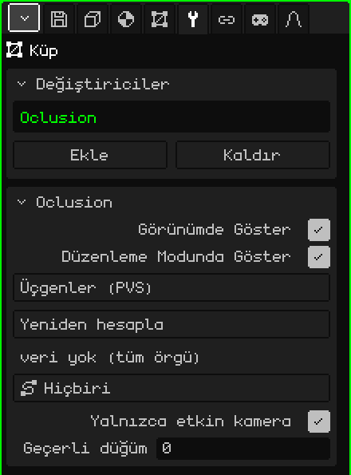

# Culling

**Culling** değiştiricisi örgünün yalnızca kameranın bulunduğu bölgeden görülen üçgenlerini çizer. PlayStation 1 oyunlarının yaptığı gibi, her bölge için bir tane olmak üzere önceden hesaplanmış görünürlük listeleri kullanır (bir **PVS**, *potansiyel olarak görünür küme*). Büyük ortamlar için işe yarar: koca bir bölümden yalnızca bulunduğun koridordan görülen kısım çizilir.

 Nokia N95 düşünülerek tasarlanmıştır; orada çizilmeyen her üçgen kazanılmış hızdır. Bölge değiştirmenin neredeyse hiç maliyeti yoktur: listeler yalnızca bir kez hazırlanır ve bir bölgeden diğerine geçerken yalnızca hangisinin kullanıldığı değişir. Kare başına hiçbir hesaplama yapılmaz.



## Nasıl eklenir

1. Ortamın örgüsünü seç.
2. Özellikler'de **Değiştiriciler** sekmesini aç (anahtar simgesi).
3. **Ekle**'ye dokun ve **Culling**'i seç.

Listede iç adıyla, **Oclusion** olarak görünür ve altında parametrelerinin bulunduğu kart açılır. Örgüye dokunmaz: yalnızca hangi üçgenlerin çizileceğini seçer, bu yüzden örgü bütün ve düzenlenebilir kalır. Bu nedenle Değiştiriciyi Uygula seçeneği yoktur.

3D Görünüm'ün Ekle menüsündeki **Culling** nesnesiyle karıştırılmamalıdır; o, bir örgünün üçgenleriyle değil, nesnelerin bütünüyle çalışır.

## Veriler nereden gelir

Değiştirici neyin göründüğünü hesaplamaz: bunu modelle birlikte gelen bir dosyadan okur. `nivel.obj` dosyasından içe aktarılmış bir örgü için aynı klasörde `nivel.pvs.json` dosyasını arar:

```json
{ "sectores": 2, "tris": [[0, 1], [2, 3]] }
```

`sectores` kaç bölge olduğunu belirtir; `tris` ise her bölge için çizilecek üçgenleri içerir; üçgenler `.obj` dosyasındaki yüzlerin sırasına göre 0'dan başlayarak numaralandırılır. Normalde bu dosya orijinal oyundan ya da ayrı bir araçtan gelir. Her bölge bir **düğümdür**: 1 numaralı düğüm ilk listedir, 0 numaralı düğüm ise örgünün tamamını çizer.

## Parametreler

| Parametre | Ne yapar |
|---|---|
| Görünümde Göster | Kapalıyken örgünün tamamı çizilir. |
| Düzenleme Modunda Göster | Hiçbir şeyi değiştirmez: Düzenleme Modunda örgü her zaman tamamen çizilir. |
| Yöntem | **Üçgenler (PVS)**, `.pvs.json` dosyasındaki listeleri kullanır. **BSP (beklemede)** gri görünür: henüz seçilemez. |
| Yeniden hesapla | `.pvs.json` dosyasını yeniden okur, örneğin dosyayı yeniden ürettikten sonra. "PVS yeniden hesaplandı" ya da dosyayı bulamazsa "PVS: kaynak .obj'nin yanında <model>.pvs.json eksik" uyarısını verir. |
| (durum satırı) | Yeniden hesapla'nın altında: "4 düğüm \| etkin düğüm: 2", dosya yoksa "veri yok (tüm örgü)" ya da "PVS dosyası yüklenmedi (Yeniden hesapla)". |
| Yol | Sahnedeki bir yol (**Ekle → Yol**), örneğin kameranın üzerinde ilerlediği ray. Yolun her düğümü bir bölgedir ve motor göze en yakın düğümü kendisi seçer. **Hiçbiri** seçiliyse bölge elle ya da bir script'ten ayarlanır. |
| Yalnızca etkin kamera | Açıkken (varsayılan) sahne oynatılırken etkin kamera belirleyicidir; duraklatıldığında kendiliğinden hiçbir şey seçilmez ve düğüm elle ayarlanır. Kapalıyken viewport'un görünümü belirleyicidir: ortamda serbestçe uçup üçgenlerin nasıl belirip kaybolduğunu görebilirsin. |
| Dallar | Yalnızca yolun birden fazla dalı varsa görünür, örneğin ana yol ve bir bonus yolu. En yakın düğüm aranırken hangi dalların hesaba katılacağını seçer; açık olan her dal yeşil görünür. Düğmede örneğin "Dallar: 3 (tümü)" ya da "Dallar: 2/3" yazar. |
| Geçerli düğüm | O an çizilen bölge; 0 = örgünün tamamı. Her bölgeyi kontrol etmek için elle değiştirilebilir. Düğümü Yol kendisi seçtiğinde motor bu değerin üzerine yazar. |

Bir script'ten `setSector(objeto, n)` etkin düğümü değiştirir (0 = örgünün tamamı). Bkz. [Parçacıklar, sis ve görünürlük](../lua/api-particulas-niebla.md).

## Bilmekte fayda var

- Örgü Düzenleme Modundayken her şeyi düzenleyebilmen için tamamı çizilir.
- Listede geometri üreten başka bir açık değiştirici varsa ([Ayna](modificador-espejo.md), [Dizi](modificador-array.md), [Alt Bölüm Yüzeyi](modificador-subdivision.md)…), Culling kullanılmaz ve her şey çizilir: `.pvs.json` dosyasındaki üçgen numaraları asıl örgüye aittir.
- Listeler üçgenleri numaralarıyla belirtir. Örgüyü düzenleyip yüz ekler ya da silersen numaralar değişir ve listeler başka üçgenleri gösteriyor olabilir: Culling bitmiş ortamlar içindir, hâlâ modellenmekte olanlar için değil.

[3D Örgü](objeto-malla.md) sayfasına dön
