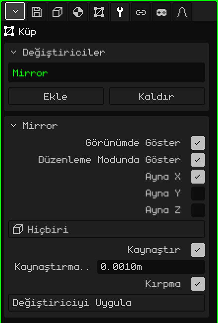

# Ayna

**Ayna** değiştiricisi örgüyü bir düzlemin öbür tarafına yansıtır. Simetrik olan her şey için işe yarar: bir karakterin, bir yüzün ya da bir arabanın yarısını modellersin, diğer yarısı kendiliğinden, yansıtılmış olarak belirir. Çalışırken bir tarafta değiştirdiğin şey öbür tarafta da tekrarlanır.

## Nasıl eklenir

1. Örgüyü seç.
2. Özellikler'de **Değiştiriciler** sekmesini aç (anahtar simgesi). Yalnızca etkin nesne bir örgü olduğunda görünür.
3. **Ekle**'ye dokun ve **Ayna**'yı seç.

Değiştiriciler kartındaki listede iç adıyla, **Mirror** olarak görünür ve altında parametrelerinin bulunduğu bir kart açılır.

Bir değiştirici örgüyü bozmaz: asıl örgü olduğu gibi kalır ve onu düzenlemeye devam edersin; gördüğün şey sonuçtur. İstediğin an kapatılabilir, listede **Yukarı taşı** ve **Aşağı taşı** ile yeri değiştirilebilir (iki ya da daha fazla değiştirici olduğunda görünürler), **Kaldır** ile silinebilir ya da **Değiştiriciyi Uygula** ile örgüye kalıcı olarak işlenebilir.

## Parametreler

| Parametre | Ne yapar |
|---|---|
| Görünümde Göster | Kapalıyken yansıma hesaplanmaz: ne görünümde ne de render alırken. Yansımalı ve yansımasız hâli karşılaştırmaya yarar. |
| Düzenleme Modunda Göster | Kapalıyken örgüyü düzenlerken yalnızca asıl yarı görünür; Nesne Moduna dönünce yansıma belirir. |
| Ayna X | Soldan sağa yansıtır. Açık gelir: bir karakter ya da araba için işe yarayan budur. |
| Ayna Y | Önden arkaya yansıtır. |
| Ayna Z | Yukarıdan aşağıya yansıtır. |
| Ayna Nesnesi | **Hiçbiri** seçiliyse aynanın düzlemi örgünün orijininden geçer. Başka bir nesne seçersen (örneğin bir Boş nesne), düzlem o nesnenin orijininden geçer ve onunla birlikte döner; ölçeği hesaba katılmaz. Onu taşıdığında ya da döndürdüğünde yansıma anında güncellenir. |
| Kaynaştır | Dikişi kaynaştırır: düzlemin neredeyse üzerinde duran köşeler ona yapışır ve iki yarı tarafından paylaşılır. Böylece ortada bir çizgi kalmaz ve yumuşak gölgelendirme kesintisiz olarak bir taraftan öbürüne geçer: yarım bir küre tam bir küre gibi görünür. Açık gelir. |
| Kaynaştırma Mesafesi | Bir köşenin kaynaşması için düzleme ne kadar yakın olması gerektiği (varsayılan 0.001 m). Dikiş açık kalıyorsa biraz artır; istemediğin köşeler yapışıyorsa azalt. Aynı zamanda Kırpma'nın payıdır. |
| Kırpma | Düzenleme Modunda köşeleri taşırken düzlemin öbür tarafına geçmelerine izin vermez: düzleme ulaşan köşe ona yapışık kalır ve yalnızca üzerinde kayar. Ortadaki köşeler ayrılmaz, böylece dikiş yanlışlıkla açılmaz. Açık gelir. |
| Değiştiriciyi Uygula | Yansımayı örgüye kalıcı olarak işler: iki yarı da gerçek köşeler hâline gelir ve değiştirici listeden çıkar. Dört kenarlı yüzler dört kenarlı kalır. Geri alınabilir. |

Birden fazla eksen açarsan her yansıma bir öncekinin sonucu üzerinde yapılır. X ve Y açıkken nesnenin dörtte birini modellersin ve dört parçanın hepsi ortaya çıkar.

## Sıra önemlidir

Değiştiriciler yukarıdan aşağıya uygulanır: her biri bir öncekinin bıraktığı şey üzerinde çalışır. Ayna neredeyse her zaman ilk sırada olur:

- **Ayna, [Alt Bölüm Yüzeyi](modificador-subdivision.md)'nin üstünde:** önce modelin tamamı kurulur, sonra hepsi birlikte, ortada iz kalmadan yumuşatılır. Tersi olursa her yarı ayrı ayrı yumuşatılır ve birleşim yerinde bir kırışık kalır.
- **Ayna, [Dizi](modificador-array.md)'nin üstünde:** Dizi zaten tamamlanmış nesneyi kopyalar ve Göreli ofseti nesnenin bütününün boyutunu kullanır.

Ayna'da Değiştiriciyi Uygula, listede nerede olursa olsun yalnızca Ayna'yı kalıcı olarak işler: diğer değiştiriciler yerinde kalır.

## İpuçları

- Aynanın düzlemi örgünün orijininden geçtiği için orijin modelin ortasındayken çalış. Ortada olması gereken köşeleri tam düzlemin üzerine koy.
- Rahat modellemek için önden ortografik görünümle bak (bkz. [3D Görünüm'de gezinme](../tutoriales/navegacion.md#önden-yandan-ve-üstten-görünümler)): Ayna X'in düzlemi ortada dikey bir çizgi olarak görünür.
- Model bittiğinde, her yarıyı ayrı ayrı rötuşlamak istersen Ayna'yı uygula; örneğin bir karakterin kusursuz simetrik olmaması için.

[3D Örgü](objeto-malla.md) sayfasına dön
