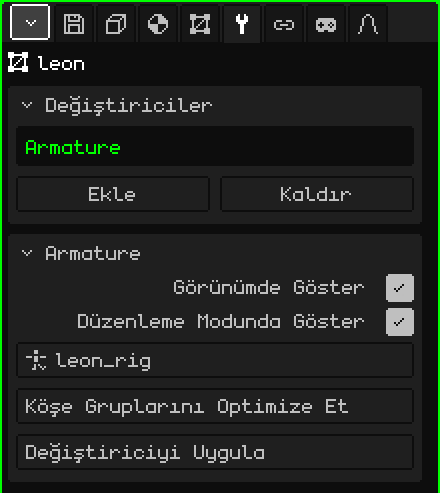

# İskelet

**İskelet** değiştiricisi örgünün bir iskeletin kemiklerini izlemesini sağlar: iskelete poz verdiğinde ya da onu canlandırdığında örgü de onunla birlikte bükülür. Hareketsiz bir modeli yürüyen, zıplayan ya da el sallayan bir karaktere dönüştüren budur.

## Nasıl eklenir

1. Örgüyü seç.
2. Özellikler'de **Değiştiriciler** sekmesini aç (anahtar simgesi).
3. **Ekle**'ye dokun ve **İskelet**'i seç.

Listede iç adıyla, **Armature** olarak görünür ve altında parametrelerinin bulunduğu kart açılır. Tüm değiştiriciler gibi örgüyü bozmaz: dinlenme pozu olduğu gibi kalır. Kapatılabilir, **Kaldır** ile silinebilir ya da **Değiştiriciyi Uygula** ile örgüye kalıcı olarak işlenebilir.

İskeleti olan bir FBX ya da glTF içe aktarıldığında değiştirici zaten eklenmiş ve kendi iskeletini gösterir hâlde gelir.

## Parametreler

| Parametre | Ne yapar |
|---|---|
| Görünümde Göster | Kapalıyken örgü deforme olmaz: dinlenme pozunda kalır. |
| Düzenleme Modunda Göster | Kapalıyken köşeleri düzenlerken örgü deforme olmadan dinlenme pozunda kalır. |
| Hedef | Örgüyü hareket ettiren iskelet. Liste yalnızca sahnedeki iskeletleri gösterir. **Hiçbiri** seçiliyse deforme olmaz. |
| Köşe Gruplarını Optimize Et | Her köşeyi tek bir kemikle, onu en çok hareket ettiren kemikle ve tam ağırlıkla bırakır. Ara ağırlıklar kaybolduğu için onay ister. |
| Değiştiriciyi Uygula | Geçerli karedeki pozu örgüye kalıcı olarak işler ve değiştiriciyi kaldırır: örgü o pozda donmuş olarak kalır. İskelete dokunulmaz. Geri alınabilir. |

## Örgü hangi kemiğin onu hareket ettirdiğini nasıl bilir

**Köşe gruplarıyla**. Her grup **bir kemikle aynı adı** taşır ve o kemiğin hangi köşeleri ne kadar hareket ettirdiğini belirtir: **ağırlık**, 0'dan (hiç) 1'e (tamamen). Bir köşe birden fazla grupta olabilir; bir dirsekte, yumuşakça bükülmesi için yarısı kolda, yarısı önkolda.

Gruplar **3D Örgü** sekmesinde, **Köşe Grupları** kartındadır:

| Düğme | Ne yapar |
|---|---|
| Köşe Grubu Ekle / Yeniden adlandır | Bir grup oluşturur ve ona ad verir. Ad, kemiğinkiyle harfi harfine aynı olmalıdır. |
| Ata / Kaldır | Düzenleme Modunda seçili köşeleri gruba ekler (ağırlık 1 ile) ya da gruptan çıkarır. |
| Seç / Seçimi kaldır | Grubun hangi köşeleri içerdiğini gösterir. |

Omuz ve diz geçişleri gibi ince ağırlıklar için [Ağırlık Boyama](pintura.md#ağırlık-boyama)'yı kullan: seçili grubun ağırlığını maviden (hiç) kırmızıya (tamamen) boyar.

## Adım adım

1. İskeleti kur (**Ekle → İskelet**) ve kemikleri modelin içine yerleştir (bkz. [İskeletler](esqueletos.md)).
2. Örgüye **İskelet** değiştiricisini ekle ve **Hedef**'te iskeleti seç.
3. Her kemik için onunla aynı adı taşıyan bir grup oluştur ve ağırlıkları ata ya da boya.
4. İskeleti seç, **Poz Modu**'na geç ve bir kemiği hareket ettir: örgü onu izler.

## Bilmekte fayda var

- İskelet'in listedeki yeri hiçbir şeyi değiştirmez: diğerleriyle birlikte hesaplanmaz, örgüyü her karede, çizerken deforme eder.
- Asıl örgüyü deforme eder. Geometri üreten başka açık değiştiriciler varsa ([Ayna](modificador-espejo.md), [Dizi](modificador-array.md), [Alt Bölüm Yüzeyi](modificador-subdivision.md), [Vida](modificador-screw.md), [Boolean](modificador-booleano.md)), görünen şey üretilmiş örgüdür ve kemikleri izlemez. Canlandırmadan önce onları uygula.
- Bu değiştiricilerden birini uygulamak (Ayna hariç) listenin tamamını boşaltır ve İskelet de gider. Köşe grupları kalır: İskelet'i yeniden ekle ve Hedef'i yeniden seç.

 Nokia N95'te örgüyü her karede deforme etmenin bir maliyeti vardır ve her köşeyi etkileyen kemik sayısı arttıkça bu maliyet de artar. **Köşe Gruplarını Optimize Et** her köşeye tek bir kemik bırakır ve skinning çok daha hızlı çalışır; karşılığında eklemler daha sert bükülür. Bunu en sonda, ağırlıklar hazır olduğunda yap.

[3D Örgü](objeto-malla.md) sayfasına dön
