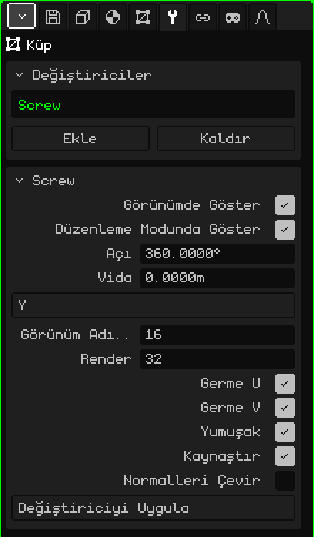

# Vida

**Vida** değiştiricisi (İngilizcesi *Screw*) bir profili bir eksen etrafında döndürür ve dönerken bıraktığı yüzeyi oluşturur, tıpkı bir torna gibi. Bir vazonun, bir kadehin ya da bir şişenin yarım siluetini çizersin, Vida onu nesnenin tamamına dönüştürür. Profil dönerken bir de yükselirse, bir vida dişi ya da bir yay ortaya çıkar.

## Nasıl eklenir

1. Profilin bulunduğu örgüyü seç.
2. Özellikler'de **Değiştiriciler** sekmesini aç (anahtar simgesi).
3. **Ekle**'ye dokun ve **Vida**'yı seç.

Listede iç adıyla, **Screw** olarak görünür ve altında parametrelerinin bulunduğu kart açılır. Tüm değiştiriciler gibi örgüyü bozmaz: profil yerinde durur ve sonucu görürken onu düzenleyebilirsin. Kapatılabilir, **Yukarı taşı** ve **Aşağı taşı** ile yeri değiştirilebilir, **Kaldır** ile silinebilir ya da **Değiştiriciyi Uygula** ile örgüye kalıcı olarak işlenebilir.

## Profil

Profil bir çizgidir: kenarlarla birbirine bağlanmış, yüzü olmayan köşeler. Dönüş ekseni örgünün **orijininden** geçer; bu yüzden her köşenin orijine olan uzaklığı, nesnenin o yükseklikteki yarıçapıdır. Çizmenin bir yolu:

1. **Ekle → Örgü → Köşe**, orijinde tek başına bir köşe oluşturur ve doğrudan Düzenleme Moduna girer.
2. Önden bak (bkz. [3D Görünüm'de gezinme](../tutoriales/navegacion.md#önden-yandan-ve-üstten-görünümler)).
3. **Köşeleri Ekstrüde Et** ile (Örgü → Köşe menüsü) sonraki köşeyi önce tabanı yapmak için yana, sonra duvar için yukarı doğru, nokta nokta çıkar.

Eksenin üzerinde kalan köşeler nesneyi kapatır: orijindeki ilk köşe, vazonun tabanının merkezidir.

## Parametreler

| Parametre | Ne yapar |
|---|---|
| Görünümde Göster | Kapalıyken döndürme yapılmaz: ne görünümde ne de render alırken; yalnızca profil görünür. |
| Düzenleme Modunda Göster | Kapalıyken profili düzenlerken yalnızca çizgi görünür. |
| Açı | Profilin ilk adımdan sonuncusuna kadar kaç derece döndüğü (varsayılan 360, tam tur). 180 ile nesnenin yarısı çıkar. Negatif bir değer öbür yöne döndürür. 360'ı geçebilir: 1080 ile üç tur atar. |
| Vida | Profilin dönüşün başından sonuna kadar eksen boyunca kaç metre yükseldiği. 0'da bir tornadır (vazo, kadeh, şişe); başka bir değerle bir vida dişi ya da bir yay olur. |
| Eksen | Hangi eksen etrafında döndüğü: X, Y ya da Z. Varsayılan **Z**'dir, yani dikey eksen: önden görünümde çizilen bir profil, masanın üzerindeki bir vazo gibi dik durur. |
| Görünüm Adımları | Görünümde dönüş boyunca profilin kaç kopyasının yapıldığı, 2'den 512'ye (varsayılan 16). Adım arttıkça daha yuvarlak ve daha ağır olur. |
| Render | **Görüntü Render Al** ya da **Animasyon Render Al** sırasında kullanılan adımlar (varsayılan 32). |
| Germe U | UV koordinatlarını dönüş boyunca oluşturur; böylece bir doku nesneyi bir etiket gibi sarar. |
| Germe V | UV koordinatlarını profil boyunca, yukarıdan aşağıya oluşturur. İkisi de kapalıyken UV olmaz. |
| Yumuşak | Üretilen yüzeyde yumuşak gölgelendirme: yüzey köşeli değil, yuvarlak görünür. Açık gelir. |
| Kaynaştır | Aynı yere düşen köşeleri kaynaştırır: profilin eksene değen köşelerini (taban, kapalı bir şişenin ağzı) ve turun kapandığı yerdeki dikişi. Açık gelir. |
| Normalleri Çevir | Yüzlerin baktığı yönü ters çevirir. Nesne ters, karanlık ya da içeriden bakılıyormuş gibi görünüyorsa kullan. |
| Değiştiriciyi Uygula | Sonucu **Görünüm Adımları** ile örgüye kalıcı olarak işler. Aşağıdaki nota bak. |

Tur, yalnızca Açı 360 ve Vida 0 olduğunda dikişsiz olarak kendiliğinden kapanır. Başka bir açıyla ya da profil yükselirken başlangıç ve bitiş açık kalır.

## Örnekler

- **Bir vazo:** yarım siluetin profili, Açı 360, Vida 0 ve 16 ile 32 arasında adım.
- **Bir vida dişi:** eksenden uzakta kısa bir profil, Açı 1080 ve Vida 3: her biri bir metre yükselen üç tur. Sarmal kırık görünmesin diye adımları artır.

 Nokia N95'te her adım, çizilecek bir profil kopyası daha demektir. Modellerken az Görünüm Adımı kullan, yüksek değerleri Render'a bırak.

> [!NOTE]
> Vida'da Değiştiriciyi Uygula, yalnızca bunu değil, listedeki açık olan **tüm** değiştiricileri kalıcı olarak işler ve listeyi boşaltır: kapalı olanlar ve [İskelet](modificador-esqueleto.md) gibi geometri üretmeyenler de gider. Geri alınabilir.

[3D Örgü](objeto-malla.md) sayfasına dön
