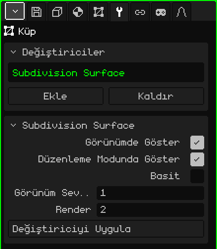

# Alt Bölüm Yüzeyi

**Alt Bölüm Yüzeyi** değiştiricisi her yüzü daha küçük yüzlere böler ve varsayılan olarak şekli yuvarlatır. Düzenlemesi hızlı ve hafif olan az poligonla modelleyip sonucu yumuşak görmeye yarar: bir küpten küreye benzeyen bir şey, low-poly bir karakterden de yuvarlak hatlı bir karakter çıkar.

## Nasıl eklenir

1. Örgüyü seç.
2. Özellikler'de **Değiştiriciler** sekmesini aç (anahtar simgesi).
3. **Ekle**'ye dokun ve **Alt Bölüm Yüzeyi**'ni seç.

Listede iç adıyla, **Subdivision Surface** olarak görünür ve altında parametrelerinin bulunduğu kart açılır. Tüm değiştiriciler gibi örgüyü bozmaz: kapatılabilir, **Yukarı taşı** ve **Aşağı taşı** ile yeri değiştirilebilir, **Kaldır** ile silinebilir ya da **Değiştiriciyi Uygula** ile örgüye kalıcı olarak işlenebilir.

## Parametreler

| Parametre | Ne yapar |
|---|---|
| Görünümde Göster | Kapalıyken alt bölme yapılmaz: ne görünümde ne de render alırken. |
| Düzenleme Modunda Göster | Kapalıyken düzenleme yaparken örgü alt bölünmemiş hâliyle görünür ve düzenleme daha hızlı olur; Nesne Moduna dönünce yine yumuşak görünür. |
| Basit | Kapalıyken (varsayılan) her seviye şekli yumuşatır ve köşeleri yuvarlatır. Açıkken köşeleri hareket ettirmeden yalnızca yüzleri böler: şekil aynı kalır ama daha fazla köşesi olur; örneğin köşe renklerini daha ayrıntılı boyamak için. |
| Görünüm Seviyeleri | Görünümde kaç kez alt bölüneceği, 0'dan 6'ya (varsayılan 1). Her seviye yüz sayısını 4 ile çarpar: 6 yüzlü bir küp 1 seviyeyle 24, 2 seviyeyle 96, 3 seviyeyle 384 yüze çıkar. 0'da alt bölme yapılmaz. |
| Render | **Görüntü Render Al** ya da **Animasyon Render Al** sırasında kullanılan seviyeler (varsayılan 2). Böylece görünüm hafif kalır ve son görüntü daha yumuşak çıkar. |
| Değiştiriciyi Uygula | Alt bölmeyi **Görünüm Seviyeleri** ile (Render seviyeleriyle değil) örgüye kalıcı olarak işler. Aşağıdaki nota bak. |

## Alt bölmeyle nasıl çalışılır

- En iyi dört kenarlı yüzlerle çalışır. Bir üçgen 3 dörtgene, beş kenarlı bir yüz de 5 dörtgene bölünür.
- Alt bölmek gölgelendirmeyi değiştirmez: düz gölgelendirilmiş bir örgü yine köşeli görünür. Pürüzsüz görmek için Düzenleme Modunda yüzleri seç ve Yüz → **Yumuşak Gölgele** menüsünü kullan.
- Bir kenarın daha belirgin kalması için yakınına **Döngü Kes ve Kaydır** ile bir kesik ekle (bkz. [Düzenleme Modu](modo-edicion.md)): kenara ne kadar yakınsa o kadar sert olur.
- Kapalı olmayan bir örgüdeki açık kenarlar, kenarı izleyerek yumuşatılır.

## Sıra önemlidir

Değiştiriciler yukarıdan aşağıya uygulanır. [Ayna](modificador-espejo.md)'yı Alt Bölüm'ün **üstüne** koy: böylece modelin tamamı tek seferde yumuşatılır. Ayna altta olursa her yarı ayrı ayrı yumuşatılır ve ortada bir kırışık kalır. [Dizi](modificador-array.md) ile de aynısı olur: Kaynaştır ile kaynaştırılmış kopyalar birlikte yumuşatılır.

 Nokia N95'te her seviyenin bir yükü vardır: 1 seviyeyle çizilecek yüz sayısı dört katına, 2 seviyeyle on altı katına çıkar. Görünüm Seviyeleri'ni 0 ya da 1'de bırak, modellerken Düzenleme Modunda Göster'i kapat ve yüksek seviyeleri Render'a sakla.

> [!NOTE]
> Alt Bölüm'de Değiştiriciyi Uygula, yalnızca bunu değil, listedeki açık olan **tüm** değiştiricileri kalıcı olarak işler ve listeyi boşaltır: kapalı olanlar ve [İskelet](modificador-esqueleto.md) gibi geometri üretmeyenler de gider. Geri alınabilir.

[3D Örgü](objeto-malla.md) sayfasına dön
