# 3D Görünüm'de gezinme

> [!NOTE]
>  Nokia N95 fare ve klavyeyi (Bluetooth ile) destekler. Bu sayfanın Nokia ile ilgili kısımları, onu fare ve klavye olmadan, yalnızca telefonun tuşlarıyla nasıl kullanacağını anlatır.

Bu sayfada 3D Görünüm'de nasıl gezineceğin anlatılıyor. Gezinmek, bakış açını hareket ettirmektir: sahnenin etrafında dönmek, yana kaymak, yaklaşmak ya da uzaklaşmak.

Gezinmeyi bilmek önemlidir: 3D modelleri ve animasyonları rahat ve hızlı yapmak için sahnede dolaşmayı ve çalışmak için rahat bir konuma geçmeyi bilmen gerekir.

Aşağıdaki komutları kullanmak için 3D Görünüm'ün [etkin viewport](interfaz.md#etkin-viewport), yani yeşil kenarlıklı olan olması gerekir.

En çok kullanacağın üç şey **yörüngede döndürme**, **kaydırma** ve **yakınlaştırma**. Her biri fareyle, dokunmatik ekranda parmaklarla ya da Nokia N95'in tuş takımıyla yapılabilir. PC videolarında sağ alttaki fare, o an basılan tuşu yeşille gösterir.

## Yörüngede döndürme

Yörüngede döndürme, görünümü sahnenin etrafında döndürmektir; tıpkı üstündekileri her yönden görmek için bir masanın etrafında yürümek gibi.

 **Fareyle:** **orta tuşu** (tekerleği aşağı bastırarak basılır) basılı tut ve sürükle. Trackpad'de ya da orta tuşu olmayan bir farede <kbd>Alt</kbd> tuşunu basılı tut ve **birincil tuşla** (sol tuşla) sürükle.

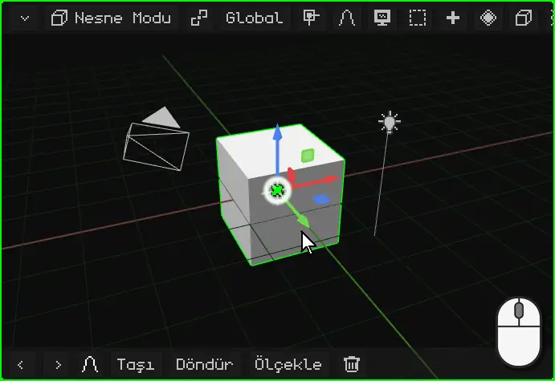

 **Parmakla:** 3D Görünüm'ün üzerinde bir parmağını sürükle. Arka plandan başla: parmağını gizmonun (nesnenin renkli okları) üzerine koyarsan onu hareket ettirirsin.

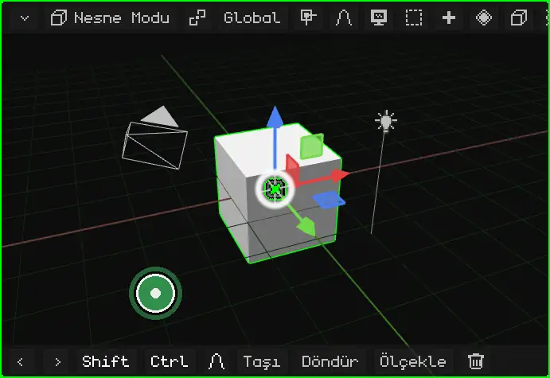

 **Nokia N95'te:** bir **ok tuşunu** basılı tut. Basılı tuttuğun sürece görünüm o yöne döner.

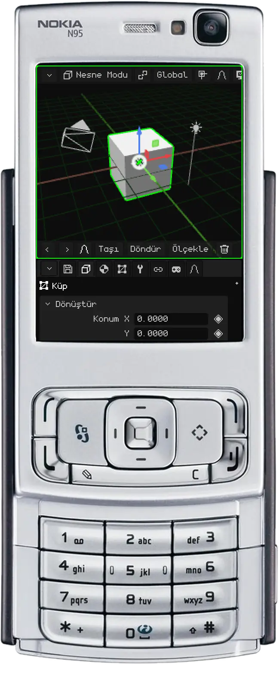

## Kaydırma

Kaydırma (ya da *pan*), görünümü döndürmeden yana, yukarı ya da aşağı kaydırır.

 **Fareyle:** <kbd>Shift</kbd> tuşunu basılı tut ve **orta tuşla** sürükle. Trackpad'de: <kbd>Alt</kbd> + <kbd>Shift</kbd> ve birincil tuşla sürükle.

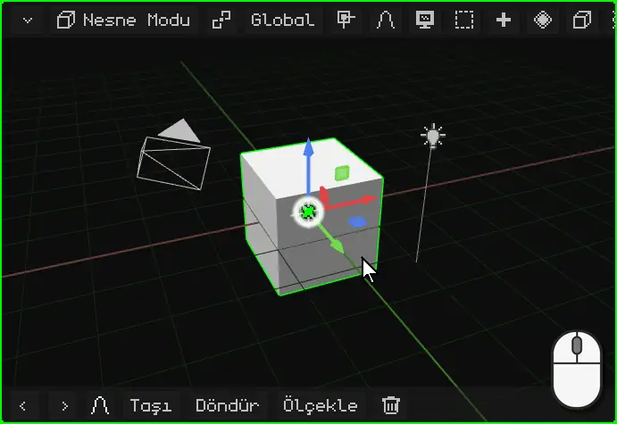

 **Parmaklarla:** **iki parmağını** ekrana koy ve onları birlikte aynı yöne hareket ettir.

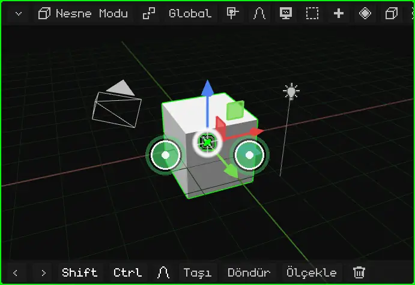

 **Nokia N95'te:** <kbd>\*</kbd> tuşunu basılı tut ve ok tuşlarını kullan.

## Yakınlaştırma

Yakınlaştırma seni yaklaştırır ya da uzaklaştırır. Adım mesafeye göre ayarlanır: küçük bir şeyin yakınında yavaş, uzaktan hızlı ilerler. Bu yüzden tüm sahneye bakmak için de, tek bir köşeye bakmak için de aynı şekilde işe yarar.

 **Fareyle:** **tekerleği** çevir. İleri yaklaştırır, geri uzaklaştırır. Trackpad'de iki parmağını yukarı ya da aşağı kaydır.

 **Parmaklarla:** sıkıştırma hareketi yap. Parmakları birbirinden ayırmak yaklaştırır, birleştirmek uzaklaştırır.

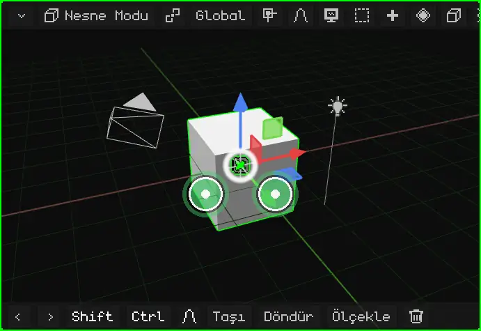

 **Nokia N95'te:** <kbd>0</kbd> tuşunu basılı tut; yaklaştırmak için **yukarı**, uzaklaştırmak için **aşağı** ok tuşunu kullan.

## Seçileni kadraja alma

Sahnede kaybolduysan ya da belirli bir şey üzerinde çalışmak istiyorsan, onu **kadraja al**: görünüm seçili olana ortalanır ve yakınlaştırma, seçili olan tam sığacak şekilde ayarlanır. Bundan sonra yörüngede döndürme onun etrafında yapılır.

| | Nasıl kadraja alınır |
|---|---|
|  PC | <kbd>Num .</kbd> (sayısal tuş takımındaki nokta) |
|  Nokia N95 | <kbd>0</kbd> tuşuna tek basış, ok tuşu olmadan (bir ok tuşuyla birlikte basılı tutulursa yakınlaştırma olur) |
|  Dokunmatik ekran | İki parmakla çift dokunma |
| Menü | Görünüm → Seçileni Çerçevele |

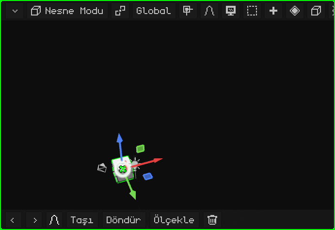

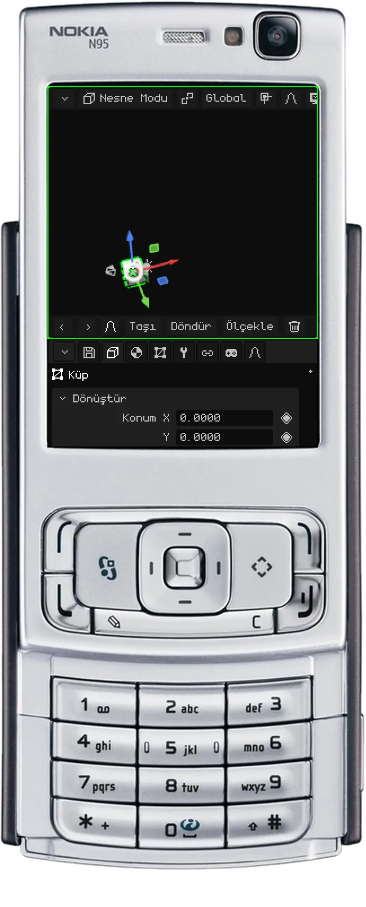

### Düzenleme Modu'nda

[Düzenleme Modu'nda](modo-edicion.md) örgünün seçili kısmı kadraja alınır: nesnenin tamamı değil, seçtiğin köşeler, kenarlar ya da yüzler. Büyük bir modelin bir ayrıntısı üzerinde çalışmak için işe yarar: onu seçer, kadraja alır ve etrafında yörüngede döndürürsün.

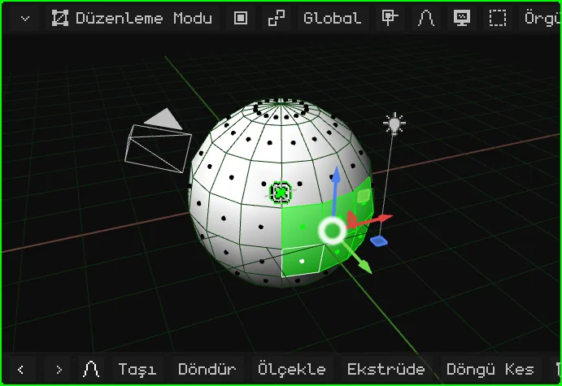

## Yerel görünüm

Sahnede çok şey olduğunda tek bir şey üzerinde çalışmak zahmetlidir: öndekiler görüşü kapatır, yörüngede döndürürken de araya girer. **Yerel görünüm** yalnızca seçili olanı (bir ya da birkaç nesne) görünür bırakır ve onu kadraja alır. Geri kalanı sahneden silinmez ya da gizlenmez: yalnızca bu viewport'ta görünmez olur. Sol üstte "Yerel görünüm" yazısı belirir.

Geri dönmek için aynı şey tekrarlanır: her şey yeniden görünür ve görünüm daha önceki haline döner.

| | Nasıl girilir ve çıkılır |
|---|---|
|  PC | <kbd>/</kbd> |
|   Nokia N95 ve dokunmatik ekran | Görünüm menüsü → Yerel görünüm |

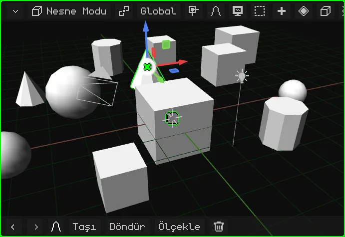

## Önden, yandan ve üstten görünümler

Sahneye bir yönden dümdüz bakmak için, yörüngeyi elle ayarlamadan:

| Görünüm |  PC | Menü |
|---|---|---|
| Ön / Arka | <kbd>Num 1</kbd> / <kbd>Ctrl</kbd> + <kbd>Num 1</kbd> | Görünüm → Bakış Açısı → Ön / Arka |
| Sağ / Sol | <kbd>Num 3</kbd> / <kbd>Ctrl</kbd> + <kbd>Num 3</kbd> | Görünüm → Bakış Açısı → Sağ / Sol |
| Üst / Alt | <kbd>Num 7</kbd> / <kbd>Ctrl</kbd> + <kbd>Num 7</kbd> | Görünüm → Bakış Açısı → Üst / Alt |

 <kbd>Ctrl</kbd> ile her tuş karşıt görünümü verir.

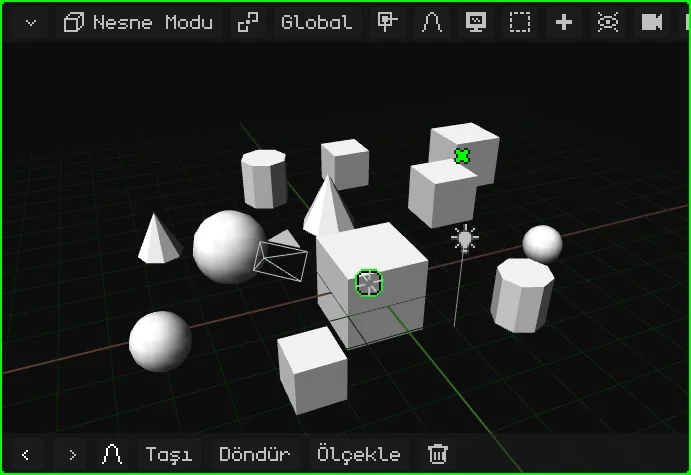

 **Nokia N95'te:** <kbd>#</kbd> tuşunu basılı tut ve bir ok tuşuna bas. Sol ve sağ, görünümü sahnenin etrafında 90°'lik adımlarla döndürür. Yukarı, üstten görünüme geçer; aşağı yandan görünüme döner, bir kez daha aşağı ise alttan görünüme geçer. Daha önce serbestçe döndürdüysen, ilk ok tuşu görünümü yalnızca en yakın görünüme düzeltir.

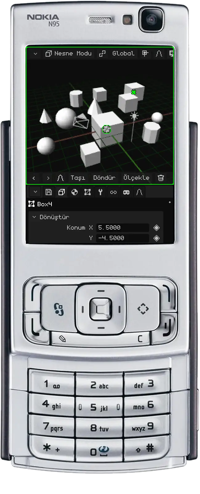

## Perspektif ve ortografik görünüm

3D Görünüm'ün sahneyi göstermenin iki yolu vardır:

- **Perspektif:** gözün ya da bir kameranın gördüğü gibi. Uzaktaki şeyler daha küçük görünür, paralel çizgiler (bir yolun kenarları, videodaki kutu sıraları) ufukta tek bir noktada birleşir: **kaçış noktası**. Gerçekte de böyle görünür, derinlikle.
- **Ortografik:** perspektifsiz. Yakında da olsa uzakta da olsa her şey boyutunu korur, paralel çizgiler asla birleşmez. Bir mimari plan ya da teknik çizim gibidir.

Ortografik görünüm hassas modelleme için işe yarar: nesneleri hizalamak, boyutları karşılaştırmak ve mesafeye aldanmadan ölçmek için. Önden, yandan ve üstten görünümlerle birlikte kullanınca bir plan üzerinde çalışmak gibidir. Perspektif ise sonucun nasıl görüneceğini görmeye yarar.

| | Nasıl değiştirilir |
|---|---|
|  PC | <kbd>Num 5</kbd> |
|  Nokia N95 | <kbd>#</kbd> tuşuna tek basış, ok tuşu olmadan |
| Menü | Görünüm → Perspektif/Orto |

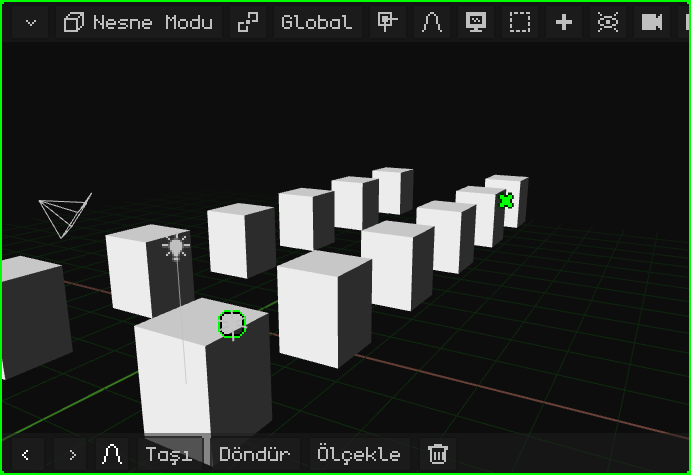

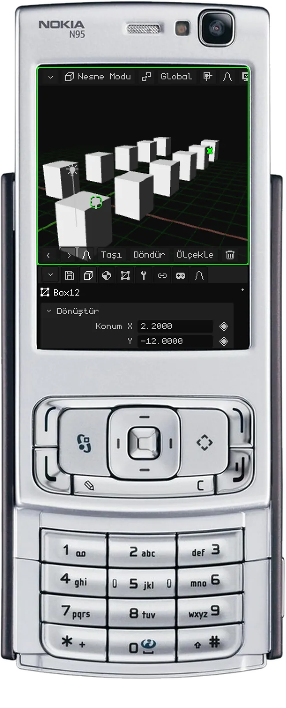

## Yörüngeyi kilitleme

**Yörünge kilitliyken** görünüm dönmeyi bırakır: önceden yörüngede döndüren hareket artık görünümü kaydırır, sanki masanın üzerinde bir kâğıdı kaydırıyormuşsun gibi. Bir evin kat planı ya da mekanik bir parça gibi 2D bir plan olarak çizilen modellerde rahat çalışmak için idealdir: yukarıdan ortografik görünümde bakarken planın tamamında gezinirsin ve plan hiç eğilmez.

| | Nasıl kilitlenir ve açılır |
|---|---|
|  PC | Görünüm menüsü → Yörüngeyi Kilitle |
|  Dokunmatik ekran | Görünüm menüsü → Yörüngeyi Kilitle |
|  Nokia N95 | <kbd>9</kbd> |

Kilitlediğinde ya da kilidi açtığında bir bildirim çıkar; kilitli olduğu sürece menüde Yörüngeyi Kilitle yeşil görünür.

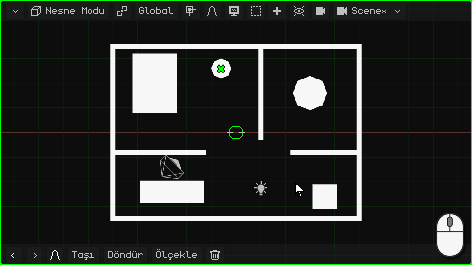

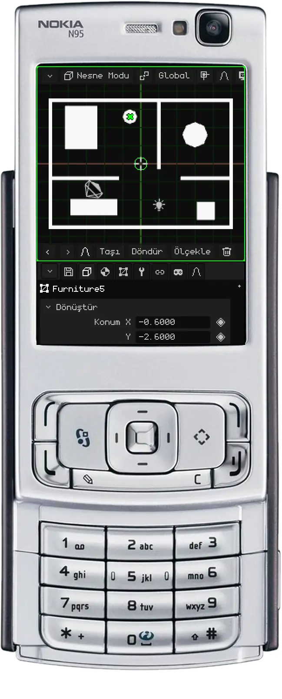

## Etkin kamera

Sahnede birden fazla kamera olabilir, ama **etkin kamera** yalnızca bir tanedir: oyunda ve render'larda kullanılan kamera. Bu kameranın gördüğü şey, oynarken görülen ve bir görüntünün ya da videonun render'ını aldığında ortaya çıkan şeydir. Gezindiğin görünüm yalnızca çalışmak içindir: ne oyunda ne de render'larda görünür.

Etkin kameradan bakmak için:

| | Nasıl girilir ve çıkılır |
|---|---|
|  PC | <kbd>Num 0</kbd> |
|  Nokia N95 | <kbd>8</kbd> (Düzenleme Modu dışında: orada 8, Döngü Kes'tir) |
| Menü | Görünüm → Kameralar → Etkin Kamera |

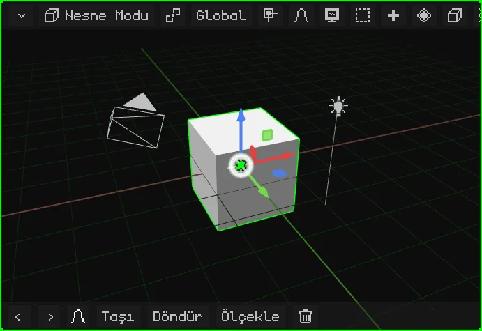

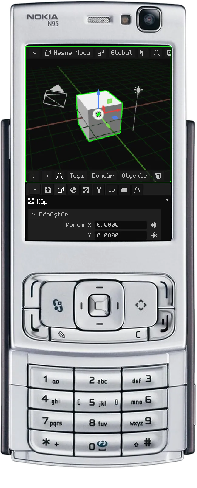

Dikdörtgen kadrajdır: içinde kalan, render'da çıkan şeydir. Alt ortada bir **kilit** vardır:

- **Açık** (başlangıçtaki hali): yakınlaştırma ve kaydırma, kameraya dokunmadan, yalnızca kadrajı incelemen için seni yaklaştırır. Yörüngede döndürme seni kamera görünümünden çıkarır ve kameranın bulunduğu yerden gezinmeye devam edersin.
- **Kapalı:** yörüngede döndürme, kaydırma ve yakınlaştırma **kamerayı** hareket ettirir. Çekim böyle ayarlanır.

### Kamerayı görünüme kilitleme

Kilit kapalıyken etkin kamera görünüme kilitlenir: normal gezinmedeki gibi yörüngede döndürür, kaydırır ve yakınlaştırırsın, kamera da seninle birlikte hareket eder. Bir kamerayı tam istediğin yere yerleştirmenin en rahat yolu budur: kameradan bakar, kilitler ve çekim tam aradığın gibi olana kadar gezinirsin.

| | Nasıl kilitlenir ve açılır |
|---|---|
|  PC | Kilide bir tık |
|  Dokunmatik ekran | Kilide bir dokunuş |
|  Nokia N95 | Sol seçim tuşu menü çubuğunu açar (bkz. [Menü çubuğunun tüm seçenekleri görünmediğinde](interfaz.md#menü-çubuğunun-tüm-seçenekleri-görünmediğinde)); orada Görünüm → Kamerayı görünüme kilitle |
| Menü | Görünüm → Kamerayı görünüme kilitle |

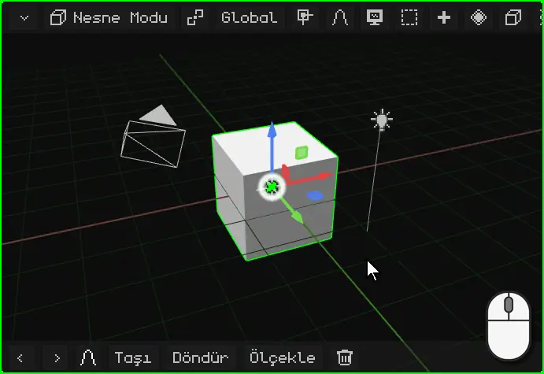

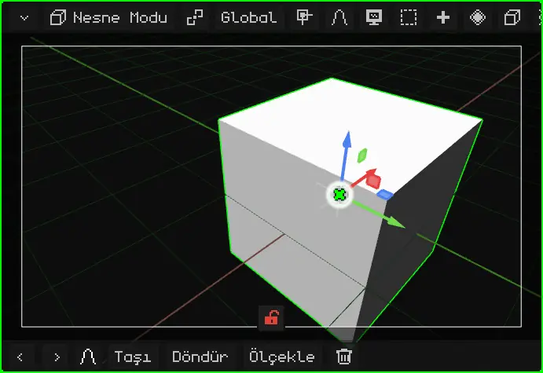

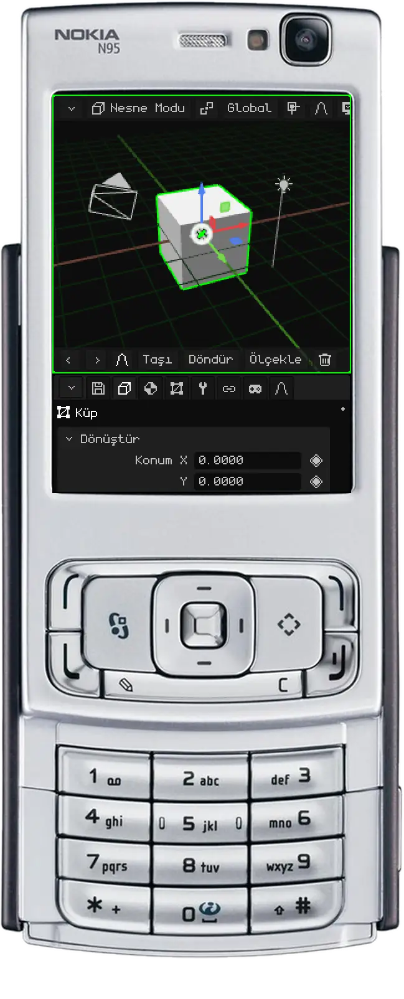

Başka bir kamerayı etkin yapmak için onu seç ve <kbd>Ctrl</kbd> + <kbd>Num 0</kbd> tuşlarına bas (ya da Görünüm → Kameralar → Etkin Nesneyi Kamera Yap).

## Diğer görünüm seçenekleri

| Seçenek | Ne yapar |  PC |  Nokia N95 | Menü |
|---|---|---|---|---|
| Görünümü döndürme | Görünümü kendi ekseni etrafında 15° döndürür; başını yana eğmek gibi. | <kbd>Num 4</kbd> / <kbd>Num 6</kbd> | — | — |

Editörün tüm kısayolları [Klavye kısayolları](atajos.md) sayfasında.

## Tüm kontroller bir bakışta

### Fareyle (PC)

| İşlev | Açıklama | Nasıl kullanılır |
|---|---|---|
| Yörüngede döndürme | Görünümü pivot noktası etrafında döndürür. | Orta tuş + sürükleme ya da <kbd>Alt</kbd> + sol tuş + sürükleme. |
| Kaydırma (pan) | Görünümü yana kaydırır. | <kbd>Shift</kbd> + orta tuş ya da <kbd>Alt+Shift</kbd> + sol tuş + sürükleme. |
| Yakınlaştırma | Yakınlaştırır ya da uzaklaştırır. | Fare tekerleği. |
| Seç | İşaretçinin altındakini seçer (karar, tuşu bıraktığında verilir). | Sol tık; <kbd>Shift</kbd>+tık ekler ya da çıkarır. |
| Kutu Seçimi | Arka planda sürüklemek bir dikdörtgen çizer. | Sol tuşla sürükle ya da <kbd>B</kbd>. |
| Bağlam menüsü | Modun menüsünü işaretçinin olduğu yerde açar (bir dönüştürme sırasında ise onu iptal eder). | Sağ tık. |
| Yörüngeyi Kilitle | Yörüngede döndürme yerine kaydırma yapılır: görünüm bir 2D tahta gibi kalır. | Görünüm menüsü → Yörüngeyi Kilitle. |
| Kamerayı görünüme kilitle | Etkin kameradan bakarken gezinmek kamerayı hareket ettirir: çekim böyle ayarlanır. | Kilide tık (altta, kamera görünümünde) ya da Görünüm menüsü → Kamerayı görünüme kilitle. |

### Klavyeyle

| İşlev | Açıklama | Kısayol |
|---|---|---|
| Ön görünüm / Arka görünüm | Önden ya da arkadan bakar. | <kbd>Num1</kbd> / <kbd>Ctrl+Num1</kbd> |
| Sağ görünüm / Sol görünüm | Yandan bakar. | <kbd>Num3</kbd> / <kbd>Ctrl+Num3</kbd> |
| Üst görünüm / Alt görünüm | Yukarıdan ya da aşağıdan bakar. | <kbd>Num7</kbd> / <kbd>Ctrl+Num7</kbd> |
| Perspektif / Ortografik | İki projeksiyon arasında geçiş yapar. | <kbd>Num5</kbd> |
| Görünümü döndürme | Görünümü kendi ekseni etrafında 15° döndürür. | <kbd>Num4</kbd> / <kbd>Num6</kbd> |
| Kamera görünümü | Etkin kameranın gözünden bakar (tekrar basınca çıkar). | <kbd>Num0</kbd> |
| Etkin Kamera Yap | Etkin nesne, etkin kamera olur. | <kbd>Ctrl+Num0</kbd> |
| Seçileni Çerçevele | Görünümü seçilene ortalar ve yakınlaştırmayı ayarlar. | <kbd>Num.</kbd> (sayısal tuş takımındaki nokta) |
| Yerel görünüm | Yalnızca seçileni gösterir ve kadraja alır; tekrar basınca her şeyi geri getirir. | <kbd>/</kbd> |
| Model içe aktarma | OBJ, FBX, glTF veya GLB içe aktarmak için dosya gezginini açar (yalnızca PC). | <kbd>Num9</kbd> |

### Parmaklarla (Android, dokunmatik Web)

| İşlev | Açıklama | Hareket |
|---|---|---|
| Yörüngede döndürme | Görünümü döndürür. | Tek parmakla sürükle. |
| Yakınlaştırma ve kaydırma | Sıkıştırma hareketi yakınlaştırır ya da uzaklaştırır; iki parmağı birlikte hareket ettirmek görünümü kaydırır. | İki parmak. |
| Seç | Parmağın altındakini seçer. | Dokun ve kımıldatmadan kaldır. |
| Seçileni Çerçevele | <kbd>Num.</kbd> ile aynı. | İki parmakla çift dokunma. |
| Dokunmatik değiştirici tuşlar | Araç çubuğundaki Shift ve Ctrl düğmeleri: seçime eklemek ya da yol seçmek için açık (yeşil) kalırlar. | Shift / Ctrl'ye dokun. |
| Görünüm (gezinme) | Düzenleme Modu'nda ve boyama modlarında parmak, seçmek ya da boyamak yerine gezinir. | Araç çubuğundaki monitör şeklindeki düğme. |

### Nokia N95 tuş takımıyla

| İşlev | Tuş |
|---|---|
| Yörüngede döndürme | Ok tuşları (basılı tut) |
| Yakınlaştırma / Seçileni Çerçevele | <kbd>0</kbd> + yukarı/aşağı / yalnızca <kbd>0</kbd> |
| Kaydırma | <kbd>\*</kbd> + ok tuşları |
| Görünümler (ön, yan, üst) / Perspektif-Ortografik | <kbd>#</kbd> + ok tuşları / yalnızca <kbd>#</kbd> |
| Taşı / Döndür / Ölçekle (dönüştürme sırasında: X / Y / Z ekseni) | <kbd>1</kbd> / <kbd>2</kbd> / <kbd>3</kbd> |
| Onayla / İptal | OK (orta tuş) / <kbd>C</kbd> |
| Sil (iptal edilecek bir şey yokken) / Geri Al ve Yinele | <kbd>C</kbd> / <kbd>C</kbd> + sol veya sağ |
| Gölgelendirmeyi değiştirme | <kbd>6</kbd> |
| Ekstrüde (Düzenleme Modu) | <kbd>7</kbd> |
| Döngü Kes (Düzenleme Modu) / Kamera görünümü (düzenleme dışında) | <kbd>8</kbd> |
| Yörüngeyi Kilitle | <kbd>9</kbd> |
| Kamerayı görünüme kilitle (kameradan bakarken) | Sol seçim tuşu → Görünüm menüsü |
| Seçimde sırayla dolaşma / ekleme, çıkarma, hepsi ya da hiçbiri | Kalem tuşu / Kalem tuşu + ok tuşları |
| Menü çubuğu / sanal imleç | Sol / sağ seçim tuşu |
| Viewport değiştirme, yeniden boyutlandırma, büyütme | Yeşil tuş (tek başına, + ok tuşları, + OK) |
| Tam ekran oyun modu | Yeşil tuş + <kbd>0</kbd> (bir daha: görüntü tüm ekranı kaplar; bir daha: geri döner). Arayüz yok, kamera kenarlığı ve çevresindeki karanlık alan yok (siyah şeritler yalnızca kamera ekrandan farklı bir en-boy oranı bildirirse, ikinci basışa kadar kalır) ve oklar kaydırma yapmaz: oyun olduğu gibi görünür |

N95 ayrıca Bluetooth fare ve klavye de kabul eder. Metin yazmak için T9 kullanılır.
