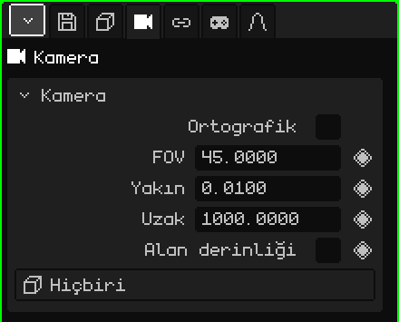

# Kamera

**Kamera**, sahneye yerleştirilmiş bir bakış noktasıdır. **Etkin kamera** oyun ve render'lar için kullanılandır: onun gördüğü, oynarken görülen ve görüntüde ya da videoda çıkan şeydir. Bu makale kameranın özelliklerinin başvuru kaynağıdır; nesnelerin nasıl eklendiği ve taşındığı [Nesne Modu](../tutoriales/modo-objeto.md) eğitiminde anlatılıyor.

## Sekmeler

| Sekme | Neler içerir |
|---|---|
| Nesne | Tüm nesnelerde olduğu gibi konum, dönme, ad ve görünürlük: bkz. [3D Örgü](objeto-malla.md#nesne-sekmesi). |
| Kamera | Kameranın merceği: aşağıdaki kart. |
| Kısıtlamalar | Bkz. [Kısıtlamalar](restricciones.md). |
| Betikler | Nesnenin Lua script'leri. Bkz. [Whisk3D'de Lua](../lua/README.md). |

## Kamera kartı

| Özellik | Ne yapar |
|---|---|
| Ortografik | Perspektif olmadan: uzaktaki şeyler küçülmez ve paralel çizgiler birleşmez. Bkz. [Perspektif ve ortografik görünüm](../tutoriales/navegacion.md#perspektif-ve-ortografik-görünüm). |
| FOV ◆ | Derece cinsinden görüş açısı (yukarıdan aşağıya). Küçüldükçe bir telefoto gibidir: kadraja daha az şey girer ve daha yakından görülür. Büyüdükçe geniş açıdır: kadraja daha çok şey girer ve perspektif abartılı hâle gelir. 45'ten başlar. |
| Yakın ◆ | En kısa çizim mesafesi: kameraya bundan daha yakın olanlar çizilmez. 0.01'den başlar. |
| Uzak ◆ | En uzun çizim mesafesi: bundan daha uzakta olanlar çizilmez. 1000'den başlar. |
| Alan derinliği | Bulanıklığı açar: odak mesafesinde olanlar net, geri kalanı bulanık çıkar. Bunu ışın izleme çizer; Son İşleme de aynı odağı kullanabilir. |
| Diyafram (f) | Gerçek bir kamerada olduğu gibi ne kadar bulanıklaştırdığı: sayı küçüldükçe bulanıklık artar. |
| Odak mesafesi ◆ | Kaç metreye odaklandığı. Kameranın üzerinde çizilen çizgi ve artı işareti yerini gösterir. |
| Odak nesnesi | Odağın, nerede olursa olsun kendiliğinden izlediği bir nesne. Bir nesne seçildiğinde Odak mesafesi kaybolur. **Hiçbiri** elle ayarlanan mesafeye geri döner. |
| Hedef | Etkin kameranın her zaman baktığı bir nesne: nesne hareket ederse kamera onu izlemek için döner. **Hiçbiri** seçiliyse kamera, onu döndürdüğün yöne bakmaya devam eder. |

Diyafram (f), Odak mesafesi ve Odak nesnesi, Alan derinliği işaretliyken görünür.

### Yakın ve Uzak ne zaman değiştirilir

Kameraya çok yakın bir duvar ya da karakter kesik görünüyorsa **Yakın**'ı azalt. Büyük bir ortamın arka planı kayboluyorsa **Uzak**'ı artır. Aralığı gerektiğinden fazla açmamak iyi olur: Yakın ile Uzak arasında çok mesafe varsa, birbirine çok yakın yüzler titreyebilir, özellikle Nokia N95'te.

Yakın ve Uzak canlandırılabilir: örneğin kamera yükselip ortamın daha fazlasını gösterdiğinde çizim sınırını uzaklaştırmak için işe yarar.

### Bir karakteri izleyen kamera

Çekime göre iki yolu var:

- **Kamera yerinde kalır ve döner:** karakteri **Hedef**'e koy. Etkin kamera, karakter koşsa bile onu çekimin ortasında tutar; tıpkı onun geçişini izleyen biri gibi.
- **Kamera onunla birlikte yolculuk eder:** Hedef'i Hiçbiri'de bırak ve kameraya kaynağı karakter olan, yalnızca **Konum**'u işaretli bir **Child Of** kısıtlaması ekle. Karakterle aynı mesafede ve aynı açıyla gider, karakter döndüğünde dönmez (bkz. [Child Of](restricciones.md#child-of)).

## Etkin kamerayı seçme

Sahnede birkaç kamera olabilir ama yalnızca biri etkindir. Değiştirmek için:

| | Nasıl seçilir |
|---|---|
|  PC | Kamerayı seç ve <kbd>Ctrl</kbd> + <kbd>Num 0</kbd> |
| Menü | Görünüm → Kameralar → Etkin Nesneyi Kamera Yap |
| Özellikler | Animasyon sekmesi → **Etkin kamera** kartı |

Etkin kamera kartında eşkenar dörtgen **kamera kesmeleri** oluşturur: bir karede bir kameradan diğerine geçmek. Bkz. [Zaman Çizelgesi](linea-de-tiempo.md).

Etkin kameranın içinden bakmak ve gezinerek çekimi ayarlamak için gezinme eğitimindeki [Etkin kamera](../tutoriales/navegacion.md#etkin-kamera) bölümüne bak.
