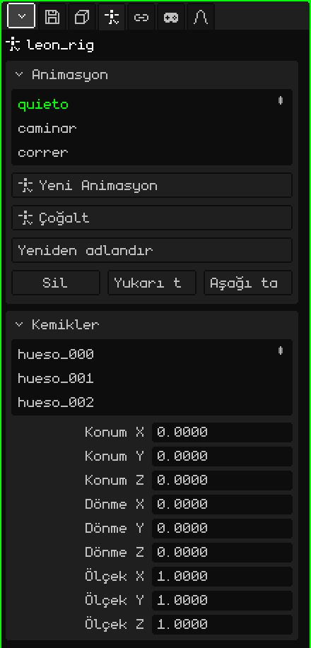

# İskelet

**İskelet**, karakterleri ve bükülen şeyleri canlandırmaya yarayan, **kemiklerden** oluşan bir nesnedir. Kemikler hareket eder ve örgü deforme olarak onları izler: bir kolu canlandırmak için yüzlerce köşeyi taşımak yerine birkaç kemiği döndürürsün. Bu makale iskeletin özelliklerinin başvuru kaynağıdır; nesnelerin nasıl eklendiği ve taşındığı [Nesne Modu](../tutoriales/modo-objeto.md) eğitiminde anlatılıyor.

Ekle → İskelet, daha fazlası eklenmeye hazır, tek kemikli bir iskelet oluşturur. 3D Görünüm'de her kemik, örgünün içinde olsa bile görülebilmesi için her şeyin üzerinde mavi bir çizgi olarak çizilir.

## Dinlenme ve poz

Her kemiğin iki durumu vardır:

- **Dinlenme:** iskelet kurulurken kemiğin konulduğu yer. Örgünün deforme olmadığı duruştur (örneğin kolları açık bir karakter).
- **Poz:** kemiğin animasyonun bir karesinde nasıl durduğu: kaldırılmış kol, döndürülmüş baş. Poz vermek dinlenme durumunu değiştirmez: ona her zaman geri dönülebilir.

## Modlar

Bir iskeletin, 3D Görünüm'ün **Mod** menüsünden seçilen üç modu vardır:

| Mod | Ne işe yarar |
|---|---|
| Nesne Modu | Herhangi bir nesne gibi iskeletin tamamını taşımak, döndürmek ve ölçeklemek. |
| Düzenleme Modu | İskeleti kurmak: uçlardan kemik oluşturmak, onları taşımak, ebeveyne bağlamak. Dinlenme durumunu değiştirir. |
| Poz Modu | Poz vermek ve canlandırmak: kemikleri döndürmek ve keyframe kaydetmek. |

 <kbd>Tab</kbd>, Nesne Modu ile Poz Modu arasında geçiş yapar (Düzenleme Modundan da Poz Moduna geçer).

Her modun araçları ve kısayolları kılavuzdaki [İskeletler](esqueletos.md) sayfasındadır.

## Sekmeler

| Sekme | Neler içerir |
|---|---|
| Nesne | Tüm nesnelerde olduğu gibi iskeletin bütününün konumu, dönmesi, ölçeği, adı ve görünürlüğü: bkz. [3D Örgü](objeto-malla.md#nesne-sekmesi). |
| İskelet | Animasyonlar ve kemikler: aşağıdaki iki kart. |
| Kısıtlamalar | Bkz. [Kısıtlamalar](restricciones.md). |
| Betikler | Nesnenin Lua script'leri. Bkz. [Whisk3D'de Lua](../lua/README.md). |

## İskelet sekmesi

### Animasyon

İskeletin animasyonları (**klipler**): yürümek, koşmak, zıplamak. Her klip kemiklerin zaman içindeki pozlarını saklar.

| Özellik | Ne yapar |
|---|---|
| Liste | İskeletin klipleri. Seçili olan, düzenlenen ve oynatılan klip olur. |
| Yeni Animasyon | Kemikler dinlenme durumundayken boş bir klip oluşturur. |
| Çoğalt | Asıl klibe dokunmadan bir çeşitleme yapmak için seçili klibi kopyalar (klip varsa görünür). |
| Yeniden adlandır | Klibin adını değiştirir. Aynı iskelet içinde tekrarlanamaz. |
| Sil / Yukarı taşı / Aşağı taşı | Klibi siler ya da listede taşır. |

Nasıl canlandırılır: [Zaman Çizelgesi](linea-de-tiempo.md).

### Kemikler

İskeletin kemiklerinin listesi. Biri seçildiğinde kart onun verilerini gösterir:

| Özellik | Ne yapar |
|---|---|
| Ad | Kemiğin adı. Değiştirildiğinde iskeletin örgülerindeki köşe grubu da yeniden adlandırılır, böylece örgü onu aynı şekilde izlemeye devam eder. |
| Ebeveyn | Hangi kemiğe bağlı olduğu (kökse **Hiçbiri**). Ebeveyn taşındığında alt öğeleri de taşınır. Bir döngü oluşmasın diye menü kemiğin kendisini ve ona bağlı olanları sunmaz. |
| Bağlı | Yalnızca ebeveyni varsa. İşaretliyken kemiğin başlangıcı ebeveynin ucuna kaynaşık kalır: birini taşımak öbürünü de taşır. Kemik ayrıyken işaretlemek, onu yapıştırmak için taşır. İşaretli değilken yine alt öğedir ama ucu serbesttir (kesikli bir çizgi görünür). |
| Konum X, Y, Z | Kemiğin geçerli pozda, ebeveyninden ölçülerek nerede olduğu. |
| Dönme X, Y, Z | Geçerli pozda derece cinsinden ne kadar döndürülmüş olduğu. |
| Ölçek X, Y, Z | Geçerli pozdaki boyutu: 1 asıl boyuttur. |

Konum, Dönme ve Ölçek **pozu** düzenler ve anında görünür, ama bir keyframe eklenene kadar (Poz Modunda Anahtar Kare Ekle) animasyona kaydedilmez.

## Bir örgünün iskeleti izlemesi

Bir örgünün kemiklerle deforme olması için iki şey gerekir:

1. Örgüde, **Hedef**'te iskeleti seçili olan **İskelet değiştiricisi** (Özellikler → Değiştiriciler sekmesi → Ekle → İskelet). Bkz. [İskelet (değiştirici)](modificador-esqueleto.md).
2. Kemiklerin adlarını taşıyan **köşe grupları** (Özellikler → 3D Örgü sekmesi → [Köşe Grupları](objeto-malla.md#köşe-grupları)). Her grup, kemiğinin hangi köşeleri ne kadar hareket ettirdiğini belirtir; ağırlıklar [Ağırlık Boyama](pintura.md#ağırlık-boyama) ile boyanır.

Eldeki bir kılıç ya da bir şapka gibi katı bir nesne için bunların hiçbiri gerekmez: kaynağı iskelet olan ve elin ya da başın kemiğini kullanan bir [Child Of](restricciones.md#child-of) kısıtlaması yeterlidir. Bir örgüyü deforme etmekten çok daha hafiftir ve Nokia N95'te fark edilir.

## Bir karakteri içe aktarma

Ekle → İçe aktar → glTF ya da GLB, kurulmuş bir karakteri tek seferde getirir. Örneğin Leon:

- iskeletin alt öğesi olarak **örgü**;
- dosyanın adını ve sonunda `_rig` taşıyan **iskelet**;
- örgüyü hareket ettiren her kemik için bir tane olmak üzere, dosyadaki ağırlıklarla birlikte **köşe grupları**;
- Animasyon kartında klipler olarak **animasyonlar**;
- ve animasyonlar varsa, örgüye zaten eklenmiş ve kendi iskeletini gösteren **İskelet değiştiricisi**.

Listeden bir klip seç, Zaman Çizelgesi'nde Oynat'a bas; karakter hareket eder.
