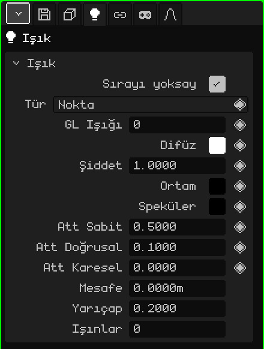

# Işık

**Işık** sahneyi aydınlatır: Aydınlatma'sı açık olan malzemeler, üzerlerine düşen ışıklara göre daha açık ya da daha koyu görünür. Bu makale ışığın özelliklerinin başvuru kaynağıdır; nesnelerin nasıl eklendiği ve taşındığı [Nesne Modu](../tutoriales/modo-objeto.md) eğitiminde anlatılıyor.

## Üç tür

| Tür | Nasıl aydınlatır | Ne için |
|---|---|---|
| **Nokta** | Bir ampul gibi, bir noktadan her yöne. | Lambalar, mumlar, kamp ateşleri, bir nesnenin parıltısı. |
| **Güneş** | Hepsi aynı taraftan gelen paralel ışınlarla. Önemli olan nereye baktığıdır, nerede olduğu değil. | Dış mekânlarda gün ışığı. |
| **Spot** | Bir el feneri gibi, bir koni içinde. | El fenerleri, bir arabanın farları, bir sahnenin projektörleri. |

Ekle → Işık bir Nokta ışığı oluşturur; Ekle → Güneş ve Ekle → Spot diğer ikisini doğrudan oluşturur. Tür daha sonra **Tür** özelliğinden değiştirilebilir.

Güneş ve Spot, nesne döndürülerek yönlendirilir. Güneş, aydınlattığı yöne doğru zemine kadar her zaman bir çizgi çizer; ışık seçiliyken Spot konisini, Nokta ışığı ise **Mesafe**'si büyüklüğünde bir küre gösterir.

## Sekmeler

| Sekme | Neler içerir |
|---|---|
| Nesne | Tüm nesnelerde olduğu gibi konum, dönme, ad ve görünürlük: bkz. [3D Örgü](objeto-malla.md#nesne-sekmesi). |
| Işık | Aşağıdaki kart. |
| Kısıtlamalar | Bkz. [Kısıtlamalar](restricciones.md). |
| Betikler | Nesnenin Lua script'leri. Bkz. [Whisk3D'de Lua](../lua/README.md). |

## Işık kartı

| Özellik | Ne yapar |
|---|---|
| Sırayı yoksay | İşaretliyken (varsayılan) ışık, Outliner'da nerede olursa olsun tüm sahneyi aydınlatır. İşaretli değilken yalnızca Outliner'da kendisinden **sonra** çizilenleri aydınlatır: belirli şeyleri belirli ışıklarla aydınlatmaya yarar. |
| Tür | Nokta, Güneş ya da Spot. |
| GL Işığı ◆ | OpenGL'in 8 ışığından hangisini kullandığı (0'dan 7'ye). Bkz. [8'den fazla ışık](#8den-fazla-ışık). |
| Difüz ◆ | Işığın rengi. |
| Şiddet ◆ | Ne kadar güçlü aydınlattığı. 1 rengin olduğu gibi hâlidir; fazlası daha güçlüdür. |
| Ortam ◆ | Her yere, ışığa bakmayan yüzlere de ulaşan eşit bir ışık. Siyahtan başlar (ortam ışığı yok). Gölgeler siyah kalmasın diye biraz artır. |
| Speküler ◆ | Işığın malzemelerde bıraktığı parlamanın rengi. Siyahtan başlar (parlama yok). |
| Att Sabit, Att Doğrusal, Att Karesel ◆ | **Zayıflama**: ışığın mesafeyle nasıl söndüğü. Sabit onu her yerde eşit olarak zayıflatır; Doğrusal uzaklaştıkça yavaş yavaş söndürür; Karesel uzakta çok daha hızlı söndürür. Güneş'te görünmezler. |
| Spot Açısı ◆ | Yalnızca Spot'ta: koninin merkezden kenara kadar derece cinsinden ne kadar açık olduğu. 45 ile koni toplamda 90° açılır. |
| Spot Üssü ◆ | Yalnızca Spot'ta: ışığın koni içinde nasıl dağıldığı. 0 eşit aydınlatır; daha yüksek değer ışığı merkezde toplar ve kenarları karartır. |
| Mesafe | Işın izlemede bir Nokta ışığının ya da bir Spot'un metre cinsinden ne kadar uzağa kadar aydınlattığı; aynı zamanda çizilen koninin uzunluğudur. 0 sınırsızdır. Güneş'te görünmez. |
| Yarıçap | Işın izleme için: lambanın boyutu. 0 keskin kenarlı sert gölgeler verir; büyüdükçe yumuşak kenarlı gölgeler verir. Güneş'te derecedir. |
| Işınlar | Işın izleme için: bu ışığın kaç gölge ışını gönderdiği. Işın arttıkça yumuşak gölgeler daha temiz ama daha yavaş olur. 0, Dosya / Render sekmesindekileri kullanır. |

### Mesafe ve zayıflama

İkisi de bir ışığın ne kadar uzağa kadar fark edildiğini değiştirir, ama aynı şekilde değil:

- **Zayıflama** her zaman geçerlidir; 3D Görünüm'de, oyunda ve ışın izlemede: ışık mesafeyle giderek söner ama hiçbir zaman tamamen kesilmez.
- **Mesafe** ışın izleme için bir kesme noktasıdır: ışık tam orada sıfıra inecek şekilde yumuşakça söner ve ötesini aydınlatmaz. OpenGL'de kesmez: orada belirleyici olan zayıflamadır. Küre ya da koni nerede bittiğini gösterdiği için bir kılavuz olarak da işe yarar.

## 8'den fazla ışık

OpenGL **aynı anda en fazla 8 ışık** çizer; bunlar 0'dan 7'ye numaralandırılır: bu, **GL Işığı** özelliğidir. Sahnede çok daha fazlası olabilir; 8'i geçince yeni ışıklar öncekilerden biriyle aynı numarayı paylaşır. Işın izleme ise hepsini kullanır.

**Sırayı yoksay** işaretli değilken bir numara bilerek yeniden kullanılabilir: GL Işığı 0 olan bir ışık, Outliner'da kendisinden sonra çizilenleri aydınlatır, daha aşağıdaki aynı GL Işığı 0'a sahip başka bir ışık da ardından gelenler için onun yerini alır. Böylece uzun bir ortam, 8'i aşmadan her bölgede farklı ışıklara sahip olabilir.

## Örnekler

| Sahne | Nasıl kurulur |
|---|---|
| Gündüz bir dış mekân | Difüz'ü hafif sarı bir Güneş ve gölgeler siyah kalmasın diye biraz açık mavi Ortam. |
| Lambalı bir oda | Lambaya bir Nokta ışığı; duvarlara doğru sönmesi için Att Doğrusal biraz daha yüksek. Işın izleme için odanın büyüklüğünde bir Mesafe. |
| Bir el feneri | Küçük bir Spot Açısı ve yüksek bir Spot Üssü olan bir Spot; bir [Child Of](restricciones.md#child-of) kısıtlamasıyla karakterin eline bağlı. |
| Titreyen bir ışık | Şiddet'te (◆) yükselip alçalan değerlerle keyframe'ler. |
