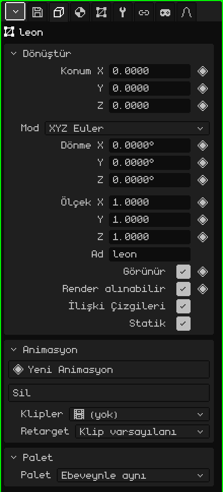
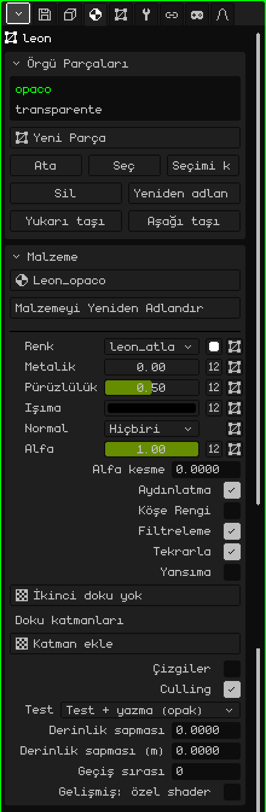
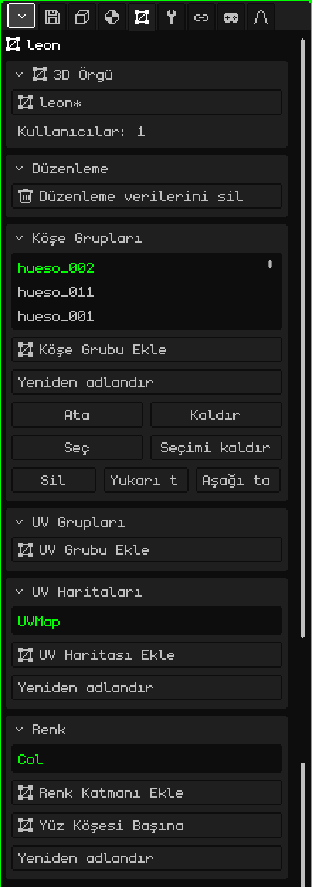
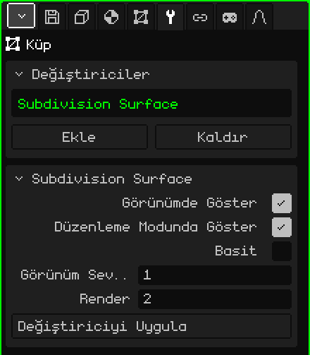

# 3D Örgü

**3D örgü**, şekli olan nesnedir: köşelerden, kenarlardan ve yüzlerden oluşur; modellenen, boyanan ve canlandırılan şey odur. Bir küp, bir karakter ya da koca bir ortam örgüdür. Bu makale örgünün özelliklerinin başvuru kaynağıdır; nesnelerin nasıl oluşturulduğu, taşındığı ve ebeveyne bağlandığı [Nesne Modu](../tutoriales/modo-objeto.md) eğitiminde anlatılıyor.

## Sekmeler

Bir örgü seçiliyken Özellikler, her zaman bulunan Dosya / Render ve Animasyon sekmelerine ek olarak şu sekmeleri gösterir:

| Sekme | Neler içerir |
|---|---|
| Nesne | Tüm nesnelerde ortak olanlar: konum, dönme, ölçek, ad ve görünürlük. |
| Malzeme | Örgünün parçaları ve her birinin malzemesi. |
| 3D Örgü | Örgünün verileri: hangisini kullandığı, köşe grupları, UV haritaları ve renk katmanları. |
| Değiştiriciler | Şekli bozmadan değiştiren değiştiriciler. |
| Dönüştür | Yalnızca Düzenleme Modunda: seçilenin merkezi, sayılarla yazmak için. |
| Kısıtlamalar | Bkz. [Kısıtlamalar](restricciones.md). |
| Betikler | Nesnenin Lua script'leri. Bkz. [Whisk3D'de Lua](../lua/README.md). |

## Nesne sekmesi

Tüm nesne türleri için aynıdır: kameralarda, ışıklarda, iskeletlerde ve seslerde de bulunur.

### Dönüştür

| Özellik | Ne yapar |
|---|---|
| Konum X, Y, Z ◆ | Nesnenin metre cinsinden nerede olduğu. Z yüksekliktir. |
| Mod | Dönmenin nasıl yazıldığı: **XYZ Euler** (derece cinsinden üç açı, okuması en kolay olanı), **Kuaterniyon (WXYZ)** ya da **Eksen Açısı**. Son ikisiyle **Dönme W** görünür. Modu değiştirmek nesneyi döndürmez: yalnızca sayıların nasıl gösterildiğini değiştirir. |
| Dönme X, Y, Z ◆ | Her eksen etrafındaki dönme. |
| Ölçek X, Y, Z ◆ | Her eksendeki boyut: 1 asıl boyut, 2 iki katı, 0.5 yarısıdır. |
| Ad | Nesnenin adı, Outliner'ın gösterdiğiyle aynı. Tekrarlanamaz: zaten varsa sonuna bir numara eklenir (`.001`). |
| Görünür ◆ | Nesnenin görünüp görünmediği. Outliner'daki gözün aynısıdır. |
| Render alınabilir ◆ | Render'larda çıkıp çıkmadığı. İşaretli değilken 3D Görünüm'de görünmeye devam eder ama görüntüde ya da videoda yer almaz. |
| İlişki Çizgileri | Nesneyi ebeveynine bağlayan çizgi. Bir nesnenin çok sayıda alt öğesi olduğunda ve çizgiler görünümü kapattığında kapatmak işe yarar. |
| Statik | Nesnenin hiç hareket etmediğini belirtir. Yalnızca ızgara yöntemli bir Culling nesnesinin içinde önemlidir: statik bir nesne her karede ölçülmek yerine hücresine yalnızca bir kez yerleştirilir. |

### Animasyon ve Palet

- **Animasyon:** nesnenin kendi animasyonları (örneğin bir köşe animasyonu) ve klipleri. Bkz. [Zaman Çizelgesi](linea-de-tiempo.md).
- **Palet:** nesnenin hangi renk paletini kullandığı. **Ebeveynle aynı** seçiliyken (varsayılan) paleti devralır; projeden bir palet seçmek nesneyi ve ona bağlı her şeyi yeniden boyar.

## Malzeme sekmesi

### Örgü Parçaları

Bir örgü **parçalara** bölünebilir ve her parçanın kendi malzemesi vardır. Örneğin bir evin duvarları bir parçada, pencerelerin camları başka bir parçada olabilir.

| Özellik | Ne yapar |
|---|---|
| Liste | Örgünün parçaları. Seçili olan, aşağıdaki Malzeme kartında gösterilendir. |
| Yeni Parça | Boş bir parça oluşturur. |
| Ata | Düzenleme Modunda seçili yüzleri seçili parçaya aktarır. |
| Seç / Seçimi kaldır | O parçanın yüzlerini seçer ya da seçimini kaldırır. Gerekirse Seç, onları göstermek için Düzenleme Moduna geçer. |
| Sil / Yeniden adlandır | Parçayı siler (yüzleri bir önceki parçaya geçer) ya da adını değiştirir. Sil, birden fazla parça varsa görünür. |
| Yukarı taşı / Aşağı taşı | Sırayı değiştirir. Parçalar bu sırayla çizilir: saydam olanı sona bırakmak iyi olur. |

### Malzeme

Malzeme parçanın nasıl göründüğünü belirler: rengini, dokusunu ve ışığın ona nasıl vurduğunu. Varsayılan malzeme düzenlenemez: bir şeyi değiştirmek için önce yukarıdaki seçiciyle (**Yeni Malzeme**) bir malzeme oluşturulur; bu seçici projedeki başka bir malzemeyi seçmeye de yarar. En çok kullanılan seçenekler:

| Özellik | Ne yapar |
|---|---|
| Malzemeyi Yeniden Adlandır | Malzemenin adını değiştirir. |
| Renk | Parçanın dokusu, **Temel Renk**'in küçük karesi ve dokunun kullandığı UV haritası. |
| Metalik, Pürüzlülük, Işıma, Normal, Alfa | Her biri bir sayı ya da bir doku olabilir (**Sayı / doku** düğmesi). Alfa saydamlıktır: 1'den küçükse ya da bir alfa dokusuyla malzeme saydam hâle gelir. |
| Alfa kesme | Alfası düşük olanı karıştırmadan keser: parmaklıklar, tel örgüler ya da yapraklar için. 0 kapatır. |
| Geçirgenlik, IOR | Cam ve kırılma. Yalnızca **Işın İzleme** açıkken (Dosya / Render sekmesi). |
| Aydınlatma | Sahnenin ışıklarının ona vurup vurmadığı. Kapalıyken renk düz, hep aynı görünür. Grafik arka ucunda shader varsa **Gölgeleme** görünür: Köşe başına ya da Piksel başına. |
| Köşe Rengi | Temel renk yerine örgüye boyanmış renkleri kullanır (bkz. [Köşe Boyama](pintura.md#köşe-boyama)). |
| Filtreleme / Tekrarla | Dokuyu yakından yumuşatır (işaretli değilken pikseller görünür) / onu bir mozaik gibi tekrarlar. |
| Yansıma | Krom gibi, ortamın bir yansıması. |
| Doku katmanları | İlkinin üzerine, her biri kendi UV haritası ve karışımıyla en fazla dört doku daha. |
| Çizgiler / Çizgi Kalınlığı | Parçanın kenarlarını piksel cinsinden kalınlıkla çizer. |
| Culling | Arka yüzleri çizmez. |
| Test, Derinlik sapması, Geçiş sırası | Çıkartmalar ve başka şeylerin üzerine oturan şeyler için gelişmiş derinlik seçenekleri. |
| Gelişmiş: özel shader | Malzemeyi özel olarak çizen bir dosya: bkz. [Yazılan shader'lar](shaders.md). |

Nesnenin fiziği varsa (Ekle → Fizik), **Fizik** kartı da bu sekmede görünür.

## 3D Örgü sekmesi

### 3D Örgü

Nesnenin şekli projenin bir kaynağıdır ve birkaç nesne aynı örgüyü **paylaşabilir** (Bağlantılı Çoğalt bunu yapar): birini düzenlemek hepsini düzenler.

| Özellik | Ne yapar |
|---|---|
| Seçici | Nesnenin kullandığı örgü (kaydedilmemiş değişiklikleri varsa bir `*` ile). Buradan projedeki başka bir örgü ya da **Yeni kopya** seçilir. |
| Kullanıcılar | Sahnedeki kaç nesnenin bu örgüyü kullandığı. |
| Tek Kullanıcılı Yap | Örgü paylaşılıyorsa görünür: nesneye kendi kopyasını verir, böylece diğerlerine dokunmadan düzenlenebilir. |

Örgü bir kütüphanedense "Bir kütüphaneye ait (salt okunur): düzenlemek için kütüphaneyi açın" uyarısı görünür ve onu değiştirebilecek her şey panelden kaybolur.

### Düzenleme

**Düzenleme verilerini sil**, artık modellenmeyecek bir ortam için işe yarar: örgüden Düzenleme Modunun kullandığı verileri çıkarır, böylece daha hızlı yüklenir ve daha az bellek kaplar (Nokia N95'te önemlidir). Bu sırada Düzenleme Moduna girilemez. **Düzenlenebilir örgüye dönüştür** bu verileri yeniden hesaplar.

**Normalleri Kilitle** kutusu, Düzenleme Modunda köşeleri taşırken bu örgünün normallerinin yeniden hesaplanmamasını sağlar. Böylece içe aktarılmış bir modelle gelen ya da elle düzeltilmiş normaller korunur. Kapalı gelir ve her örgünün kendi ayarı vardır.

### Köşe Grupları

**Köşe grubu**, her birinin bir ağırlığı olan köşelerden oluşan bir listedir. Bir [iskeletin](objeto-esqueleto.md) her kemiğin hangi köşeleri hareket ettirdiğini bilmek için kullandığı şey budur: grup, kemikle aynı adı taşır. Ağırlıklar [Ağırlık Boyama](pintura.md#ağırlık-boyama) ile boyanır.

| Özellik | Ne yapar |
|---|---|
| Köşe Grubu Ekle / Yeniden adlandır | Bir grup oluşturur ya da adını değiştirir. |
| Ata / Kaldır | Düzenleme Modunda seçili köşeleri gruba ekler (ağırlık 1 ile) ya da gruptan çıkarır. |
| Seç / Seçimi kaldır | Neleri kapsadığını görmek için grubun köşelerini seçer ya da seçimini kaldırır. |
| Sil / Yukarı taşı / Aşağı taşı | Grubu siler ya da listede taşır. |

**UV Grupları** da aynı şekilde çalışır, ama ağırlıkları [UV Düzenleyici](editor-uv.md)'nin 2D iskeletleri içindir.

### UV Haritaları

**UV haritası**, dokunun örgünün üzerine nasıl oturduğunu belirtir. Bir örgünün birkaç tane olabilir: örneğin biri renk dokusu için, diğeri farklı şekilde tekrarlanan bir doku katmanı için. Malzemenin her dokusu hangisini kullanacağını seçer.

**UV Haritası Ekle** bir tane oluşturur, **Yeniden adlandır** adını değiştirir; Sil, Yukarı taşı ve Aşağı taşı birden fazla harita varsa görünür.

### Renk

**Renk katmanları**, Köşe Boyama ile örgüye boyanan renkleri saklar. **Renk Katmanı Ekle** bir tane oluşturur; **Renk Modu**, **Köşe Başına** (bir köşeyi paylaşan yüzler onun rengini de paylaşır) ile **Yüz Köşesi Başına** (sert kenarlar için her yüzün kendi rengi olabilir) arasında geçiş yapar. Yeniden adlandır, Sil, Yukarı taşı ve Aşağı taşı UV haritalarındaki gibidir.

## Değiştiriciler sekmesi

**Değiştirici**, örgüyü bozmadan değiştirir: istenildiği zaman kapatılabilir, yeniden sıralanabilir ya da silinebilir ve asıl örgü yerinde durur.

**Değiştiriciler** kartında liste (değiştiriciler yukarıdan aşağıya sırayla uygulanır), **Ekle** (türleri içeren menü), **Kaldır** ve **Yukarı taşı / Aşağı taşı** bulunur. Altında seçili değiştiricinin kartı (başlığında adıyla) **Görünümde Göster**'i (kapalıyken hesaplanmaz), **Düzenleme Modunda Göster**'i (kapalıyken düzenleme daha hızlıdır ve çıkınca yeniden hesaplanır), değiştiricinin özelliklerini ve onu örgüye kalıcı olarak işleyip listeden çıkaran **Değiştiriciyi Uygula**'yı içerir.

Her değiştiricinin kendi makalesi vardır:

| Değiştirici | Ne işe yarar |
|---|---|
| [Vida](modificador-screw.md) | Bir profili bir eksen etrafında döndürür: vidalar, vazolar, yaylar. |
| [Ayna](modificador-espejo.md) | Örgüyü yansıtır: bir yarısı modellenir, öbürü kendiliğinden çıkar. |
| [Dizi](modificador-array.md) | Sıra hâlinde kopyalar: merdivenler, çitler, zincirler. |
| [Alt Bölüm Yüzeyi](modificador-subdivision.md) | Örgüyü alt bölerek yumuşatır. |
| [Boolean](modificador-booleano.md) | Başka bir nesneyi birleştirir, kesiştirir ya da çıkarır. |
| [Culling](modificador-culling.md) | Optimizasyon: kameradan görünmeyeni çizmez. |
| [İskelet](modificador-esqueleto.md) | Örgüyü bir iskeletle deforme eder. |
