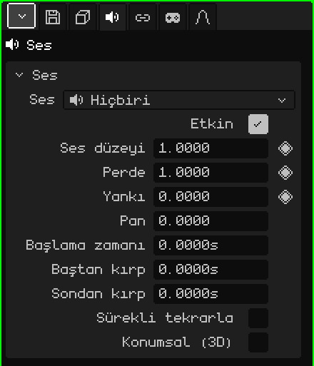

# Ses

**Ses** nesnesi sahneye yerleştirilmiş bir sestir: bir müzik, bir efekt, bir makinenin gürültüsü. 3D Görünüm'de bir hoparlör olarak görünür. Bir müzik gibi her yerde aynı şekilde ya da bulunduğu yerden, yaklaştıkça daha yüksek duyulabilir. Bu makale ses nesnesinin özelliklerinin başvuru kaynağıdır; nesnelerin nasıl eklendiği ve taşındığı [Nesne Modu](../tutoriales/modo-objeto.md) eğitiminde anlatılıyor.

Yeni bir Ses nesnesi sessiz başlar: **Hiçbiri**. Dosya Ses kartında seçilir.

## Ses önceden seçilmiş olarak

-  [Kütüphane](outliner.md#kütüphane-görünümü)'den bir sesi 3D Görünüm'e sürüklemek, bıraktığın yerde o sesi çalan bir Ses nesnesi oluşturur.
-  Bir ses dosyasını (örneğin bir `.wav`) 3D Görünüm'ün üzerine bırakmak onu projeye ekler ve nesneyi oraya oluşturur.

## Sekmeler

| Sekme | Neler içerir |
|---|---|
| Nesne | Tüm nesnelerde olduğu gibi konum, ad ve görünürlük: bkz. [3D Örgü](objeto-malla.md#nesne-sekmesi). Gizlenen bir ses çalmaz ve bir koleksiyonu gizlemek içindeki sesleri susturur. |
| Ses | Aşağıdaki kart. |
| Kısıtlamalar | Bkz. [Kısıtlamalar](restricciones.md). |
| Betikler | Nesnenin Lua script'leri; bir oyunda onu çalabilir ya da susturabilirler. Bkz. [Whisk3D'de Lua](../lua/README.md). |

## Ses kartı

| Özellik | Ne yapar |
|---|---|
| Ses | Çalan dosya ve süresi. Menü, projedeki sesleri, **Hiçbiri**'yi ve diskten projeye bir ses getiren **Dosya tarayıcısından ses yükle...** seçeneğini listeler. |
| Etkin | İşaretli değilken çalmaz. Silmeden kapatmaya yarar. |
| Ses düzeyi ◆ | Ne kadar yüksek çaldığı: 1 dosyanın kendi ses düzeyi, 0 sessiz, 2 iki katı. |
| Perde ◆ | Daha ince ya da daha kalın. 1 orijinalidir; 2 bir oktav daha ince ve iki kat hızlı, 0.5 bir oktav daha kalın ve yarı hızda çalar. Bu yüzden perdeyi değiştirmek süreyi de değiştirir. |
| Yankı ◆ | Bu sesin ne kadarının reverb yankısına gittiği: 0 hiç, 1 tamamı. Mağara, kilise ya da koridor hissi verir. |
| Pan | Hangi taraftan duyulduğu: -1 sol, 0 orta, 1 sağ. Yalnızca Konumsal (3D) kapalıyken: açıkken tarafı nesnenin bulunduğu yer belirler. |
| Başlama zamanı | Sahnenin hangi saniyesinde başladığı. |
| Baştan kırp | Dosyanın başından kaç saniye kesildiği. |
| Sondan kırp | Dosyanın sonundan kaç saniye kesildiği. |
| Sürekli tekrarla | İki kırpma arasında kalan kısım durmadan, kesintisiz tekrarlanır. Arka plan müzikleri ve sürekli gürültüler için. |
| Konumsal (3D) | Nesnenin bulunduğu yerden duyulur. Aşağıya bak. |
| Tam ses yarıçapı | Yalnızca Konumsal (3D) ile: metre cinsinden bu mesafeye kadar tam ses düzeyinde duyulur. |
| Duyulma menzili | Yalnızca Konumsal (3D) ile: metre cinsinden bu mesafeden itibaren artık duyulmaz. |

## Süreler saniye cinsindendir

Sesin süreleri karelerle değil, **saniyelerle** ölçülür. Böylece sahne saniyede 30 kareden 60 kareye geçerse sesler aynı ana bağlı kalır ve hiçbir şeyi yeniden ayarlamak gerekmez.

[Zaman Çizelgesi](linea-de-tiempo.md#sesler)'nde seçili her sesin bir **şeridi** vardır: nerede başladığı ve ne kadar sürdüğü. Şeridi sürüklemek **Başlama zamanı**'nı, uçlarından birini tutmak da kırpmaları değiştirir. Zaman Çizelgesi'nin Oynat'ıyla çalar, durdurunca susar.

Bir oyunda ses, ortaya çıktığı anda (örneğin bir prefab'ın parçası olan bir patlamanın sesi) artı **Başlama zamanı**'nda belirtilen süre kadar sonra başlar.

## Konumsal (3D)

İşaretli değilken ses, bir müzik gibi nerede olursa olsun aynı şekilde duyulur. İşaretliyken dinleyene göre **bulunduğu yerden** duyulur:

- Ne kadar yakınsa o kadar yüksek: **Tam ses yarıçapı**'na kadar tam ses düzeyinde çalar, oradan itibaren azalarak **Duyulma menzili**'nde tamamen kesilir.
- Sağdaysa sağdan, soldaysa soldan duyulur.
- Arkadaysa daha kısık ve daha ortadan duyulur.

Dinleyen, oyunda etkin kamera, editörde ise etkin 3D Görünüm'dür (ya da kameranın içinden bakılıyorsa kamera). Ses seçiliyken 3D Görünüm iki küre çizer: tam ses yarıçapınınki ve duyulma menzilininki.

## Örnekler

| Ses | Nasıl kurulur |
|---|---|
| Arka plan müziği | Konumsal (3D) kapalı, Sürekli tekrarla açık. |
| Bir şelale | Konumsal (3D) ve Sürekli tekrarla; küçük bir Tam ses yarıçapı ve büyük bir Duyulma menzili ile: uzaktan duyulmaya başlar ve yaklaştıkça yükselir. |
| Bir animasyonun 4. saniyesinde bir darbe | Başlama zamanı 4, ya da şerit Zaman Çizelgesi'nde oraya taşınmış. 30 FPS'de bu 121. karedir: 1. kare 0. saniyedir. |
| Sonunda kısılarak biten bir müzik | Ses düzeyinde keyframe'ler (◆): sondan biraz önce 1, sonda 0. |
