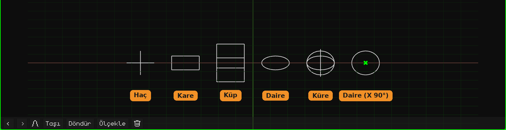

# Boş

**Boş**, örgüsü olmayan bir nesnedir: ne render alırken ne de oyunda görünür. Bir referans noktası olarak işe yarar: kendisine bağlı diğer nesneleri döndürmek ya da ölçeklemek için bir pivot, bir kameranın ya da bir kısıtlamanın yöneleceği bir yer, canlandırmak için bir kontrol. **Ekle → Boş** ile, 3D imlecin bulunduğu yere eklenir. Nesnelerin nasıl eklendiği ve taşındığı [Nesne Modu](../tutoriales/modo-objeto.md) eğitiminde anlatılıyor.

3D Görünüm'de çizgilerle çizilir. Yeni bir Boş nesne, görmesi ve tutması kolay, **zemine yatırılmış bir dairedir**. Çizimin şekli, boyutu ve dönmesi kendi kartında değiştirilir. Bu **yalnızca nasıl göründüğüdür**: nesneyi, dönüşümünü ya da alt öğelerini değiştirmez.

## Sekmeler

| Sekme | Neler içerir |
|---|---|
| Nesne | Tüm nesnelerde olduğu gibi konum, dönme, ölçek, ad ve görünürlük: bkz. [3D Örgü](objeto-malla.md#nesne-sekmesi). Boş nesneyi ölçeklemek alt öğelerini de ölçekler. |
| Boş (haç) | Aşağıdaki kart. |
| Kısıtlamalar | Bkz. [Kısıtlamalar](restricciones.md). |
| Betikler | Nesnenin Lua script'leri. Bkz. [Whisk3D'de Lua](../lua/README.md). |

## Boş kartı

| Özellik | Ne yapar |
|---|---|
| Şekil | Nasıl çizildiği, her biri kendi simgesiyle: **Haç** (üç eksen), **Kare**, **Küp**, **Daire** ya da **Küre** (her eksen için bir tane olmak üzere üç daire). Kare ve daire zemine yatırılmış olarak doğar. Küçük ekranlarda (Nokia N95, PSP, 3DS ve Dreamcast) daire ve küre yarı sayıda çizgiyle çizilir: orada fark anlaşılmaz ve telefon daha az çizim yapar. |
| Boyut | Çizimin bir uçtan öbür uca metre cinsinden boyu. 1 bir metredir. |
| Dönme X, Y, Z | Çizimi derece cinsinden döndürür. Örneğin **X** 90 olduğunda daire dik durur. |

Bunların hiçbiri nesneyi taşımaz ya da döndürmez: Boş nesne aynı yerde kalır ve alt öğeleri bundan etkilenmez. Projeyle birlikte kaydedilir.

## Ne işe yarar

- **Bir pivot:** bir Boş nesnenin alt öğesi olan nesne, Boş nesnenin bulunduğu yerden döner ve ölçeklenir. Örneğin alt noktasına yerleştirilmiş bir Boş nesneye bağlanmış bir top, Boş nesne ölçeklendiğinde zemine doğru ezilir.
- **Sahneyi düzenlemek:** bir Boş nesneye bağlı birkaç nesne, yalnızca Boş nesne taşınarak birlikte hareket eder.
- **Bir hedef:** [kısıtlamalar](restricciones.md) bir Boş nesneye yönelebilir; örneğin bir kameranın ona bakmaya devam etmesi için.
