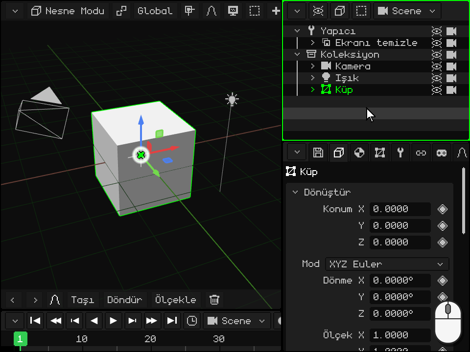
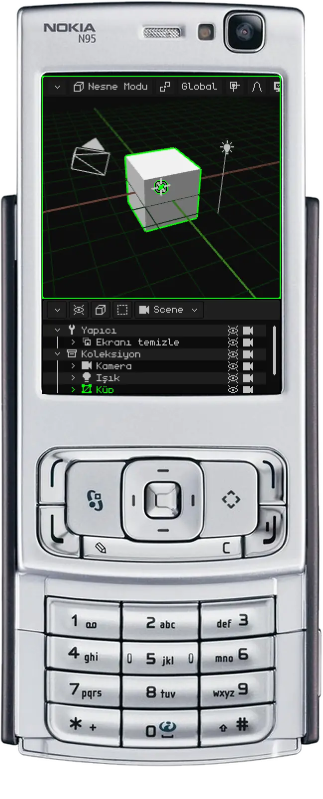
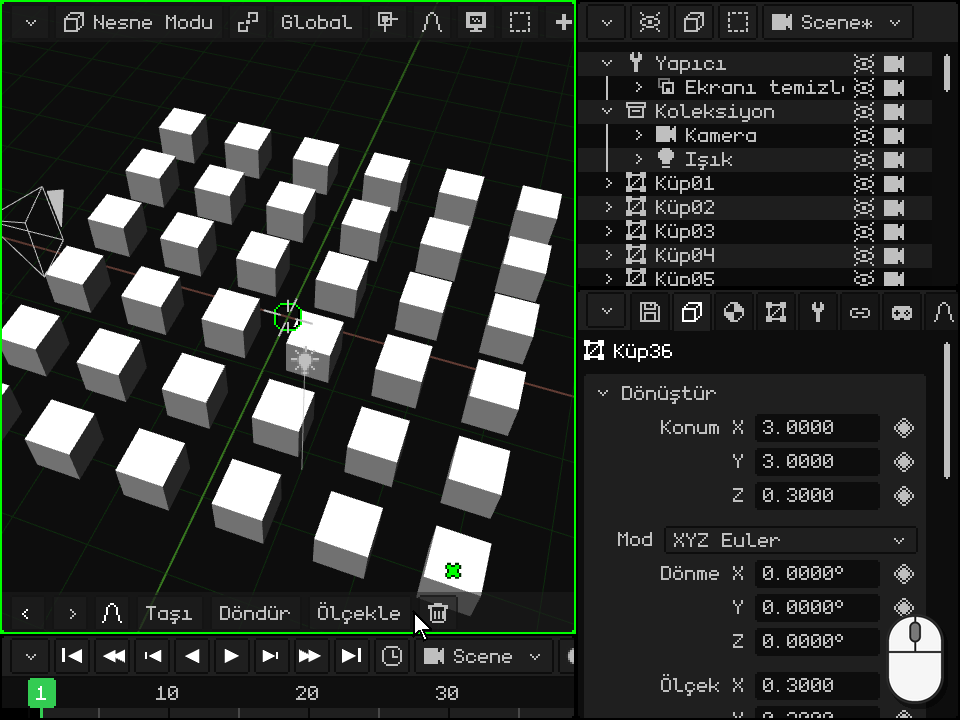

# Outliner

> [!NOTE]
>  Nokia N95 fare ve klavyeyi (Bluetooth ile) destekler. Bu sayfanın Nokia ile ilgili kısımları, onu fare ve klavye olmadan, yalnızca telefonun tuşlarıyla nasıl kullanacağını anlatır.

**Outliner**, sahnedeki her şeyin listesidir: nesneler, kameralar, ışıklar ve koleksiyonlar. [Viewport'lar](interfaz.md) bölümünde görülen viewport'lardan biridir; PC'de sağ üsttedir. Nesneler buradan seçilir, gizlenir, sıralanır, birbirinin içine yerleştirilir ve yeniden adlandırılır.

Outliner'da seçtiğin şey 3D Görünüm'de de seçili olur, tersi de geçerlidir. En son seçtiğin nesne **etkin nesnedir**: Özellikler'in gösterdiği nesne.

 **Android'de** Outliner ekranda gelmez: yer 3D Görünüm'e ve Özellikler'e bırakılır. Onu kullanmak için, [Türü değiştirme](interfaz.md#türü-değiştirme) bölümündeki gibi köşe düğmesiyle bir viewport'u Outliner'a dönüştür (ya da birini böl). Outliner olmadan da çalışılabilir: nesneler 3D Görünüm'de onlara dokunarak seçilir, Özellikler'de de ad ile **Görünür** ve **Render alınabilir** onay kutuları bulunur.

 **Nokia N95'te** Outliner ekranda gelmez: yalnızca iki viewport sığar. Sahneyi düzenlerken Özellikler'i Outliner'a dönüştür: **sol seçim tuşuyla** sekmelerine girersin, sol ok tuşuyla da köşe düğmesinin menüsüne ulaşırsın; orada Outliner'ı seç. Geri dönmek için Outliner'da sol seçim tuşu doğrudan o menüyü açar. Yeşil **arama tuşuyla**  onu etkin viewport yaparsın: N95 ile ilgili aşağıdaki her şey, yeşil kenarlık Outliner'dayken yapılır.

## Her satırın gösterdikleri

Her satır bir nesnedir. **Ok**, içindekileri katlar ya da açar; **simge** türünü söyler (örgü, kamera, ışık, koleksiyon...); ardından **ad** gelir: etkin nesneyse yeşil, seçiliyse daha koyu bir yeşil olur; sağda da **göz** ve **kamera** vardır. Başka bir nesnenin içindeki nesne daha sağda, ona bağlı olarak görünür; soluk bir satır gizli bir nesnedir.

Yeni bir projede en üstte, ekranı hazırlayan bir rutin olan **Yapıcı**, altında da kamera, ışık ve küple birlikte **Koleksiyon** bulunur. Koleksiyon, düzen için bir klasördür.

## Seçme

| | Nasıl seçilir |
|---|---|
|  PC | Satıra bir tık yalnızca o nesneyi seçer. <kbd>Shift</kbd> + tık, etkin nesneden o satıra kadar tüm satırları seçer. <kbd>Ctrl</kbd> + tık bir satırı ekler ya da çıkarır. Fare Outliner'ın üzerindeyken yukarı ve aşağı ok tuşları önceki ya da sonraki satıra geçer. |
|  Dokunmatik ekran | Satıra bir dokunuş. 3D Görünüm'ün araç çubuğunda **Shift** ya da **Ctrl** açıkken dokunuş, klavyedekiyle aynı şeyi yapar. Parmağı sürüklemek listeyi kaydırır. |
|  Nokia N95 | Yukarı ve aşağı ok tuşları önceki ya da sonraki satıra geçer; liste de onu takip etmek için kendiliğinden kayar. |
| Menü | Seç → Tümünü Seç, Tüm seçimi kaldır ya da Seçimi tersine çevir |

## Katlama ve açma

Bir nesnenin içinde başka nesneler varsa, oku onları gösterir ya da gizler. Kullanmadığını katlamak listeyi kısa tutar.

| | Nasıl katlanır ve açılır |
|---|---|
|  PC | Oka bir tık. Fare Outliner'ın üzerindeyken klavyenin sağ ok tuşu etkin nesneyi açar, sol ok tuşu katlar; zaten katlıysa sol ok tuşu bir üstteki nesneye çıkar ve onu katlar. |
|  Dokunmatik ekran | Oka bir dokunuş. |
|  Nokia N95 | Sağ etkin nesneyi açar, sol katlar; zaten katlıysa sol bir üstteki nesneye çıkar ve onu katlar. |

## Gizleme: göz ve kamera

- **Göz**, nesneyi 3D Görünüm'de gösterir ya da gizler. Gizli bir nesne render'da da çıkmaz. İçinde başka nesneler varsa onlar da onunla birlikte gizlenir ve satırları soluk görünür.
- **Kamera**, nesnenin **render**'da çıkıp çıkmayacağına karar verir. Kapalıyken nesne çalışırken görünmeye devam eder, ama render aldığın görüntülerde ve videolarda yer almaz.

Bunlara dokunmak seçimi değiştirmez.

| | Göz | Kamera |
|---|---|---|
|  PC | Göze tık ya da etkin nesne için <kbd>H</kbd> (fare Outliner'ın üzerindeyken) | Kameraya tık |
|  Dokunmatik ekran | Göze bir dokunuş | Kameraya bir dokunuş |
|  Nokia N95 | <kbd>2</kbd>, etkin nesneninki | <kbd>3</kbd>, etkin nesneninki |
| Menü | Öğe → Gizle/Göster (etkin nesneninki) | — |

İkisi Özellikler'de, Dönüştür kartında da bulunur: **Görünür** ve **Render alınabilir**. Eşkenar dörtgenleri olduğu için canlandırılabilirler: örneğin bir şeyin videonun belli bir anında belirmesi için.

## Sıralama ve bir nesneyi başka birinin içine yerleştirme

Listenin sırası değiştirilebilir ve bir nesne başka birinin **içine** yerleştirilebilir: onun **çocuğu** olur ve ebeveyn taşındığında, döndürüldüğünde ya da ölçeklendiğinde çocuk da ona eşlik eder. [Nesne Modu](../tutoriales/modo-objeto.md#outliner-sahnedeki-nesneler) eğitiminde buna **ebeveyne bağlama** denir. Nesne sahnedeki yerinden kımıldamaz: yalnızca listedeki yeri değişir.

 **Fareyle:** satırı tut ve sürükle. Başka bir satırın üst ya da alt kenarının üzerinde bir **yeşil çizgi** belirir: bıraktığında nesne o satırın önüne ya da arkasına, aynı seviyeye yerleşir. Başka bir satırın ortasının üzerinde o satır vurgulanır: bıraktığında nesne onun **içine** yerleşir. Son satırın altına bırakılırsa, onu içeren her şeyden çıkar. Üst ya da alt kenara yakınken liste kendiliğinden kayar; böylece uzun bir listenin her satırına ulaşılır.

 **Parmakla:** parmağını satırın üzerinde bir saniye, telefon titreyene kadar kıpırdatmadan tut: satır tutulmuş olur. Sonra onu fareyle olduğu gibi sürükle ve bırak. Hiç hareket ettirmeden bırakırsan nesnenin menüsü açılır. Bu bekleme olmadan parmağı sürüklemek listeyi kaydırır.

 **Nokia N95'te:** satırı ok tuşlarıyla seç ve <kbd>1</kbd>'e bas. Satır yeşil olur ve artık ok tuşları onu hareket ettirir:

-  **Yukarı** ve **aşağı**, onu aynı seviyedekiler arasında yukarı ya da aşağı taşır.
-  **Sağ**, onu aynı seviyede üstünde duranın içine yerleştirir.
-  **Sol**, onu içinde bulunduğu nesneden çıkarır: o nesnenin arkasına, onun seviyesine yerleşir.
-  <kbd>1</kbd> bir kez daha (ya da <kbd>OK</kbd>) onu orada bırakır. <kbd>C</kbd> iptal eder ve onu eski yerine döndürür.

 Bütün bu hareket tek seferde, <kbd>C</kbd> + sol ile geri alınır. Örneğin bir ışığı aydınlattığı nesnelerin önüne koymak için işe yarar.

## Etkin nesneyi bulma ve kadraja alma

Büyük bir sahnede liste uzundur ve 3D Görünüm'de bir şey seçmek listeyi kaydırmaz: satırı görünür alanın dışında kalabilir. Onu listede bulmak ya da nesneyi 3D Görünüm'de görmek için ([Seçileni kadraja alma](../tutoriales/navegacion.md#seçileni-kadraja-alma) bölümündeki gibi **kadraja almak** için):

| | Outliner'da | 3D Görünüm'de |
|---|---|---|
|  PC | Fare Outliner'ın üzerindeyken <kbd>Num .</kbd> (**Etkini göster**): liste, seçili olan ortaya gelene kadar kayar. Katlanmış bir şeyin içindeyse satırı yoktur: önce onu aç. | Fare 3D Görünüm'ün üzerindeyken <kbd>Num .</kbd> |
|  Dokunmatik ekran | Listeyi parmakla sürükle | 3D Görünüm'ün üzerinde iki parmakla çift dokunma |
|  Nokia N95 | Liste, ok tuşlarıyla seçtiğin satırı kendiliğinden takip eder | <kbd>0</kbd> tuşuna tek basış, etkin viewport Outliner olsa bile |
| Menü | — | 3D Görünüm'ün çubuğunda Görünüm → Seçileni Çerçevele |

## Yeniden adlandırma

| | Nasıl yeniden adlandırılır |
|---|---|
|  PC | Ada çift tık ya da etkin nesne için <kbd>F2</kbd>: satır bir metin alanına dönüşür. Yeni adı yaz ve <kbd>Enter</kbd> ile ya da dışarıya bir tıkla onayla; <kbd>Esc</kbd> onu olduğu gibi bırakır. |
|  Dokunmatik ekran | Ada çift dokunma: ekran klavyesi açılır. |
|  Nokia N95 | Sol seçim tuşuyla çubuğa girersin, sağ ok tuşuyla da Öğe → Yeniden adlandır'a ulaşırsın. T9 ile yaz ve <kbd>OK</kbd> ile onayla. |
| Menü | Öğe → Yeniden adlandır |

Aynı sahnedeki iki nesne aynı adı taşıyamaz: ad zaten kullanılıyorsa Whisk3D ona bir sayı ekler ve seni uyarır. Bir script nesneyi adıyla anıyorsa, kendiliğinden güncellenir.

## Çoğaltma ve silme

| | Çoğaltma | Silme |
|---|---|---|
|  PC | <kbd>Shift</kbd> + <kbd>D</kbd>; Bağlantılı Çoğalt için <kbd>Alt</kbd> + <kbd>D</kbd> | <kbd>X</kbd> ya da <kbd>Delete</kbd> |
|  Nokia N95 | Öğe → Çoğalt | <kbd>C</kbd> |
| Menü | Öğe → Çoğalt ya da Bağlantılı Çoğalt | Öğe → Sil |

Outliner'dan yapıldığında kopya, 3D Görünüm'deki gibi fareyi takip etmeden, orijinalin tam üstünde kalır: onu sonra taşı. Silme onay ister ve ikisi de geri alınabilir.

## Outliner'ın menü çubuğu

| Düğme | İçeriği |
|---|---|
| **Görünüm seçenekleri** (göz) | Neyin gösterileceği: Yapıcı, diğer rutinler ve göz ile kamera sütunları (**Görünürlük simgeleri** ve **Render simgeleri**). |
| **Öğe** (küp) | Sil, Yeniden adlandır, Taşı, Gizle/Göster, Çoğalt, Bağlantılı Çoğalt, Prefab oluştur ve Prefabı paketten çıkar. |
| **Seç** | Tümünü Seç, Tüm seçimi kaldır ve Seçimi tersine çevir. |
| Sahne | Projenin hangi sahnesinin, oyununun ya da prefab'ının düzenlendiği ([Sahneler, oyunlar ve prefab'lar](outliner.md#sahneler-oyunlar-ve-prefablar)). |

 Bir satıra sağ tık onu seçer ve aynı menüyü orada, işaretçinin yerinde açar.

 Parmakla, satırı titreyene kadar tut ve hareket ettirmeden bırak: aynı menü açılır.

## Kütüphane

Projenin **kaynakları** (örgüler, malzemeler, dokular, animasyonlar, sesler, script'ler, prefab'lar...) Outliner'da değildir: köşe düğmesiyle seçilen kendi viewport'ları vardır, **Kütüphane**. Klasörler içinde küçük resimler gösterir, hangi kaynakların kullanıldığını ve hangilerinin kullanılmadığını söyler; bir kaynak 3D Görünüm'e sürüklenebilir: bir örgü bir nesne oluşturur, bir malzeme de altında kalan şeye atanır. [Kütüphane görünümü](outliner.md#kütüphane-görünümü) bölümünde anlatılıyor; Outliner'ın geri kalanı da [kılavuzunda](outliner.md) ve [Kısayollar](atajos.md#outliner) sayfasında.

## Kütüphane görünümü

| İşlev | Açıklama |
|---|---|
| Kaynaklar | Klasörler içinde örgüler, malzemeler, dokular, animasyonlar, prefab'lar, sahneler, sesler, script'ler, [shader'lar](shaders.md), yazı tipleri ve videolar. 3D'de bir örgünün üzerine sürüklenen bir malzeme ya da shader, bırakılmadan önce işaretçinin altındaki parçada görünür. Yeşil onay işareti = kullanımda; kırmızı çarpı = sahipsiz; `*` = kaydedilmemiş. |
| Filtre / Liste ya da Izgara | Yalnızca tek bir türü gösterme; küçük resimleri görme. |
| Bir kaynağı sürükleme | Bir klasöre (onu taşır), 3D Görünüm'e (örgü = yeni nesne, malzeme ya da doku = dokunulan şeye atanır, prefab = örnek) ya da Özellikler'deki bir açılır listeye. |
| Yeni klasör / Klasöre taşı | Düzenleme (klasörler yalnızca düzen içindir). |
| Kaynağı çoğalt / Kullanıcıları seç / Sahipsizleri Temizle | Kopyalama, onu kimin kullandığını bulma, kimsenin kullanmadığını silme. |
| .w3d'nin içinde / Harici | Özellikler'den (Kaynak kartı): kaynağı projenin içine ya da dışına taşır. |

## Sahneler, oyunlar ve prefab'lar

Sahnenin adını taşıyan düğme (Outliner'da ve 3D Görünüm'de) projenin sahnelerini, oyunlarını ve prefab'larını listeler. Oradan yenileri oluşturulur, başlangıç sahnesi seçilir ve bir sahne oyuna dönüştürülür (ya da tersi).
