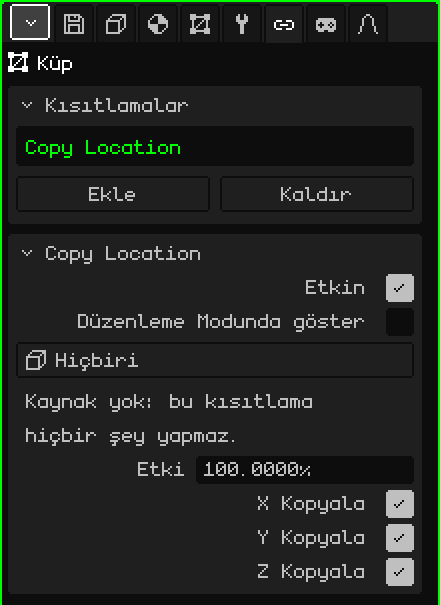
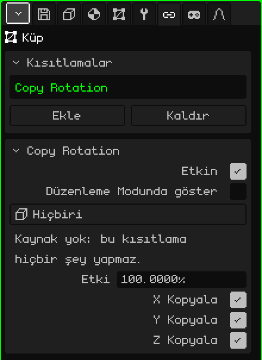
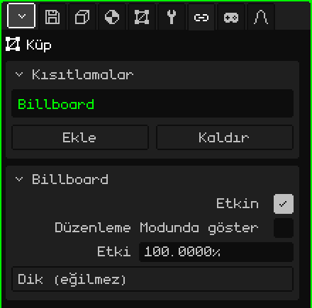
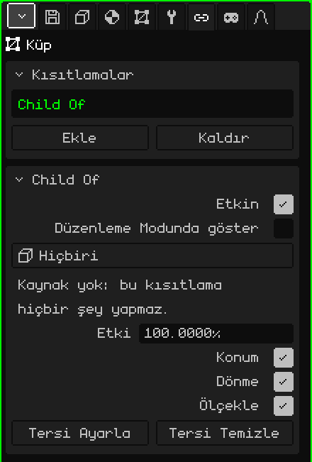

# Kısıtlamalar

**Kısıtlama** (İngilizcesi *constraint*), bir nesnenin başka bir nesneden bir şey almasını sağlar: konumunu, dönmesini, her zaman kameraya bakmasını ya da onu alt öğesiymiş gibi izlemesini. Elle canlandırmadan şeylerin kendiliğinden yerleşmesine yarar: karakterin altında giden bir gölge, her zaman yüzünü dönen düz bir ağaç, ele yapışık bir kılıç. Bu makale her birini ve tüm parametrelerini açıklıyor; nesnelerin nasıl eklendiği ve taşındığı [Nesne Modu](../tutoriales/modo-objeto.md) eğitiminde anlatılıyor.

## Nerede bulunurlar

Özellikler → **Kısıtlamalar** sekmesinde. Her 3D nesnede bulunur: örgüler, kameralar, ışıklar, iskeletler, sesler, boş nesneler. Bir arayüzün 2D öğelerinde bulunmaz.

Her birine bakmadan önce, hepsi için geçerli üç şey:

- **Nesnenin sayılarını değiştirmezler.** Kısıtlama, çizim sırasında üstüne uygulanır. Nesne sekmesindeki Dönüştür kartı nesnenin kendi konumunu ve dönmesini göstermeye devam eder; kısıtlama kapatılır ya da silinirse nesne tam olarak oraya geri döner.
- **Her görünüm için ayrı hesaplanırlar.** Kameraya bağlı olanlar (Billboard ya da kaynağı **Görünüm** olanlar) o an çizim yapan kamerayı kullanır: iki 3D Görünüm açıkken her biri sonucu kendi bakış açısından görür. Oyunda etkin kamera kullanılır.
- **Her yerde aynı şekilde çalışırlar:** editörde, derlenmiş oyunda, Android'de ve Nokia N95'te.

## Kısıtlamalar kartı

| Özellik | Ne yapar |
|---|---|
| Liste | Nesnenin kısıtlamaları. Seçili olan, aşağıdaki kartta gösterilendir. |
| Ekle | Dört türü içeren menü: **Copy Location**, **Copy Rotation**, **Billboard** ve **Child Of**. |
| Kaldır | Seçili kısıtlamayı siler. |
| Yukarı taşı / Aşağı taşı | Sırayı değiştirir (iki ya da daha fazla kısıtlama olduğunda görünürler). |

**Sıra** önemlidir: kısıtlamalar yukarıdan aşağıya uygulanır ve her biri üsttekilerin bıraktığı şey üzerinde çalışır. İkisi aynı şeyi etkiliyorsa daha aşağıdaki kazanır.

## Hepsinde ortak olanlar

Altta, başlığında adıyla birlikte seçili kısıtlamanın kartı görünür. Şu üç satır tüm türlerde bulunur:

| Özellik | Ne yapar |
|---|---|
| Etkin | Kısıtlamayı silmeden açar ya da kapatır. Kısıtlamalı ve kısıtlamasız hâli karşılaştırmaya yarar. |
| Düzenleme Modunda göster | Kapalıyken (varsayılan), nesnenin köşeleri düzenlenirken kısıtlama uygulanmaz: örgü gerçekte bulunduğu yerde görünür ve düzenlenir. Açıkken Düzenleme Modunda da uygulanır. |
| Etki | Ne kadar ağırlığı olduğu, %0'dan %100'e. 100 ile tamamen uygulanır; 0 ile hiçbir şey yapmaz; arada bir değerle nesne, tek başına olacağı yer ile kısıtlamanın onu götürdüğü yer arasında kalır (50 ile yolun yarısında). |

**Düzenleme Modunda göster** bilerek kapalı gelir: kameranın peşinden dönen bir ağacı ya da başka bir yere kaçan bir örgüyü düzenlemek çok zahmetlidir.

## Copy Location

Başka bir nesnenin **konumunu kopyalar**: nesne, seçilen eksenlerde tam olarak kaynağın bulunduğu yere yerleşir.

| Özellik | Ne yapar |
|---|---|
| Kaynak | Nereden kopyaladığı. **Hiçbiri**, **Görünüm** (o an çizim yapan kamera) ya da nesnenin kendisi ve ona bağlı olanlar dışında sahnedeki herhangi bir nesne. |
| X Kopyala, Y Kopyala, Z Kopyala | Hangi eksenleri kopyaladığı. Eksenler Dönüştür kartındakilerle aynıdır: Z yüksekliktir. İşaretlenmemiş bir eksen nesnenin kendi değerinde kalır. |

Konumu aradaki mesafeyi korumadan olduğu gibi kopyalar: üç eksenle nesne kaynağın tam üstüne gelir. Kaydırılmış durması için izlememesi gereken eksenin işareti kaldırılır ya da örgü Düzenleme Modunda kaydırılır (bir şeyi aradaki mesafeyi koruyarak izlemek için bkz. [Child Of](#child-of)).

Kartın uyarıları:

- "Kaynak yok: bu kısıtlama hiçbir şey yapmaz." Kaynak Hiçbiri'deyken görünür; kaynak nesne silindiğinde de görünür: düğmede kendiliğinden Hiçbiri yazar.
- "Eksen yok: bu kısıtlama hiçbir şey yapmaz." Üç eksenin de işareti kaldırıldığında görünür.

**Örnekler:**

- **Karakterin altında yuvarlak bir gölge:** üzerinde koyu bir leke olan bir düzlem; X Kopyala ve Y Kopyala işaretli, Z Kopyala işaretsiz. Tüm zemin boyunca karakterin altından gider ve karakter zıpladığında gölge yerde kalır.
- **Asla ulaşılamayan bir gökyüzü:** üzerine gökyüzü boyanmış büyük bir küre, kaynağı **Görünüm**. Gökyüzü her zaman kameraya ortalanmış gider; bu yüzden ne kadar yürünürse yürünsün kenarına asla varılmaz.
- **Karaktere eşlik eden bir ışık:** kaynağı karakter olan ve yalnızca X Kopyala ile Y Kopyala işaretli bir ışık. Karakteri yukarıdan, ışığın kendi yüksekliğinden izler.

## Copy Rotation

Başka bir nesnenin **dönmesini kopyalar**: nesne yerinden kıpırdamadan kaynakla aynı şekilde döner.

| Özellik | Ne yapar |
|---|---|
| Kaynak | Nereden kopyaladığı: **Hiçbiri**, **Görünüm** (o an çizim yapan kamera) ya da nesnenin kendisi ve ona bağlı olanlar dışında sahnedeki bir nesne. |
| X Kopyala, Y Kopyala, Z Kopyala | Dönüştür kartındaki dönmeyle aynı eksenleri kullanarak hangi dönmeleri kopyaladığı. Üçüyle nesne kaynağın yönelimini birebir alır; bir ya da ikisiyle yalnızca o açıları kopyalar, diğerleri nesnenin kendi açıları olarak kalır. |

Copy Location ile aynı uyarılara sahiptir ("Kaynak yok…" ve "Eksen yok…"). Ara bir etki değeriyle dönme her zaman en kısa yoldan gider.

**Örnekler:**

- **Bir barın tavan vantilatörleri:** yalnızca birinin pervanelerinin dönmesi canlandırılır, diğerlerinin pervaneleri onun dönmesini kopyalar. Hepsi düz asılı olduğu için üç eksenin işaretli olması yeterlidir. Hepsinin hızını değiştirmek için birinin animasyonu değiştirilir.
- **Birinci şahıs görünümde ekrana yapışık bir şey** (bir oyundaki eller ve silah, bir aracın kokpiti): aynı nesnede iki kısıtlama, Copy Location ve Copy Rotation, ikisinin de kaynağı **Görünüm**. Nesne kamera nereye giderse oraya gider ve onunla birlikte döner. Örgü, önde, aşağıda ve sağda kalması için Düzenleme Modunda kaydırılır.

## Billboard

Nesnenin **yüzünü kameraya dönmesini** sağlar: ekrana karşıdan bakacak şekilde kendiliğinden döner. Kaynağı yoktur: her zaman o an çizim yapan kameradır.

| Özellik | Ne yapar |
|---|---|
| Mod | **Dik (eğilmez)**: arkasını dönen bir insan gibi yalnızca yana döner ve her zaman dik kalır. **Kameraya bak**: ayrıca kamera yukarıda ya da aşağıdayken ona bakmak için eğilir. |

Billboard, kameranın bulunduğu noktaya değil, ekranın **düzlemine** hizalanır: görünümdeki tüm billboard'lar ekrana paralel kalır.

Etki 100 olduğunda dönmeyi billboard belirler ve Dönüştür kartındaki dönme hesaba katılmaz. Düzlem yan dönük kalırsa Düzenleme Modunda döndürülür (Düzenleme Modunda göster kapalı geldiği için orada kısıtlamasız görünür).

Kartın uyarısı: "Etki 0 ile 100 arasındayken billboard kameranın önünden geçerken 180 derece dönebilir. Önlemek için %100 kullanın." Bunun nedeni, dönmekte olan bir yönelimle nasıl karıştırıldığıdır: bu dönüş rahatsız ediyorsa %100 kullanılır.

**Örnekler:**

- **Ucuz ağaçlar:** bir ağaç fotoğrafı olan (saydamlıklı) bir düzlem ve Dik (eğilmez) modu. Her yönden bütün bir ağaç gibi görünür ve tek bir düzlemdir: Nokia N95'te bir ormanı doldurmak için ideal.
- **Duman, kıvılcımlar, bir lambanın parıltısı, arka planda bir güneş:** dokusu olan bir düzlem ve Kameraya bak modu; böylece yukarıdan da karşıdan görünür.
- **Bir karakterin adının yazdığı bir tabela ya da bir can çubuğu** başının üstünde: Kameraya bak; karakteri izlemesi için de ebeveyni karakter olacak şekilde bağlanmış.

## Child Of

Outliner'da başka bir yere bağlı olsa bile nesnenin başka bir nesnenin ya da bir iskeletin bir **kemiğinin** **alt öğesi** gibi davranmasını sağlar. Kaynak hareket ettiğinde, döndüğünde ya da ölçeklendiğinde, ona yapışıkmış gibi onu izler.

| Özellik | Ne yapar |
|---|---|
| Kaynak | Ebeveyn rolündeki nesne: **Hiçbiri** ya da nesnenin kendisi ve ona bağlı olanlar dışında sahnedeki bir nesne. Burada Görünüm seçeneği yoktur. |
| Kemik | Yalnızca kaynak bir iskeletse: bağlı olduğu kemik. **Hiçbiri** iskeletin tamamını izler. |
| Konum | Kaynağın hareketlerini izleyip izlemediği. |
| Dönme | Kaynak döndüğünde dönüp dönmediği. |
| Ölçekle | Kaynakla birlikte büyüyüp küçülmediği. |
| Tersi Ayarla | Nesneyi kısıtlamadan önce bulunduğu yerde bırakır ve o andan itibaren kaynağı izlemesini sağlar. |
| Tersi Temizle | Nesnenin konumunu yeniden kaynaktan ölçer: Konum 0, 0, 0 ile tam kaynağın üzerinde (ya da kemiğin tabanında) durur. |

Kaynak silinirse diğerlerinde olduğu gibi "Kaynak yok: bu kısıtlama hiçbir şey yapmaz." uyarısı görünür.

### Tersi ayarlama ya da temizleme

Kaynak seçildiğinde nesne sıçrar: konumu artık kaynaktan ölçülür. Çalışmanın iki yolu vardır:

- **Önce yerleştir, sonra ayarla:** nesneyi olması gereken yere koy (örneğin kılıcı ele), kaynağı ve kemiği seç ve **Tersi Ayarla**'ya dokun: nesne koyduğun yere döner ve oradan kaynağı izler.
- **Temizle ve yaz:** **Tersi Temizle** ile nesnenin Dönüştür kartı kaynağa olan mesafe hâline gelir. Tam sayı bilindiğinde işe yarar: Konum 0, 0, 0 nesneyi tam kemiğin üzerine koyar.

Kısıtlama tersi temizlenmiş olarak gelir; kaynak seçildiğinde sıçramasının nedeni budur.

### Child Of'ta etki

0 ile nesnenin gerçek ebeveyni (Outliner'daki) belirleyicidir, 100 ile kaynak. Bu yüzden bir kılıç Outliner'da karakterin alt öğesi olabilir (böylece karakter başka bir yere götürüldüğünde onunla birlikte hareket eder) ve ayrıca ele bir Child Of kısıtlaması da taşıyabilir: eli iki kez hareket etmeden izler.

**Örnekler:**

- **Leon'un elinde bir silah:** kaynağı Leon'un iskeleti, Kemik'te sağ elin kemiği olan bir Child Of; silah ele yerleştirilir ve Tersi Ayarla'ya dokunulur. Katı bir nesne için bir örgüyü iskeletle deforme etmekten çok daha hafiftir ve Nokia N95'te fark edilir.
- **Bir şapka ya da bir gözlük:** aynısı, başın kemiğiyle.
- **Dönmeden eşlik eden bir kamera:** yalnızca Konum işaretli. Kamera karakterle aynı mesafede gider ama karakter döndüğünde dönmez.
- **Hareket eden bir platformun üzerindeki bir nesne:** Outliner'daki yeri değiştirilmeden platformla birlikte yolculuk etmesi için Konum ve Dönme ile platforma bir Child Of.

## Hangisi ne zaman kullanılır

| Nesnenin… | Kısıtlama |
|---|---|
| başka bir nesnenin ya da kameranın bulunduğu yere gitmesi için | Copy Location |
| başka bir nesneyle ya da kamerayla aynı şekilde dönmesi için | Copy Rotation |
| her zaman yüzünü kameraya dönmesi için | Billboard |
| aradaki mesafeyi koruyarak başka bir nesneyi ya da bir kemiği izlemesi için | Child Of |

İki nesne birbirini kopyalarsa (A, B'den ve B, A'dan kopyalarsa), Whisk3D donmaması için döngüyü keser ve bunu [Konsol](consola.md)'da bildirir: ikisinden biri kendi konumunda kalır. Çözüm, iki kısıtlamadan birini kaldırmaktır.
