# 3D Görünüm'ün menü çubuğu

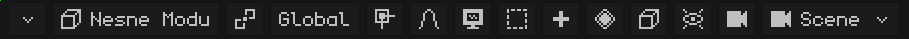

Menü çubuğu tamamen sığmıyorsa kaydırılabilir: bkz. [Menü çubuğunun tüm seçenekleri görünmediğinde](interfaz.md#menü-çubuğunun-tüm-seçenekleri-görünmediğinde).

## Mod

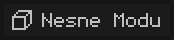 O an çalışılan modu gösterir; ona dokunarak başka bir mod seçilir. Görünen modlar etkin nesneye bağlıdır: bir örgünün Düzenleme Modu ve üç boyama modu vardır; bir iskeletin Düzenleme Modu ve Poz Modu. Başka türde bir nesneyle (bir ışık, bir kamera) düğme görünmez, çünkü tek mod Nesne Modudur. Her mod [Modlar](vista-3d.md#modlar) bölümünde anlatılıyor.

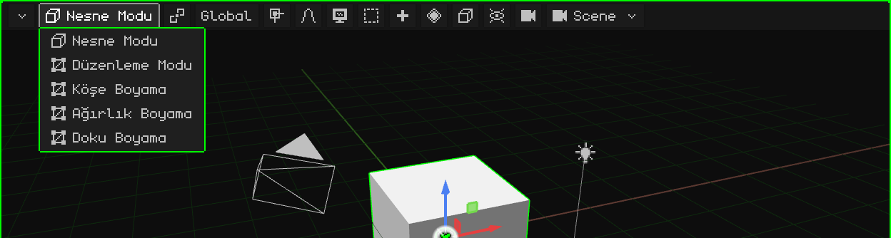

 <kbd>Tab</kbd>, Nesne Modundan Düzenleme Moduna geçer ve geri döner.  N95'te <kbd>OK</kbd>.

Bir örgünün **Düzenleme Modunda** yanında **Köşe / Kenar / Yüz** düğmesi belirir: tek tıklamayla neyin seçileceği (bkz. [Düzenleme Modu](modo-edicion.md)).

## Pivot

 **Pivot noktası**, dönüşümün gerçekleştiği yerdir: seçilenin neyin etrafında döndürüldüğü ve nereden ölçeklendiği. Düğmenin simgesi seçilen pivota göre değişir; böylece hangisinin ayarlı olduğu bir bakışta görülür.

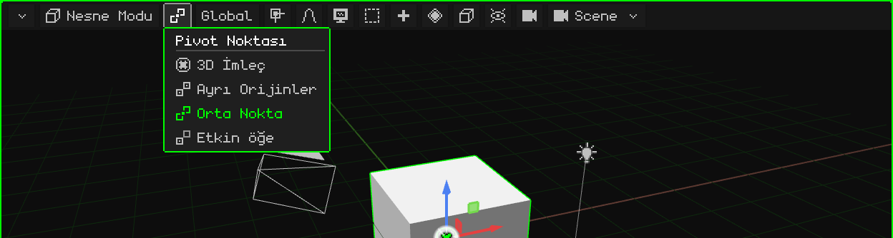

| Pivot | Nereden döndürür ve ölçekler |
|---|---|
|  **3D İmleç** | 3D imleçten. Şeyleri herhangi bir noktanın etrafında döndürmeye yarar: imleç oraya konur ([Mıknatıs menüsüyle](#mıknatıs)) ve döndürülür. |
|  **Ayrı Orijinler** | Her nesne kendi orijininden: hepsi aynı anda, her biri kendi yerinde döner. |
|  **Orta Nokta** | Seçilen her şeyin merkezinden. Varsayılan budur. |
|  **Etkin öğe** | Etkin nesnenin (en son seçilenin) orijininden: diğerleri onun etrafında döner. |

Her birinin videolu bir örneği [Nesne Modu](../tutoriales/modo-objeto.md#pivot-noktası) eğitiminde bulunuyor.

## Yönelim

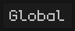 Tek bir eksende taşırken, döndürürken ya da ölçeklerken (<kbd>X</kbd>, <kbd>Y</kbd>, <kbd>Z</kbd> ile, gizmoyla ya da N95'in tuşlarıyla) kullanılan eksenler. Düğme seçili yönelimi gösterir.

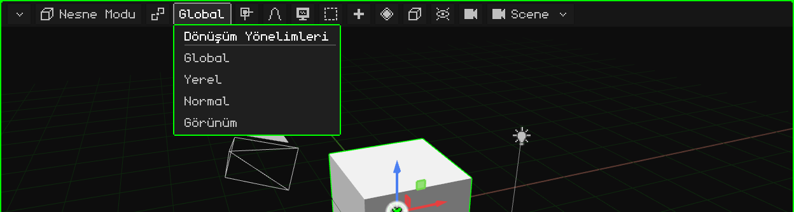

| Yönelim | Eksenler |
|---|---|
| **Global** | Dünyanınkiler: her zaman aynıdır, Z yukarı bakar. Varsayılan budur. |
| **Yerel** | Nesnenin kendi eksenleri: onunla birlikte döner. Döndürülmüş bir araba kendi Yerel ekseninde ilerler. |
| **Normal** | Düzenleme Modunda: seçili yüzün baktığı yön (Ekstrüde'nin kullandığı budur). |
| **Görünüm** | Ekranınkiler: X yana, Y yukarı. |

 Bir dönüşüm sırasında eksen harfine ikinci kez basmak Global'den Yerel'e geçirir: <kbd>G</kbd> <kbd>Y</kbd> <kbd>Y</kbd>.

## Mıknatıs

 **Mıknatıs** açıkken taşınan şey bir şeye yapışır: diğer nesnelerin köşelerine, kenarlarına ya da yüzlerine veya bunların merkezlerine. Düğme açıkken yeşil olur.

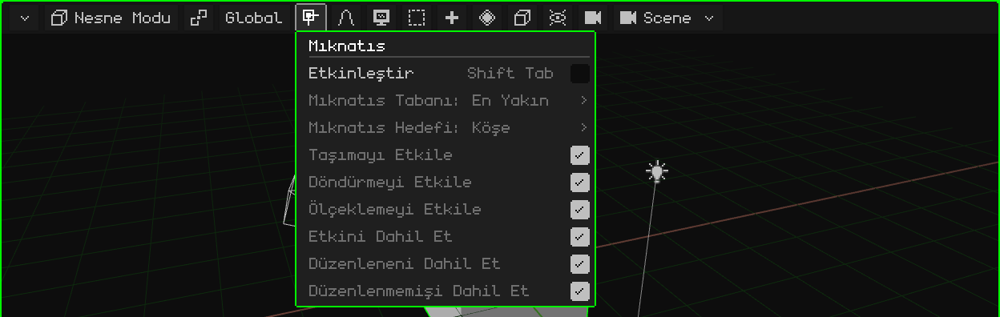

| Seçenek | Ne yapar | Kısayol |
|---|---|---|
| Etkinleştir | Mıknatısı açar ya da kapatır. | <kbd>Shift+Tab</kbd> |
| Mıknatıs Tabanı | Taşınan şeyin hangi noktasının yapışacağı: en yakın, merkez, ortanca ya da etkin. | Menü |
| Mıknatıs Hedefi | Neye yapışacağı: köşe, kenar, yüz, bunların merkezleri. Yüze yansıt / En yakın yüz ile köşeler başka bir yüzeyin üzerine oturur (retopoloji için). | Menü |
| Taşımayı / Döndürmeyi / Ölçeklemeyi Etkile | Hangi işlemlerde etkili olacağı. | Menü |
| Etkini / Düzenleneni / Düzenlenmemişi Dahil Et | Hangi nesnelere yapışabileceği. | Menü |

**3D imleç** başka bir menüyle, imlecin mıknatıs menüsüyle taşınır: <kbd>Shift</kbd> + <kbd>S</kbd> ya da Nesne → Mıknatıs menüsü (İmleç Seçilene, Seçimi İmlece...). [Nesne Modu](../tutoriales/modo-objeto.md#3d-imleç) eğitiminde anlatılıyor.

## Orantılı düzenleme

 **Orantılı düzenleme** ile bir şeyi taşırken, döndürürken ya da ölçeklerken yakındakiler de ona yumuşakça eşlik eder: ne kadar yakınsa o kadar fazla. Köşe köşe taşımadan organik şekiller (bir arazi, bir yüz) modellemeye yarar. Açıkken yeşil olur.

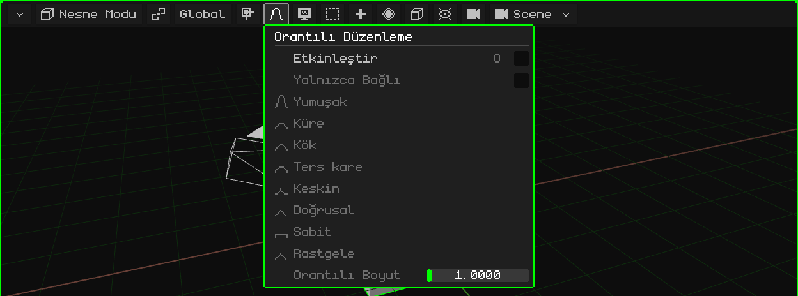

| Seçenek | Ne yapar | Kısayol |
|---|---|---|
| Etkinleştir | Orantılı düzenlemeyi açar ya da kapatır. | <kbd>O</kbd> |
| Yalnızca Bağlı | Mesafeyi kenarlar boyunca ölçer: yakındaki ayrı parçaları sürüklemez. | Menü |
| Azalma | Etkinin mesafeyle nasıl dağıldığı: Yumuşak, Küre, Kök, Ters kare, Keskin, Doğrusal, Sabit ya da Rastgele. | Menü |
| Orantılı Boyut | Etki yarıçapı. Dönüşüm sırasında tekerlekle ya da <kbd>PageUp</kbd> / <kbd>PageDown</kbd> ile değiştirilir. | Menü / tekerlek |

## Görünüm

 **Gezinme** ile ilgili her şey: sahneye nereden bakıldığı. Her seçenek, videosuyla birlikte [3D Görünüm'de gezinme](../tutoriales/navegacion.md) eğitiminde bulunuyor.

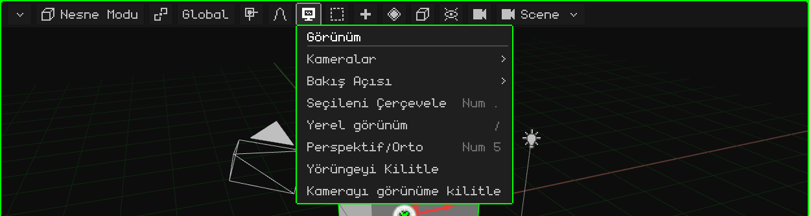

| Seçenek | Ne yapar |  Kısayol |
|---|---|---|
| Kameralar | Etkin kameranın içinden bakmak ya da seçili nesneyi etkin kamera yapmak. | <kbd>Num 0</kbd> / <kbd>Ctrl+Num 0</kbd> |
| Bakış Açısı | Ön, Arka, Sağ, Sol, Üst, Alt. | <kbd>Num 1</kbd>, <kbd>Num 3</kbd>, <kbd>Num 7</kbd> (<kbd>Ctrl</kbd> ile karşıt olanı) |
| Seçileni Çerçevele | Görünümü seçilene ortalar ve tam sığacak şekilde yaklaştırır. | <kbd>Num .</kbd> |
| Yerel görünüm | Görünümde yalnızca seçileni bırakır ve geri döner. | <kbd>/</kbd> |
| Perspektif/Orto | Perspektiften ortografiğe geçer ve geri döner. | <kbd>Num 5</kbd> |
| Yörüngeyi Kilitle | Yörüngede döndüren hareket, görünümü kaydırmaya başlar. | — |
| Kamerayı görünüme kilitle | Kameranın içinden bakarken gezinmek kamerayı hareket ettirir. | — |

## Seç

 Tek seferde her şeyi, hiçbir şeyi, mevcut seçimin tersini ya da bir kutunun içinde kalanları seçmek.

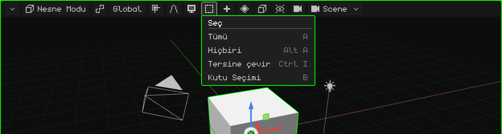

| Seçenek | Ne yapar | Kısayol |
|---|---|---|
| Tümü | Her şeyi seçer. | <kbd>A</kbd> |
| Hiçbiri | Hiçbir şeyi seçili bırakmaz. | <kbd>Alt+A</kbd> |
| Tersine çevir | Seçili olanların seçimi kalkar, seçili olmayanlar seçilir. | <kbd>Ctrl+I</kbd> |
| Kutu Seçimi | Sürüklenen bir kutu: soldan sağa (yeşil) yalnızca tamamen içinde kalanları seçer; sağdan sola (mavi) değmesi yeterlidir. <kbd>Shift</kbd> seçime ekler. | <kbd>B</kbd> ya da arka planda sürüklemek |

Düzenleme Modunda Bağlantılıyı Seç, loop'lar ve yollar da eklenir (bkz. [Düzenleme Modu](modo-edicion.md)).

## Ekle

 3D imleçte beliren ve seçili kalan yeni nesneler oluşturur. Yalnızca Nesne Modunda bulunur.

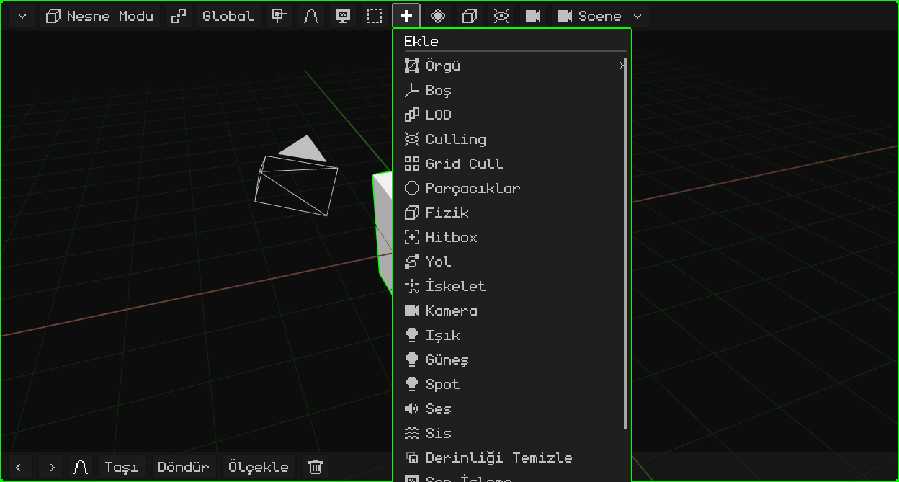

Her tür [Nesne Modu → Ekle menüsü](modo-objeto.md#ekle-menüsü) bölümünde.  <kbd>Shift</kbd> + <kbd>A</kbd> menüyü farenin bulunduğu yerde açar.

Düzenleme Modunda onun yerine **Örgü** (modelleme işlemleri, bkz. [Düzenleme Modu](modo-edicion.md)) ve **UV** (UV'leri açma ve yansıtma, bkz. [UV Düzenleyici](editor-uv.md)) belirir. Doku Boyama'da boyanan dokuyu kaydeden bir **disket** belirir; kaydedilmemiş boya varsa yeşil olur.

## Animasyon

 Seçilenin **keyframe'leri**: animasyonun bir keyframe'den diğerine gitmesi için konumun, dönmenin ya da ölçeğin değerini geçerli karede kaydetmek. Bir şey seçiliyken, Nesne Modunda ve Poz Modunda görünür; seçenekleri seçilene bağlıdır.

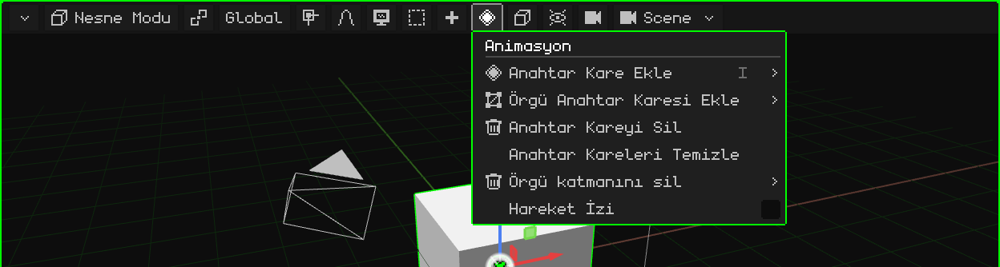

| Seçenek | Ne yapar | Kısayol |
|---|---|---|
| Anahtar Kare Ekle | Neyin kaydedileceğini seçmek için bir menü: konum, dönme, ölçek ya da hepsi. | <kbd>I</kbd> (<kbd>Shift+I</kbd>: sormadan hepsi) |
| Örgü Anahtar Karesi Ekle | Yalnızca bir 3D örgüyle: örgü animasyonundan neyin kaydedileceğini seçer; köşeler, normaller ya da UV'ler. | Menü |
| Anahtar Kareyi Sil | Geçerli karedeki keyframe'i siler. | Menü |
| Anahtar Kareleri Temizle | Seçilenin tüm animasyonunu siler. | Menü |
| Örgü katmanını sil | Yalnızca bir 3D örgüyle: örgü animasyonunun bir katmanını tamamen siler; **köşelerinkini**, **normallerinkini** (örneğin aydınlatması olmayan bir modelde) ya da **UV'lerinkini**. Her zaman en az bir keyframe kalır. | Menü |
| Hareket İzi | Canlandırılmış nesnelerin izlediği yolu görünümde çizer. | Menü |

### Poz Modunda

Bir iskelete poz verirken menü, seçili kemiklerin (ve etkin kemiğin) keyframe'leriyle çalışır:

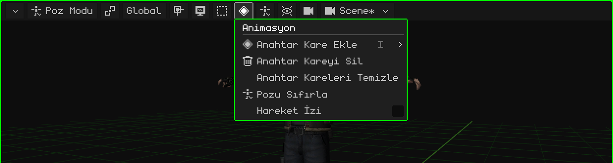

| Seçenek | Ne yapar | Kısayol |
|---|---|---|
| Anahtar Kare Ekle | Seçili kemiklerin pozunu geçerli karede kaydeder: konum, dönme, ölçek ya da hepsi. | <kbd>I</kbd> |
| Anahtar Kareyi Sil | O kemiklerin geçerli karedeki keyframe'ini siler. <kbd>Ctrl+Z</kbd> ile geri alınır. | Menü |
| Anahtar Kareleri Temizle | O kemiklerin etkin animasyondaki tüm keyframe'lerini siler. <kbd>Ctrl+Z</kbd> ile geri alınır. | Menü |
| Pozu Sıfırla | Seçili kemikler (ya da hiçbiri seçili değilse hepsi) Düzenleme Modundaki konumlarına, dönmelerine ve ölçeklerine geri döner. <kbd>Ctrl+Z</kbd> ile geri alınır. | Menü |
| Hareket İzi | Canlandırılmış nesnelerin izlediği yolu görünümde çizer. | Menü |

Animasyonun kendi eğitimi ve kendi bölümü var: [Zaman Çizelgesi](linea-de-tiempo.md).

## Nesne

 Seçilene yapılabilecekler. Görünümde sağ tıklamayla (ya da dokunmatik ekranda bir parmağı hareketsiz tutarak) açılan menünün aynısıdır. Bir şey seçiliyken görünür.

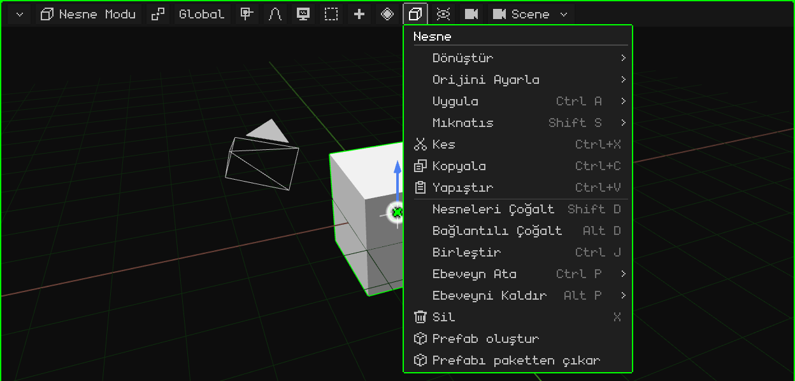

Her seçenek [Nesne Modu](modo-objeto.md) sayfasında. Düzenleme Modunda bu düğme seçilen şeyin (Köşe, Kenar ya da Yüz) menüsüne dönüşür; Poz Modunda Poz menüsüne; bir iskeletin düzenlenmesinde İskelet menüsüne.

## Bindirmeler

 **Bindirmeler**, çalışmak için sahnenin üzerine çizilen ve render'da çıkmayan yardımcılardır: zemin, eksenler, gizmo, 3D imleç. Buradan hepsi birden ya da tek tek açılıp kapatılır.

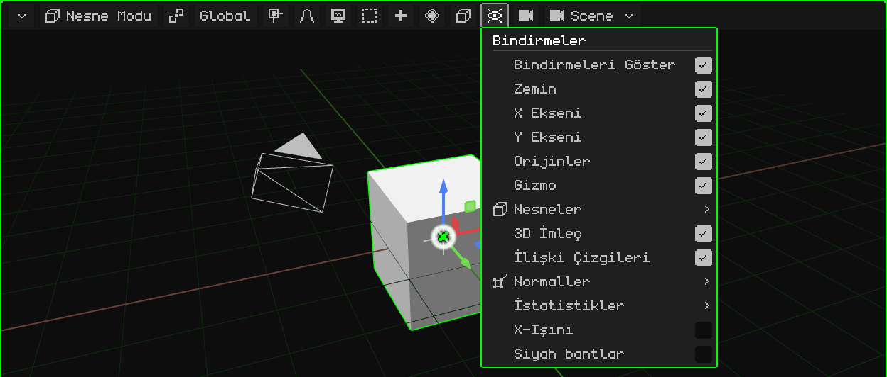

| Seçenek | Ne yapar | Kısayol |
|---|---|---|
| Bindirmeleri Göster | Tüm yardımcıları tek seferde açar ya da kapatır. | <kbd>K</kbd> |
| Zemin, X Ekseni, Y Ekseni, Orijinler, 3D İmleç, İlişki Çizgileri | Her yardımcı ayrı ayrı. İlişki çizgileri her alt öğeyi ebeveynine bağlar. | Menü |
| Gizmo | Taşıma, döndürme ve ölçekleme gizmosu. Nokia N95'te kapalı gelir. | Menü |
| Nesneler | Hangi nesne türlerinin çizileceği: iskeletler, ışıklar, kameralar, boş nesneler, parçacıklar, eğriler, hitbox'lar. | Menü |
| Normaller | Köşelerin ya da yüzlerin normallerini boyutlarıyla birlikte çizer. | Menü |
| İstatistikler | Saniyedeki kare sayısı, köşeler, yüzler, çizim çağrıları ve süreler. | Menü |
| X-Işını | Düzenleme Modunda örgü yarı saydam görünür ve arkadaki öğeler de seçilebilir. | Menü |
| Siyah bantlar | Ekrandan farklı en boy oranına sahip bir kameranın içinden bakarken çekimin dışında kalanı kapatır. | Menü |

## Render

 **Gölgelendirme modu**: sahnenin görünümde nasıl çizildiği. Projeyi değiştirmez, yalnızca çalışırken nasıl göründüğünü değiştirir.

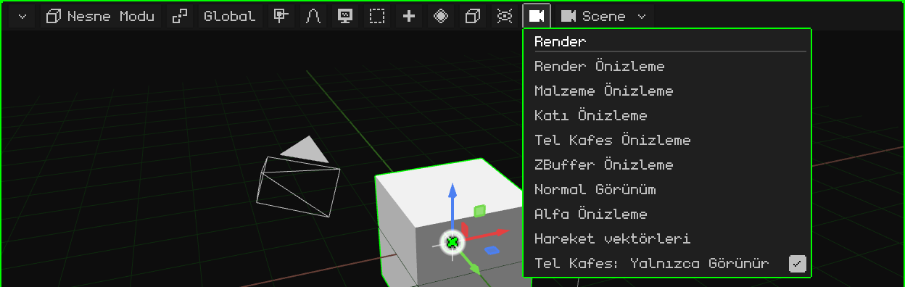

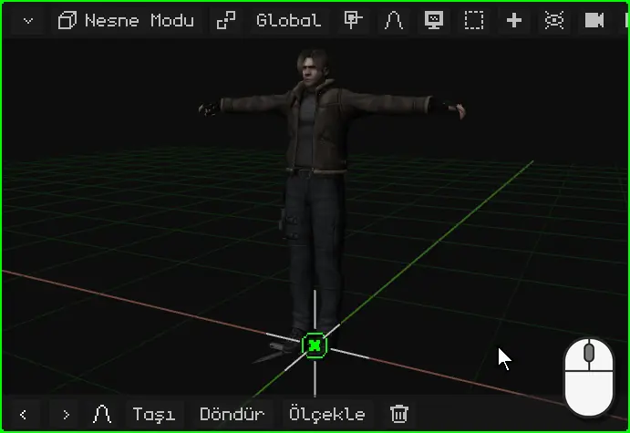

| Mod | Nasıl görünür |
|---|---|
| Render Önizleme | Sahnenin ışıklarıyla. Işın izleme açıkken ışın izlenen görüntüyü yavaş yavaş gösterir. |
| Malzeme Önizleme | Varsayılan mod: sahnenin ışıklarına bağlı olmadan, görünümden gelen nötr bir ışıkla malzemeler ve dokular. |
| Katı Önizleme | Şekli görmek için her şey gri. |
| Tel Kafes Önizleme | Yalnızca kenarlar. **Tel Kafes: Yalnızca Görünür** ile yalnızca karşıdan görülenlerin kenarları. |
| ZBuffer Önizleme | Derinlik: yakın açık, uzak koyu. |
| Normal Görünüm | Renklerle normaller. |
| Alfa Önizleme | Siyah beyaz saydamlık. |
| Hareket vektörleri | Her pikselin önceki kareden beri ne kadar hareket ettiği (kırmızı = X, yeşil = Y). Render'ın `_vectores` geçişiyle aynı görüntü. |

 <kbd>Z</kbd> sonraki moda geçer.  N95'te <kbd>6</kbd>.

## Sahne

 Düzenlenen şeyin adı: projenin bir **sahnesi**, bir **oyunu** ya da bir **prefab**'ı. Ona dokunarak başka biri seçilir, yenisi oluşturulur ya da sahne oyuna dönüştürülür.

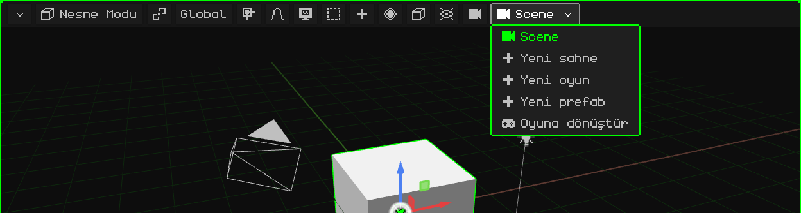

Sahneler, oyunlar ve prefab'lar [Proje](proyecto.md) sayfasında anlatılıyor.
