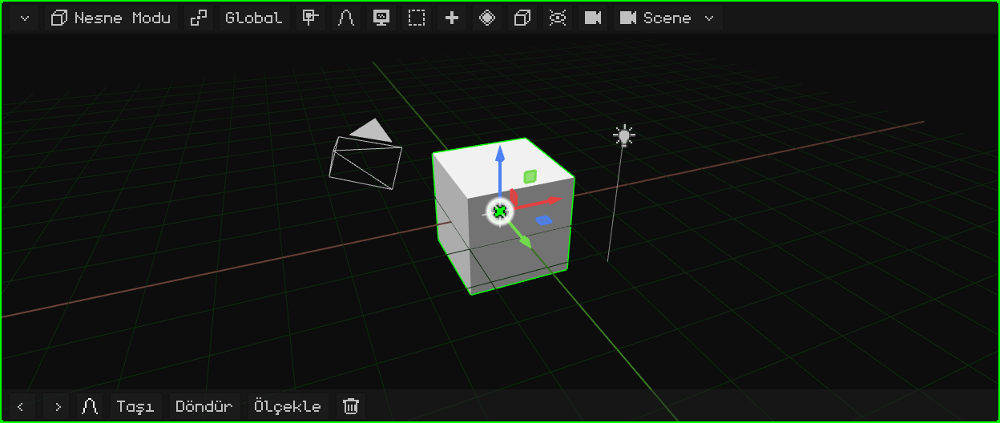
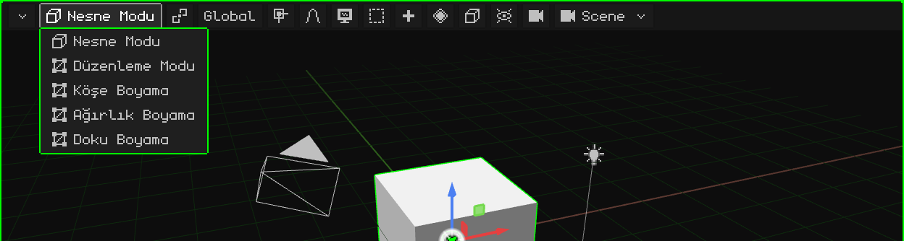
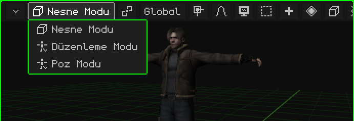
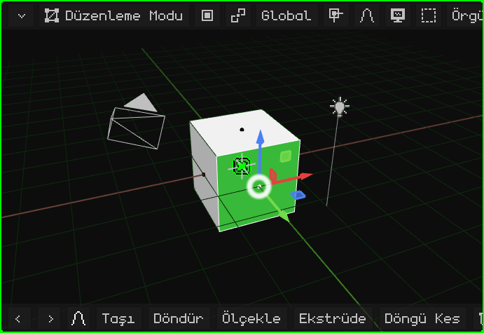
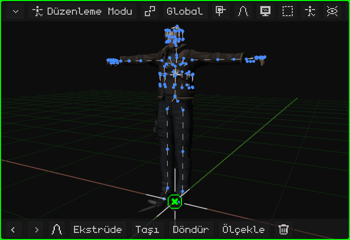
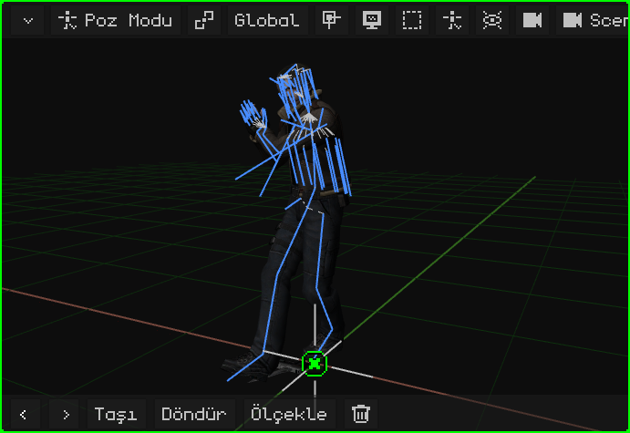
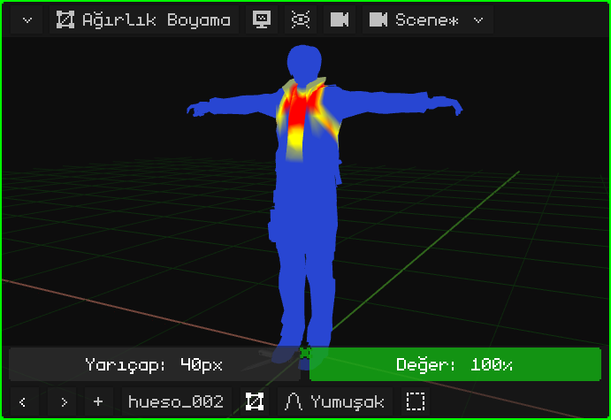
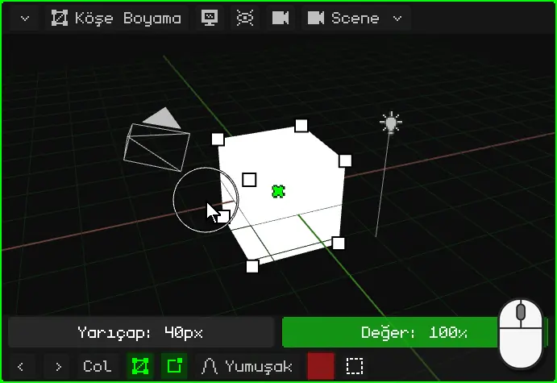
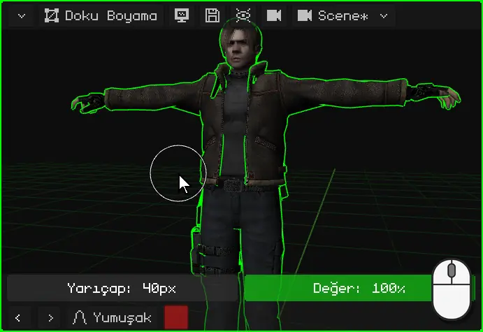
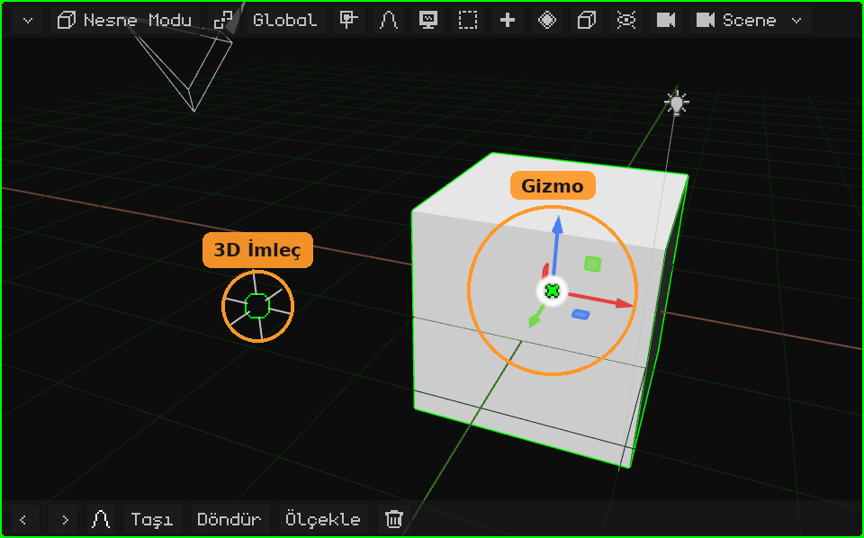

# 3D Görünüm

**3D Görünüm**, sahnenin görüntülendiği ve düzenlendiği viewport'tur: modelleme, nesneleri taşıma, boyama, poz verme ve canlandırma burada yapılır. Tüm viewport'lar gibi üstte kendi **menü çubuğu**, altta da kendi **araç çubuğu** vardır.

- **Menü çubuğu**, düğme düğme ve menüleriyle: [3D Görünüm'ün menü çubuğu](vista-3d-barra.md).
- **Gezinme** (yörüngede döndürme, kaydırma, yakınlaştırma, görünümler, kamera): [3D Görünüm'de gezinme](navegacion.md) ve [3D Görünüm'de gezinme](../tutoriales/navegacion.md) eğitimi.
- **Taşıma, döndürme ve ölçekleme**, gizmo, pivot ve yönelim: [Taşıma, döndürme ve ölçekleme](transformar.md).

## Modlar

3D Görünüm farklı **modlarda** çalışır: tıklamaların, tuşların ve menülerin ne yaptığı o anki moda bağlıdır. Mod, menü çubuğunun o anki modu gösteren ilk düğmesiyle ya da <kbd>Tab</kbd> ile seçilir (Nesne ↔ Düzenleme; Nokia N95'te <kbd>OK</kbd>).

Seçilebilen modlar **etkin nesneye** bağlıdır. **Nesne Modu** hepsinde vardır. Bir 3D örgüye Düzenleme Modu ve üç boyama modu eklenir; bir iskelete Düzenleme Modu ve Poz Modu. Başka herhangi bir nesneyle (bir ışık, bir kamera, bir ses) tek mod Nesne Modudur ve düğme görünmez.

| Mod | Hangi nesnelerde var | Ne işe yarar |
|---|---|---|
| [Nesne Modu](modo-objeto.md) | Hepsi | Nesnelerin bütünüyle çalışma: oluşturma, taşıma, döndürme, ölçekleme, çoğaltma, ebeveyne bağlama ve silme. |
| [Düzenleme Modu](modo-edicion.md) | 3D örgüler ve eğriler | Modelleme: örgünün köşelerini, kenarlarını ve yüzlerini taşıma, ekleme ve silme. |
| [Düzenleme Modu](esqueletos.md#düzenleme-modu-iskelet) | İskeletler | İskeleti kurma: kemikleri oluşturma ve dinlenme pozisyonlarına yerleştirme. |
| [Poz Modu](esqueletos.md#poz-modu) | İskeletler | Kemiklere poz verme ve pozları kaydetme: bir karakter böyle canlandırılır. |
| [Ağırlık Boyama](pintura.md#ağırlık-boyama) | 3D örgüler | Her kemiğin her köşeyi ne kadar hareket ettirdiğini boyama. |
| [Köşe Boyama](pintura.md#köşe-boyama) | 3D örgüler | Renkleri doğrudan köşelerin üzerine boyama. |
| [Doku Boyama](pintura.md#doku-boyama) | 3D örgüler | Doğrudan nesnenin üzerinden dokuya boyama. |

### Nesne Modu

Whisk3D'nin açıldığı mod ve tüm nesnelerde olan tek moddur. Nesnelerin bütünüyle çalışılır: seçilir, taşınır, döndürülür, ölçeklenir, eklenir ve silinir. Bkz. [Nesne Modu](modo-objeto.md) ve [Nesne Modu](../tutoriales/modo-objeto.md) eğitimi.

### Bir örgünün Düzenleme Modu

Örgünün **şekli** modellenir: köşeler, kenarlar ve yüzler. Menü çubuğunda **Köşe / Kenar / Yüz** düğmesi (tek tıklamayla neyin seçileceği) ile **Örgü** ve **UV** menüleri belirir. Sahnenin geri kalanı görünmeye devam eder ama ona dokunulamaz.

### Bir iskeletin Düzenleme Modu

**İskelet** kurulur: kemikler oluşturulur (başka bir kemiğin ucundan ekstrüde edilerek), taşınır ve ebeveyne bağlanır. Bu, iskeletin **dinlenme** pozisyonudur, yani canlandırılmadığındaki hâli.

### Poz Modu

İskelete **poz verilir**: kemikler iskeletin kendisi değişmeden döndürülür ve taşınır, örgü de onları takip eder. Farklı karelere kaydedilen pozlar karakterin animasyonudur.

### Ağırlık Boyama

**Her kemiğin örgünün her bir parçasını ne kadar hareket ettirdiği** boyanır: kırmızı, seçili kemiğin tamamen hareket ettirdiği yerler; mavi, hiç hareket ettirmediği yerler. Kol büküldüğünde belin değil kolun bükülmesini sağlayan budur.

### Köşe Boyama

Örgünün **köşelerine renkler** boyanır, doku olmadan. Basit modellere renk vermeye, elle boyanmış gölgelere ve shader'lardaki efektlere yarar.

### Doku Boyama

Bir bebeğin üzerine boyar gibi, **doğrudan dokunun üzerine**, nesnenin üstünden boyanır. Boyanan, menü çubuğunda beliren disketle kaydedilir.

Boyama modlarında araç çubuğunun üstünde fırça satırı (**Yarıçap** ve **Değer**) belirir. Bkz. [Boyama modları](pintura.md).

## Araç çubuğu

3D Görünüm'ün altında **Geri Al** ve **Yinele** (oklar), **son kullanılan komutlar** (başlangıçta Taşı, Döndür, Ölçekle ve Sil; kullanılan öne geçer) ve **orantılı düzenleme** bulunur. Taşırken, döndürürken ya da ölçeklerken araç çubuğu değişir: yeşil onay işareti onaylar, kırmızı çarpı iptal eder, yönelim, ve **X**, **Y** ile **Z** hareketi o eksenlerle sınırlar. Bkz. [Taşıma, döndürme ve ölçekleme](transformar.md#araç-çubuğu).

 Dokunmatik ekranda **Shift** ve **Ctrl** eklenir; açık kalırlar (yeşil) ve o tuşların yerine geçerler. Bir de **Görünüm** düğmesi (monitör) eklenir; böylece Düzenleme Modunda ve boyama modlarında parmak seçmek ya da boyamak yerine gezinir.

 Nokia N95'te ekranı sahneye bırakmak için gizlidir ve gerektiğinde belirir: boyama modlarında fırça satırı (**Yarıçap** ve **Değer**) çıkar; orantılı düzenleme açıkken taşırken, döndürürken ya da ölçeklerken de onun yarıçap çubuğu. Düğmeleri **sanal fareyle** kullanılır: sağ seçim tuşuyla açılır, ok tuşları onu hareket ettirir ve <kbd>OK</kbd> tıklar.

## Gizmo ve 3D imleç

- **Gizmo**, seçilenin üzerindeki renkli oklardır: taşımak, döndürmek ve ölçeklemek için tutulur. Gizmonun üzerine bir tık bir moddan diğerine geçirir. Bkz. [Gizmo](transformar.md#gizmo).
- **3D imleç**, artılı dairedir: **Ekle** ile eklenen her şey orada belirir ve pivot noktası olabilir. Bkz. [3D imleç](../tutoriales/modo-objeto.md#3d-imleç).

 Nokia N95'te gizmo kapalı gelir, çünkü ekran küçüktür ve orada tuşlarla taşınır. **Bindirmeler → Gizmo**'dan açılır ve sanal fareyle tutulur.
