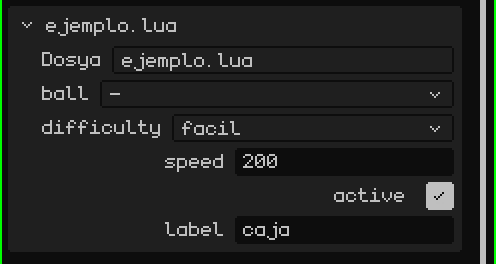
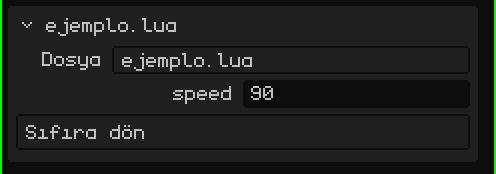

# Script, bir nesnenin bileşenidir

Whisk3D'de bir script her zaman sahnedeki bir **nesneye** aittir (bir örgü, bir boş nesne, bir 2D düğme…). Bir nesnenin birden fazla script'i olabilir; her biri kendi değişkenleriyle, ayrı ayrı ve göründükleri sırayla çalışır.

Script'in içinden `self()` sahibi olan nesneyi döndürür. *Başka* nesneleri kullanmak için script, `properties` adında global bir tablo tanımlar. Editör onu okur ve Özellikler panelinde, script'in kartında her girdi için bir alan gösterir:

```lua
properties = {
  ball       = "object",                          -- sahneden bir nesne seçmek için bir alan
  difficulty = { "facil", "normal", "dificil" },  -- bir açılır liste (ilki varsayılandır)
  speed      = 200,                               -- script'i kullanan her nesneye özel bir sayı
  active     = true,                              -- bir evet/hayır
  label      = "caja",                            -- bir metin
}

function start()
  local p   = object("ball")         -- "pelota" alanında seçilen nesne
  local dif = option("difficulty")   -- "facil", "normal" ya da "dificil"
  local v   = property("speed")      -- 200 ya da o nesnede ne ayarlandıysa
end
```

> [!NOTE]
> `properties`'i okumak için editör, oyun çalışmıyor olsa bile **dosyayı çalıştırır**. Bu yüzden fonksiyonların dışına yalnızca tanımlar koy (tablolar, sabitler, `local`), asla bir şey yapan kod koyma.

Script'in kartında, Özellikler'de böyle görünür: her özellik için bir alan, koddakiyle aynı sırada.



Böylece aynı script, farklı değerlere sahip birçok nesne için kullanılabilir: bir düşmanın `speed` alanı 200, bir diğerininki 350 olabilir.

## Özellikleri gerçek zamanlı değiştirme

`property("speed")` değeri o anda okur. Oyun çalışırken onu Özellikler'de değiştirirsen, script değişikliği bir sonraki karede görür, ama yalnızca onu `property()` ile yeniden okursa. Değeri bir değişkene kaydettiysen (`start()` içinde `local v = property("speed")`), değişken baştaki değerde kalır.

```lua
function update(dt)
  -- her karede okunur: oyun çalışırken Özellikler'de değiştirdiğin şeyi görür
  move(self(), property("speed") * dt, 0, 0)
end
```

`property()`'i her karede okumak, bir değişken kullanmaktan daha yavaştır. Bütün oyunda böyle çalışmak iyi bir fikir değil: değerleri ayarlarken kullan, değerler yerine oturunca da onları `start()` içinde değişkenlere kaydet.

## Düğmeler

Bir özellik bir **fonksiyon** ise kartta bir **düğme** belirir: ona dokunmak o fonksiyonu çağırır. Düğmede adından başka bir şey yazması için metni ve fonksiyonu bir tabloya koy:

```lua
properties = {
  speed    = 90,
  zero = { "Sıfıra dön", function()
    setRotation(self(), 0, 0, 0)
  end },
}
```



Oyun çalışırken fonksiyon, oyundaki script'te çalışır. Oyun yokken script yalnızca o çağrı için yüklenir: böylece bir düğme, sahneye bir şey yapan bir **editör eklentisi** işi görür. Örneğin `selected()` ile, yani editörde seçili nesnelerle:

```lua
properties = {
  upload = { "Seçileni yükselt", function()
    for _, o in ipairs(selected()) do
      move(o, 0, 0, 1)   -- bir metre yukarı
    end
  end },
}
```

> [!NOTE]
> Bir düğmenin oyun dururken yaptığı şey, elle yapmışsın gibi sahnede kalır ve aynı şekilde geri alınır: <kbd>Ctrl</kbd> + <kbd>Z</kbd> düğmenin yaptığı her şeyi tek seferde geri alır. Oyun çalışırken geçmişe hiçbir şey kaydedilmez: **Durdur**'a dokunduğunda her şey eski hâline döner.

Script'ler birbirleriyle değişken paylaşmaz. Birbirlerine veri aktarmak için (puanlar, oyuncunun kazanıp kazanmadığı…) ortak bir alan kullanırlar: `setShared("puntos", 10)` yazar, `getShared("puntos")` okur. Sayıları, evet/hayır değerlerini ve metinleri saklar; oyun durdurulduğunda boşaltılır.
