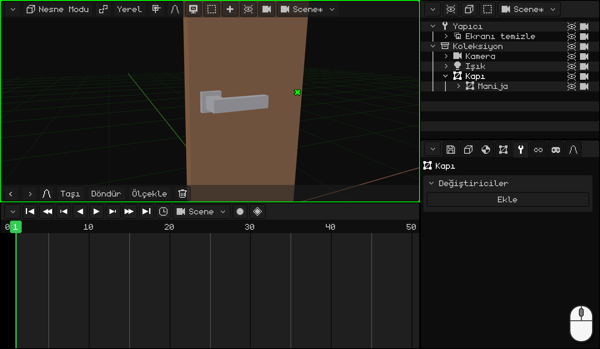
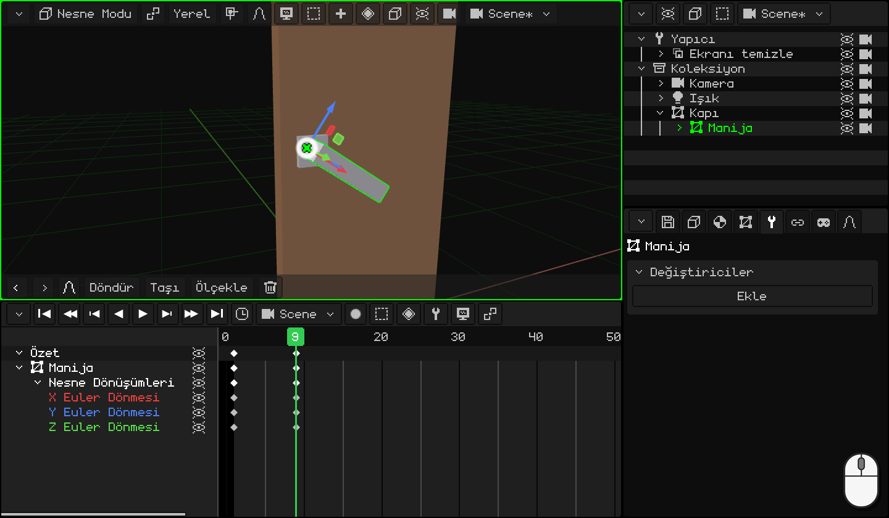
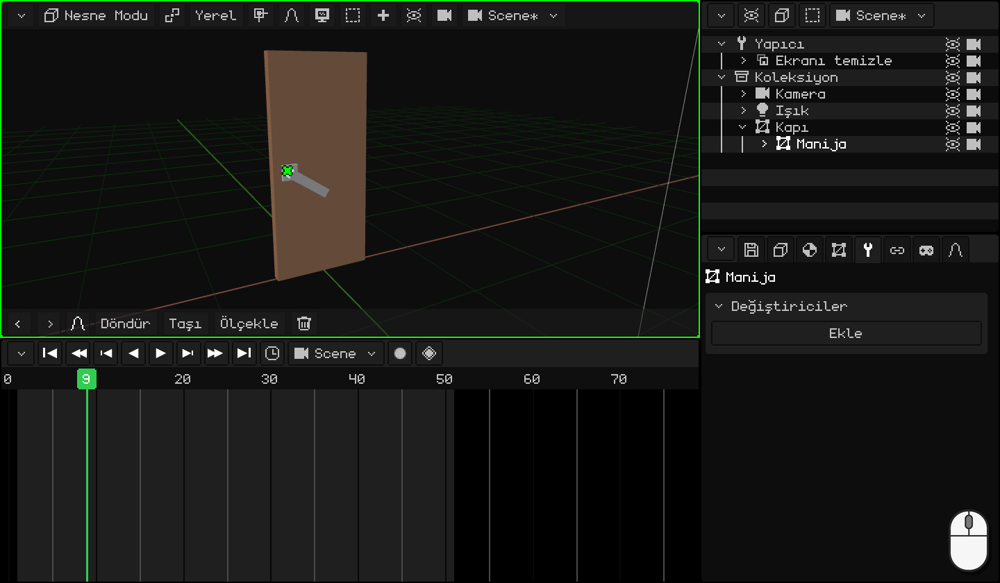
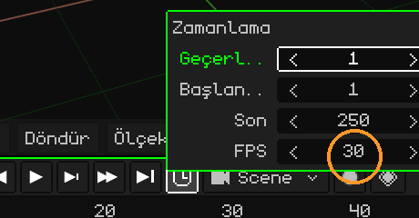
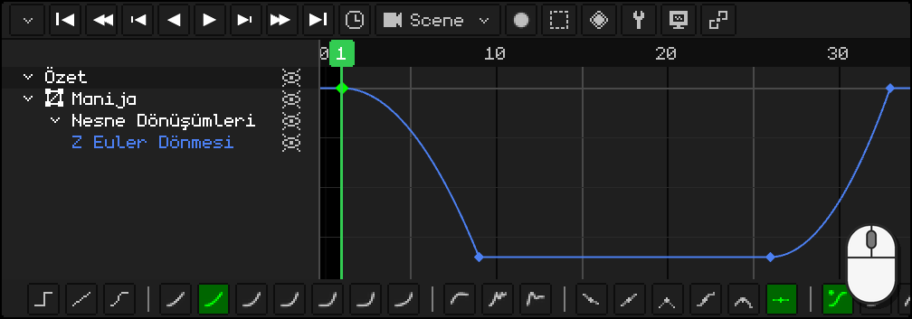
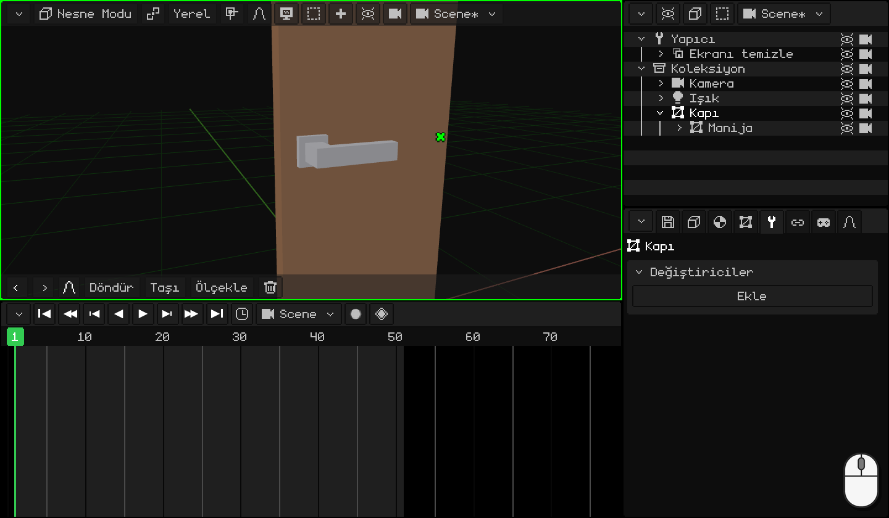

# Kapıyı canlandırma

Önceki eğitimdeki ([Kapı kolunu modelleme](modelar-picaporte.md)) kollu kapıdan başlıyoruz: kapının orijini menteşede, kolun orijini döndüğü yerde ve kol kapının çocuğu. Şimdi onu gerçek bir kapı gibi canlandıracağız: önce kapı kolu iner, kapı ancak kol aşağıdayken açılmaya başlar ve sonunda kol yerine döner.

Bu sırada şunları öğreneceksin:

- **keyframe** koymak: bir nesnenin bir karedeki pozu;
- zaten istediğin gibi olan keyframe'leri **çoğaltmak**;
- animasyonun **zamanlamasını** ayarlamak ve **saniyedeki kare sayısını** seçmek;
- **eğri düzenleyicisini** kullanmak: eğri nedir ve bir tık ve araç çubuğuyla nasıl değiştirilir.

## 1. Kapı kolu

Bir **keyframe**, bir nesnenin bir karedeki durumunu kaydeder: konumunu, dönmesini ya da ölçeğini. İki keyframe olunca program aradaki tüm kareleri hesaplar: animasyon budur.

1. Seçmek için **kola** tıkla. **Zaman Çizelgesi**'nde **1**. kareye git: kapı kolu yukarıda.
2. Fare 3D Görünüm'ün üzerindeyken <kbd>I</kbd> tuşuna bas ve **Yalnızca Dönme**'yi seç: Zaman Çizelgesi'nde 1. karede bir eşkenar dörtgen belirir.
3. **9**. kareye git (Zaman Çizelgesi'nin sayılarına bir tık) ve kapı kolunu indir: <kbd>R</kbd> <kbd>Y</kbd> `-34` <kbd>Enter</kbd>. Kol, önceki eğitimde ona koyduğumuz orijini etrafında döner.
4. Yine <kbd>I</kbd> → **Yalnızca Dönme**: 9'da bir eşkenar dörtgen daha.

 Dokunmatik ekranda: keyframe, 3D Görünüm'ün menü çubuğundaki eşkenar dörtgen düğmesiyle konur, **Animasyon → Anahtar Kare Ekle → Yalnızca Dönme**; kare de Zaman Çizelgesi'nin sayılarına bir dokunuşla değiştirilir. Kapı kolu araç çubuğunda **Döndür** **Y** `-34` ile indirilir; sayılar üstteki çubuğun klavyesiyle girilir.

 Nokia N95'te: <kbd>2</kbd> (döndürme), <kbd>2</kbd> (Y ekseni), kalem + `-34` ve <kbd>OK</kbd>. Keyframe ise **Animasyon → Anahtar Kare Ekle → Yalnızca Dönme** ile konur.

## 2. Keyframe'leri çoğaltma

Kapı açılırken kol aşağıda kalmalı ve sonunda yukarı dönmeli. Bu iki poz zaten elinde: kolu yeniden döndürmene gerek yok.

1. Zaman Çizelgesi'nde **9**. karedeki eşkenar dörtgene (aşağıdaki poz) tıkla, <kbd>Shift</kbd> + <kbd>D</kbd>, kopyayı **26**. kareye götür ve tıkla. 9'dan 26'ya kadar kapı kolu aşağıda kalır.
2. **1**. karedeki eşkenar dörtgene (yukarıdaki poz) tıkla, <kbd>Shift</kbd> + <kbd>D</kbd> ve kopyayı **33**'e götür: kapı kolu yukarı döner.

İşaretçiye değil, kopyanın eşkenar dörtgenine bak: farenin bir kare sağında çıkar. Kopya başka bir keyframe'in üzerinden geçerken ona bir şey olmaz: onu yalnızca tam üstüne bırakırsan **yerine geçer**.

  Dokunmatik ekranda ve N95'te (sanal fareyle) çoğaltmak yerine kopyalayıp yapıştırılır: 9. karedeki keyframe'e bir dokunuş ve Zaman Çizelgesi'nin **Anahtar** menüsünde (eşkenar dörtgen düğmesi) **Kopyala**; 26. kareye gitmek için sayılara bir dokunuş ve **Anahtar → Yapıştır**. 1'dekini 33'e de aynı şekilde.

## 3. Kapı

1. Yalnızca onu seçmek için **kapıya** tıkla. **11**. kareye git ve <kbd>I</kbd> → **Yalnızca Dönme**: buraya kadar kapı kapalı. Kapı ancak 11'de, kol aşağı indikten sonra açılmaya başlar.
2. **26**. kareye git ve kapıyı aç: <kbd>R</kbd> <kbd>Z</kbd> `-80` <kbd>Enter</kbd>, sonra yine <kbd>I</kbd> → **Yalnızca Dönme**.

Animasyonu **oynat** (<kbd>Space</kbd> ya da Zaman Çizelgesi'ndeki ▶ düğmesi): kapı kolu iner, kapı açılır ve kol yukarı döner. Bu arada kol kapıyla birlikte hareket eder, çünkü onun çocuğudur.

 Dokunmatik ekranda: **Döndür** **Z** `-80` ve **Animasyon → Anahtar Kare Ekle → Yalnızca Dönme**.

 Nokia N95'te: <kbd>2</kbd>, <kbd>3</kbd> (Z ekseni), kalem + `-80` ve <kbd>OK</kbd>; ardından **Animasyon → Anahtar Kare Ekle → Yalnızca Dönme**.

## 4. Zamanlama

Her şey çok mu hızlı, yoksa çok mu yavaş oluyor? Keyframe'leri taşımak gerekir:

- <kbd>G</kbd> seçili keyframe'leri zamanda kaydırır (örneğin geri dönen kapı kolunu 33'ten 36'ya).
- <kbd>S</kbd> onları ölçekler: hepsi seçiliyken `2` animasyonun iki kat sürmesini sağlar.

Animasyon **50**. karede biter: Zaman Çizelgesi'nin **saatinde**, **Son** `50` <kbd>Enter</kbd>.

### Saniyedeki kare sayısı

Bir animasyonun süresi **kare** olarak sayılır; bir saniyeye kaç kare sığdığını da **FPS** söyler (*frames per second*: saniyedeki kare sayısı). Aynı **saatte**, **FPS** alanında değiştirilir. Her animasyonun kendi FPS'i vardır: sahnenin animasyonu ve her klip farklı FPS'lerde olabilir.

Whisk3D **30** ile başlar: kapının 50 karesi bir buçuk saniyeden biraz fazla sürer.

| FPS | Ne için |
|---|---|
| **24** | Sinema. Animasyona daha sinematik bir hava verir ve render alacaksan çok daha az kare demektir: 24'te bir dakika 1440 kare; 30'da 1800. |
| **30** ya da **60** | Diziler ve video oyunları. |

60'ta canlandırmana gerek yok. Oyunda motor aradaki kareleri kendisi hesaplar: 30'da yapılmış bir animasyon 60'ta çalışan bir ekranda akıcı görünür ve daha az bellek kaplar.

FPS'i canlandırmaya başlamadan **önce** seç. Keyframe'ler karelerinde kalır: sonradan FPS'i artırırsan animasyon hızlanır, düşürürsen yavaşlar.

## 5. Eğriler

Zaman Çizelgesi'ni **eğri düzenleyicisine** geçir (**Görünüm → Eğriler**). Orada canlandırılan her değer bir **eğridir**: nesnenin her an hangi konumda, dönmede ya da ölçekte olduğunu söyler. Sol ve sağ **zamandır**; yukarı ve aşağı **değerdir**.

**Yalnızca Dönme** üç ekseni de kaydeder, ama kapı kolu ve kapı yalnızca birinde döner: diğer iki eğri hiçbir şey yapmayan düz çizgilerdir. Onları sil: o satırları seç ve <kbd>X</kbd>. Yalnızca değişen eğriler kalır ve daha rahat çalışılır.

### Eğrinin şekli

Eğri **düz bir çizgiyse** nesne hep aynı hızla hareket eder: birden kalkar ve birden durur. **Robotik** hissettirir. Bazen tam da bunu isteriz, ama gerçek hayatta neredeyse hiçbir şey böyle hareket etmez: şeyler kalkarken **hızlanır**, varırken **yavaşlar**.

Soldan sağa **aynı sürede** giden, her biri farklı bir eğriye sahip altı topa bak. Her birinin yanında kendi eğrisi ve onunla birlikte ilerleyen bir nokta var:

| Eğri | Nasıl hareket eder | Ne için |
|---|---|---|
| **Doğrusal** | Hep aynı hızda. | Bir makine, bir taşıyıcı bant, robotik bir şey. |
| **Hızlanıp yavaşlar** (girişte ve çıkışta) | Yavaş kalkar, ortada hızlı gider ve yavaş varır. | Neredeyse her şey: yürüyen bir insan, bir kapı, bir kamera. |
| **Hızlanıp birden durur** (girişte) | Yavaş kalkar ve son hızla varır. | Düşüp çarpan bir şey, sonuna dayanan bir kapı kolu. |
| **Hızlı çıkıp yavaşlar** (çıkışta) | Son hızla kalkar ve yavaş yavaş durur. | Fırlatılan bir şey, kendiliğinden kapanan bir çekmece. |
| **Sekme** | Varır, sona çarpıp birkaç kez seker ve durur. | Düşüp zıplayan bir şey, kapanan bir kapak. |
| **Elastik** | Hedefi geçer, geri döner ve durana kadar yay gibi salınır. | Bir yay, bir anten, ekranda zarifçe beliren bir şey. |

Eğriler animasyonun **doğal** görünmesini sağlar.

### Araç çubuğu

Bir keyframe ya da bir eğri parçası seçiliyken Zaman Çizelgesi'nin araç çubuğu onun eğrisini tek tıkla değiştirir:

- **Enterpolasyon Modu:** **Sabit**, **Doğrusal** ve **Bezier**; ardından en yumuşaktan en serte doğru hesaplananlar (**Sinüzoidal**, **Karesel**, **Kübik**, **4. derece**, **5. derece**, **Üstel** ve **Dairesel**) ve efektli olanlar (**Geri tepme**, **Sekme** ve **Elastik**).
- **Tutamaç Türü:** bir **Bezier** eğrisinin tutamaçlarının nasıl oluşturulduğu.
- **Yumuşatma Türü:** hesaplananlarda efektin nerede olacağı: **Otomatik**, **Girişte**, **Çıkışta** ya da **Giriş ve çıkışta**.

Klavyeyle: <kbd>E</kbd> **Enterpolasyon Modu**'nu, <kbd>Ctrl</kbd> + <kbd>E</kbd> de **Yumuşatma Türü**'nü açar.

### Kapı kolu: TAK!

Gerçek bir kapı kolunu indirdiğinde hızlanır ve sonuna dayanıp birden durur: TAK! Bıraktığında yay onu yukarı kaldırır ve yukarıda yine birden durur. İki seferde de **hızlanıp birden durur**.

1. **Kol** seçiliyken eğri düzenleyicisinde kalan eğrinin satırına tıkla: Zaman Çizelgesi onu bütünüyle kadraja alır.
2. Eğrinin 1. ve 9. kareler arasındaki inen parçasına tıkla: çizgiye bir tık o parçayı seçer.
3. Araç çubuğunda **Karesel**. Onun **Otomatik** yumuşatması **Girişte**'dir: hızlanır ve birden durur.
4. 26 ile 33 arasındaki geri dönen parçaya da aynısını yap.

  Dokunmatik ekranda ve N95'te: parçaya bir dokunuş (ya da sanal fare), sonra **Karesel**'e bir dokunuş: araç çubuğu aynıdır.

### Kapı

Kapı her zamanki eğriyle, **Bezier** ile iyi görünür: **hızlanır ve yavaşlar**. Onu itersin, hızlanır ve açık kalana kadar yavaşlar. Hiçbir şeyi değiştirmene gerek yok.

Sonraki eğitimde, [Bir topu zıplatma](pelota.md), eğrileri bir topa ağırlık vermek için animasyonun bir başka ilkesiyle birlikte kullanacağız: esnetme ve ezme.
